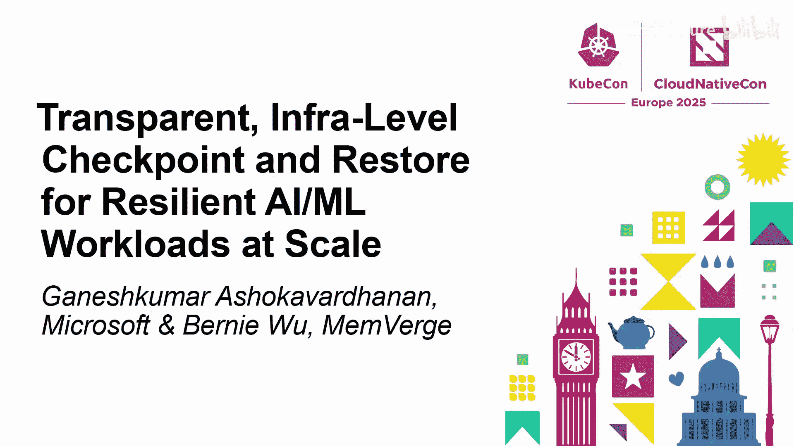
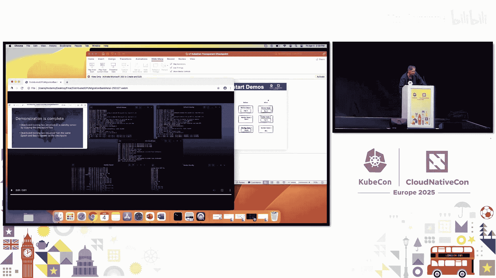
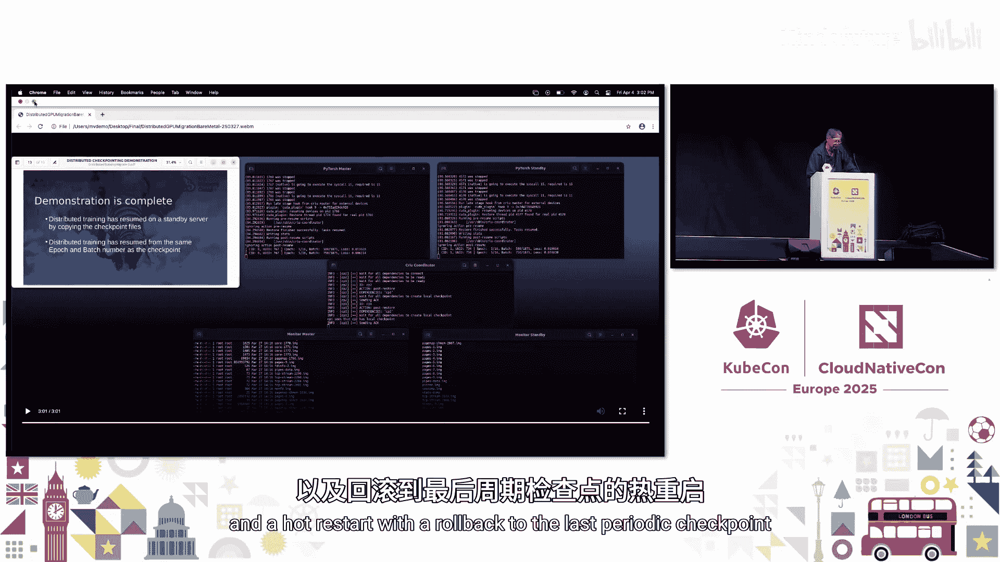
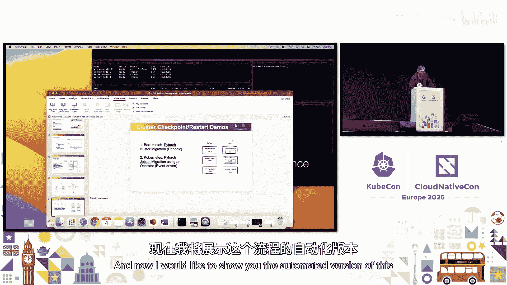
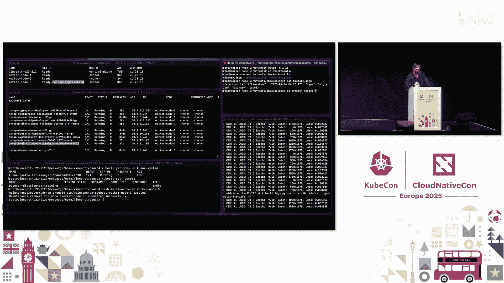
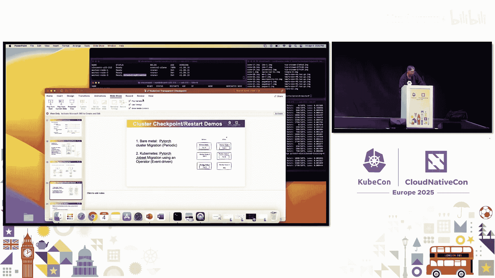
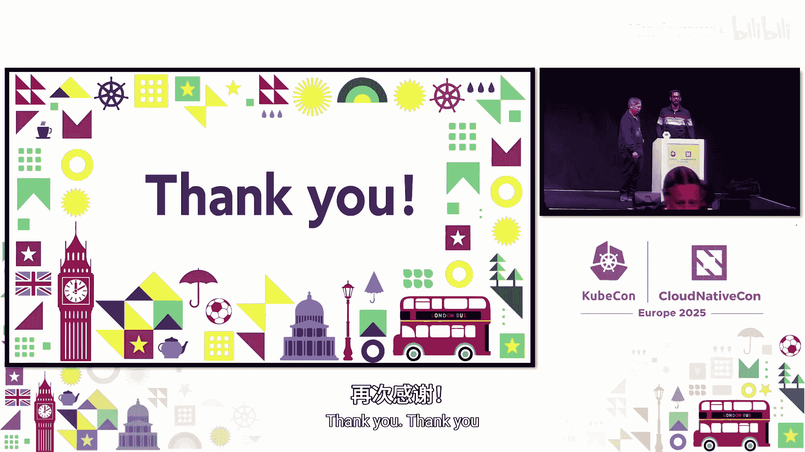

# KubeCon-+-CloudNativeCon-大会2025-｜-云原生计算-｜-可观测性-｜-Kubernetes-｜-Prometheus-p46-P46-Transparent,-Infra-Level-Checkpoint-and-Restore-for-Resil...-Ganeshkumar-Ash--BV1Cd32zDEBG_p46-

Great to see you all on Friday afternoon towards the end of the conference。

 when you could be out in London enjoying the beautiful weather。 Hi， everyone。 I'm with Bernie here。

 and I'm Gnesh， and we are going be talking about inlevel transparent checkpointing for resilient AI M L workloads。

😊。

Believe it or not that is me without a beard， and I am a software engineer in the Azure Kubernetes service team at Microsoft at AKS。

 we run a managed Kubernetes service platform which allows you to run a variety of compute workloads。

Including lots of M L training and infant workloads。

 And we have users running these workloads at extremely large scales。

 I particularly work on GPU provisioning and making it easier to run a variety of GPU workloads on the platform。

 I've also previously worked on speeding up part start time through a feature called artifact streaming。

😊，Yeah my name is Bernie Wu I'm the VP of Technology Parts for a company called Memverdge。

 Memverdge is a Silicon Valleybased startup that has software that we've developed that helps on memory virtualization and also checkpointing software and so we're hoping to bring those two kinds of capabilities into the AIML area on a personal note I live part time in Hawaii and I noticed that the culture of the Kubernetes community in Hawaii is very similar there' there's a very friendly culture one that helps each other and and it's almost like an extended family or what we call OHana and Hawaii and we also in Hawaii we like to welcome new people that's called the Yoloa Spirit so one of these days I hope will have Kcon over in Hawaii。

Anyway back to you。Thank you。Today's talk， well start off with a brief poll。

 then talk about the motivation for why we want to do this approach and what are the other current approaches that people are taking to address these problems。

 Then we'll define what infar levelvel transparent and checkpointing is。

 talk about use cases and limitations。 And then Bernie will share about how it works and show some cool demos to see this in action。

 And we'll also talk about some open areas that we could address together as a community。😊。

For this part， I would really， really love your participation。😊，There'll be three questions。

 First one， how many of you have run GPU workloads in Kubernetes， Please raise your hands。 Wow。

 that's great。 Almost everyone here has done that as expected。😊。

And then how many of you are not satisfied with the existing solutions for resilience。

 things like handling GPU failures or node downtime， could you please raise your hands okay。

 almost all of you who raised previously to， and how many of you care about resilience more for training or fine tuning。

嗯。Okay， that's about half of you。 And what about for infants。Alright， there's a good number。

 but fewer than for training。That's sort of the mix that I've heard from conversations with folks。

 too。And then finally， how many of you are focused on improving the utilization of your GPU infrastructure。

😊，Okay， awesome， awesome， Greg almost all of you raised your hands。

 which is good to know because GPUs are expensive and you could probably save a few several thousand dollars of money by improving the infrastructure utilization。

😊，And this is also validated by many papers and reports that have come out。

 You probably have seen the Lama 3 paper with how frequent GPU errors are。

And the different types of issues that have that people are encountering， especially for training。

And then we， we've seen talks in this conference as well， talking about the frequency of GPU errors。

Theres also surveys which validate what you're experiencing around low GPU utilization。

 So about a third of users have。😊，Less than or equal to 30% of GPU usage， according to this survey。

 And how do we address these challenges today and how can we make it better。Today。

Many users are running GPU health checks that are integrated as part of node problem detector。

And those can be also combined with a remedy controller。

 which can take actions like rebooting the node or resetting the GPU。

This helps you in identifying issues， and taking mitigation steps。

But it still has questions on how you can handle the application efficiently。Because you。

 you face issues around things like scheduling that time and also slow part starts。

 because when you have a new node that needs to be provisioned， that takes a while。

 And if you have a large model that takes several Gvs or sometimes multiple hundred Gs。

 it's going to take a long time to load。We talked about some aspects from the info provider perspective and also from a user perspective in this Cuecon Salt Lake3 talk。

 But now we're going to address the other side of how we make it easier from the application perspective such that they don't have to think about these problems on their own。

Another approach that' is commonly done is model checkpointing during training。

 it's done frequently and then if a node goes down you just restore from the registry or another repository where you have the previous checkpoints of the model rate stored and then you can continue the training process。

Some approaches include。Basically， interrupting your workload as well。 And that's a naive approach。

 And then just migrating to a new node of there issues。

You could also use tools like Q and volcano to make this process easier。

 along with some GP strategies like multi instance GPs。But all of these。

Adds different aspects of the problem。They still face some common challenges。

 like slow loading time and recovery time for your end to end workload。 They might。

 You might need to configure your applications as well to handle things like recovery from the last checkpoint。

It could also lead to higher costs。 And we think that this could be made more resilient。

So what is inleve transfer and checkpointing， This is the aspect that we want to talk about today。

 and we want to define it in what phrase by phrase。

 So checkpoint here represents capturing the entire state of the running application with the point in time memory and all the associated files so that you can basically pause。

 migrate and hot restart it later。Transparent refers to the application code of frameworks not needing to be changed。

So the application does not need to be aware of this checkpointing process。

Then in level refers to this completely being handled by orchestras or schedulers and the platform itself so that users don't need to worry about it。

II want to really emphasize this point that this is not model checkpointing。

It's not just model check planninging because you're capturing the entire application state in your container。

And from the usage perspective， it's the people at the platform layer who would really care about the solution。

From， from the implementation aspect。And this is， as you know， an emerging topic。

 and we are in the emerging track， too。 So not everything is going to be fitting perfectly。

 But so well have open open discussions at the end。So if you're new to this。

 you might have many questions。You know， how production ready is it。

 Can you restore it on different GPUs， What type of different machines can you restore it on。

 How do you handle network state， How much time does it take to do all these additional computations。

And we'll be addressing some of these questions， but I also highly recommend multiple other talks that you could look at for more details。

So for a high level overview。Think of。Yourself， as a neural network that is running on a double decker bus in London。

 taking the views of the city， learning about it and updating your neural network ways。😊。

Unfortunately， your bus breaks down。So your application container cannot start running。

 You cannot continue training。What happens next。Well， without you knowing it。

Almost a snapshot of view from two minutes ago was taken and kept in the British Museum。Now。

 we want to be able to restore that。And continue running it。So this is the checkpointing phase。

 And that that was kept in the museum。And then now you spin up a new node where you can continue running your application。

But instead of going through some application specific logic。

 you can recover to where you were from just two minutes ago and continue as if nothing happened pretty much so。

You're gonna be like almost like the sd people in the show severance are like unlike them。

 You're gonna remember what you did。 So all the training。

 the neural network ways that you updated are still gonna be there。 and you can continue running it。

😊，So because we've captured the entire memory state， that will also be restored in this process。

And this will help in improving resilience。 And we'll also talk about how it improves utilization。

So there's a host of。Challenges that this can address。 So these three categories，1。

 which we call scheduling optimization， another for handling node downtime。

 And then the third one for part start time improvements。For scheduling。

 if you have a higher priority workload that comes in or if you have idle resources that are you know scheduled。

 but actually not being utilized。Or if you have spot instances that can go away anytime。

 you could use this checkpoint resource approach to be able to migrate your workloads。

 or you could also use it to handle it efficiently。

 And then especially when you have long-running jobs that need to be taken over by another job。

 we need to have a seamless process for capturing the state and being able to save it somewhere and then restore it。

😊，So this helps there。 And then for note downtime， like the original chart that I showed with GPU issues。

You can add to that end to end flow to be able to checkpoint right before the GPU goes down or if take draining the node and then restore it when you go to a new node。

And a lot of these use cases are unlocked by the faster time it takes to load the new container image and the application。

And many companies are starting to already use this for speeding up their parts， start times。

So what are the other like M specific use cases that we may be able to address to this。For inference。

 many of you might assume that inference can be considered as a stateless application。

 but is it really stateless。Well， according to one definition， stateful applications。

 Sa past and present information while， stateless applications don't。The for inference， let's say。

 for LLMs， you， you tend to store values like the key value cache values in memory。

 And that could be both in GPU memory and in CPU memory。

And if you lose the inference workload and the KV cache is only present on your node。

 then that memory have that would have to be recomputed later。With most current approaches。

But with transparent checkpointing， it might be possible to restore that state and continue running your application without much need for additional recomput。

But one requirement there is the time to reload the KV cache must be less than the time needed to recompute it。

Then for distributed M L training in this， in this time chart。

 you see checkpoints being done at a regular cadence。This is from Microsoft Research paper。

 this graph。 and they were talking about how to optimize checkpointing。From the model layer。

 So the model。I need to mention that the model checkpointing will still happen even with in level checkpointing because model level checkpointing is useful for experimentation。

 And if you want to go back to previous date。 So we will be complementing this model level checkpointing with in level checkpointing so we take perhaps more frequent checkpoints and then restore it if there is an issue in between two model checkpoints So in this time chart you see that if there's a failure in between checkpoint 3 and checkpoint 4 you'd have to retrain from checkpoint3 that base additional cycles basically for GPU and。

CPU， but also because when you have a distributed training case。

 many other nodes in your entire cluster will also have to wait for your one node to be restored and then the progress to be synced because at the end of each checkpoint。

 typically they will be sinking their gradients and the weights。

But this is not a solution to everything。 there are some limitations that we need to be aware of and address one being that the checkpointing。

 the info layer is not aware of the application state itself。

 which means that the checkpoint could be significantly larger compared to just app levelve checkpointing So let's say for inference for the model itself will take up most of the space。

 but you also have additional libraries and health of functions that will be loaded onto memory that would also be copied over and depending on the application。

 the amount of memory you the difference between the two checkpoints can be significant as well。Then。

 there's。Rigd requirements for restoration， sometimes where you might have to match the machine configurations。

 but also， this varies on the type of checkpointing implementation you use。

And then you would want to have rest in a machine which obviously has like the same or higher memory。

There's also some resource considerations like。How much compute time it takes and that can vary between periodic and event driven checkpointing。

 So this these are pretty much two types of checkpointing you can do。

 So periodic as you like the the word， you keep checkpointing every few minutes or a few seconds based on how you configure it and then event driven is if you know that there's going to be a failure。

Then you can checkpoint it and then keep the latest checkpoint。

This graph there is sort of a high level graph on the trade offs that are involved in figuring out what type of checkpointing we want to do。

So on the Y axis， you see the total cost of operating workload。 And then on the X。

 you see the checkpoint frequency。 So if your checkpoint frequency is really low。

Youre not if you're going to checkpoint after a very long period of time。

 the additional compute overhead for checkpointing is going to be low。

 but your resilience to errors and recovery time will be high because you might need to recompute it if you error it out。

And then on the other extreme， if you're checkpointing really frequently， your compute。

Consumption is going to be significantly higher， but your overall。Resilience might might be better。

 but the total cost of operating your job would be higher as well。

 So we need to find a sweet spot for how frequently you need to checkpoint。

 and that will vary also depending on the type of application and also the type of GPUs that you have。

 the error rate and other factors。Bernie will continue and he'll share about how it works and show some cool demos。

 O， great。😊，Thanks， Knesh。Yeah， so as Gnesh discussed。

 he's now defined what infrlevel transparent checkpointing is。

 he's described some use cases that we see our possibilities and he's also described the limitations of checkpointing and so now what I want to do is just deep dive more into how we're trying to implement transparent checkpointing for Kubernetes and everything is centered around an open source project called Creo。

 Creo stands for checkpoint Re and user space and Creo was started in 2012 is designed to checkpoint applications running on Linux platforms and's in wide production with other virtual machine platforms for doing live migrations and then my company members has been using Creo as part of a spot instance migration of long-running HPC batch workloads on public clouds in addition to that Creo is incorporated。

If you don't know already into Kubernetes， the 130 release supports forensic examination of containers。

 those containers are checkpointed by Creo， and in addition to that in Kubecon Paris last year。

 I gave a brief talk on some work that we done with NviDdia to introduce GPU level checkpointing to the。

This community and so I demonstrated an operator that could do a GPU CPUU checkpoint of a single workload running on a pod and successfully restarted elsewhere there's ongoing work by the community to and they've created a very nice GPU plugin for Creo that also will support the AMD GPU and I want to give a shout out to excuse me Radisson and Adrian here in the front row and their colleague Victoria they presented yesterday and so if you want to read more about the history of Creo and where the Creole project actually stands those of the folks to talk to in addition to all that work what we did was we have to make this ready for production level workloads as Ganesh referred to we need to do something about the checkpoint overhead and so in that Ushaped curve we showed in the previous slide what we're trying to do is lower that curve and flatten it out so we get a very highly efficient。

Checkckpointing technology and to do that from our experience working with HPC batch workloads。

 we are focused primarily on reducing the checkpoint interruption time。

 production interruption time and then also the space consumption by the checkpoints and then also computer and memory resources that are being used to execute these checkpoints and so we've been successful with HPC workloads doing that using a combination of what we call asynchronous checkpointing compression technologies and then also even incremental checkpointing and in case of asynchronous types of checkpointing。

 we've been able to reduce the window， the checkpoint production interruption window up from anywhere between 30 and 100 x 100 times better than just running it without any kind of asynchronousency and then with compression we've been able to achieve up to find one levels of compression and incremental。

Snapshots also for situations where we have very， very narrow times to handle preemption signals so we're hoping to bring all those kinds of capabilities to bear on the Kubernetes problem and so part of that is we also have a lot of experience working with external events like spot instance preemption signals working with schedulers so we've done integrations already with on the HC side with SLurR LSF and HTC condor and we're hoping to bring that kind of know how to bear also so we just started working with Q and the job the job set projects to integrate there another consideration for operationalizing this kind of checkpointing is security issues as you guys know as you may know the Creo actually has to run in a privileged state because it needs a checkpoint all the different。

Posit within that particular node so there's some security things we have to address there and then also sometimes there's third party license managers that need to be taken care of when they're checkpointed and things are being moved around and then ephemeral files is another area I think right now you're allowed to spill memory into onto a disk and you're also allowed to have ephemeral files as part of your workloads and so those also need to be checkpointed and moved elsewhere if you're going to do hot restart somewhere else。

And then lastly， we're continuing to work with NVIDA to improve the checkpointing features in terms of fractional GPUs and things like that。

 and then also improve the overall performance and flexibility to be checkpointed and migrate to different types of environments。

So those are all ongoing efforts to operationalize checkpointing here。

And just to give you a quick idea of what's going on right now that the GPU checkpointing is currently a two stage process。

 the first stage is to checkpoint to actually halt further job submissions to the GPU and this is done on a process ID basis。

 whole submissions and then secondly wait for that particular process to complete。

 and then we take that memory， dump it to system memory。

 so that's the first stage and then from system memory we're also checkpointing the system memory plus the GPU memory that's just been dumped there along with any kinds of ephemeral files and things like that。

 taking that all and dumping that onto per volume somewhere or some sort of directory。

And the restoration process is simply the reverse of that a two stage process currently。

Now last year again I showed a single node being checkpointing and hot restarted。

 we wanted to extend that to a distributed architecture and so the key components of that are first of all there's a high-level coordinator this coordinator's role is to first of all discover membership of who belongs in this particular distributed cluster and we do that by mapping out the network relationships between all the workers and doing a self-discovery。

 but in addition to that we've also have an option to just basically query the jobet API and just find out where are the workers and then so that's one component。

 another component is a synchronizer， synchronizer's job as you can see on the right side of this thing is to make sure all the workers when they're invoking this Creo operation are all doing it concurrently so there's this place where in the Creo design where you can。

put an action script hook called at the predump stage to make sure that all the checkpoints are occurring simultaneously and then conversely on the other side of the checkpoint。

 there's a post stump a barrier there where we can make sure everything is also released simultaneously and the purpose of that is to make sure there's no messages in transit and things like that that could be lost or corrupted by having things checkpointed out of sync。

And then we also have a web hook that allows us to provide for particular applications。

 a checkpoint path or or to persistent volume or whatever。

 so that we know where this checkpoint is being stored and there's a demon set to deploy this on each host and we do use a modified version of RunC。

 and the goal of that is to RunC would normally pull off a cold restart container off of the registry。

 but in this case RunC will then go to a directory path that there is one for a checkpoint and bring the image in that way。

So that's the basics of how our clustered transparent checkpointing is me implemented and then to automate all this naturally we've got to put this in an operator and the goal of this operator is to create a graceful preemption and hot restart of a workload。

 whether it's an individual application or a distributed one。

 and so we look at this as a way to reduce what we call the friction of moving or hibernating stateful long- runningning workloads and a lot of AI MLL workloads have that kind of characteristic。

And so so this is basically there's two ways we can implement this saying one is to implement it as a sidecar or we can also implement this。

 deploy this via demon set， so for the purposes of using this for node maintenance。

 we're excuse me implementing this as a demon set deployment and pretty much off- shelflf components that are listed there。

 the only thing that's been modified off the shelflf Creole version4， for example。

 the only thing that's been modified is the run C so that we can directed it to a checkpoint path to pull the checkpoint and image。

This is what we're talking about kind of a use case that we're working on is called jobet migration the first type of migration is for a schedule to use to to take set of pods in a particular distributed cluster and move them in an entirety to some other location this could be used to help maybe defragment a particular infrastructure and also to use it for prioritizing while higher priority jobs to take over the resources etc ce。

 and then the second one is more for node maintenance what I discovered during this conference which was really interesting is that seems like almost 90% of these failures that you see with GPUs can actually be corrected by just simply evacuating the node and rebooting it so we see this scenario where we're actually dealing with again that distributed cluster but we're just。

Moving one node， the failing node or the one that has the problem over to a hotsp and then maybe rebooting the hot spare。

 so I think there's also been a lot of progress in doing predictive kinds of work on predicting which nodes may be failing and so this kind of technique I think would help in known maintenance。

So just before I go into this the demo itself， I just want to explain what we're trying to do here to keep things simple。

 we have just three nodes in this three workers in each demo。

 the first demo is going to be bare metal demo of a two node pi torch distributed cluster and we're going to use our periodic checkpoint so when you see that to checkpoint and fail we'll manually walk through that demo so you'll be able to see every step of this process and then what we'll do is we'll fail over to a spare node and then you'll able see it resume operation now because it this periodic you'll see it roll back to the epic where it actually in this case was checkpointed so when we do the checkpoint it continues running but when we do the restoration it will'll roll back to the last checkpoint the second demo is we're going to show more automated things and that's going to happen a lot faster be alert but that's a job set migration。

So that's more of an event driven thing， the event will be we're typing in there to take this note out of maintenance。

 we'll automatically take that note out of maintenance。

 migrate the workload to the spare and resume operation that's all done with Q in the job sets。

So let me now switch over to the demos。Okay。

So this is the first demo is the bare metal demo。It's running good。

 so there's two workers there a master and a worker。

 and they're already running this pytorrch distributed thing so you can see the epics and patches going they're scrolling by。

And also we're running the GPU， so we're pulling up the SMI NVIDdia SMI tool to verify the GPUs are up and running。

 that's on the bottom there。Then also I want to show you that we're showing you the TCPI peak connection。

 so these things are chatting a lot with each other。

And so that's what's being highlighted there in the bottom windows there in the demo。Again。

 this is going to be a manual demonstration， then we pulled up in the middle there。

 this is our checkpoint coordinator， our synchronizer that will make sure that these two node when they're checkpointed below are aligned with each other。

 and so we're typing in a manual checkpoint for each one。

And so they're both being checkpointed and coordinated。And the checkpointing。

 you can start seeing on the lower left， the checkpoint dump files now on the lower right。

The dump files as is being checkpoint now if you notice above， the application is continuing to run。

 so the checkpoint occurred fairly quickly and it was about an E5 when the checkpoint occurred but everything is still progressing。

And so now what we're doing is we're trying to arsr the lower right worker to a spare node which we haven't shown yet because not I haven't posted it yet on the screen there。

 but we're doing an a sync and just copying the files manually。

 and so you can see all the files listed there on that lower right side of the window。

So it's taking a little while to arsen it。And then。

Then what we're doing is we're going to kill that worker。

And then switch the monitor on the upper right so that we can see the spare node。

So that's being set up right now。And again， this is the manual demo。

 so I just wanted you to see this and while this thing is Ron。

 I also want to give a shout out to my colleagues， Ron and Vincent back in California that did all the hard work of putting these demos together。

And then， yeah， so now the checkpoint coordinator has been invoked again to do the restoration process and all the files are being reloaded and the system is being restarted。

And pretty soon you'll start seeing the checkpoint log and some of the distributed Piytorrs log scrolling along again。

Yeah， so there it goes， it's resuming and it actually resumed even though the job continued running。

 we actually ended up rolling it back to about E5 in his demo。

 so that's the manual demo of a checkpoint and a hot restart with a roll back to the last periodic checkpoint。

And now I would like to show you the。Excuse me here the automated version of this。

 so here what we have is we're going to demonstrate taking a note out of maintenance using an operator。

So we have three node set up and then a master。And。Yeah， so and we're using Q， the Q project。

To migrate from node 3 to node 1。And then also we're showing this job set notion。

 so the job set is called PyT distributed training。That's what we're just highlighted there。

That's the job set and then。What we're doing here is just going to show the log so we can watch the epics and batches go by and so we'll show you later on that there's total continuity even though we restarted it elsewhere now we're highlighting node3 because that's what we're going to take down this is a maintenance CRD that we set up in conjunction with our operator and then we also set up a maintenance shell script and all you have to do is basically execute the maintenance shell script and just put the node name in and everything's automated after that。

And that's what we're doing right now we're invoking the maintenance shell script if you look immediately above in that kind of panel you'll see that you'll see a quick termination and a start of the containers above it and the other node。

 so there's the termination， there's the new creation of the new replacement container。And then。

See where are we here okay now we're starting up this long thing again you can see it pretty much resumed where it left off。

 it'll scroll up some mores you'll see that while we're waiting for it to scroll up you'll also be able to see this checkpoint file that's where right now we're just dumping these in an NFS file but just to show you where these checkpoints are we're just showing them that in the upper right corner there。

So anyway there you go and if you look at this bottom corner。

 bottom right corner you'll be able to see that we resume right where we left off basically on E 9 batch 1000 there so that's the demo I hope you。

Enjoyed that and let me。Let me make some concluding remarks here。哦。

Sorry。😔。

Yeah， so next steps and call to action， so what I just showed you today is that we demonstrated the feasibility of using an operator that transparently checkpoint and hot Re start a distributed pytorrch AIML workload and improve its resiliency and so our next steps will be to continue to this is kind of a crawl walk run。

 but we're going to work on overhead optimization， characterization， how to scale this up。

 we believe it should be highly scalable because everything can be done parallel on each node。

 the checkpointing process and then also we have a lot of work to do on backend networks well probably start with the RDMA kinds of connectivity and then also telemetry and integration of Prometheus and then we also want to continue to work with coUa and the Creole communities to improve functionality and capabilities。

 and contribute back there and then my call to action for you folks we appreciate any feedback。

 evaluation or specific use cases。If you want to give us an early try。

 that would be great evaluation and we are very interested in working with the scheduler community and orchestrators and even application frameworks to we see possibilities of where this could be used in that context to help with checkpointing or to coordinate checkpointing and then also spot instances and we want to keep ramping this up and validating things at scale so with that I'd like to thank you very much and have G come back up here I see do we have any time left oop。

Okay， did we overshoot Yeah， We had a bit over。 thank you。 I apologize， thank you。

Think think we'll take questions in the hallway later。

 and then we'll also upload the slide deck for reference。

 and with additional references to previous talks， too。 Thank you。 Thank you。

