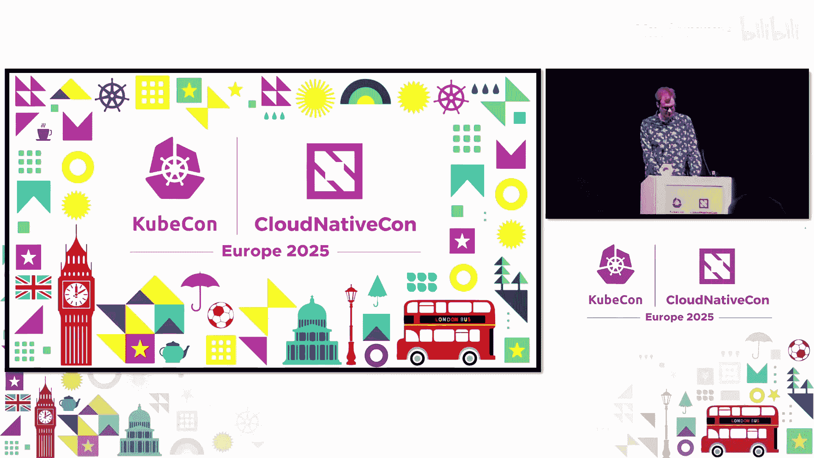

# KubeCon-+-CloudNativeCon-大会2025-｜-云原生计算-｜-可观测性-｜-Kubernetes-｜-Prometheus-p47-P47-Thousands-of-Virtual-Kubelets---1-to-1-Mapping-a-Supercomputer-To-Kubernetes--BV1Cd32zDEBG_p47-

Thanks， everyone for coming to my talk。 This is thousands of virtualcts。

1 to one mapping a supercomputer to Kubernetes with subernetes。 Let's get started。😊，So hi everyone。

 I'm Dennis， I'm a security and cloud computingut masters student at Alder University in Finland。

 as well as NU in Norway。😊，My cloud native career started at Weave Works。

 where I co authored Weave Igite。Currently， I'm working on my master's thesis at the Astroinformatics research Group at Alder University with a focus on supercomputer and cloud integration。

So let's start with a quick poll to see which backgrounds you're coming from。First。

 raise your hand if you're familiar with high performance computing or supercomput on any level。

so it's hard to see， but I see a lot of hands。Nice。

And then raise your hand if you're familiar with cloud computing or Kubernetes， again， on any level。

Yeah， okay， I look more as we expected for Kubecon， nice。

So let's hop straight into some comparisons then to get everyone on the same page。

On the highest level， the difference between cloud computing and high performance computing is this。

The cloud assumes infinite resources and finite demand。

 while high performance computing assumes finite resources and infinite demand。

 so sort of the opposite。In practice， this means that cloud workloads are typically bound to a small set of nodes。

While there is no capacity for running a lot of workloads in parallel。

On the high performance computing side， on the other hand。

 single workloads may span across the entire system limited only by the number of nodes in total。

Initially， this paints a picture that there are fundamentally different assumptions at play when building for the cloud versus high performance computing platforms。

However， with the advent of artificial intelligence workloads in today's market。

 the tables have turned for the cloud。 Nowadays， cloud and HC requirements look increasingly similar。

The demand for resources by workloads is increasing， while platform limits are starting to show。

Last September， the European Commission published a report by the former European Central Bank President。

 Mayo Dragi。Mario was tasked to prepare a report of his personal vision on the future of European competitiveness。

In the report， Mario encouraged opening up HBC capacity to startups。

 small to medium sized enterprises， and the broader AI community as a whole。

He also highlighted the importance of expanding EuroHPC to additional cloud and storage capabilities using unified public and private infrastructure for upcoming AI and cloud service deployments。

To understand what all of this is about， we first need to understand the similarities and differences between the cloud and HC worlds on an architectural level。

Modern H PCC and cloud hardware is actually surprisingly similar。

 So let's focus on what differs between them。 And specifically， it's the software stack。

Most cloud platforms nowadays run Kubernetes， as you probably know。

While a lot of high performance computing systems run something called slur。

As a side note for this presentation， Im considering high performance computing。

 its abbreviation HP PCC and supercomputers all to be essentially synonyms。

So reduced to their simplest forms， we can observe that Kubernetes and Slum are fundamentally very similar distributed systems。

Let's start from the clients。These are the users of the system who interact with an API interface。

Next。And there's some differences with the API interface， but in the Kubernetes side。

 it's the API server。 and on the S side， it's essentially a bunch of commands that you invoke through a batchsh script。

Next， in both systems， we have a set of controllers that mutate the state。

To create track of that state。Including， for example， the workloads deployed by the users。

 both systems rely on a database。And finally， both systems have a set of node agents。

 one on each node which handle the actual execution of the workloads。

The main difference between the two lies in which components communicate with which other components。

 as already mentioned， Kubernetes has the API server， which essentially manages everything。

 all the components connect to it while in Sm it's a little bit more complicated essentially。However。

 even if the architectures look quite similar on the component level。

 the high level architectures and goals are actually quite different。

Kubernetes's strength lie in its versatility and reconciliation。

You can deploy Kubernetes basically anywhere and its self healing abilities make sure that the system keeps running through upgrades and partial failures。

On the other hand， SloRm， as an HPC scheduler， has its strength in scheduling large scale multinote workloads and optimally handling the complex hardware topology present in modern HPC systems and supercomputers。

On the drawbacks， SLRm definitely exposes a lower level abstraction compared to Kubernetes。

 which currently has somewhat limited interfaces for hardware control。And also。

 while the community is hard at work at improving the ease of deployment。

Setting up a Kubernetes cluster， especially on HPC scale， is still a somewhat involved process。

I'll also highlight two particular key drawbacks in the Sm ecosystem that I'll be focusing on today。

Based on the experiences in my research group， the HPC software stack is much more fragile compared to Kubernetes。

 and， for example， software upgrades are not seamless。So both， both sides have some key benefits。

 but unfortunately also drawbacks。What if we could merge the two communities and ecosystems gaining the advantages of both while minimizing the disadvantages of either。

Around a year ago， this was the starting point for my master's thesis research。

My quest to map the HPVC and Cloud integration landscape started on the Lummi supercomputer。

Loommi is the eighth fastest supercomputer in the world at the moment as and is located in my home country of Finland。

However， through my exploration， I quickly gained the knowledge that Lumi is one of the trickiest supercomputers for this kind of research。

😊，None of the existing solutions that I tried would work。

 So the scope of my thesis suddenly expanded quite a lot。Introducing supnetes。

Supernnetes is my master's thesis project that aims to bridge the gap between the cloud and the HC。

Subernetes is a so called transparent bridge， which connects a Kubernetes environment and a s environment together。

And crucially， Supubernnetes actually works on Lomi。Here's the architecture of Supannetes。

 There's a lot to take in， So let's do a step by step walkthrough of how this works。

So you have a Kubernetes cluster on the top and an HPC environment in this case low me on the bottom。

On Lummi， we have a set of nodes here I'm representing them as Lummi Gn 1 and Lummi G Note 2。

When you deploy Sububernetes， it itself consists of two components， you have the controller。

 which is running in your Kubernetes cluster as a pod， and then you have the agent。

 which is just a process that you start on a login node。

 The login node on an HC system is essentially just an end point where you SSH into in order to run workloads on the machine。

First， the agent establishes an MTLS secured GRPC reverse tunnel to the controller。

Then the controller requests the agent to discover the nodes on the HPC side。

For each node one to one， the controller then deploys a virtual Ct instance。

This is essentially a virtual representation of a Kubernetes node without the back end part。

Then let's say you deploy a po。You can deploy the po either directly or through a job or basically any other means。

 This is a standard V1 slash pod from Kubernetes。The controller then picks up your pod。

Passes it to the agent， which then uses the Som commands to dispatch it as a job。In this case。

 that job is split into two tasks running on two nodes in parallel。

These new jobs then get observed and pods will be created， and their status， logs， et cea。

 all the metadata bidirectally synchronized on the virtual Cubt nodes。

We need these so called shadow pods in since we can't split pods across nodes in Kubernetes。

 like we can jobs in the HPC system through the use of tasks。Finally。

 Subernnetes associates the created pods for the job with the original pod you deployed。

Allowing you to see the status and logs like the pod would run natively on Kubernetes。

 so it's fully transparent。And naturally， any other jobs running in the HPC environment will be observed and reconciled as well。

 so we have the observing and then the reconciliation。

Leading to the virtual cut nodes in Kubernetes getting a complete view of the state of their respective nodes in the HPVC cluster。

 and this is important if you use schedulers on the Kubernetes side so that they can use the node and po metrics in order to do smart scheduling decisions。

 for example。This wouldn't have been possible without the great cloud native Giths tool， Fl CD。

 or simply Fl， which I modified and integrated into Subnetes to achieve consistent synchronization。

And I'll also highlight all the work put into the virtual Cubt project。

 which is the backbone for mirroring the entire HPC system into Kubernetes in the first place。

All right， let's jump into a demo， but hopefully this works， there's a lot of moving parts。Okay。

 it's visible， great。So on the top left， we have a Kubernetes cluster。

 This is just a single node cluster with a lot of virtual Cubt nodes managed by sububernetes。So。

Here we see that there's 1003 nodes， this is 1002 virtual nodes exposed by Souernetes and one physical node。

 if we scroll all the way to the bottom here you see that this node here at the bottom is the only physical one actually running the cluster。

So let's hop into or actually I'll highlight this as well。

 since I just got this working before the demo， this node CPU and memory metrics are also exposed so we can take a look that these nodes are around 30% utilized which is not that great and we have a memory utilization of 45% as well。

 but don't read too closely into these numbers， Sm is a bit wonky in how it reports this metric。

All right， let's jump into this particular node。So we can try spaing a deployment。At the bottom here。

 I'm running SQ in a loop。 So this is essentially a view into all the jobs that are running on Lomi with my user account。

The port we're going to be deploying looks like this。So it's essentially just a standard V1 pod。

 I'm deploying something intentionally something very light here so that we can get it scheduled quickly since this is live。

So we're just going to be pulling the alpine container from Docker hubub and then running a loop which just counts to 300 in one second intervals。

 and we should be able to also observe that in real time。In order to deploy onto a subupernetes node。

 you need to add a toleration so that the port can actually be deployed on one of these nodes。

 and here I'm also using node name just to target this particular node。So we can take a look。

So Vennets also supports passing arbitrary options to SLm through this label system。

 and here I'm passing in the time flag in order to add enough time for the job so that it can complete successfully。

So let's apply it。Here we go。And we see that it has appeared and it's independent status at the moment。

And at the bottom， we already see that the controller passed it to the agent and the agent immediatelypatched it and it also immediately started running because it is such a lightweight job and there thankfully wasn't anyone else hogging all the nodes。

At the moment。But however， we still see the pending status up here。

 This is due to supnetes being essentially out of necessity pole based。

 So there's a 10 second polling interval because you can't watch resources in Sb。So in just a moment。

 we should see the reconciliation of the pods also happening， and there we go。

And we also see the shadow po that was created for this job。

 So it's this one in a special name space。 So just for for the tracking purposes。

 And so Bennetes associates these two together so that you can just take a look at at the logs of your po and see it running in real time。

😊，That's the demo。However， we're not done yet。As I've hinted。

 Soernnetes is not alone in the HPC to Cloud Bridge landscape。

Let's take a broader look at what's available。Here I've listed the six projects that aim to bridge the gap between the cloud and HPBC ecosystems today。

The first three， interlink， HBK and Subannetes， are recently developed and maintained。

The next three are not deployable currently， but I've listed them here for completeness。

Knock is the predecessor of HK and is deprecated。Then we have K Foundry。

 which was presented at a previous Cuecon， but to my knowledge it' still not public。And finally。

 we have the Slinky Surm bridge， which is sort of the official solution from SdMD。

 the developers of Slom， but this is yet to be developed。And specifically。

 take the last two with a grain of salt， since I've needed to make some educated guesses based on any public information I could find about them。

So first， all of these solutions are able to take workloads defined in communities in some way or other and deploy them onto an HC system。

However， of these， only Subernetes is able to do the reverse。

 namely also synchronized jobs from the HC system back to Kubernetes。

So Bennetes is also the only solution to provide a complete node view to the Kubernetes。

 node to Kubernetes in order to， for example， use。Cll native schedulers here。

And it can expose the entire node structure of the HPC environment to Kubernetes as well。And finally。

 there's a firewall typically in place on HPBC systems， and especially on Lommi。

 this is a challenging aspect for all of these bridge solutions in general。

 the yellow warnings here are not necessarily deal breakers but might require some elaborate workarounds。

And for Slinky， this can't yet be evaluated。However， as great the Subnetes is。

 it also cant solve the two key HPBC environment issues I highlighted previously。Namely。

 the secure multitenancy and high availability on the HPC side。In fact。

 none of the HVC bridge solutions can fix this。Let me explain these two issues in a bit more detail。

So first， the multitenancy。You can think of this， like running a hotel。

The tenants here are the customers that book rooms to do work in and store their stuff in。

In this context， the tenants can be， for example， developers or teams from various AI companies working on different projects。

 doing work in training LLMs， and storing stuff in the form of training data and resulting models。

At the moment， our hotel of Lumi needs to accommodate around 3400 people。

Let's see if that's feasible。In order to support multitenancy properly。

 the tenants must be isolated from each other in our hotel。

 we do have walls between the rooms directly accessing the data from other tenants is prevented through Unix permissions。

However， our hotel also has no locks on the door doors to their rooms。

Another tenant can just walk into the hallway of networking and directly access any other tenant's room where the other tenant might。

 for example， be running a Jupiter lab environment。Through that environment。

 they can then access the stuff the first tenant stored in their room。

 namely their confidential data and models。In technical terms。

 we don't have kernel nor username spaces。And technically。

 since we don't have processed namespaces either， the walls of our hotel between the rooms are also transparent。

 and you can basically see what all the other tenants are currently doing。On the Kubernetes side。

 there are existing and performance solutions for addressing these concerns。

You can install locks for your rooms by taking advantage of， for example， network policies。

 Spy and Celium。Containers also natively provide us with opaque walls by default since they isolate your processes。

Let's next discuss the high availability concerns。Unlike the cloud。

 hardware faults and software upgrades in the H PCC space often involve downtime， unfortunately。

This is a screenshot from my email inbox listing all the issues with Lumi over the past year where red entries are associated with downtime。

In terms of cost efficiency， let's do a bit of napkin math。

 So let me at the total cost of 1 50 million and a planned lifespan of five years。

We can calculate and amortize yearly cost of 30 million a year。If we count it this way。

 the cost of one day of downtime is around 82，000 euro。

This here represents 28 days of continuous downtime。So first of all。

 think about if your cloud platforms would just go offline for a month， that sounds a bit crazy。

But if we use the same formulas here， this works out to 2。3 million of， essentially。

Unusable capacity on the H PCC system， while software is being upgraded。

And the successor for Lumi has already been planned and allocated 250 million euros。

 and while we don't know the lifespan is's probably under 10 years。

 so the cost of down time will probably either stay the same or increase in the future。

So now that we understand these issues at hand and that the bridge solutions also aren't the ultimate solution。

 is there a way to unite the communities and ecosystems in an even better way。

Let's board the seamless integration train to take a glimpse into the future。

Well start off at today's station。Today's station is our base case， namely how A Lumi， for example。

 is set up today， just a single HPC environment jointly accessed by all tenants。

So let's fro up and off we go， mind the gap between the train and the platform。From our base case。

First， we move the users up， and then we insert a new Kubernetes enabled world in a new cloud environment。

Now， pay close attention。In order to retain the best parts of Sm while avoiding its drawbacks and also leverage Kubernetes strengths at the same time。

The tenants now operate in isolated s clusters running inside of Kubernetes as pods。

This is nowadays implemented already by at least three projects。

We have the Slinky sm operator not to be confused with the Slinky surm bridge。Both scand products。

And then we have sunk by Corweve and also Opera by Nbia's AI。However， obviously。

 we still want to utilize the actual HPC hardware that is currently managed by an existing soil installation on the bare metal。

This is where HC the cloud bridges， and especially Subernetes come into play。

Soubernetes aims to be able to expose the underlying hardware to SLm。

 our underlying hardware and SLRm to Kubernetes faithfully enough in order to support running HPC schedulers within the Kubernetes cluster。

It is a key component for essentially exposing a sort of large enough Kubernetes cluster to evaluate the new environment atop the existing software stack。

And this。With this， we've arrived at stopgap stationation。

This marks an intermediate checkpoint that is achievable today with minimal disruption to existing HC customers and platforms。

However， we can still go further。From a stop cap station， we can now do something interesting。

When we are ready to commit， sonetes， together with the underlying bare metal installation of sm。

 can actually be entirely eliminated。😊，And finally。

 Kubernetes can be dropped down to control the hardware directly。😊，At this point。

 we have achieved our goal of combining the advantages of the cloud and HPC while minimizing both of their individual drawbacks。

But why stop there？On the side， we've also gained the superpower to run the cloud native batch ecosystem。

 alternative H PCC schedulers such as Fl frameworkrame or even completely custom pipelines。😊。

And thanks to various multicster solutions in the community space。

 connecting this new hybrid environment to an external cloud is also no longer an issue。

 no more hacky bridges needed， and no need to reinvent the wheel either， just a single。

 unified and modern platform to build the future of supercomputing on。And with that。

 we've reached the final station。This architecture has a lot of potential。

 It empowers communities from both the HC and cloud ecosystems to unify their efforts。

 benefiting all the projects in the stack and making them more accessible to everyone。😊。

We gain improved security， better automation， broader ecosystem support。

 better utilization on the supercomputer， hardware。

 thanks to the accessibility improvements and finally reduced downtime and costs just to mention a few advantages。

😊，So， to conclude。We， as a community， need to start thinking about connecting HC to the cloud today。

Right now， we already have a set of HC bridge solutions， including subnetes to act as a stopg。

As we transition towards better solutions， we need to take care to improve the security posture and high availability of HPC in the process。

I also hope to have convinced you today that Kubernetes is an excellent candidate for addressing these challenges。

 There is no need to reinvent a wheel。 It's just a matter of the communities coming together for the greater good。

And finally， if this presentation piqued your interest， hit me up。

 I'm working on finishing my master's thesis on Supannetes。

 and I'm looking for interesting job opportunities to make this transition a reality。😊，Thanks。

Any questions？Okay， coming。Thank you and for this very interesting talk。 one question。

 which kind of application are supported right now。

 Because I suppose there should be a gap in the how the pod that are running in Lm are connecting or are sharing a network with the Kubernetes cluster。

IIs that the case？Yeah， at the moment， it is very difficult to bridge the networking。

 so the obvious solution would be to isolate the jobs running in Surm into a separate network name space and then bridge that network name space through a proxy or something to the Kubernetes side。

 however， since we don't even have network namespaces。

 probably the best we can do is to just implement a plain proxy that the application needs to be aware of and connect to if they want to communicate。

 but that is not yet implemented in Sububernetes。Alright， thanks。 So yeah。

 I appreciate also the table。 and it's also brave to to do that because we can miss things but。

Overlay network is definitely one road that should be should be there。 And for instance。

 Interlinka can have。 solution can。Yeah， yeah， okay。 Ill have well updated。Thanks for the feedback。

Thank you。You talk about bringing SLRm， HPC and cloud communities together was the first reason or the reasonzoing in Europe Pertic Center。

 Lomi。Let's start them and you on that path。Because it requires a lot of open mindness on the side of A PCC。

Yes， and it's a bit of an uphill battle with that。 So I'm trying to get hold of， of the people to。

Motivate in， in con considering this transition。And that's why I also presented sort of a couple of intermediate steps that are non- disruptrupive to the HPC environment so that we can evaluate whether this is feasible and also what kind of changes we need on both the HPC side as well as on the Kubernetes side in order to make this transition seamless。

 so for example， at the moment， Kubernetes doesn't necessarily have all of the fine grain control that slum exposes on HPC hardware that are required for some workloads。

But did your people at Lomi had the real use case for it。

The use case here comes from essentially the users of Lumi。 So they started from my research group。

And I've also chatted with a couple of other people who are frustrated with the difficulties of connecting these H PCC systems such as Lumi。

To the cloud in order to run， for example， batch operations like training。

 so they have their existing infrastructure， customer management， front backends， databases。

 et cetera， on Kubernetes and they want to integrate their AI training and inference backends with HPC ecosystems and it's kind of difficult to do with the way you need to SH in and run around a lot of scripts at the moment。

Okay， thank you。So I was wondering if there's another take on integration with cloud native and batch more batteryy workloads。

So we have a bunch of users who are familiar with SLm and I was sort of thinking maybe an Spat wrappper that could create job sets that can be scheduled by Q might be fun。

I've already thought about this。 And yes， this is very much an option and also a really fun thing to think about so that we don't need to run the entirety of Slom in a port like cluster entire Slom clusters but essentially just implement the bare minimum front end and then directly maps into Kubernetes resources。

 the users get what they used to Yes and I'm hoping that DRA is going over time give us a bit more of the flexibility with absolutely this heavy scheduling Yes。

 this heavily relies on DRA and also the fine grainined aspects。

 the fine grainin control aspects of DRA and maybe a difficult thing with Lo specifically is also that it's AMD based So the AMD GPU operator is kind of an essential part that needs to support DRA and all the infinni band etca that needs to happen in the Kubernetes space as well to make this a reality I think there's some cool stuff to get involved in especially with the NI scheduling as well Yes DRA and network。

So。Absolutely。去做翻位。Thanks。All right， well。no more questions， then thank you once more。

