# KubeCon-+-CloudNativeCon-大会2025-｜-云原生计算-｜-可观测性-｜-Kubernetes-｜-Prometheus-p48-P48-Testing-AI-Containers-for-Digital-Twins-in-Science---A-Cloud-HPC...-Matteo-B--BV1Cd32zDEBG_p48-

Good morning， everyone， today。

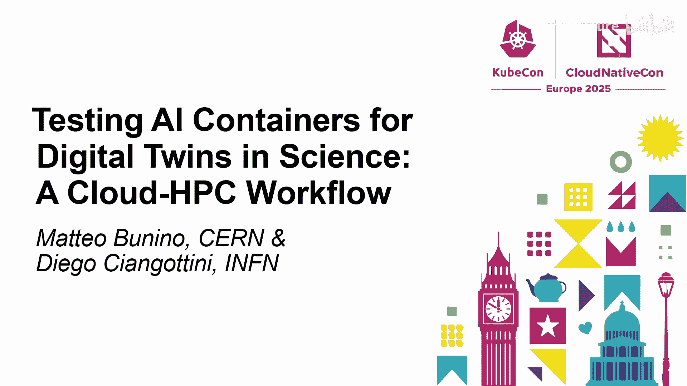

We are going to talk about something very peculiar how we managed to develop and to create a platform to develop digital twins。

In an eye。Cloud plus H PCC scenario， right。First of all， presentations， I'm Diego Chagotini from IFN。

 that is the National Institute for Nuclear Phyics in Italy。😊，And here with me on the stage。

 there is Matebuino that is from the Cern op lab。 So you might have heard a Cern Iinohan。

 It's on the same kind of of track。 We are doing physics with particles。

 And so why we are here talking about digital twins。Well。

 there are several reasons and several institute and projects that are working into whatever we are presenting today。

 I give you just the links so you can check later if you're interested。What are Li Jta doing then。

I love this sentence that summarize very well what should be a digital twin。

 So it's a digital representation of a real world system。 and yeah。😊，I it's not working like that。

 but kind of， you know， so。You have projecting wildfire and you want to forecast whatever will happen in case of this disaster。

 or in this kind of other disaster， you will want to understand the impact of flood on your landscape。

And then there are other digital twins that can be very useful。 and for instance。

 one that was just mentioned before in the nice panel that whats mentioned before its particle detection。

 so we have this big camera that are train and projected to create photos。

 the detailed pictures of what happens between particles。

 why not create a digital of this big cameras and facilitate our life and same for noise we have to do precise measurement。

 we can simulate noise or teach a machine to simulate the real world noise we have in our environment。

😊，From all these use cases that share very similar needs。

We started investigating possibility to create an engine for digital twins。

 So something that will serve multiple communities。😊。

And make them adopt and use resources that are shared across different providers。

 So you see intertwining is the project， European project where we are working this out。

And on one end， we have the providers so that can span from cloud providers to supercomputers。

 Euro HPC supercomputers。And on the other side， you have frameworks that users use to do their digital twins。

What are the challenges there？So you have to provide a platform that is capable to support all different use cases。

 all different frameworks。But also， you have to merge that with the uploading capability of everyT on different kind of backends that not necessarily are able to run cloud payloads。

Finally， since you have this multiplicity of backends。

 you want to maintain all your software as interoperable as possible。

 So you want to reproduce the very same resource on any kind of backend。😊。

So the challenge in a nutshell， we have a distributeded heterogeneous resources。Good。

 and then we need to put on top a common interface。2 problems comes from here。

 So how we give access to the users to this platform。

 and that we maintain all our workflows consistent to each other。So， for instance。

 starting from the software and the containerzoology that can come from different container runtime interface。

Plus， we know that we have lots of users that actually don't care where they are going to run。

 They just want their jobs to be done。Fortunately enough， in this case， but also in particle physics。

 we start to converging to a set of tools that are cloud native。 So the main interface that we face。

😊，In most cases， it's Kubernetes， so we left out just with a question how we can merge a Kubernetes API access to different kind of resources。

And we listened before， for quantum computing is kind of the same challenge。

So someone told me that on Tuesday there there was a nice talk about this technology that is interlinked。

 totally not not presented by me。 So there is a demo for the solution that I'm going to briefly introduce here。

 So if you' are curious， just check it out。 And idea is to create a plug world system where we put adapters on top of the remote resources that we want to control through the Kubernetes cluster。

😊，And we try very hard to keep the requirements for the providers the less invasive possible。

 So you plug into in of your edge node。Here， and youre good to go。 basically。

 you create a virtual node based on virtual cubeubbit technology that is capable to schedule part on yours Slom supercomputer。

 for instance。😊，And yeah， so why we choose this way well。In this way。

 we are capable to grant our users access to Kubernetes in interface with no compromise with no hereDs。

 Everything just run like playing Kubernetes。 So you have pods with a notation， you select a Vi node。

 Ela， you go hand up into supercomputers that do your machine learning by or your digital twin and everything is reported back once land。

😊。

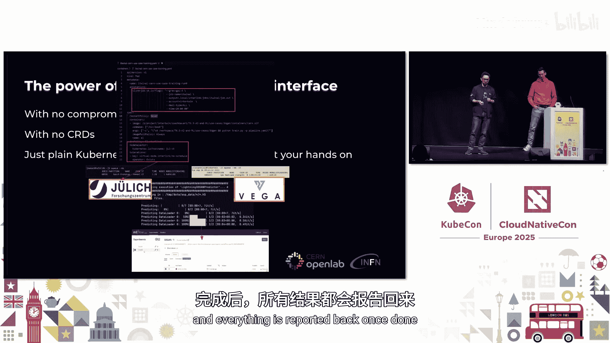

It's a community effort， of course， and the community is very interested in understanding how they can plug their own providers。

 and in fact， we have not only scientific use case。

 but you can find there in the list also enterprise that try to plug their container as a service solution in this way。

😊，And the latest news is that now this project is part of the Cl native sandbox。

 we just passed the vote a couple of months ago， and so I take this occasion to say that it's a really thin and simple。

 interface that is perfect for introduction of new commitment or a wider communities so we are really looking in to get more people on board on this。

😊。

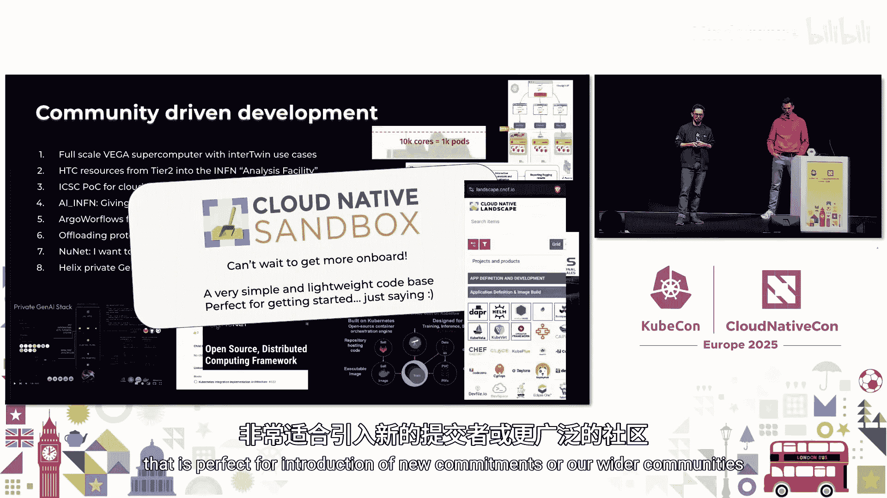

So we have an interspace， if you wish， so a set of frameworks that can run on different Kubernetes cluster that thanks to this adapter can run on on VMs with GPS on HTC system like H condo on quantum we are trying to see what we can do with this with a Galicia supercomputer on quantum computing and then we have HC centers where we started。

 we need these kind of centers to create digital twins。

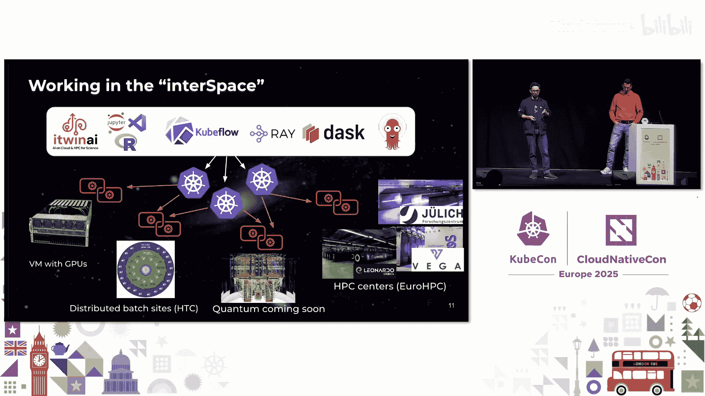

So we create a Kerae， for instance， from playing Kubernetes onchar。This。

Spone up different work nodes， but pay attention。 These work nodes are living inside a supercomputer。

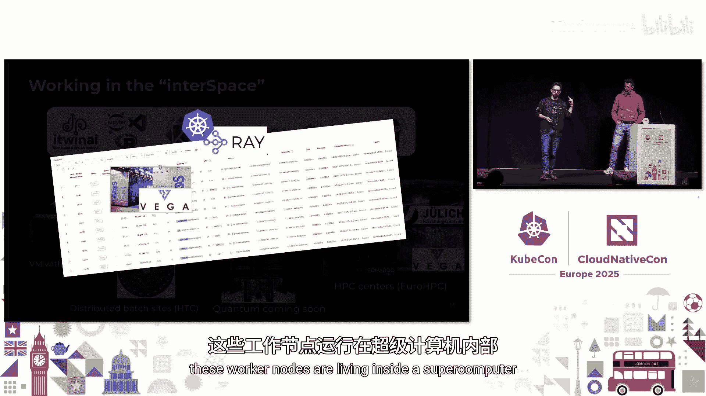

Everything seamless and completely， the user are completely unaware。 Everything is up below。Cool。

 now we have big powers。 We have also big responsibilities， because。

EWe need to provide a consistent environment for our users。 We need， In other words， a spaceship。

And a spaceship needs to provide us with a consistency of workflows， we need to check our workflows。

 we need reproducible results， and yes， we can do with the CI system that we have nowadays。

 but not without locking ourselves into custom solution or reusing and copy pasting nightmare that you might know very well。

😊，What dagger provides， the solution we choose for this。It's a runtime， basically。

 that it's meant to create composable software。 And gosh， we scientists love composable things。

 So we took a look at that。 And yeah， we got pretty。

 pretty far because we have now repeatability of our results。

 We can compose all our software in an in efficient way。

 and we can also observe what happens when we build and wind test stuff。😊，So this is all good。

 but even more we have a universal tax system so we can code our pipeline in a very efficient way。

 we have a notet platform where we have caching for our artifacts and we have built of observability。

😊，And finally， yeah， new the new thing is that we also have native integration with LL that is might be of use in the next years。

😊，This is the situation， different modules that does different things altogether can be composed to create different pipelines that we can run on our machine。

 first of all， so on your laptop you can run those pipeline， but the very same pipeline。

 we run al right， we run in the Docker engine in your CI system。all right， so just one last news。

This sandbox that you send around between your lock machine and your remote machine can also host a imagine so we can have some improvements of our workflows based on our set of pieces that we put into the puzzle。

And we ship also all our software in a resilient and efficient way。For more details。

 I leave all the links during the presentation。So now we have a interface space in the daggerverse that can match。

 provide us the capability to run on external resources through a Kubernetes cluster。

 but those Kubernetes cluster can run also in a sandbox on our C pipeline。

 granting us all the capability to be double checked before we push changes to production。😊。

And we're using good other modules that were using in other use cases。 So pretty good so far。

 I would say we are pretty satisfied and we are outside for the launch now this Pat introduced to what we deal with all these stuff。

 thanks a lot Diegogo for the introduction very nice yeah so let's see in practice what we have been doing with innernerlink and Daer So first of all。

 as introduction I'm from Cernop La， which is this entity in the Cern department。

 which is responsible for establishing collaborations with industry and academia。

 So here you can see our partners and I mean， of course feel free to reach out if you have ideas we'd like to collaborate we are always open to new collaborations and as De was saying we are interested in digital twins for instance we are participating into the inner twin project。

😊，And in this project。We are responsible for the developing a component for scalable AI waterflows for scientific digital twin applications。

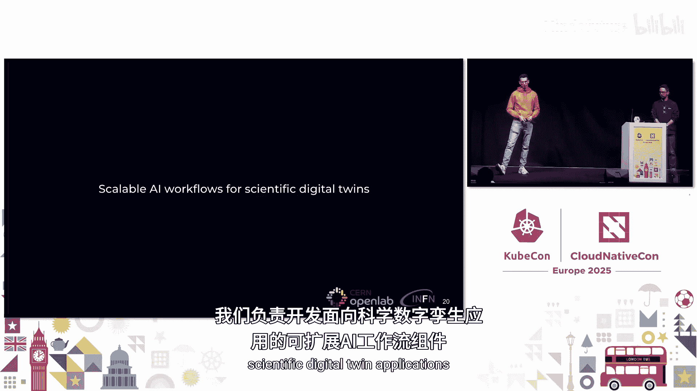

This component is implemented as a Python library， which is called Iune AI and you can imagine that as a toolkit that provides scientists with different functionalities to support distributed machine learning training。

 distributed hyperparameter optimization can support Pytharch and Tensorflow and also has a strong focus on the machine learning tracking。

 so tracking the machine learning metada that is generated during training， for instance。

 also allowing you to store the models， I mean to connect to a models registry where you can store the models and version them and so on and so forth and for this where using for instance MLF。

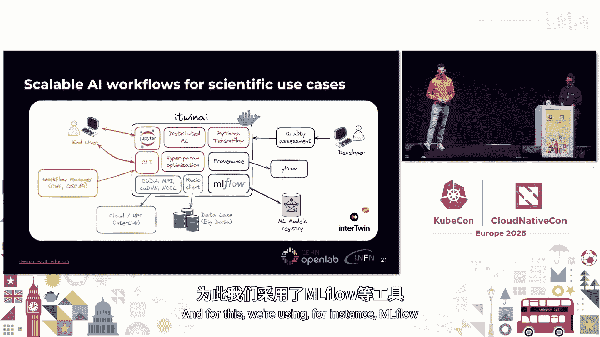

When I talk about distributed machine learning training。

 I'm actually thinking of two different models， One is the pure data parallel distributed training in which we have a model which is replicated on different GPUs on different nodes potentially in multiple nodes and the data is partition so each local replica of the model will actually access a subset specific partition of the data on the other hand。

 we can also support model parallel and hybrid， the model parallel and data parallel training which is the image on right in this case the model is too large to fit on a single GPU which is pretty common nowadays for very large language models for like transformer based models so in this case the model is distributed over multiple GPUs and to do this we rely on popular frameworks such as Pytorarch horrible ray and speed another key feature as I was saying is hyperpar。

で。So in this case， you can imagine you have a training tuning configuration in which you define the ranges for your hyperpar。

 and then the IT2A trainer will make sure that individual training trials are run in parallel and so distributed over HPC infrastructure over multiple nodes and in an optimized way and to do this we on Rayune。

So let's see some examples of digital twinwin use cases that we have in intertwin that have been currently integrated in I2 AI。

 These are not the only ones， but let's see two of them。 So the first one as it's tackling I mean。

It's focusing on the domain of environmental sciences。

 so on hydrological modeling and developing AI model to improve early warnings for droughts。

 the other is from physics so we're collaborating with people working on the data collected at the Virgo interfermeter which is meant to measure gravitational wave signals and what they would like to do is to use AI based model to dennoise the signals captured by the detector So here we can see an example of。

Let's say scalability analysis that we did with I2 AI。 So on the on the left。

 we can see a plot in which we compare different distributed frameworks。

 how they scale for the same model on the same data set。 of course， and on the right。

 we can see an example of energy benchmarking。 So we're also interested in studying how the you know。

 different distributed frameworks for a specific model for specific use scales and a specific data。

I know， how much is the energy consumption and you know。

In other words to highlight the different tradeoffs， another example， as I was saying in this case。

 we used I2 AI to perform hyperparameter optimization of a model for hydrological modeling and with I2 AI。

 we were able to reduce the validation loss of almost 75%。

But so how do we make sure that the code that we' are developing in H AI is always consistent。

So as I was saying at2I is this abstraction layer on top of popular distributed machine learning frameworks。

 so the users will provide a training configuration and a tuning configuration and then the trainer will abstract out from the complexity below which are basically different distributed machine learning frameworks and also from the HPC infrastructure。

Of course， we can write some tests and and we do that and we have， of course。

 some unit and integration tests that we use， for instance。

 to test the abstraction layer that we developed for the loggers or for some utility functions or some you know general purpose unit and integration testing for whatever any kind of feature These are classical。

 let's say are traditional unit and integration tests and can be run anywhere。

 and these are not the topic of the talk。 You already know them。

 The problem is that some features of it AI are inherently distributed。

 So how can we test these features。 you know， everywhere like how can we test these features without having access to GPUus to multiple nodes。

 An example is the worker rank assign。 So what does it mean。When we have， for instance。

 data parallel training each process assigned to a specific GPU is also assigned different ranks and the ranks are needed in the collective communication in the communication between the workers so how can we test this on a laptop of course we cannot I mean we need specific infrastructure same is for the collective operations such as allgaer。

 gather， barrier and so on so， so how can we make sure that our software is actually implementing these operations in the right way。

Other examples are， for instance， saving and loading checkpoints in a distributed machine learning setting and to when integration testing for distributed machine learning training and also the also testing that we can run distributed machine learning training under hyperparameter optimization。

 So there is like a a higherarchy。 So we have a high level distribution。

 which is the hyperparameter optimization。 And then each trial is also distributed。

 So how can we test this。嗯。Well， that's the topic of the talk， of course。

 and we're also interested in repeating these tests for all the frameworks that we' are actually using。

 so you can see that there is a kind of matrix that is building up here。

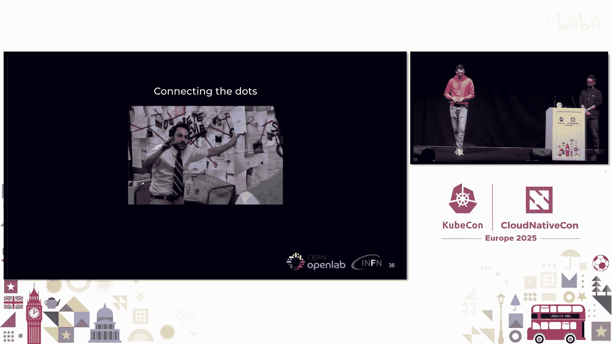

Yeah so how do how do we actually run the tests in practice so we have distributed launches which are compatible with the distributed machine learning frameworks for instance for P torch so for torch DP there's torch run if you know it if you ever heard of it and this will allow to spa a multiple processes and each process is basically just a P test command so I guess you're familiar with P test and then each test case will actually communicate with the other test cases using a collective communication backend which is provided by the distributed machine learning framework and the old thing will then be possible to be tested on HPC so this is。

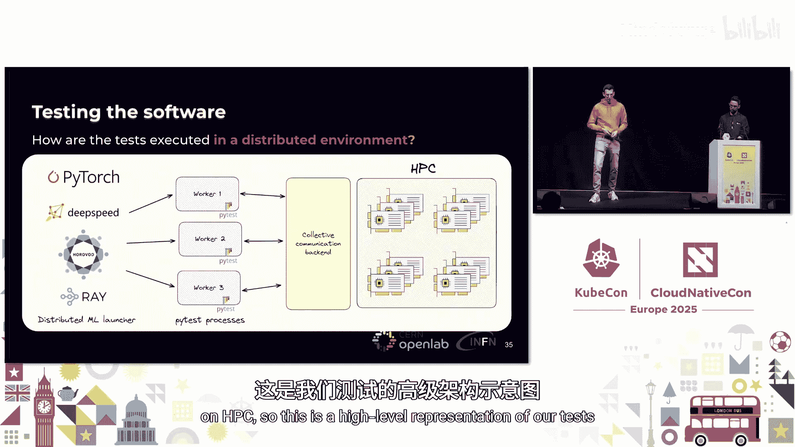

And high level representation of our tests。 Now let's put everything together。

 We saw digital twins HPC AI hydrological modeling gravital waves， so great。

 but then how do we actually automate our tests on HPC in practice we have our code and Github on Github we also keep our C waterflows such as software quality assessment unit tests。

 we build the docker containers on HPC great， but how do we integrate then the HPC resources into into into Github。

😊，嗯。So first ingredient is dagger pipelines。 So they've already made a very nice introduction。

the great benefit， in my opinion， what I noticed at least is that you can avoid to push and pray。

 you have a reproducible C that you can run on your laptop。 you can run your own Github on Gitthub。

 whatever you want， it will always be the same and is based on containers which is pretty pretty useful for us and second dagger pipelines allow to sp on the fly services in the pipeline and this will be pretty useful for the next step which is putting everything together with innerlink。

 So on the left we have the cloud side So Github called the C pipeline dagger pipeline basically and on the right we have the HPC so the remote HPC supercomputer。

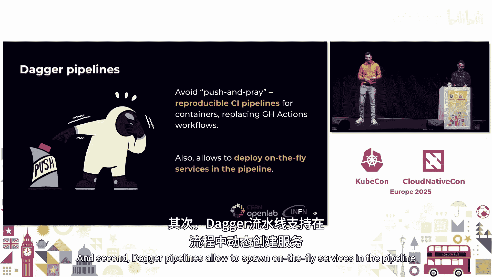

They use different technologies。 So on cloud， we can on Github， we can build doggcker containers。

 But then we need when we want to run on HC， we actually need singularity containers。

 So part of the C， let's say pipeline also consists in converting the doggcker containers into singularity containers before they are actually tested on HC。

 So it's but let's see more details what the pipeline looks like。So first of all， of course。

 we build a docker container and we run some unit tests。

 like simple CPU only tests that can be run on GitHub。Next。

 we convert the Docker image to a singularity image file。

 and we push it to some as a singularity registering。It's not it's not shown here。

 but and then we actually deploy innerlink on well， actually。

 we deploy K3 S inside the dagger pipeline on the fly。 and on top of K3 S， we deploy innerlink。

 So now by magic， we are able to use innerlink and submit jobs to HC within this pipeline。

 And so the last the last step。s let's say the central step in this picture is let's actually run the test on H。

 So we were using a link。😊，We submit the jobs if the tests are passing， right。

 we can publish the new version of the container image both to a singular art image registry and to to a Docker container registry。

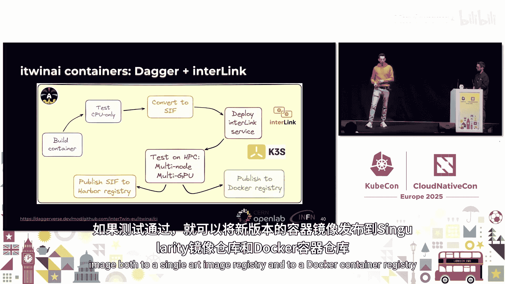

So this is actually implemented as a targetger module。 So you have also link。嗯。Yeah。

 you can find it on the daggerverse。 I'm sure everyone can read here。 but this is， of course。

 just to you know， give an overview of the code。 So in practice， how does it look like。😊。

We've been defining three dagger types are called。 So first one， I2I。

 So that's that's you know where we have the logic to build a container。

 to connect to interlink to run the tests and H PC。 I mean， to。To convert singularity， everything。

 all of these is on Gith。 so of course you can always have a look at that。

 Then we have the innerlink the innerlink type which you know allows to bootsrap the innerlink service。

 And the last one is the singular team step which actually I mean the singularity type which actually allows to convert the docker container to a singular image so。

Here we have some examples on how to use this pipeline on the left， if you can see。

 you can actually see some examples of how a container， I mean。

 how C I mean C pipeline can be built in a modular way。

 So if want we can just build a container and publish it or build a container and open a terminal in it immediately or know build a container tested on CPU only let's say environment and publish if want it's really modular whereas on the right。

 we have some examples on how to actually span innerlink and submit jobs from the same dagger pipeline。

 So you could even just use interlink without caring about all the rest on the right。

 you have some examples on how to do that。

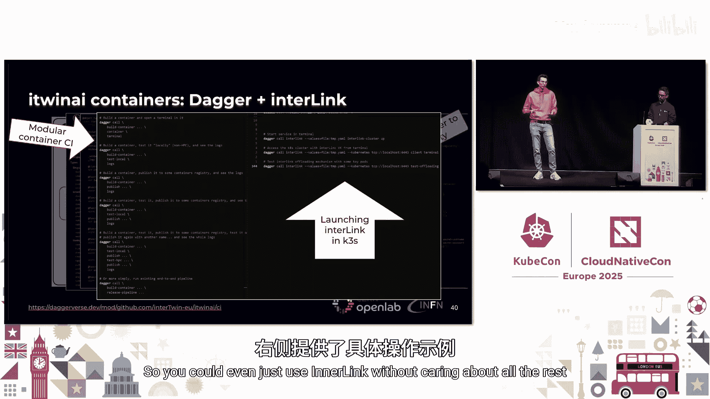

So let's see an example。 So this are this is is the end to end warflow。

We launch and we push let's say to Github。 this will trigger some let's say Github actions so some some warflows which under the hood will run a dagger pipeline here you can see the traces of the dagger pipeline on the dagger cloud so mean of course I cannot open the tabs but is very nice because you can navigate inside the whole tray So here we can see that at the beginning we were passing some variables as secrets then the container was built and the last step is actually release pipeline。

 So you know push I mean deployer link， run the test on HPC and and push the final images and here we got the final images。

 So the Dogger images will be pushed to the Github containers registry whereas the singularity images will be pushed to hardware registry which is currently hosted on certain resources and here you have。

Complete user story。Now， let's， let's wrap up。What can we currently do？Well， of course。

 build containers in our reproducible C pipeline thanks to dagger。

 We can integrate the facto H PCC into Github， and we can automate the whole thing。

So integrated C I tests on H PC through Github using Github actions， Dagger and interlink。Next steps。

 next steps are to scale up so we can create more tests。 for instance， as I was sharing before。

 we are really interested in studying the scalability of our code。

 So were we're not only interested in checking that the code is running。

 but we also want to make sure that our trainer I mean when we make changes to our trainer。

 we're not actually introducing some inefficiencies So one set of tests could be having some baseline codes some baseline reference actually making sure that the code is actually。

You know scaling is always scaling in the same way or even better or on the other hand。

 also studying the energy consumption for similar reasons。

 second could be integrating new HPC centers。 So at the moment weve just been working with Vega in Slovenia and the third one it's pretty interesting because we could the whole ci that we've been writing so far is for our code so to an AI for the abstraction layer but we could extend this to any use case that would like to write dry runss tests for let's say machine learning training for instance。

 before committing to very large jobs on HPC which take time and maybe you need to wait a lot in the queue and it's not very uncommon to allocate resources on HC for many hours many GP and then for some mistake just crashes but sometimes the allocation is not always released immediately。

You may be paying， you may be charged that's save for computer time anyway。

 so it could potentially be pretty useful for our users also to extend what we've been developing to their say day to day development。

 for HPC code， for AI and HPC。And with this， thanks a lot for attending。 You can of course。

 leave a feedback。And I left some references。 if you want to know more from the slides， But yeah。

 thanks a lot。 Yeah， thank you。👏And if you are interested in in any of this， of course。

 we are here until the end of the day so you can reach out and we can talk about that。

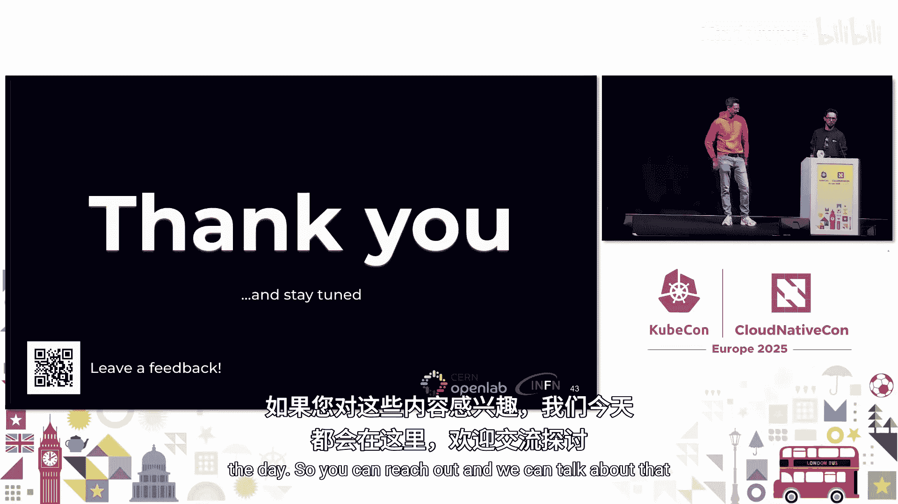