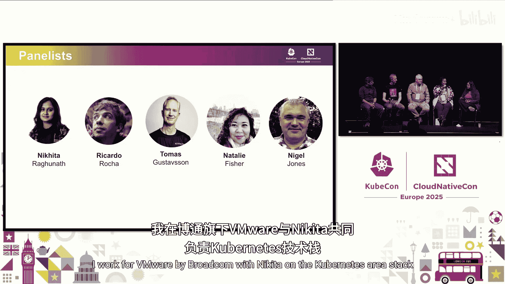
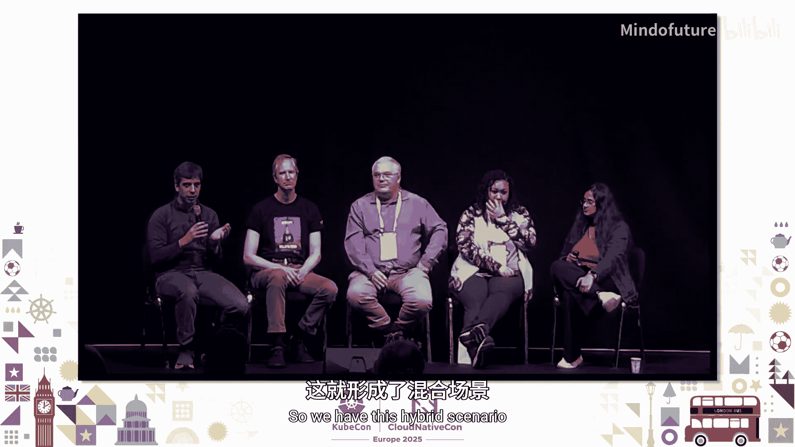
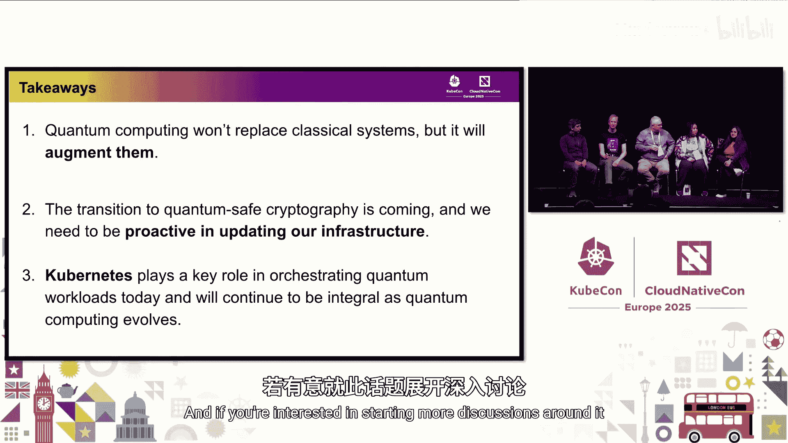

# KubeCon-+-CloudNativeCon-大会2025-｜-云原生计算-｜-可观测性-｜-Kubernetes-｜-Prometheus-p49-P49-Quantum-Ready-Kubernetes---How-Do-We-Get-There--BV1Cd32zDEBG_p49-

Hello everyone。 welcomelcom to the panel about quantum computing and Kubernetes。

 We've talked a lot about how Kubernetes is complicated。

 Now we make it even more complicated by throwing quantum computing into the mix And so most of us have heard the term quantum computing mostly as a theoretical pursuit。

 We've not really seen what the real world applications around it are and what does it really mean to run quantum workloads on Kubernetes and how we can make the Kubernetes and cloud native ecosystem quantum safe。

😊，We've talked a lot about AI then why have we've been talking about quantum now because AI is already so complicated because if we don't start talking about quantum now。

 we're going to run into trouble later on so we need to make progress while we still have time so since we're short on time we've got just got 30 minutes and I'll try to leave some time for questions let's dive right into it so we've got a wonderful set of panellistists here why don't you all going and introduce yourselves so my name is Natalie Fisher。

 I work for VM or by Brocom with Nikkiita on the Kubernetes area stack so I work as a product manager there。

Hi there everyone， I'm Nigel Jones， I work for IBM research。

 so I'm involved in post quantumum cryptography and quantum and our services there and now doing some work with AI so it's an interesting intersection to talk about today。

Yeah， and I'm Thomas Gosson， I am Chief PKI Officer at key Factor。

 and I've been working with the cybersecur and public infrastructure。

 PKI and open source for the past 30 years。Hi， I'm Ricardo。

 I lead the Pla's infrastructure team at CEN，' responsible for the teams doing cloud native deployments as well as machine learning deployments and now also starting to look at quantum computing management。

Awesome， thank you。 And as Natalie already said， I also work at Broadcom。 My name is Nikko I'm。

 a principal engineer there。 I've been involved in the Kubernetes space for a long time。😊。

Could quantum space interests me， and I thought， why not We talk more about this at Kecon。

 So let's get started。 We've talked a lot about the AI hype。

 So I just want to circle back and talk about the quantum hype when that going to happen。

So I think we're all learning about quantum computers。

 and we're still looking for real world use cases。 but these systems are developing rapidly。

 And we know that at some point， if we take cryography， for example。

 you know that some of the mathematical problems which those are based on could be attacked by quantum computers。

 but it is， it isn't just hype， there are actually services out there。

 I work for IBMware for quantum services in the cloud。

 And so it is about then making those available to people so that they can start experimenting and start learning with them。

Yeah， I can say what we are doing at CN。 So at Cern。

 we have two main initiatives around quantum computing。 Actually。

 there have been people looking at this for a few years now。

 The first one is CEN helps lead what's called the open quantum Institutes in Europe So we have a role there and this project is more about the governance and the access to this type of technology we have another effort that's called the quantum technology initiative。

 which is actually now in phase two， which means there was a phase1 before。

 So it it's already progressing。 And here it's more about the technology aspects and not only the development of the algorithms and identifying the use cases where where things can match but also ensuring that we can manage this workloads and deploy them efficiently and cost in some way cost effectiveff as well。

 So yeah， we're quite involved internally。And working in。In P eye。

Post quantum cryptography is one of the hottest topics since N standardized the first quantumum Safe algorithms in August last year。

 so it consumes a lot of our times and it's a big topic on all kind of industry focused or cybersecurity specific focused conferences。

Do I that。So one of the things that kind of got me into this particular space is we were talking about cryptographic agility so how can you quickly change cryptographic keys and it sounds like you are also working on something very similar to that one of the things that has sort of driven the projects that I was working on because I used to work in research is the US government had basically made an announcement in 2022 about having to support quantum computing。

 basically by 2035 and because the field is so nascents like everyone's kind of saying there's a lot that we don't know there's a lot that's still going on there's a lot of research that's still occurring and one of the things that's really important is try to figure out how can we get there because we're still pretty far behind there are companies such as drug companies like Pfizer that are using this to kind of test out molecules so that's like one of the more practical ways if you will of working on it and then you also have logistic opportunities as well that kind of plays in with AI workloads as well as quantum computing where they're trying to figure out best。

To identify different routes and ways to get around。So I think you all raised a really great point。

 especially around cryptography， that there's a lot of changes that we need to do。

 So can we like talk a little bit more about that。 So in say， for example。

 in this whole cloud native ecosystem or just Kubernetes to start with。

 what changes do you think will need to bring in。😊。

a lot of almost all security incubminators be it MTLS or digital signatures， JO， web tokens。

 code signing， everything relies on asymmetric cryptography， and that is， as Nigel said。

 you the algorithm orA elliptic curve dialman， those algorithms will be broken when a large enough quantum computer ceases to。

You know， the time of light and shores algorithms can be run on it。 So that's， and， of course。

 everything not only culminators， but everything in society relies on these algorithms that it means yeah。

 we have to update things or what we today think is secure will。Not be secure anymore。

I think another part of this as well is we need to understand what cryptography we're actually using。

 So getting a cryptographic inventory， you know， we've talked about S bombs for Bill of materials。

 there's a standard called C bombs， which also kind of augments that with information about your cryptography usage。

 and that needs to be， you know it's not just about what's in Kubernetes and how we build Kubernetes。

 but it's also that awareness and that usage， you know far beyond that。

 So I think understanding what you've got。Prioritizing as well。

 So we hear this you know harvest now decrypt later。

 So the idea here is we can capture traffic at the moment。

 save it and then come back to it when quantum computers are able to break it。

That involves looking at the risk it's going to be relevant。

 perhaps for your very high value data that has a long lifetime that's still going to be valuable in five。

10 years time， it may not matter for your short live data so I think understanding what you've got and then working out how you kind of prioritize is really really important you won't fix everything at once and we in the open source community have to help things again like the SBs and CBs maybe a small part of that。

Do you already see work happening in any of the projects or anywhere in the community？

So I'm actually a TSC lead for a project that's within something called the PQCA postconent Cography Association。

 We have implementations of some of these standard track algorithms like MLDSA MLKM and are working towards making sure there are high assurance so that we can start including them in stacks So there's other efforts going around in other projects open SSL。

 for example， 3。5 I think's coming out soon， so that's going to add support for some of these algorithms and we'll see that filter up through the stack so I think for all of the project maintainers working on other components it's about being aware of what's happening with those dependencies and making that available through your particular projects。

This is not to put you on the spot。But IBM is working on an open source Kissket SDK right。

 So that's pretty available as well for people to kind of look at and play with。

 but I don't know too much about it。 I don't know if you do。

 That's why I said don so yeah Kisitt is an open source toolkit for developing quantum applications。

 that it absolutely is out there。 it's been there for a while and people can take a look at it。

 that itself is open source will work with multiple backends。 but yeah I would definitely say。

 if you're interested in quantum computing。 lots of companies have education material around there。

 So I think it is something that it' good to start learning about and understanding an understanding why it's different。

 it's not that quantum computing is going to replace classical computing。

 it's actually how it augments it and how you know some of those little functions that just happen to work well on quantum can be part of our standard business processes。

Yeah， I just wanted to the one thing that I found interesting was you said。

 so there are changes that are already being made in certain projects。

 and that is thats something that we're going to see of the stack going forward。

 So from a Kubernetes or just somewhat platform engineer perspective， right？

 So when when I talk about migrating clusters to a quantumafe future， what does that really mean。

I mean， there's a couple of。a couple of things， one is modern have making sure the infrastructure is modern。

 so one prerequisite， you can say is TLS 103， I think in most commators cases it's probably modern enough。

 so TLS 103 is used， but other legacy organizations have just a huge uplift to move from TLS 102 to TLS 103。

And things like that when that after that is done， you also need to make sure you all the components are upgradable easily right you can't be stuck with legacy for years by now。

 you have to be more agile and updatetable and keep track and then it comes into the cryp agility aspects last right so projects can't hard code for RSA or E anymore it has to be configurable so it's easy to update once the。

诶。Development reaches production maturity。 So you're not stuck there either。

 You don't have to redevelop too much of the components。 So those are， I think。

 three key aspects that the community really has to step up to。

I think one point also when we talk about making use of these post quantumum algorithms within our software stacks is sometimes the key sizes may be bigger。

 the packet sizes may be bigger， in many cases you may be using hybrid schemes where you're combining traditional encryption with say elliptic curves together with quantum safefe encryption and again that can increase resource sizes and CPU maybe especially important with very small sort of transactions or very high volume。

Yeah， I mean for some applications， it won't matter at all。

 but for some applications it will may have huge impact， so we don't know until we start testing。

 so kind of starting to play around early， I think it's important。So let's switch gears a little bit。

 we've talked a lot about security and the cryptographic side of things。

 but what about running quantum workloads on Kubernetes。

 what gaps do you see right now and where are we at？Okay I can try that one。

 So the cryptography is not the main focus where I work for looking at quantum computing。

 there are clear use cases where we already have workloads that have been seeing benefits from this。

 So I'll give two examples One of them is beam calibration。 So we we have large particle accelerator。

 We have proton beams going around。 calibrating these beams is actually a very hard task。

 So people have been looking at quantum algorithms to help out with this to do this live。

 They actually validated these algorithms with a live proton beam， which is quite interesting。

 The second one is a lot of effort around quantum machine learning。 So we talked about。

What's the complication that quantum computing is bringing to to the cloud native area after AI。

 It's actually very tightly related in some of the workloads。

 So even things like the Higgs analysis that the Higgs boson。

 which is a lot of what we do is just analyzing the data coming from the detectors and trying to discover things there are quantum machine learning algorithms that will help us with this。

 they do have issues right now because of the the problem being。

The dimensionality of the problem not being adapted to the current hardware we have for quantum computers。

 And this is where things get interesting because you can do reduction of the problem using traditional machine learning algorithms and then do the second step using quantum algorithms。

 And this is the main challenge we have on the platform side I is that we have to integrate this kind of hybrid scenarios where we have more classical and and quantum workloads in the same stack。

 So this is what we are investigating from from a platform perspective is how we can have this very complex workloads how to manage them in a hybrid world which will stay there for quite a while。

There are other challenges which are more on the infrastructure side。

 which is we very likely will not have quantum computers ons site anytime soon。 So they are remote。

 So we need to integrate them in much more of HC like way where you send workloads to the cloud or remote and fetch the results and then integrate with the rest of your analysis a lot more than than the tightly coupled infrastructure you would see on a traditional data center。

I think also and the other side of that， if you like from a provider perspective。

 is that Kubernetes is critical to us when we offer quantum services through the cloud because you know the actual computation that happens on the quantum computer just a small part of that there's a lot of preprocessing。

 there's a lot of postprocessing that occurs， there's a lot of control that's involved around how you manage these systems and then there's all the usual kind of boring stuff whether it's CICD process。

 whether it's login whether it's authentication and all of that again is based on Kubernetes so Kubernetes is a critical part of making this utility available to people and I think the parallel with AI is also very good in this case because when the AI hype started a couple of years ago there was this notion of what's happening to Cloud native。

 where is AI going？But all of us that were doing cloud native for a long time。

 like there was not a lot of motivation to go and reinvent the wall stack and redo all the tools that we all rely on for several years。

 there's a strong motivation just to integrate this type of new workloads。

 maybe adapt the existing systems to accommodate properly。

 And I think the same will happen for quantum computing as well。

Not need to want to add something Oh no， no， I was just gonna say I they both kind of what said I was going to basically I was just gonna to say this similar thing。

 whereas in terms of how Kubernetes currently are acting with quantum computing and of course the A I workloads right now is it is acting as of course the orchestration component aspect of it。

 but everything right now in that space is hybrid but I think the thing that Ricardo is kind of mentioning that I thought it was really interesting is like where is it going to go from here and what does it mean when it's not hybrid。

So we talk a lot about like Qash based on quantum machine learning and such。

 So if someones herere interested in the audience about it， what should they do about it。

 like how can they， what's the next step for them if they want to。Top in。

And like quantum machine learning so I think the first the first step is to actually have a use case that can benefit machinech learning is actually a pretty good use case for quantum computing I't know if you listen to people talking about quantum computing is what was mentioned before。

 a lot of people think this will be the next generation of computing。

 This is clearly not the case that will be a hybrid world。

 So I would say the first step is to really identify a good use case。

 The second thing is that what was mentioned before。

 which is are there are toolkits that can simulate quantum computers and this is a really good step to introduce yourself and your tools to this type of workload like Kiskit is a very good example the third thing is that quantum computers are real and you can actually get access through them to them through even your public cloud providers that。

Prob already have access。 Some of them offer services in their catalog that give you access to quantum computers。

 I'm not saying it's easy then to start using them。

 That's why the integration with Kubernetes is is interesting。 There are challenges。 I'm happy to ex。

 expand a bit on some of them。 But but you can， you can do it。 it's， it's， it's real。

 It's not coming。 It's there， yeah。😊，Don't you also just discussion here， I mean。

 I think the quantum algorithms they work quite differently from what we're used to from classic computing。

 so isn't there a quite steep learning curve in order to kind of understand the actual utilities for these new machines？

Yeah， this is luckily not my job where I work。 I work on the platform side。

 but we do have the advantage of being a physics laboratory。

 so a lot of people understand this technology really， really well。

 even the theory behind it and they are pushing the boundaries this is why CEN has a lead role in things like the Open Quantum Institute and the Quantum Technology I is that we have the knowledge in of how these things can have an impact for us and potentially for other use cases as well。

 and I think the other thing in this space as well is as we learn more about these algorithms。

 more of them are developed then they themselves become offered as a service that other people can just consume and so you're doing you have a certain financial workload and look at some optimization problem you're going call out to this algorithm。

The other thing that then becomes interesting from an AI perspective is your AI model can call tools。

 Your AI model tool AI model can call these services So it itself can have access to these quantum based algorithms。

As well as then AI being used to help you develop those algorithms and write your software。

 just like you write your normal software。 So I think there's a lot of potential with AI on multiple sides of this。

That makes sense just out of curiosity So who here has played with quantum computers or just has some experience in this area or be it the cryptographic side。

 okay， just2，3，4， maybe and I get who here is interestedtrusted or maybe five。

 who here is entrusted to get into this space。😊，Okay， that's a bunch。

 So for folks who are interested， what more can they do， Like， what are the tangible things。

 For instance， when I was learning more about it， I was like， okay， this is cool， but this is。

 it looks like something。😊，That I cannot take an action upon right now。 So for instance。

 there are some maintainers of projects or people working on certain projects internally in their companies。

What should they be doing， what's the next action item for them？I was given first shot。

 I mean from a I think myself， you know when the post quantumic photographyography came along。

 have' been worked with this a long time， you know it's fun， new things。

 new algorithms applied in similar ways， but it's a lot of fun so you can have a lot of fun with this。

AndBut， yeah， if you have to， you know， learn how the， what the new algorithms are， how they work。

 how you apply them。 So there's a lot of things you can study up on them。 you know。

 how will the new hybrid key exchange work in in T L S， for example， and then。Well。

Crypt agility as well， there has been a lot depend regardless of which industry you're work in。

 be it financial or government or whatever now there's a huge flurry of new white papers coming out。

 how to apply cryptgility it just came out a couple of weeks ago and from NIST which is a real good almost educational。

 what are the things you have to think about when it comes to cryppt agility。

 if you're developing stuff， if you're deploying stuff in your platform。

 what are different aspects you have to consider， so there's great lot of good material out there to read up on。

Yeah I echo that。 I think there's a lot of material out there。

 whether it's on the cryptography side or whether it's on the quantum computing side。

 And I guess one thing for anyone who's new to an area is it is， I mean。

 I know this is a maintain on projects right It's such a great thing when new people come along and have new ideas or say why is this so complicated or why is this documentation poor and that's where new contributors。

 I think are just so immensely valuable。 you think you come along to a topic area and you don't know a thing。

 but actually you're bringing in that extra insight and then helping to spread the word more broadly。

 So I think I would encourage people to try and get involved。😊，I I would also add。

 this is a very new area。 I will give an example of how early it is。 There are concrete uses。

 but it's quite early。 So for example， we started procuring for access to quantum computers because there are few around the world there is no standard to define how you measure the workloads or how you cost or you do the costing of the workloads。

 now to procure resources， when you don't know how to actually define the cost of what you're using is really。

 really hard。 and this is where not only this area needs quantum computing experts and IT experts。

 it needs all sorts of people， it needs the business people to actually start making something more concrete from this services it's really funny when you when you start looking into it。

 how different each quantum computer is is defined。How you submit a workload。

 how you measure the efficiency， how you， you can actually ask for access and time。

 So it's quite early， which makes it really interesting in all sorts of areas。

 So even if you're not like a quantum expert， there， there's a lot to contribute to。

So there's a lot of resources it looks like。So while I was putting together this panel。

 I probably try to keep this as the last question and have some have some life for audience questions。

 So while we were putting this panel together， there was one more paneldaists whos going to join us Paul from IBM。

 So when we were discussing about this， we realized that there really isn't a space in the CNNC of community where we can forum where we can talk about this。

 So Ricardo， I'm going to put you on the spot。 You are in the TOC， the tab， where is this forum now。

😊，What should we do。Yeah， I think it's good to look I think there are two areas。

 one is to look at what we did with AI。 there was a lot of demand to have cloud native infrastructure evolve to accommodate AI and this needs two parts one is to do the governance of all this project and to integrate in the ecosystem so I think that that roles belongs a lot in what we have in the technical oversight committee so we created this AI working group that has a lot of the people doing the work getting together frequently they published a white paper that kind of defines the state of the ecosystem and gives some direction so where we should go the other part is the technical more technical evolution of the platform and we learn from AI that Kubernetes actually is extremely flexible in accommodating workloads that are not just manage。

nodes or containers。 It became an orchestrator for a bunch of stuff。

 And this is the area where we can learn a lot from what we did for AI or HPPC。

 all the new scheduling primitives， all the evolution we did in this part。

 This is essential to accommodate new things like quantum computing。

 And the fact that we were successful doing this for AI really gives a lot of optimism that we'll be able to do the same for。

 for， for this new era as well。😊，Nural do you want to talk with the PQ see。The PQC PQC yeah so again。

 as I said， there is some work going on in something called the Postconum Cptography Association that's around curating some of the work in this space。

 it's part of the Linux Foundation it's not part of CNCF and I think you know all groups like PCA and CNCF need to work closer together on this and also other groups like this Open SSF of course as well when we look into the code analysislysis Yeah we had a workshop on Monday at the Mainers sumummit about what we call the Tag reboot the tag is the technical advisory groups in the CNCF and we propose to have more flexible way of starting initiatives So I think launching whoever is interested in this area we should push the launch an initiative to start getting people and discussing more closely to not only have like a panel during Cookcon but have this going steadily during the year as well。

Yep， so if anyone's interested， please find Ricardo after the session and。

Maybe we can spin something up。So to summarize the key takeaways， right， and to simplify it really。

I see mainly three takeaways。 One is that quantum computing isn't going to replace the classical systems。

 but in fact it's going to augment them。 The second one we've talked a lot about cryptography so there is a huge transition that is coming to quantumafe cryptography that's a ton of work that we need to do and we need to start right away and like like how we talked about AI Kubernetes is going to play an integral role in quantum workloads and we need to start looking at filling those gaps and doing all the work behind them So with that let's let's end the panel here but we'll open up for questions from the audience there's a microphone with a stand over there if anyone's interested。

So we saw five hands raised before， so come forward and ask questions。Okay， so I guess no questions。

 So you get some time back。 But if anyone's interest， oh， I see， I see a few questions over there。

 okay。Hi this is mainly for Ricardo， but can I open to everyone。

 You mentioned some of the challenges you faced when integrating quantum workloads with Kubernetes。

 I've be interested to hear a bit more about these。Right， so the challenges are still there。

 I'm not gonna to claim that we sorted。 But I think the summary is that we have this。The workloads。

 the quantum workloads integrate with with the classical workloads。

 So we have this hybrid scenario where we need to delegate a part of the analysis or the process to quantum computers fetch the data back。

 the results back and continue the fact that this infrastructure is not where the rest of the infrastructure is poses a problem on itself。

 So it's the same issue we discuss constantly in the community about multic or hybrid deployments。

 This challenge is even more visible in quantum computers。

 because the interfaces are not necessarily what we expect。

 And this is where I think if the providers of these quantum computers start offering the As that we expect。

 It benefits a lot to everyone。 The second one is what I mentioned before is that we when we want to procure or access this quantum computers。

 The way we define the workloads is very。

VeryDifferent between the different devices we have access to。

 There is no standard across for defining units of computation across the different quantum computers。

 This is also a challenge。 And the last one is that a lot of the algorithms are also suited to specific devices So there's a lot less because of the lack of standardization。

 Some of the workloads are fitted to a specific type of quantum computer， or specific implementation。

 which also poses quite a lot of。Like challenges not only in in orchestrating these things。

 but also making sure we have time available in that specific device。 And this is， I don't know。

 we all have this issue with AI currently with the lack of disc scarsity of GPus。

 it's much worse in terms of quantum computers。 Like if you have a lot of people interested。

 There are not， not a lot of devices available to actually move forward。 So yeah。

 I would say this is。What we what I currently face， I'm sure if you go up up the stack。

 people are facing other challenges as well。Thank you very much。

Hi thank you for the panel that was really great so in February Microsoft unveiled to do a major 101 quantum processing unit so my question is a little bit more about ethicality and is there any consideration about ethicality to releasing them to sort of wider audience before they start you know breaking cryptography you know on a wider scale thank you。

😊，That is a hard question。😊，How do we answer that？The ethics， the ethics。嗯。

I guess it's like any service go。 Yeah， I mean， it's security has。

Been having this kind of history a long time come with Cs and the exploits and things like that。

Probably when it comes to， you know， when finally a cryptographic a relevant quantum computer comes along。

 well it might not be from an ethical hacking group or an ethical organization who knows， so I what。

Hopefully it's going to be very gradually and obvious when it happens， so it doesn't。

 you know one of the kind of joking things is how do you know a cryptographic relevant quantum computer is there。

 well that's when all Bitcoin are gone or all your Bitcoins are stolen。

Right but well hope it doesn't come to us。 So I yeah。

 definitely the organizations like IBM though who builds these things。Probably thinks。

Along these lines not going to throw out something that does it easily and it's going to be expensive as hell and I think this also goes back to that point by prioritization and what is your high value data and focus in on knowing what cryography you use what the impact of that is。

 deciding where you need to put those protections in place now don't try and fix everything but focus on that priority because we may not know when it happens until afterwards。

Thank you very much。I think we're at time。If you have more questions。

 please find us near this stage and if you're interested。And starting more discussions around it。

 Also， please try us here the stage。 Allright， thank you， everyone。

