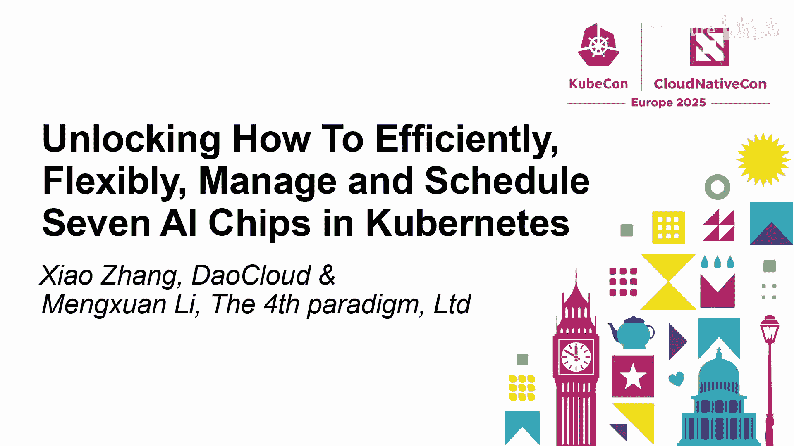
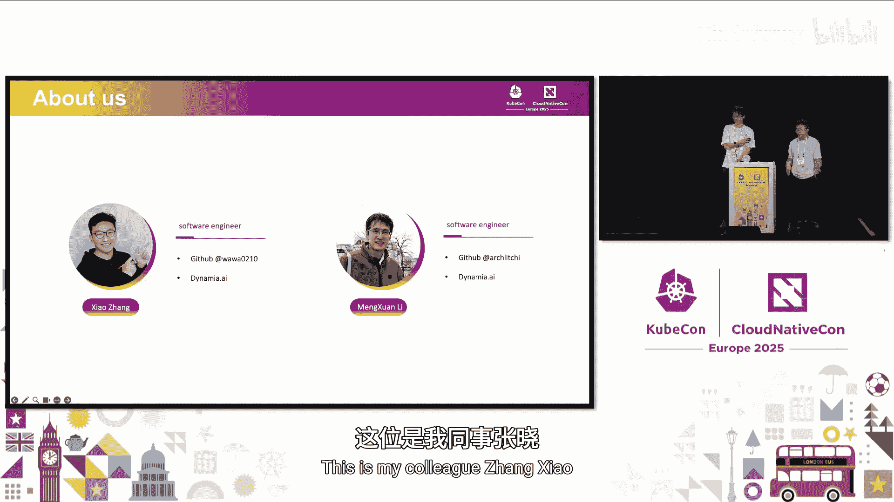
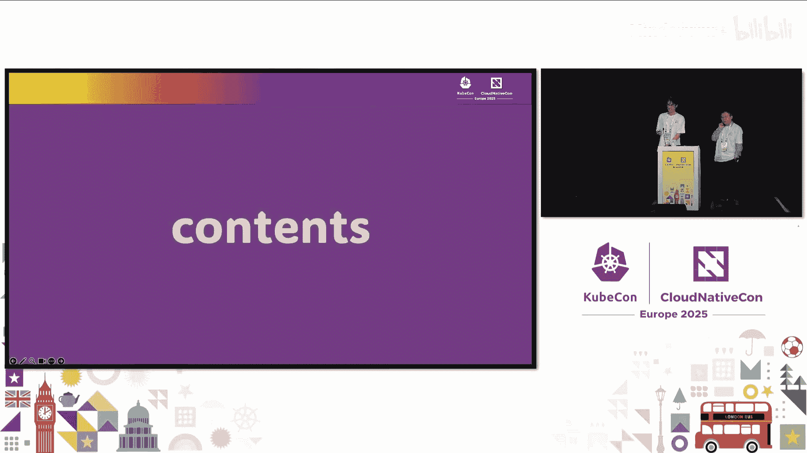
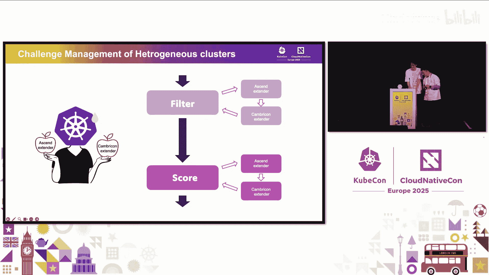

# KubeCon-+-CloudNativeCon-大会2025-｜-云原生计算-｜-可观测性-｜-Kubernetes-｜-Prometheus-p50-P50-Unlocking-How-To-Efficiently,-Flexibly,-Manage-and-Schedule-Seven-AI-Chi...--BV1Cd32zDEBG_p50-

Hello， everyone。Welcome to our session。And and this session is about unlocking how to efficiently feibility and manage the 7 AI chips in Kubernetes。

 Its a rather abstract title。 but in one， in one sentence。

 it can be sound like how to improve your GPU utilization in Kubernetes。Yes。

This session is brought is， is brought to you by two software engineers。 My name is Li Mug Xan。

 This is my colleague， Zhang Xiao。 We are both from a new funded company called Dyna Point AI。

And here are the。Let me， let me first introduce to you a background。

The first background is the best requirement for computing power。

 The global GPU marketing growth is over 60 percent60% than last year。

 The majority is majority growth is Nvidia， and the heterogeneous is over 20%， as you can see in。

In this figure， it has been rather boost after the emergence of large language models。

And you may guess we are from the mainland China。 So， so in our country。

 the high spec N video can't can can't be imported very easily。

 So we have to use alternative cards like this device vendors。 They are。

 they are all some alternative plan for N video cards。 and of course。

 they are not as high spec as Nvidia and the user user experiences may not be as good as Nvidia。

 but they。But but it is very cheap。 So it， so we can use them in the production level as well。

 And it， it has a deep decent performance。Yes， but we hear we meet a challenge is that the GPU can't be shared in the traditional Kubernetes。

 supposeose you have5 GPUs each with the capacity of 4040 g device memory。

 and it is all running a2 g little mode， small model。

 and it will cause the all the device be not not be able to fit more ports other than this one。

 So the other port which uses GPU are in a pending state。

 which cause the utilization ofU in the cluster is very low。😊。

And another challenge is the management of heterogeneous clusters。 As you can see。

 there are multiple device vendors in China， and many of them implement implement their own schedule extender。

 and it hija the filter。 hijack the score process。 And you and you have and if you have a cluster composed of multiple AI cards。

 then you have to install their schedule extenders and you have a more scheduling pipeline。

 and if you enter the filter， you have first go through the multiple extenders and go back to the filter。

 and then into the score process， you， you still need to go through all the extenders and return to the score。

 this will cause the performance of the Kubernetes scheduling is very poor。

 that's a problem needs to solve。😊，And one kind of solution is D。

 This is called dynamic resource allocation。 It is an API for requesting and sharing resources between port and consumers inside of port。

 It is stable in 1 point32 version in Kubernetes。 and it is and you need to set a resource claim and resource class and every device vendor need to implement their own resource D driver and it communicate with Kubnet to do the device sharing and scheduling and allocating。

But it has many restrictions。 The first is has it， it requires the Kubernetes version must be the latest。

 It means 1，32 divide Kubernetes， and it has to。And it has happens to me that not many device vendors implement DI driver。

 For now， the N VR DI driver is under construction and and it's not production level ready。

 So you have to maybe use， use this feature in the in the future for it in terms of production environment。

And also， it needs to create resource claim and resource class。 If you you， if want to。

 if you want to share the GPUs inside the Kubernetes， you have to configure this whole。

 you need to use the resource claims here， which is defined here。

 and the corresponding resource class defined here。 It all it it has。

It has all be need to be applied in Kubernetes。 Yes。

 and still this this feature is not enabled automatically。 You need to enable it explicitly。

And another solution is what， what we brought here is called Ham。

 Ham is a heterogeneous AI computing virtualization middleware。 It is。

It is used to provide GPU sharing and manage multi multiple multi heterogeneous AI computing devices from multiple device vendors。

 It composed of a notating web hook scheduling extender and corresponding corresponding device from for each of the device vendors。

 and we have an additionally an in container resource control for each of this device。 Yes。

 and it is very it is a plug non intrusive standard and light。

 which means you can help install and hel on installst very easily。 and it is a CF sandbox project。😊。

And the key feature of is the device share。 advancedanced scheduling and unified monitoring。

 device share is our key feature。 Let's show here。 If you have a node composed of four g and you have two users each of them submit a task which uses two GU without。

 you need to you have to use four of them all and over utilization is less than 50% and with。

 it can be observed that this two task can be shared on two GPs and leave the rest to four other task to use So it can improve the GPU utilization to nearly 100。

 Yes， and it is and it is transparent task you don't need to modify the task。

 You don't need to modify the image or the source code or anything just specify the device member you need to use is okay。

And the this is the device here inside。 This is how we control the device limit inside the container。

 We inject a library called inside this invocation line。

 It hijas calls from the k run time to ka driver。 So we so we can do the count here。

 we know how exactly are the device memory allocation inside each of the container。

 If it passed the limitation you set in this you inside this task。 It will return an O M error。 Yes。

 it applies to wider range of video and Kubernetes。

 The only the only requirement is your quoa version is greater than 10。

2 and the video driver version is greater than 440， yes。And this is how we use。

 You simply need to specify the number of GPU you wish to see in this container and。

 and along with the GPU memory you wish to cut for this container。 in this example。

 said this task needs two and each use 10 device memory and schedule that and it will cut the 10 device memory for this task and the other 22 for for other task to share and we provide the in container resource control you can see thevi S inside。

 the upper limit of device memory is limited to 10 device10 Yes。

 you can't use beyond that is according to this we guarantee that the upper limit is contained in this container。

Yes， and other features include that we can support the device specify。

 You can specify the type of GPU you wish to use if， if you want to only want to use a 100。

 then you can set the annotation of task here with the use GPU type annotation， which means。

If it assign to a 100， then you can only be applied to a 100 cards。

 or you can avoid be apply be applied to a 100 by sideface blacklist。 No use CPU type here。

And we have another feature called task priority， the。The method to use it is very easy。

 You simply specify an environment variable here called cota task priority。 For now。

 we support two types of priority，0 is the high priority， and one is the low priority。

 The difference is that as long as the high priority pod is submitting kernel to the certain GPU。

 the low priority po will be will be temporarily suspended and wait for this long high priority pod to stop submitting new kernels to GPU。

 and the low priority po will be resumed running。 It is all transparent to the task。

 and it is very automatically yes。And we also support dynamic make feature。

 you can use it like the examples。 in this page。 You simply need to specify the number of GPU you wish to use along with the device memory you wish to allocate you said the number and memory here and we will search according to the templates here。

 and we will find the most fitting make instance for you for you to use。

 and we use make video make part to dynamically generate the make instance for certain card。

 So the users doesn't need to really know the make instance name like one1 B because it is different for different different types of video card。

 The user only need to concern how many it wishes to use inside container along with the device memory it wishes to use and leave the rest for us。

 yes。And we can apply this device memory control to other devices other than Nvidia like accent。 Yes。

 this is a Huawei manufacturer AI chips。 Yes， it it is 64 G B in total。 and in this example。

 we limited to 16 g and it it you you can see here it has been limited。

 and it it also apply to inverta and Caman devices just like Huawei and Nvidia。Yes。

 and this is other sched features we we introduces like the newman and topology aware。

 If you want to allocate more than1 GP like you want to deploy an AI training job across multiple nodes and multiple g。

 wish to they probably wish to minimize communication communication cost between multiple。

 And for that reason， we can observe the topology inside between each Gus along with the network topology。

 So by doing that， we can allocate the nearest GP for for this AI training job to minimize communication cost。

 Yes， it has been applied to accent and this。Deevice， yes。

And we have another bin and spread schedule policy。 It is it is for each task。

 each taskr can specify their own schedule policy。 the means it it wishes to to GPU which has already have the task running on that GP to minimize fragmentation caused by GP share and the spread is on the contrary。

 wishes to to GPU where no pause is running on that GPU to maximize the performance。

 So each port may have their own request to it may have their own schedule policy to best their。 Yes。

 we provide the spread schedule policy for GP GP level and node level yes。

And we after we introduce the GPU sharing， there are many things you need to monitor other than the DCGM exporter matrix used by used you by the DCGM exporter。

 like how many device memory has been allocated for a certain GPU。

 How many device memory are still free， still available for other task to use and how many workloads are running on that GP and how many workloads and their corresponding port name content name and etca。

 They are all content in this form of matrix porter。

 which can be easily integrated into the premises and later be demonstrated by the graph dashboard。

 yes。And the volcano V GPPO is supported by。 If you， if you use volcano， if you go go。

 go to their project their their slice has has pages about the volcano VGP。

 which is contributed by us。 The community is responsible for the in container resource control and leave the rest scheduling process for the volcano scheduler。

 You can easily find their the volcano VPO document on the volcano VP project on the volcano project。

And it it's the same about the coordinator。 We also integrated GPU sharing GPU sharing mechanism into the coordinator。

 You can find their document in on， on their website， yes。

O allow me to pass my phone to the to my colleague to introduce the adopters。

 the road maps and the other the summary。 Yeses你直接说了。Hello hello能听OThank you。

 X to introduce architecture and the GPU sharing and the advanced schedule。

 Let me introduce ecosystem and the adopters。From now on。

 support in addition to in will also support such as theula and and the more and matrix the other sex AI chips also we want to support more AI chips。

 from the the AI chips were the the key O S operator system also support the to build in the AI system and in China and around the world。

 many vendors also building to their product such as the do cloud and the silicon cloud and the U cloud。

 the cloud is the China biggest the natural cloud provider。

And some virtual users also use to solve the GPU utilization。

 Their situation is the GPU utilization very small such as the the slow。

 the South carroll company and use to。combinebine train and influence in their production situation and such as the the the。

The， the travel company and some key users such as the P security and the the S CBBC。

 also some the bank and business company also use to in to maximum the GPU utilizationization and unified management the heterogeneous air chips。

 So from now on， we have nearly 100 and user from the around the world。Okay， so this year。

 this year also becomes the NSafe sandbox， but we also have a clean roadm in the 2025 Firstly。

 we will support more the heterogeneous AI chips such as the Kun。

 and we also want to support the M D inter or the A W S。 So any， any any any helps we。

 we will welcome。And furthermore， we also want to support the D R。 But it's。

 it's more challenging how to have a compatible way to integrate with D R A and the。

 because many users use to their production environment。 but but from now。

 and more many air chips company have done the D R A implement。 So also we。

 we will create a web U I for easy to use and。Maybe in the end of the year。

 we will propose to the incubating project。 So， yeah。And the dynamic M S for in。And if。

 if you want to join us， we will very， very welcome。Yeah， this is Arrsen and the Github。

 Github rapple， yeah。嗯，we we all finish our talk。Any questions welcome。没有问题。😔，O， any questions。他。ok。

OK。OK好。Yes。呃。The biggest challenge has is that the communication。 we can't reach it to the AMD。 Yes。

 that's the biggest。 If we have the， we， if we can reach AMD， I think this can be easily implemented。

 yes。没。Yeah， we we， we want to keep in touch with the AMMD open source strategy or the software department。

 but it's difficult to us。OK。Could you， could you say a bit more about how you do this scheduling。

 maybe So how things like pod migration or， you know。

 what happens if a node goes down that a pod is running on these kind of questions。Okay。

 the scheduling part is we implemented our。这这这个。微信陪门门淘玩 own。Schedule extender here。

 and the hammock is composed of a mutating web hook schedule extender。 And we do the scheduling here。

 We， we implement the。The filterter and。The filter and score process。 Yes。

 we and we do the additional GPU filtering and GP node scoring here in the schedule extender。 Yeah。

 so is it the regular as in。Plugging framework， or is it a completely separate schedule。

It is a schedule extender。 It's not a schedule framework because if you。

 if we adopt the architect of the schedule framework。

 you have to compare every every kubernetes schedule version from one from1 16 to 1，32。

 It is difficult for open source project like us。 So we use the schedule extender to to for。

 for using that。 it can be easily inserted in into every schedule version from1，16 to1，32。 Yes。O。

 other questions。O。Have a nice day。 Bye bye。 Have a nice day， yeah。

