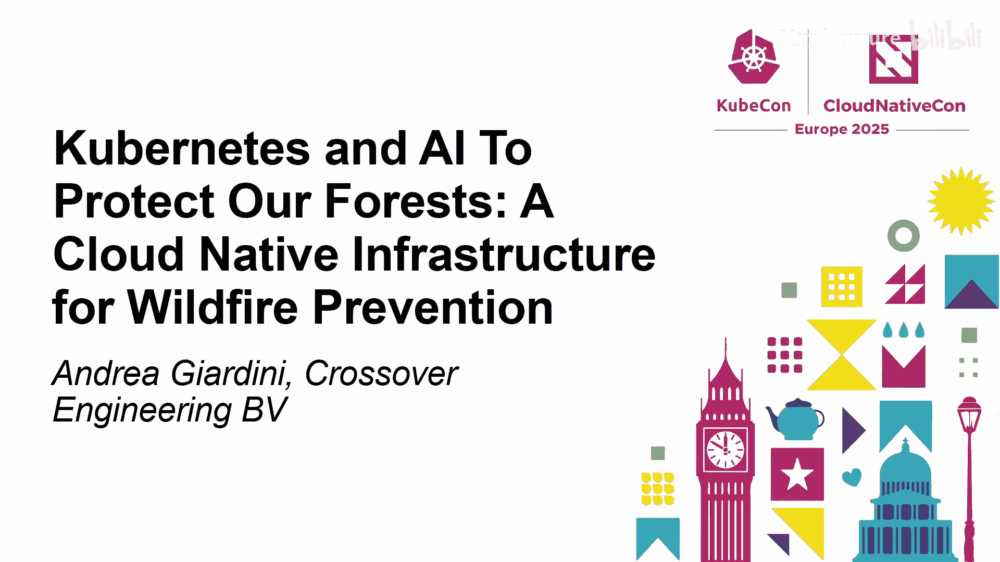
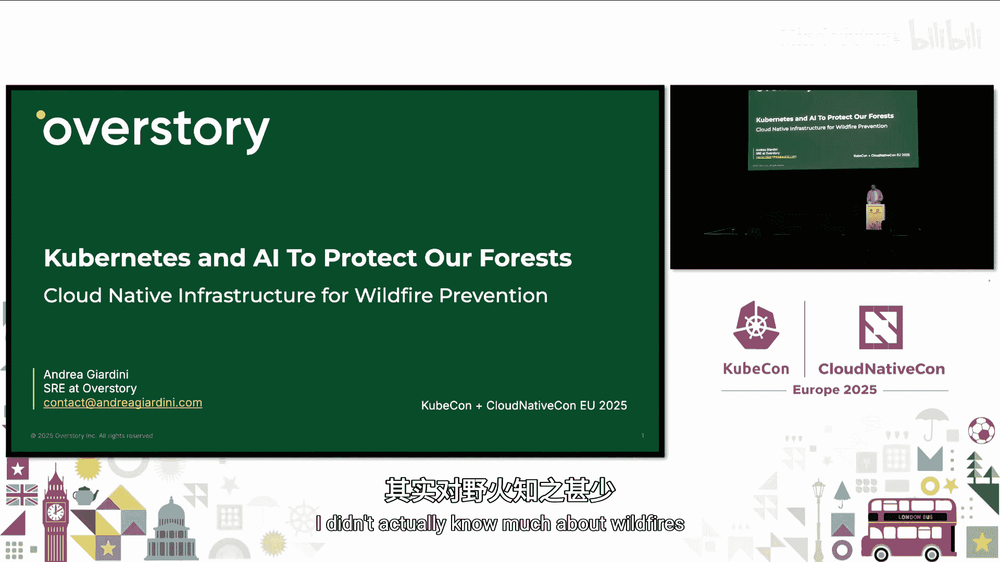
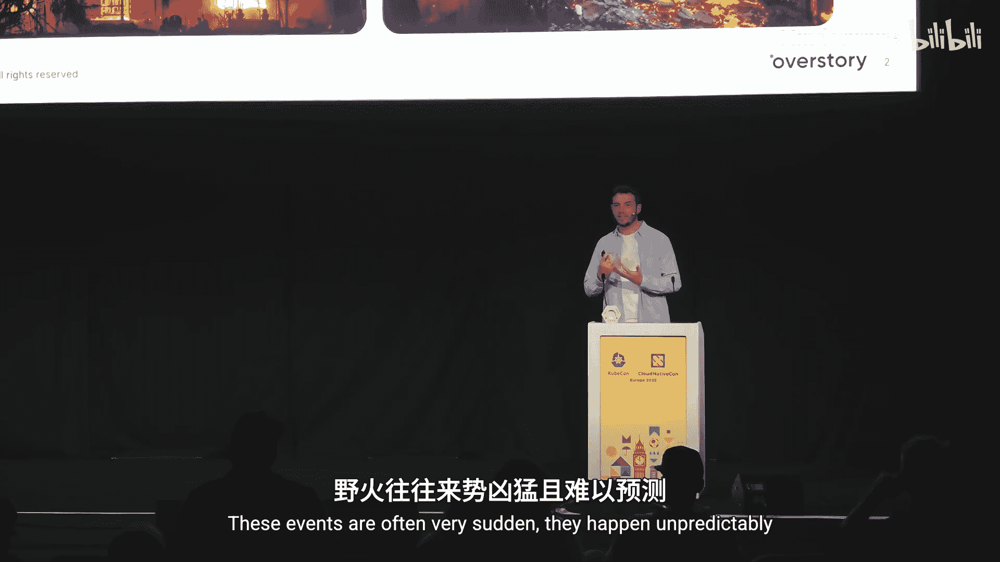
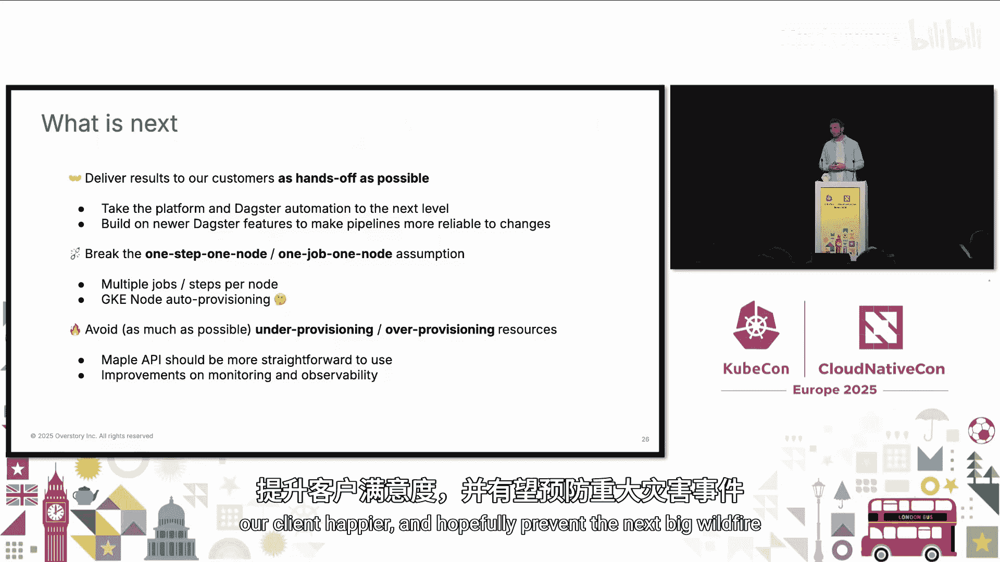
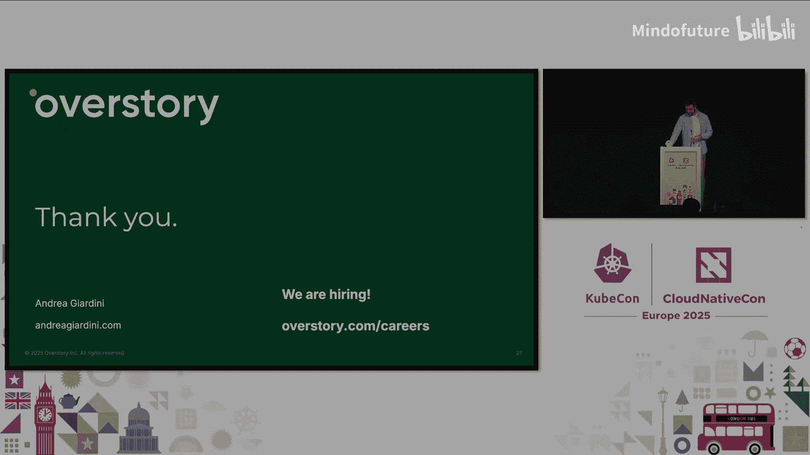

# KubeCon-+-CloudNativeCon-大会2025-｜-云原生计算-｜-可观测性-｜-Kubernetes-｜-Prometheus-p51-P51-Kubernetes-and-AI-To-Protect-Our-Forests---A-Cloud-Native-Infrastructure-for--BV1Cd32zDEBG_p51-

Good afternoon。 Thank you very much for coming to my session today。

 I know it's one of the last session of Corn It' Friday。 We're all tired and everything。 But。

 you know， if you're here， you probably want to know something。

 or at least you're curious about how we do wildfire prevention with Kubernetes and AI。

 My name is Andrera Jordanardini。 I'm a sense of ambassador。 I work as an S E for overstory。

 And my free time。 I also organize community events and yeah， community conferences around Europe。😊。

The title of my talk is Kubernetes and AI to protect our forest。

 a cloud native infrastructure for wildfire prevention。Like me。

 a couple of years ago before I started working for our story， I didn't actually know much。

About wildfires。Wilfires are invented that in Europe are a little bit more rare compared to the US just for because of the density because of the geography of the US territory。

 But their events are extremely destructive for people's lives， community， building。

 businesses and so on。These events are often very sudden。 They happen unpredictably。

 and they bring a lot of distraction to our， to our people。

Just to give an idea just a couple of months ago， I'm sure you're aware。

 I'm sure you're following the news。A big wildfire spread out in Southern California。

 This was the second biggest wildfire that happened in California。 Over 29 people died。

 Over 200000 people got evacuated。18000 homesms destroyed， and over 57000 acres of land burned down。

😔，Just to give you an idea of what 57000 acres of land means。

 this is the area that would have burned in London that represents 57000 acres。

 And this one's not even the largest wildfire that happened in California， the 2018 campfire。

was spread over an era that was almost three times as large，153000 acres。

Another thing that I didn't know about wildfire is that in California， specifically。

 over 60% of the most destructive wildfires have been caused by defective power lines。

I know it sounds curious。 I know that we expect， you know， fire to be， you know。

 wildfires to be caused by， you know， humans most of the time， just， you know。

 a cigarette that is not turned down correctly or things like this。

 But power lines are actually a big responsible of this kind of wildfire， especially in California。

And wildfire prevention is not an easy task for a multitude of reason。The first one。

In respect to power lines， is that the power infrastructure is very vast。It takes a lot of space。

 It's very complex。 It has a big number of different substation。

 And the infrastructure is just really， really big to handle and to maintain。

 And if you think about it， power lines are bringing us electricity 365 days a year。

 So it's the kind of infrastructure it needs to be， you know。

 as close as possible as a2 100% up time。The second cause， why wildfire prevention is important。

 but iss also difficult at the same time， is that failures are always sudden and catastrophic。

You might have heard that just a couple of weeks ago。

 a power substation near the Efro airport failed， and that caused the whole Erop airport to be shut down for over 24 hours。

1 over 1000 flights got disrupted， Over 300000 passengers got affected。

 And this was just a small power substation。 You see how the impact of this can be sudden and catastrophic and can cause all of disruption。

Finally。If you think about it。Much of these infrastructure。

 much of these power lines and network are always subject to atmospheric agent so they can get damaged by all kind of things。

 Let it be vegetation or a storm tenders and so on。 Ining them， is's also not easy。 very often。

 those power lines， they cross， for example， private properties。

 So if we want to go and inspect them visually。 We need to ask permission for these people to go in their private property and inspect their power lines。

 This is extremely time consuming and extremely costly for power utility companies。

And this is why our story has started to think。In a different approach， what if instead of。

 instead of going and inspecting those power line visually。

 what if we do it through satellite images， specifically very high resolution satellite imagery and machine learning so that we can get insights from the sky pretty much on how our infrastructure is doing if it needs maintenance。

 if there is a damaged line， for example。We do that with a simple process。 Well， simple。

 It will be simple because I've explain to you in these three different steps。 But actually。

 the whole process is a lot more complicated。 The idea is， first of all。

 that we get vegetation data from different sources。 Some of those are satellite images。

 Some of those are ideal images。 So we have providers that we query and they give us higher resolution satellite images。

 Think that the highest resolution that we use is 15 cm。

Then we combine this data with information that we get from the energy provider。

 So they give us all the coordinates of the poles， the lines and the kind of territory。

 where the infrastructure is standing on and so on。And basically。

 what we do is that we combine these two different types of data to create a map， a risk map。

So that the utility company can go and see where there is an elevated risk of wildfire。

 The idea is that whenever the vegetation gets too close to the power lines。

 there is an elevated risk of wildfire。 And in this case。

 the provider can go entering trim the vegetation before a wildfire spreads out。

So we make it easy for those utilities to look at the map。

 to look at our product and the results of our scan and basically understand where they need to go and act faster in order to prevent the next wildfire。

But how are we doing that， and how are we doing that using Kubernetes and cloud native solutions。

Before we move in what we currently have right now。

 I want to take a step back and think about how we got started。We are a startup。

 When I joined our story， we were around 20 people。 right now， we're over 100。When we got started。

 we need to break things and move fast and move fast。 This is， you know。

 what lot of people say about startup。 We need to figure out things you know， on。

 right on the ground。So when we started， we actually had a stack that was extremely simple。

 We just used Kubernetes because it was providing us the right balance between flexibility and stability。

 You can think that our water plot can take anything from 1 CPU and 4 gigs of memory to 72 CPUs and alpha TB of memory。

😊，And stability。 So we had that with Kubernetes。And most of our processing was happening with Jupiter Hub。

 I'm sure you're familiar already with Jupiter notebooks。

 Jupiter Hub is just a tool that allows you to create different Jupyter notebooks using different types of resources。

 And in the beginning， that was all we had。We started with this。

 and everything was a Jupyter notebook。 So we would create all our processing pipelines。

 We would create all our data analysis in Jupiter notebook。

 We built some custom integration to it so that people could go and select the container image that they wanted to spin。

 Select the machine where they wanted to run it。 And basically。

 they would have the possibility of running their Jupyter notebook on a machine。

 which know much higher power compared to their laptop。

 eventually a bigger GPU or a large amount of memory or CPU。

So that the scientists could just go on this platform， select the machine that they wanted。

 select the image that they wanted and run the experiment in a Jupiter notebook。As you can imagine。

 Jupiter notebooks are great for experimenting。But this became an nightmare pretty early。

 Reputability and tracking in particular， was extremely difficult。

 And as we have to repeat these kinds over time， every time we had these kind of messages all over slack。

 Ay， do you remember which version of pandas we used a year ago， The new one breaks everything。

And the whole process in general was just very manual。 It was really。

 we always needed to assign a data scientist to with every delivery that we were doing for a client。

 And is there a scientist would have to go through the Jupyter notebook step by step。

 fix the problem that they would encounter on the way。

 and pretty much deliver the results to the final client。

 It was a very one to one binding one request from the client， one data scientist assigned to it。

So after a while， it was just time to automate and move forward。We。

Set to ourselves two main objectives。 The first one， getting rid of Jupiter notebook。

 We tried different combination of things。 We tried using a tool called N B dev that allows you to take your Jupyter notebook and convert it into a Python package。

 We were not very successful with that。 I have to say。In general。

 what we experienced at Jupiter notebook are difficult to maintain， difficult to test。

 and tracking with Git was very complicated。If you don't know about it。

 the Jupiter notebook is pretty much a giant Json file。

 So you can imagine what that means whenever you need to track that in Gi。And the second。

 probably the most important objective was that we wanted to automate those water flow runss。

 We wanted to break this relationship between the number of data scientists we have and the number of projects that we were running。

 So we needed for a data and water flow orchestrator。In here。

 we stumbled upon a warflow Cacio called Dexter。 This is a project I'm a fan of being contributed to the open source project for quite some time。

 We started using it since version 0。 something。 and now there are like 1。10。

I personally like Dxter because first of all it's an open source project is backed by a company in the US with their own cloud offering。

 but weve been using their open source version very successfully。

 It gave us immediately a couple of things that we like。 First first of all， fast development。

 If you have experience with data and workflow later。

 you know that just understanding what is the right way of setting up your python project can be a pain。

 Dxter makes it very easy。 Dxter scaffold project name。

 and you get the project structure out of the box with all the best use cases from their maintainers。

It was very easy to test locally。 It was very easy to get started really， really fast。

 It all works with Python modules， which our data scientists and data engineers like。

And this is something that where I'm a little bit biased as a cloud engineer。 It's very cloud native。

 You can really see that people built this tool with cloud native in mind。

So what we do over our story is that we run Dxter in our Kubernetes cluster and the setup。

 if you look at this slide， it's a classical microservice architecture setup。

 So our user that you can see on the right side of the slide， accesses the web interface of Dagter。

 which is called daggit。You know， as a normal web application。Basically。

 what they get is an overview of the system， which pipelines are failing。

 which pipelines are successful， which pipelines need attention。

Then there is another component called the Dstar demon。

 which takes care of running the pipelines based on a certain schedule or on certain condition and monitor pipelines while they're running so that if there is a step that needs to be re。

 it gets reed。 And if the pipeline fails， it notifies the final user。 And all of this。

 all of these boxes that you see， they are all deployments。 All this。

 they are all stateless application。And then you can see in the lower part of this slide。

 a set of boxes that I call the deployment。 Dexter calls them code locations。 Basically。

 each one of those is a GRPC server is a GRPC server that exposes basically advertised to the Dxter demo and the Web interface。

 which pipelines are present in that code location， which schedules， sensor assets and so on。

So each one of those deployments is independent， meaning that each thing that we have inside of our story is responsible for one of the or more of these code locations。

 and they can do whatever they want with them。 They can create a new pipeline， remove it， edit it。

 modify， a so on， so on。And the big advantage here is that whenever a team breaks one of these deployment。

 all the other deployments are not affected。 We， there is very high isolation between them。

 And that's extremely important as the company started to grow up。

When I said before that Dxter is really something that has been built with cloud native in mind。

 I wanted to bring you a couple of examples， as well。

One of the feature that I like the most about Dxter。

 And that's something where I had experience with other tools and had a lot of trouble with other tools is the idea behind I O managers。

In other tools， whenever you need to build a pipeline that needs to run locally and in the cloud。

 I always find it a little bit complicated。 Very often you need to put some logic in the code that you've read that says。

 if I'm running in the cloud， I want my data to be saved in S3。 If I'm running it locally。

 I want my data to be saved locally。 You don't need to do that with Dxter Dxter framework thats this for you。

 So you can focus on the logic of your data of your application of your workflow in your python code。

 and Dxter abstracts all the rest。In this way， the project stay the same。 The code stays the same。

 but simply based on the environment， If Dxter is running in Kubernetes。

 it will save its output in as free on Google Cloud storage。 If it's running locally。

 it will run on your Dxter demer and save the file locally， which is a really neat feature。

 because it allows us to really， you know， have a clear cut between the data part of things and the implementation part。

😊，Another task that Dxter does really well。Is that in the age of cloud。

 data has many different forms。Right， when we talk about data processing in the past。

 usually you had a database， a couple of files here and there。

 the data that you were processing was more or less uniform。 But now we live in the cloud， right。

 data can be a big query table can be a plus req database or your snowflake data store or a file on G C S。

 Data can have a lot of different formats and tools very often， they focus on how data is built No。

 not on how data is connected with each other。It is more and more difficult with with other tools to understand what is the relationship between between my Postgrelql database table and my big query table。

 And that's because the tool focuses on how data is built， not on how it's connected。

A really neat concept that Dxter introduced on top of the usual jobs and pipelines and step is the idea behind assets。

An asset in Dexter can be anything can be any data， any type of data。 Again， a big query table。

 It can be an asset。 A database can be an asset。 A file can be an asset。

And what Dxter is very good at is making explicit where the connection between those is。

 which assets depends on each other and so on。In here， I just put a couple of example。

 I pulled them from their documentation。 You can see very clearly that there are two abite ingestion pipelines that then gets processed with you know。

 three different DBT projects。 And finally， I'm running my forecast using Python。 simple。

 easy to visualize。 I know where the data is going。 I know where how the data depends on each other。

 Another example here on the right side。 Ingestion is done using fivet。

 and then using DBT to modify the data。 And finally。

 I am predicting the new order using my tensor flow model。

 It's easy to understand how the data flows through the system。

 because we're focusing on how data is related。 not on how data is built。As I mentioned， in Dexter。

 they don't want you to go all in on this approach。 It's a cause kind of opttne situation。

 You can even mix them。 but you still have all the possibilities of running pipelines， you know。

 in the traditional way， with jobs， pipelines， steps and so on。Over time。

 as we started to get more and more experience with Dxter。

 we also started to build our own libraries。In particular。

 we have a library internal library we called Male。 You know， where a company cared about trees。

 So our cluster， libraries and projects very often have a name of trees。In this case， in particular。

 I'm showing you a maple op。 You can think of op as a pipeline steps。Think of an off of as a step。

 pretty much。What I'm putting doing here is adding a decorator and say， okay。

 this function is not an actual Python function。 This one is a step of my pipeline。

And I can customize this step， however I want。In this case， I'm specifying that I want this function。

 this particular step to run on a node that has a GPU。 and this are a high memory node。

 A node that has at least 32 CPUs available and around 390 gig of memory。

And the last two lines are also very important。 Its a feature of Kubernetes that is relatively recent。

 but we use extensively。 This is called ephemeral volumes。 Basically。

 there are volumes that can be created dynamically。 and have the same lifetime as the pod。

 So as the pod gets created， a volume gets attached to it。

 It stays connected to the pod for the whole lifetime of the pod。 And when the pod gets terminated。

 the volume also gets deleted。😊，And it is very useful for scratch space。

 So what I'm specifying in this maplelo is that I also want a scratch space。

 I want a hundred 50 GB of volume that is temporary to the lifetime of the pod。

 And this is is very used， for example， to store temporary files。😊，Right now。

 this is the situation that we have with Male。 We have plans to improve it because I feel like this is still too Kubernetes specific。

 Like our developers need to know too much about Kubernetes to know about this。

 So in a new version of Male， the idea is to hide that even more。

As Dxter's step can be mapped into different pods， Dxter leaves us the possibility of playing with it in different ways。

 In particular， in two ways that I find quite interesting。

The first one is that we can have a pipeline where we have a single pod and a single node。

 so I can have a pipeline with multiple steps， but all of them will be run in one node with the same amount of allocated resources。

 So at the beginning of my pipeline， I can say， well。

 this whole pipeline is going to take four CPUs and dig of memory。

 And Dter we run that on a single pod。 So all the step will will be run as part of a single pod。

 Or I can go the other way around and say， look， instead of having a single pod。

 let's do it in multiple pods where every step as a different amount of CPUs resources。

 And so for example， I can have a multiple pods， multiple nodes pipeline where every step as a different type of requirements。

In the example below， the first one takes four CPU and dig gigs of memory。

 The second one requires a lot more CPU， a lot more GP and a lot more memory。 And finally。

 the third one uses a feal storage。 This allows us to not reserve a GPU for the whole duration of a pipeline。

 but just for the steps that uses that particular feature。 If you have a pipeline that lasts 8 hours。

 You don't want to reserve a GPU for 8 hours and use it just for one。

 You want to reserve you want to reserve the GP just for the hour where you're using it， right。

 as GPU are really expensive。What is happening now。 So at this point， we already became pretty。

 you know， Dxter， you know， good users。 We were open。

 we were contributing back to the open source project。 We were working with it very extensively。

 We started to build more and more pipelines and more and more， you know， assets into it。

But now we wanted to take the next step。One thing we noticed with Dxter。

 one thing we struggle a bit with is observability in particular。

 the Dxter web interface is very self explanatory by opening it。

 I can get like a gist immediately of how my pipelines are doing and how my system is going。

But the problem is that it's very difficult to get aggregate statisticsistic。

If I want to know something like， what is the failure rate of this pipeline over the past 30 days。

 that's something very difficult to get。Also， some of the dependencies that we have while we build this process are really difficult to model to model using Dxter native using the Dxter model。

So what we decided to do is to build a platform on top of it。

 meaning that Dxter will continue to stay our waterflow engine。

 But the logic on how we trigger those pipelines， the parameters and the configuration will happen externally。

 So we built an interface to Dter that talks with the Dxter API and that triggers jobs in a certain order or with certain settings。

 depending on the delivery that we need to do， depending on the data that we need to analyze。

And this is how it looks like。So in the lower part of this image， you can see the usual GK E cluster。

 and we have Dxter installed in there。 And that's all in good。On the top right side。

 we see what we call the platform， the delivery platform。 These are different microservices， starter。

 router， trigger and watcher that are all running in Google Crun。

 Were also big fans of Google Cloudrun and older communication happen using Google P up。

 So classic like messaging queuing system。Basically。

 what happens is that whenever a new event gets triggered in the starter， the router。

 the trigger and the watcher， basically keep an eye on their execution indexter and make sure to trigger jobs in a certain order and make sure to trigger them with the right setting。

So the trigger and the washer are doing nothing more than interacting with the Dxter API and making sure the flows happens correctly。

And then what we get as an output is the possibility of seeing a delivery and T。

 This whole process that we see at the beginning， from image acquisition to like infrastructure。

 you know， getting the post online line from the customer up to the final delivery。

 It's something that happens all in our platform。Since the communication happens via pub up between all these different microservices。

 we are able to export all those messages to the query。

 We have open telemetry that exports data as well to Google Cloud Ma。

 And then we visualize it using Grfaa。 Grrafaana is a great tool。

 It has multiple different data sources so we can pull data from the query。

 We can pull data from Google cloud metrics and display them in one unique dashboard to give full visibility to our team。

😊，And this is what it looks like。 Our orchestraation platform dashboard allows us to see something like this。

 where for every deliver that we have， we can see step by step out it's going。

 If there are some steps that need attention， if there are some steps that are failing more than usual。

 And if some steps need manual intervention， that unfortunately still， that still happens sometime。

So how do we connect all the pieces。 How what are we doing right now and what is the current state of things。

 Well， this screen that they took just a couple of weeks ago for the first time we managed to run our first delivery end to end zero touch in 30 minutes。

 This was not a new delivery。 This was delivered that we are already done in the past that we were recomputing comparing the outputs just to make sure the outputs were the same。

And this was a great result。 This was the cmination of almost a year of work。

 pretty much building our platform from the ground up。😊，你师。A team that is separate from mine。

 So I'm part of the Sari team。 This one is the platform team。

 But we have worked very closely over the past couple of over the past months to make sure that this project was successful。

What's next？Well， the first target is always to deliver results to our customer as ends off as possible。

 We want to avoid as much as possible manual intervention。

 We want to avoid doing these results manually because whenever that happens。

 the risk of mistakes gets much， much higher。We also plan on building a newer Dxter feature to make pipeline more reliable to changes。

 We are using Dxter extensively， but they improve very， very fast。 It's all started。

 They also need to move fast， right。We would like to break the one step。

 one node or one job per node assumption。 It would be very nice to have multiple jobs or steps per node。

 And we are looking into both G K E node pool auto provisioning。

 but also Kubernetes dynamic resource allocation， which is something that has been yeah。

 has been talked about several times this week。And finally， this one is one of the trickiest 1。

 I have to say， avoiding as much as possible under provisioning or over provisioning resources。

 the nature of our work and the data we use is that depending on the。Input image that we get。

The same process can take。You know， very different amount of CPU and memories。

 And this is very difficult to predict in advance。We would like， first of all。

 to make the Maple API more straightforward to use。 So I'd even more details from the users。

 even more， you know， abstract Kubernetes even more and definitely work on improvements on monitoring and observability。

We all the free of this。 We hope we will manage in the future to make our delivery more reliable。

 our client happier and hopefully prevent the next big wildfire。 Let's do it this way。😊。

Thank you very much for the attention。 This was my talk。

 I'm Andre Zardini or for overs story in case you're interested in what I talk today in case you're curious to hear more about it。

 our website is overstory dot com。 And yeah， there is also a career page where hiring actively people all over Europe and the US。

 Thank you very much， folks。😊，Any questions。New Dxter feature。 Okay， yeah， Rob， thank you， Rob。

 Thank you。 Robert asked me about new Dxter feature that we are looking to implement。

 Dxter has a new feature that has been， well now be released like six months ago。

 like this called asset checks， basically。😊，I talked about asset briefly。

 But the idea with asset checks is that every time your assets is materialized， so it's refreshed。

 it will run some checks on your asset to make sure that youre not breaking the API downstream。

 So if you're building a file with let's call it a CV file。 It will make sure， for example。

 that all the rows are in there so that you're not breaking all all the pipelines that are downstream。

 a feature that we don't actively use， we have coded some logic inside our pipelines。

 which is because we didn't have the feature yet。 but it's something that can greatly improve the reliability of our pipelines because you know like sometimes you remove remove a column to a file just because you think nobody is using it。

 but you never know many customers you have many you know how many users you have that are pulling data from you。

 So that's one of the feature I I'm looking forward to。😊，Any other question， y。啊。我去。Yeah。喂。

That that's a very good call。 So there are， basically， the question was。

 we have Dxter running into our into our infrastructure and Dxter already provides certain feature like triggers and schedulers and so on that are able to do a lot of this automation for you。

 And the question was， why did you decide to re implementple all this outside of Dxter using the platform。

 As you correctly said， the part that you were seeing running in cloudron。

 These old custom developed。 These is a little bit more of a。😊，Use case for overstory。

 Let's say that a wide use case。 The problem that we have is that our pipeline take a really long time because from image acquisition to final delivery。

 you know， there can be days pretty much And also the decision that we make are difficult to model natively in Dexter。

 And sort a certain point， we gave it to try to try to implement that in Dexter。

 But it was just too complicated in too custom。 Let's put it this way to use just， you know。

 Dxter native concept。 And this is why we decided to build this system that as you correctly say。

 it runs outside runs in Google Cloud platform。 and those components are all customly built pretty much。

I hope it answers your questions。Anyone else。Yeah。S us how to。Resources。Yeah。Where do we come。

I on the assets。予ケシのか。Yeah， good question。 So what I've shown you before is that you can allocate different resources。

 depending on the task。Or you can define the resource like pipeline wise。 Basically。

 And the question is， how can I do one or the other， You can do that basically。

 always with always with theators。 So just use Python decorators。

 If you put the decorator on the pipeline， the resources are being allocated for the whole pipeline。

 If you put the decorator step by step。 If you select these resources step by step。

 then each step we have its own resources。 That's this idea。Yeah， with with code location。

 you can define some defaults so that you make sure that， you know。

 you always have at least a minimum amount of resources that are located to every step。 But yeah。

 you can customize it always using the curators， which I find it really nice because you know。

 you have everything in code。 You don't have to。 Yeah。

 you're not doing anything manual any pointing click。Yeah。Yeah， that's true。 I。

 it's a new feature of Dxter I haven't talked about。 It's called Dxter pipes。

 I don't have a lot of experience with it。 I have to say。

 but it's also one of the new features that we are we want to look into because it looks really promising。

Okay， thank you very much for the talk。 I will be around in case you have any other question。

 Thank you very much。😊。

