# KubeCon-+-CloudNativeCon-大会2025-｜-云原生计算-｜-可观测性-｜-Kubernetes-｜-Prometheus-p52-P52-Kubernetes-Meets-Climate-Science---Building-Large-scale-Feature-De...-Armaga--BV1Cd32zDEBG_p52-

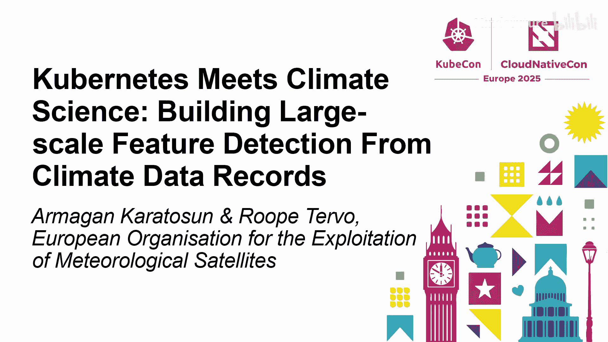

And this is me， Arman， very nice to meet you all。 and I work as online cloud data access services expert。

 as youma said。 But unfortunately， my colleague group at Harvard couldn't be able to join us here。

 but we work together with him。 Also a team of climate scientists and two interns on this project。

 So I want to also introduce you folks to my team as well。😊，And with that in mind。

 I want to introduce you also to European public space sector。

 But let me start by saying that I do not hold any official position to represent any of these in institutions。

 So this will be like the online information available。With this in mind。

 we have the first in line Ea， which is European Space Agency。

 and it's the Europe's gateway to space。 Eza works together with their national agencies。

 institutions and their member states， and they coordinate several missions and programs like Galileo or Coperniccles。

 And we also have in the second line Uniad。Which stands for the European Organization for the Exploitation of Meurgical Sateites。

 and it operate operates satellites for monitoring weather， Cl and the environment。

 Ua also works together with the their national agencies， member states， institutions and the other。

Space related institutions as well。 And we have in our online and archive data， data data lake。

 we have more than 10 per base of data span more than 300 collections。

I must say I worked at UD as a cloud computing engineer between 2019 and 2022。

 and now as online day access services experts since July 2024。

ECMW F stands for the European Center for Mediium range Weather forecast， and it provides 24。

7 operational Service， producing and disseminating numerical weather predictions。

 predictions to the to its member states and cooperating states。

 ECMWF also host a high high performance computing facility。

 as well as a common cloud infrastructure related to their HPC facilities。

 and they also have a meteorological archival and retrieval system， Mars。

 which is providing access to the meteorurgological data that has been collected or generated at the ECMWF over the years。

 I also want to highlight that I worked at ECMW F as a cloud computing engineer between 2022 and 2024。

😊，So let me also give you a quick introduction to climate data records。

 and it refers to any long termm record of a calibrated data that is useful for climate scientists or climate applications。

 And the data from current or past satellites or archive are used to generate the CR Ds。

 and these archives basically is the development throughout the satellite program or our satellite application facilities or Sas for short。

 and also can include different collections like Coernics or other European Union funded projects。

 This is very nice， you know， but the problem is it is pending over several petabytes of data。

 So it's really hard to move the data from one place to another or download the data to your local computer to process。

 We have multiple data sources and the access methods。

 So most of the time every new program has its own ways of archiving and accessing the data。

 The source data can come in various。😊，Different formats。 So， and some of them are binary formats。

 So there is some kind of a pre processing required to start with working with climate data。

 And to do that， you need multiple libraries to handle all this kind of an operations。

And we had an idea to make it a little bit simpler for the end users。

 So we thought if they cannot afford moving the data， let them compute new to data。

 And this is how European Me cloud was born。 And the idea is to move the users to close proximity to the compute resources that we have and let them have some computing resources allocated their ten。

 This is the infrastructure as a service as an idea。 But this is not a private cloud。

 because we are serving cloud resources to our member states and other institutions with R And D fund。

 for example， But this is also not a public cloud。 So any random citizen cannot go to the web page and sign in and get some resources。

 Therefore， we are calling it a community cloud a community cloud for Earth observation and scientists。

And the key idea might be to have any CMW F V VM that digesting down down sampling and transferring only the necessary data to Uat VM。

 which has some kind of a satellite imagery going on。 And that is the idea。

But the biggest benefit of having European weather cloud was that it provide us a well established way as a meturgical society to work together coming among UMaa。

 E MWF and our member states。 So we have a common platform that we can work together this time。

And you might ask why C Ds are important and how we can make it more accessible。 So C R Ds are。

 they are providing C DR are providing long term calibrated information on how。

 where and to what extent the Earth's atmosphere， land。

 cryosphere like ice sheets and oceans are changing over long time periods。 So this might be。

 for example，Important to analyze the extent of the sea ice of the past decades。

 and it can give important clues to the climatologist。

 or this can be an early warning for a fog for aviation。

 So this and high quality system feature identification is crucial for that reason to further develop the application and M algorithms to detect this kind of anomalies。

And as you mentioned out， we have many two goals to build this Earth system feature detection。

 One is to spot support our member states in feature detection from Earth observation data to provide early warnings。

 This is the fog example that I gave you earlier。 and the other goal is to collect a global database for a longtime series of identified features。

 This is the ice sheet example that I gave like for a 40 years of data。

 You need to gather this kind of features over a long time period in order to identify the changes。

And the goal， I like say， the end goal is to establish a community platform to label these features。

 maintain a database of these features， including the possibilities to explore， visualize。

 modify and export all these features that we gathered。To do that。

 we evaluated models to identify and categorize the tropical storms using pretrained M L models through transfer learning。

 I will not go into the details， but if you are interested with them。

 you can scan the Q code and and access to our publication。 But T LDR。

 we were scanning over 2000 images from Japanese Ma agency from the satellites from G MA containing roughly 5000 tropical storms。

 You might ask why Japanese satellites because Europe doesn't have as many tropical storms as as Japanese So that was like an no brainer for us to use that instead。

And we were like using international best best track archive for climate stewardship I B tracks for short database as a ground route because they already identify these things after it happens。

 And then if they are putting it into the database。 So it serves as a， as a ground route。

 we were manually checking the bounding boxes。 But we were not。Fixing the the models based on that。

 And we were using the work current I in intensity， D C I for short。

 to use to categorize these storms， the different types of storms。

And we found out the faster R CNN provide the best performance out of the other three。

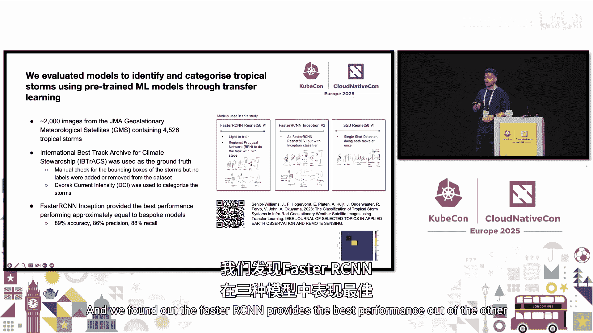

And in here， you can see， actually， in， in， in the green boxes。

 you see the tropical storms correctly identified by the model and also present in the IB trackx database。

And in the yellow1。There are tropical storms detected by the model， but not found in I B trackx。

 But the problem is the amount of tropical storms are exceptionally many。

So as an I T S as an I T specialist， these are all looking tropical storms to me。

 at least from my eyes。 But the problem with the model is that we need some kind of a。

Domain expert to check all these different tables because， because。

 as you can see in the yellow ones， they are not identified as real storms。

 So this was a false positive。

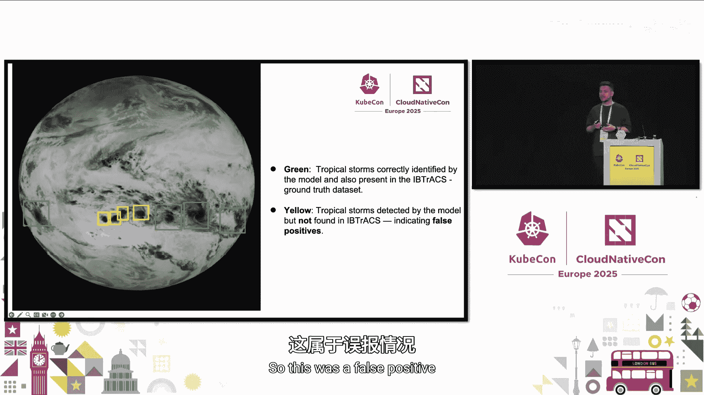

So manual labeling by the domain experts are clearly needed， and you cannot have auto label。

 auto labeled tropical storms。 That's not that simple。

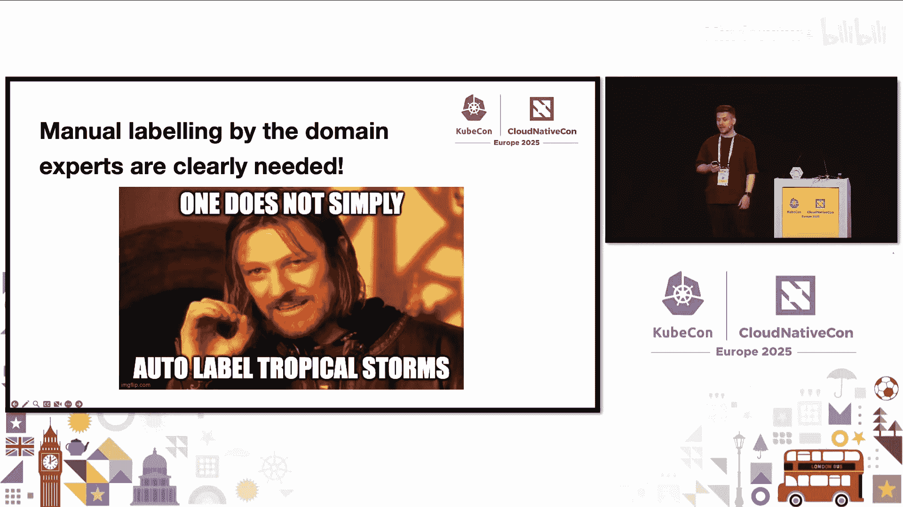

Hold on。 then。 Does this mean that the labeling has to done manually。 Like we have， as I said。

 we had like thousands of images that needs to be identified。 and we need climatologists。

 climate scientists sit on a PC， manually labeling all of that。In a completely separate work， I。

 I am together with my friends in that project， a completely separate project。

 we were exploring segment anything model for satellite imagery。 Again。

 I will not go into the details。 You can check the publication。

 but we kind of figured out that Sam is actually doing very well on segmenting the satellite imagery。

 although that is not trained on， on that kind of a。Data set。

 So we were using Euroda data set in this case， but we were not training some on the Euroda data set。

 We were just using a pretrain model， but it still managed to segment the images。Quite accurately。

And here you can see a small application that we。Developed together my colleagues at ECMW F at that time。

 And here you see some kind of a flaw in the palm area。 you see that。 and there's a bounding box。

 and you can make that prediction a little bit more pinpoint with the with the key points And when you select the area of area of interest。

 you can click the segment。 and it will basically segment the rest segment image from the rest of the image。

 And then you can export this information to any tool that you would like to visualize。

 This can be a that map application that climate scientist is using。

 so you can export that annotation and you can use it on your on your research。

 So this is something that we were doing at that time completely outside of of this scope。

 But it give me an idea。 So maybe we can create an environment combining all these different tools。

 And we will start thinking about what exactly is needed。😊。

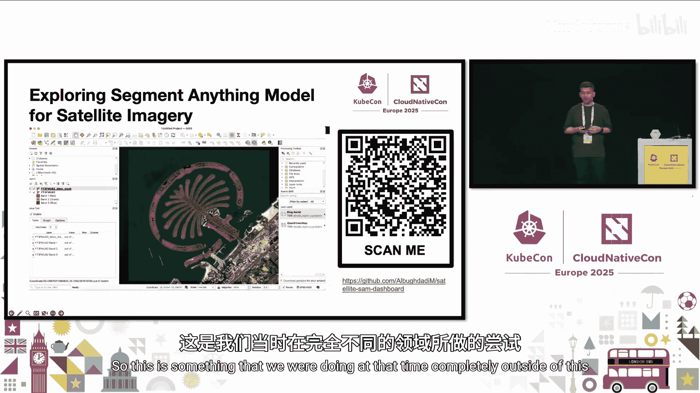

createre such a collaborative environment for the Earth Earth reservation scientists。

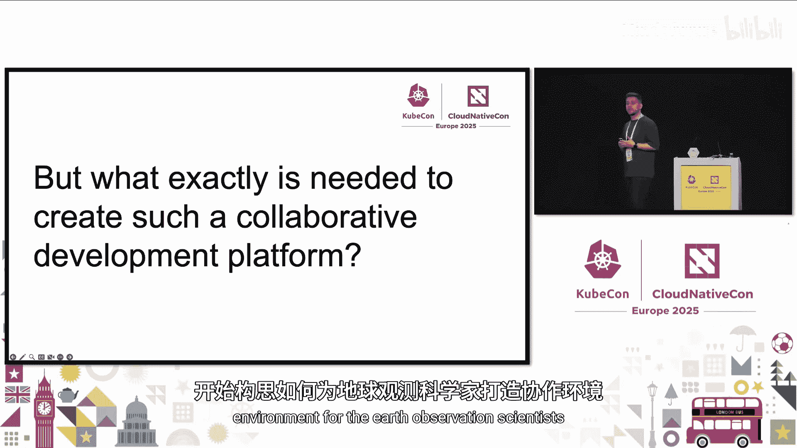

And this is what we came up with。 We have L models。 We have Kubernetes。 We have climate scientists。

 We can work together to build an Earth system feature detection platform that can serve a climate scientists a collaboration platform on。

 on carrying on， carrying on their research。😊，So you see， there are different tools。

 and I will be touching them in my future slides。

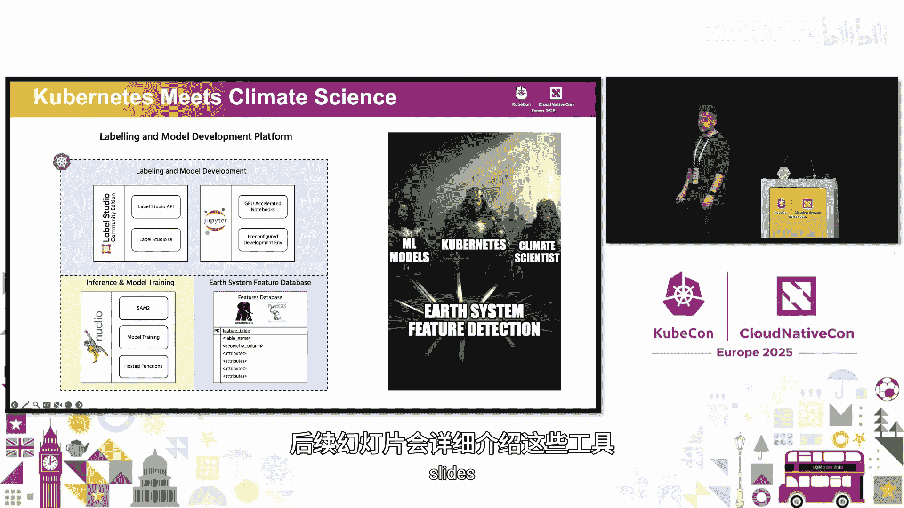

But this is the blueprint for this joint labeling and model development platform。 So to say。

 So on the in the starting side， you have the input label data。 For example， I B tracks。

 and you have the source data。 This can be U a data store， for example。 But the problem is。

 the source data comes in various different binaryer formats。

 So you need to do some kind of a data preparation。For example。

 you can use libraries like Sp to generate images from that earth observation data。

 And then you can put them into an S 3 bucket or something， something like that to store。

And then you can passse this IB track labeling as a grand So grand route。 And in here。

 you need some kind of an annotation platform like， like we developed it。

 And I showed you in the playread strike like something like this。

 And here we can use a community tool called label studio because it has an API and everything and can make it easier for our observation scientists to import all these things to。

 to the platform that they are developing something。 And from there。

 we can actually utilize Sam to help them labeling the the features that they detect。😊。

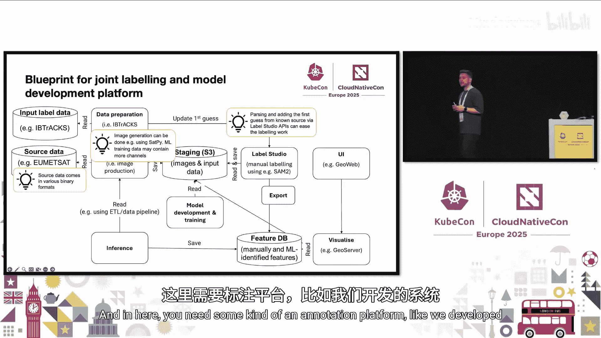

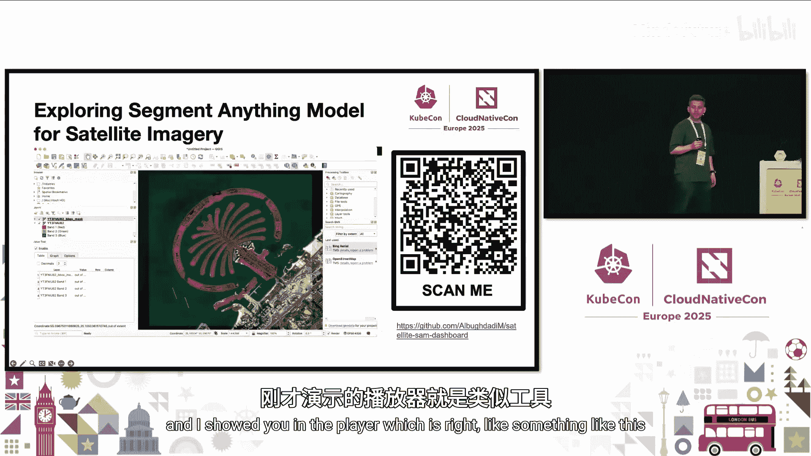

And after that， we can export these features to a database。 In this case。

 we are using a Postqql extension called Postkis and store it in a longer term so that we can visualize it afterwards and。

😊，This can be any web map service。So you might ask what's under the hood then。

 We have an infrastructure service， infrastructure as a service coming from European weather cloud。

 It's based on Openstack。 And this is for P O C reasons。

 So this is a pathfiner as we call it in to identify the benefits and how we can do this in a production afterwards。

 So you can see these specs are not that big in CPU and Ram and block storage。

 we can also have a little bit more room for that。 but we are especially limited on the GPus。

 We have two physical a 6000 GPus presented as V GPPU flavors。

 and we are using Kubernetes key as the flavor rancher to manage and provision Kubernetes clusters。

 we are using opentack cloud control manager I I plugins for readr only access to the storage we also have long con for readrite many。

 and we are using GPU operator to present this GPU resources to the。😊，To the pots。

 we are also having some instance groups to alter scale the worker nodes。 But as I said。

 the V VGP instance group is quite much tight in this case， because we don't have many resources。Yes。

 you heard it right。 We have a 600s， and this card is five years old。

 but our infrastructure is five years old as well。 And this is a pathfinder。

 So we are still trying to figure out what we need in the in the in the next five years so that we can build our platform accordingly。

 this， these cards are presented as， as I said， Vi GP。 and we have like。

Couple of flavor flavors there presenting how much memory that we have on the V GPP U side。

 And I must say that these resources are really scarce。

 So we need to be extra careful on how we spend that。😊，As I also pointed out in the previous slide。

 we are using NviD GPU operator to present all this because it simplifies the installation and maintenance and the operations。

 And it also bundles up a lot of nice tools from Nvidia。 And you don't need to， of course。

 you need to configure them in the in in the installation phase。

 But at least you have one source of ground route that you can configure everything in in one place。

 And we are implementing time slicing for better resource sharing and utilization。😊。

You might ask time slicing， Why not X X X can be in here。 MP S or or make。

 I have a short short answer for you because we have to。 our car doesn't support anything else。

 So we have to use time slicing。 And this is our only option to have V GPPU sharing to share some resources。

 But don't worry， we I also have a long answer。So we are using GPus mostly with Sam to segment images and users are runningetitive repetitive。

 mostly unrelated data processing drops。 This is not a parallel processing in in sense of MP。

 So using something like MP S might be an overkill。

 most of the time we have some kind of a processor that is expecting input data and it's generating some kind of an output data。

 And if we lose the data in somewhere， we can always reprocess it and get the same data out of it anyway。

 So this is a nice trade off in in terms of memory memory isolation as well。

 because we we can regenerate that output data anyway。

 And this is but this doesn't mean that we are not setting some ground rules。

 We do have some resource quotas and we are watching the GPU utilizations anyway。 but。

I think this is a nice trade off with limited three P resources available。

And we are also in the future， at least we are also considering implementing retraining of the Sam2 using annotated data。

 And that might change the things a little bit。But for now， I think this is a nice trade off。

So I also would like to highlight a couple of challenges that we identified during during our platform journey。

 One was to hiding infrastructure complexity from Eo scientistsentists。

 So these people are domain experts。 and they are scientists。 and they are really smart。

 But not everyone has to know how to present a V GPP to a pod or this or that。

 So this needs to be hidden from， from the Earth observation scientists， In my opinion， at least。

 But a challenge rises again， how to integrate all this multiple tools。

 how to deploy and manage this tool tools at scale。

 And we also were missing a useful documentation in that we can actually contribute something back to the open source。

And to do that， we came up with some design principles。 First of all。

 use open source and open license license of ecosystem。 Second。

 we tried to automate everything with Gitops and infrastructure as code。

 we also adapted a Kubernetes first approach where we were using official operators as a first choice。

 And if it is not mature enough or doesn't exist。 We were using well supported hem charts。

 And if nothing is available。 And we have to build our custom solution。

 that is the only time that we are building our custom solution。And this is what we end up。

 like these， these are the tools that that I was mentioning in my previous slides as well。

 But let me just also give you a higher overview。 We try to build a f flexible and open and machine learning friend friendly platform for Earth observation scientists and。

To， to make it a little bit easier for them in the beginning， We prepare the data for the end users。

 At least some of the datas that are in high demand， but they can still bring their own data if they。

 if they like。The scientists are already familiar with Jupiter Hub。

 and they were using it quite extensively。 So we provided a hosted hub where they can interact with the other tools that we are providing in the platform and also have some kind of a GPU processing capabilities to。

 to help them getting started。And， of course， they， they don't。

 they don't have to use this to host the Jupyter up。 They can be bring their own tools。

 their own editor instead of a G Jupiter hub， or they can bring their own Ga server to visualize the。

 the features that they identified in the features database。

 But the gist of this slide is that we are maintaining some of applications that they are already using separately so that we can have a collaborative environment environment for them。

And I would like to have a few words on Gitops here in the previous slide， I said many platform。

 one platform， many applications， one Git， but it is like also one Argo CD to rule them all as well。

 So we have all these different applications。 We have Jupyter hubub。 We have labeled studio。

 We have nuclear。 We have functions running on nuclear。 I will come to that。

 We have a cloud native P G and postg extension。 And all these applications needs to be managed and not install。

 first of all， and then manage and then maybe they two operations to back the database up， etc ce。

 So if there is an operator in place。 we can automate in coordination with Gitops best practices。

 we can automate all these different tools in at least one single ground truth。

 and it gives us consistency on how we present this platform to the end user。😊。

And this is what it how it looks like。 In the end。 I know Jupiter Hub can introduce a little bit of complexity sometimes。

 but providing a hosted hub gives us an opportunity to have some plugins already in place for them。

 such as the Jupiter G or Jupiter La kit。 So these are the things that they don't need to worry about anymore。

 And we also have installed some of the。😊，Tools and libraries that they would like to they would like to have in the end。

 so they don't need to run manual commands on on a terminal or something like that。

 And for the labeling part， we are using label studio。

 I must say we did did a huge trade off between different tools like Cva annotate。 There were many。

 there are many tools when it comes to the image labeling。

 But we found label studio is the most extendable with the API and U I。 So it was a nice just nice。

 nice tool that we can move forward with it。 And it's quite customizable。

We are also using nuclearcle as， as a server framework。 There are many。

But this serves the best for the Earth observation use case with the lower maintenance overhead。

 So nuclear treats the code as a whole， and it can build a container image on the run time。

 And then you just need to run this as， as a function。

 This will actually called processor in the earlier versions。 And it fits our purpose really well。

 because most of the time， what we have in Earth observation science is also a processors that are deployed。

 deployed。One another。 So it is not a parallel， as I described。

 but concurrent processes and nuclear handles this use case really well。

 And most of the climate scientists are very familiar with Python and nuclearcle is very python friendly。

 The only it can integrate withflow pipelines or any other pipeline orchestrator as well。

 but the only downside of it， let's say it lacks this kind of a built in workflow pipelines likeflow pipelines or or ago workflows。

 So if you wna do end to end automation the Earth observation scientist or the user needs to bring that logic into Jupyter hub or into their code。

 also， the function versioning is not the same as managing a model registry。

 but managing a model registry is also an additional overhead。 And right now。

 we only have couple of functions。 So we can bundle everything up in an image and use that instead。😊。

And thebuging， the deployed functions can be a tricky。 and the images tend to be a little bit large。

 So， for example， the， the thing that I am doing right now is to build them outside of nuclear and put it in some kind of a central registry so that I can just download it instead instead of building it on the runtime because these pipeys and libraries can be big。

 And you are also putting the model and the checkpoints inside of it。

And the other difficulty was to integration with the label studio machine learning backend。

 because it was expecting a docker composeos set up。 So we did some， something manual that we had to。

 And documentation can be a little bit tricky as well。And this is the ugly。

 This is the machine learning backend that that I personally。

 You can scan the QR code and judge my code。 As I said。

 the label studio was expecting a Docker composeos set that it has an web application server supervisor the and RQ to schedule the training jobs etc ce。

 So I thought， okay， I can replace all that with the tools that I already available on Nio。

 And then I can use the machine learning the label studios machine learning SD K to build the model and present in a way that that label studio expects。

 Fortunately， label studio is not that selective on how。

 how you can present this kind of an information。 It just expect you to have some kind of a gson。

 So that is very fortunate in my opinion because then you can actually replace the label studio with something else because at the end of the day。

 the prediction and how this has been presented to the end user is just a gson。😊，File。

 the rest can say the same， obviously。And this is how it looks like the label studio， at least。

 I was planning to do this online。 but yeah， video is safer。 So this is how it looks like。

 how many images1800， something like that。 and this is already uploaded to from NS S3 bucket。

 You see here。 I have the Doac labels that are coming from IB track database。

 And I also have additional labels down below called Sam， These are use。

 this will be using the machine learning model。😊，To annotate。 And if you go to the model。

 model is already like integrated with the system。 I must say all of this can be done from an API as well。

 And I also have a separate video to how to do that。 But I think this is an overkill。

 So showing the U I is good enough。😊，And once you set all these things up。

 you have all these images that that you can export in the system。

 And here you see all these different labelings coming from the IB track database。

 And these are different types of storms， different categories。And in here。

 I would like to have my own。 So let me just speed this up a little bit， whoops。So， let's go。

And here， if you go， for example， on the right hand side， I have the Sam labels。

 and I have the auto annotation is is enabled so that I can auto detect the features。

 And then what I need to do is to select the label that I would like to give it。 It was a duorac 3。

 I think。 So I put the the key point。 And then Sam did the segmentation and generate the label。

 And you can see it's very well compatible with the the data coming from I B tracks。😊。

And then you can accept the labeling， and then this label will be available to extract。

 And then you can extract all that information to the Earth system feature database。

 And you see on the left hand side， how we can deploy this with cloud native PG。

 but on the right hand side， you see a visualization of the atmospheric motion vectors。

 A M for short， the movement of individual cloud or watervaapor。

 watervaapor patterns in success successive satellite satellite images。

 You see in the previous demo we had like multiple images of the same system， it was not the same。

 It was actually moving slightly。 So when you export all that labeling into a database and try to visualize it again。

 you will see all the shapes coming through Earth visualizing the movement of of that cloud or water vapor。

😊。

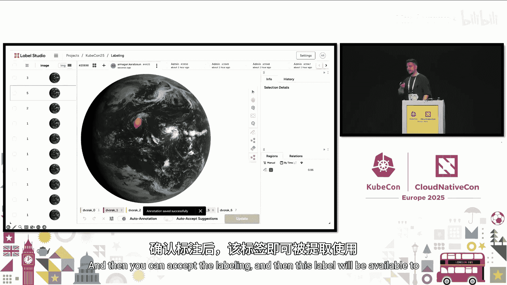

What's next。Well， we need to work together with U at member states to develop tools for data preparation。

 We also need to run joint labeled campaigns to label more and more data。

 And we also I need to identify the best available methods for each feature。 And， okay， of course。

 we need to make more data available for the experts so that they can do more on the model development。

 And I really like to train the M L models with or the nuclear Sam to integration。 I mean。

 with the labeled data。 And I really would like to have better GPUus， to be honest。😊。

we are also planning to improve and extend the Earth system feature data database with more features and。

 and， and， and capabilities。And thank you very much。 And if you have any questions。

 I will be pleased to answer them。😊，I just a single question。 how large is your M ops team。

Not that big， like。1，2，3，4。O。And it works。 Or is it too much work。It works with a caveat。

 with a with an asterisk。Of course， I would like to have a bigger team。 Okay， Thank you。Anyone else。

Then， thank you very much。

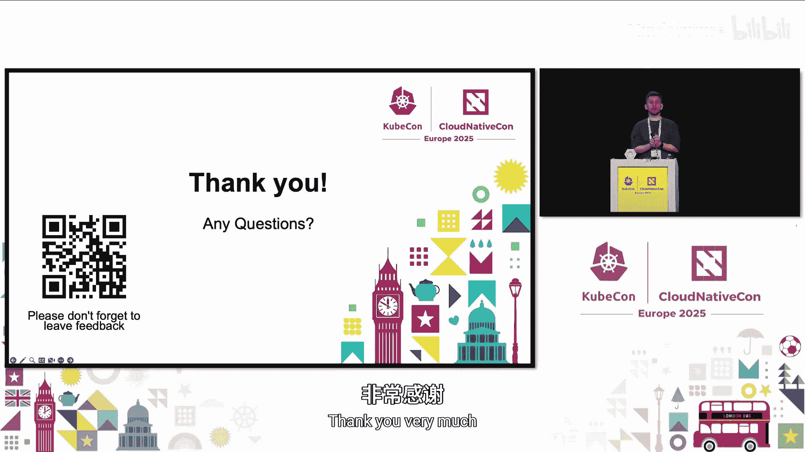