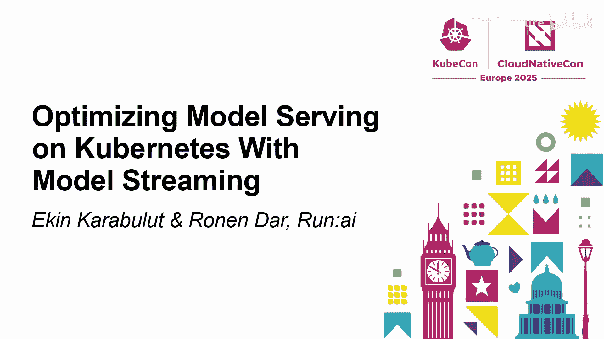
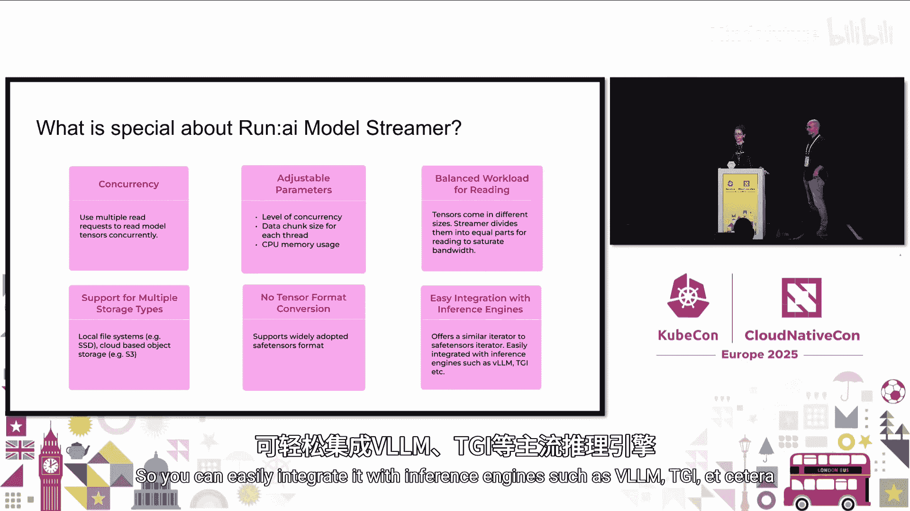
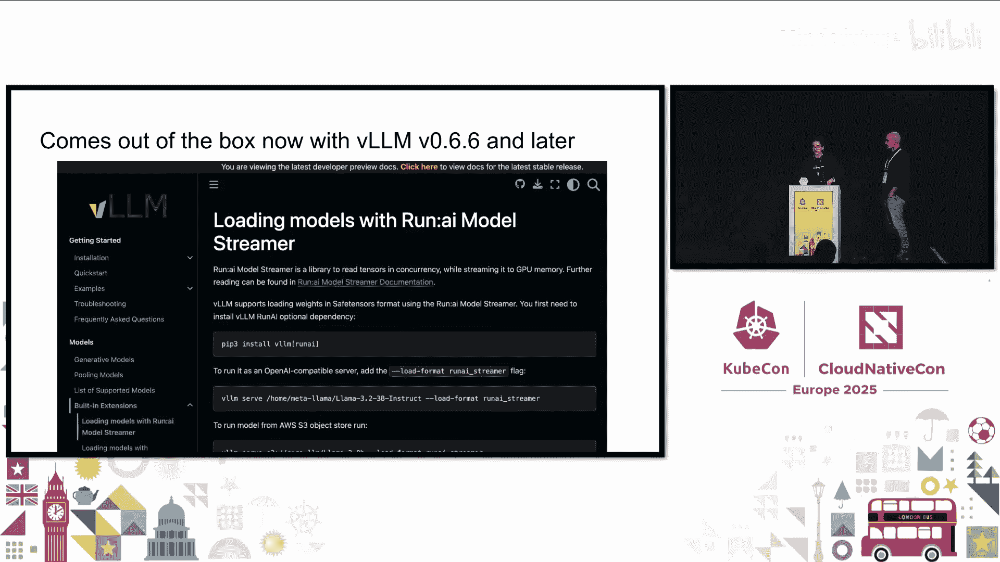

# KubeCon-+-CloudNativeCon-大会2025-｜-云原生计算-｜-可观测性-｜-Kubernetes-｜-Prometheus-p53-P53-Optimizing-Model-Serving-on-Kubernetes-With-Model-Streaming---Ekin-Karabulut--BV1Cd32zDEBG_p53-

Okay， cool。 So this talk will be about optimizing model serving inference。On Kubernetes。

EWith model weight streaming。So I'm B andal， and'm happy to be here。I was I'm from the Ra AI team。

 I was I was the co founder and CEO of Ra AI。 who started in 2018。 Ra AI。

 were doing what we call AI infrastructure orchestration。R， I was acquired by Nvidia last year。

 and now we're part of the Nvidia team。 Before that。

 I did my PhD and and postd in information theory。And Akin is here with me。Yes。

 so I am the developer advocate from the run AI team now in Media。

 I also did my master's in robotics， cognition intelligence in Munich。So today。

 we are gonna talk about model inference。 Yes， model inference。 And。

 and we got this run AI model weight streamer。 It's an open source project that we published last year。

 And this is the work of Noa and Oma who couldn't be here。 but we presenting their work。

 So great work by them。😊，So let's start。 So inference in theory， right。

 there is a training data set and a model is being trained on that data。

 and it's being evaluated after the training。 And if results are good。

 and it it moves to inference right， and inference new data or users queries are getting into the model being processed and new predictions or general outputs are being generated。

 right。And this is what's the， the， the topic of this talk， right， about inference， how。

 how models can serve new requests in a cloud native space on， on GPus。

So in traditional applications with whether web applications， common practice is to use autoscalers。

 right， and there are users who getting in and there are instances。

 replicas of of of applications running on maybe on in a container or on a CPUU and when traffic goes up。

New replicas are spun up， right， to save those requests。 And when traffic goes down。

 those replicas are being spunwned down， right， to save costs。

So that's with traditional applications。 But with AI， it's much。

 much more difficult because of few reasons。 But one of the biggest reasons is the cold start problem。

 What we call the cold start problem。 It takes a long time to spin up a new replica。Right。

 so first of all， the process of spinning up a new replica， it involves provisioning a new machine。

 right， but with GP machines， it takes longer than provisioning a CPU machine。

 usually because there are less GPs out there in the cloud and because there are software libraries like ka drivers and and ka cans and libraries that that wait a lot and it takes time to install them。

 Second thing is the container image， just loading the container image， usually within in AI。

 those images are big It involves a lot of python libraries。

Bing up the inference engine usually also takes a considerable time。

 But this talk is going to be about the last part， about loading the model weights， right， just。

Downloading the model weights from a storage location into the GPU。 and it can take a long time。

 right， It can be really significant。 For example， with Lama 3。

8 billion usually it's being it's being deployed with 16 B per weight。

 And then the weights are around 15 GB。 So that's a lot， right， Lama 3 with 70 billion。

 it would be more than 100 GB， just the weights themselves to download form a storage and and load into a GPU。

 diptick are1， right， more than 1 TB。 So that's huge。That's huge。 And it can take many minutes。

Can take sometimes more than 10 minutes just to download the the weights and load into the GPU。

So the our goal is to right to accelerate that process。 And why is it that important。

 Just a few s about that。 So a few use cases for inference， one time one is realtime inference。

 where there is one model and a high load right， many users  queryering just one model。

 and maybe there are multiple replicas running on a GPU。And。Or as we said， right。

 we want to scale up replicas when traffic goes up and scale them down， right。

 Usually those GPus will be available。 It's like a whole store if like provisioning new GPUs or not。

 Sometimes it's not， it's not possible to spin down GPus。

 But let's assume that those GP U are out there and and if if they are not used to those to run those replicas they are used for some other workloads。

 But spinning up and down those replicas can take a long time。

And users won't wait for a few minutes until their ques are being answered。

 So what we see usually happening is over provisioning。

Those GPUs are being more more GPs are being provisioned to run those servers。

 and it means high costs and low GPU utilization。Another use case， it's called models。

 or like multiple models。AndThat needs to be needs to be sell to different users， but infrent load。

 right， just infrequently， users are accessing one of those models。So what you will want to do。

 right， to scale to 0， use scale to 0 and put all of those models in some storage and spin a replic up when users are  querying that model。

But if that spinning up that replica takes many minutes。

 then you won't be able to do that if your application needs like low latency。

 So usually what we see is called models just being provisioned on many GPUus just to keep them warm。

 so latencies will be latency will be low。And that's， again， high cost， low utilization。

ELast use case for inference， offline inference， right， running a bad job that。

Process and a lot of data in in a batch fashion。 so a job starts。

 it starts to process the data outputs， outputs outputs out there。

 and when the job finishes those repas down。 but you're paying for the time that it takes to spin up those replicas。

 you paying for those gus and can if its that for several minutes， then it can be significant。

 So reducing that cold start problem reducing the time that it takes to load models into your GPU can be significant。

 that's the goal of of this project。 and A will explain more about model loading and what we did with any ice stream Yes。

s let's zoom into those containers and the model loading process a bit。

 So we have a storage that can be a local storage that can be an object storage doesn't matter。

 you have your model there。 And first of all。You need to move your model to your CPU memory。

 And in the CPU memory， there are also some different things that might be happening。

 like sharding the model， quantization， etc cea。 that will add up on time as well。

And then after you load the model to the CPU memory。

 you need to transfer to the to those weight to the GPU memory， which is the second step。

 So these these steps are happening sequentially， there is no parallelization and it takes a lot of time。

 So when we started checking out the problem we realized that we needed some specific things before creating the the project。

 So first of all， the sequential loading will not work for us。

 So we need something that's working in a parallel manner。Second of all。

 we need a library that supports multiple storage types， for example。

 for Sa tensors laer S3 is not supported and you might need to change your either storage or your code base in order to make your storage type work So that's something that we wanted to avoid third we want to be able to be compatible with safe tensors Sa tensors format for model weight is becoming the state of art and it's very safe so we want to work with Sa tensors specifically。

 and we want this project to be integrated easily with different inference engines。

 we don't want to keep pushing a single inference engine that you should use in order to leverage the project itself。

So this brought us to run AI model streamer。So we created this Python SD DK with a C plus plus implementation。

 and we designed it in a way that it accelerates the model loading times onto GPUus from various types of storage network file systems as three deskk doesn't matter。

 So the the two key things that we are doing here as reading tensors concurrently from the storage while transferring them to GPU。

 And we also divide the tensors into equal parts for saturating the bandwidth while reading。

 because we want to saturate storage bandwidth with our loader。

A bit more information about what is so special about run AI model streamers。 So as I said。

 we have a concurrencies。 So we use multiple reading requests to read model tensors concurrent from storage and we stream those to the GPU at the same time。

 we have some adjustable parameters so you can adjust the level of concurrency depending on your storage type you can choose how you want to divide the safe tensors like the data chunk size for each thread and you can also define CPU memory usage for example you might have a limited CPU memory or you might have a gigantic CPU memory that you want to leverage。

 you can basically adjust those parameters with model streamer and we will use that。

Balance workload for reading。 That's super important。 Tensors in AI come in different sizes。

 So we divide those tensors into equal parts for reading so that we can separate the。

 the storage bandwidth。We support multiple storage types， local file systems。

 cloud based object storage。 We support both。You don't need to convert any tenors from Sa tensors and then other way around。

 So we support widely adopted Sa tensors format。 no need to convert them and store them separately and we created the run run Ai models streamer innova that it is actually a Sa tensers iterator。

 So it's very similar how Sa tensers iterator， the traditional version of loading models works。

 So you can easily integrate it with inference engines such as VLLM， T GI， etc。

 whatever you are using and speaking of VLLM。 if you are using a version that's higher than0。66。

 we are also coming out of the box now in the in the VLLM containers and VLLM versions so。

You can try it out with viaama as one。And now I want to talk a bit about our benchmarkings like how does it actually perform in practice right so I will not go through the whole software stack I will leave the QR code here later on so that you can read the benchmarking white paper but we essentially used metamod metama 8 billion it was a 15 gigs and we stored it in a single Safe Tsers file as hardware。

 we used a single GPU8 and G on AWS and we chose three different storage types here first of all local SSDs。

 one is GP3 SSD and the other one is IO2 SSD the important thing that you should know about these IO2 SSD has a higher tripput and we use Amazon S3 which is located in the same region with our with our install。

Once。A little sneak peek to the whole benchmarking experiment you can see here。 And Q R code is here。

 Feel free to scan it to check out the whole。Bchmarking study。

So the two main things that we checked is standalone loaders， Sa Tensers loader。

 run eye model streamer and Tenzerizer。 they how long it takes for them to load a model from storage to GPU。

 And then we also checked how much time it takes to boot the engine and load the model with VL them。

 So these are the two things that we checked out。 And as you can see。

 we see quite some amount improvements with runi model streamer。

 And I want to share the key takeaways right now with you that we learn throughout this these experiments。

So first of all， con concurrency drives speed up to a point。 So concurrency is amazing。

 We checked out also different levels of concurrency from different storage types。

 and when we see a lot of improvement when we increase the concurrency But when you seturate your storage bandwidth。

 you are not gonna get more improvement because laws of physics， you can do more。 So we。

 we realize that we are hitting the limit after increasing concurrency enough。😊，嗯。

The second key takeaway is， as I said， B workload distribution is crucial。

 Tensors vary in size Partitioning work into equal chunks among those threats help optimizing bandwidth saturation and making the streamer process faster。

 because imagine like1，1 tensor being GBs and one is mes。 So then we need to wait for the。

 for the reading process that's happening with the gigtes of of tenss first。

And the third one is storage bandwidth。 It matters a lot。

 So for deployments that you are gonna go for， if they demand fast model access。

 think about investing in high performance storage because we realize that it， it matters a lot。

 the bandwidth itself。 if you're dealing with cold start problem。 it reduces the load times a lot。

 especially in on-prem and hybrid environments。And as we talked before。

 streamamer has some parameters， so you should actually check out the concurrency。

 like the optimal optimal amount of concurrency that you need specifically for your storage type and also if you have any specific requirements for CPU memory。

 etcter。 you should tune the the streamers parameters。

 because it's it affects the cold start times quite a lot。And with S 3， we， we got very good results。

 This is because our approach with S S 3。 So creating an AWS S3 client per thread with each thread sending multiple as synchaneous requests to the back end affects the the performance quite a lot。

 It's， it's super powerful V C results that's on their5 seconds I actually had difficulties to put them in the。

 in the chart in the earlier days。 So this was quite amazing。 If you are using S 3。 Give it a go。😊。

And some things that we noticed in the cloud， which is a bit independent of runi streamer。

 So we were checking out the theoretical throughput that we are gonna get storage bandwidth we we are gonna get with the assessD even if it's written four gigs per second in the documentation on the websites。

 we could only see up to two gigs per second， So keep in mind that there might be some practical limits that needs a bit planning。

And also， if you want to run your own benchmarking with the streamer or with some something else。

 make sure that you are accounting for S3 caching effects。 That's something that we realize。

 probably in the S3 backend， there is some caching happening So after running some experiments one after each other in the S3 setup we saw quite some exhilaration。

 which is not good if you are trying to calculate a cold start performance。

 So if you want to give it a go and check out some some benchmarkings。

 make sure that you a cooldown period between cloud tests。Yeah， and some。

 some exciting moves that' that's coming up。 and that's already here。

 So we have a new version0 do 13。 It has full AW S S3 native authentication Now we also support G G C S and we have some usability improvements and in the roadm we have some very cool stuff coming up。

 We are gonna support shed models。 We are gonna optimize multi GPU model loading We are gonna have parallel multi file loading。

 and we are also planning to support GPU direct storage。

 and we are especially excited about the G GC S support We are working with the G KE team and the first impressions from the GK team is amazing。

 They see 96% model load time reduction with model streamer We used with VLM in compare in compared to download。

😊，Building the model from the cloud object storage directly， which makes us happy。 Yeah。

 so here are some Q R quotes for you。 The first one is to the Github reportpo。

 And this is Q R code for the benchmarking White Paper。 We have a lot of results。

 If you w to have a look。 And if you have any questions。

 We are gonna be at the booth after this talk， we are very happy to answer any questions。

 chat about how you experience this， this challenge。😊，And one more thing。

 we are very excited about this specific Cuecon because the， the core of the run AI platform。

 our run AI scheduler is now available under Apache license。 So if you are scheduling AI workload。

 we are very happy to hear your feedback。 any， any feedback， any contribution。 any early adapter。

 adapters are very much welcome。 and you can also come to booth if you wan to talk about the scheduler。

 we are very happy to hear your hear your ideas and opinions。 we call it Yes。

 whatever you call it K I K A I。😊，Yes， that's。That's it for， for today from us。

