# KubeCon-+-CloudNativeCon-大会2025-｜-云原生计算-｜-可观测性-｜-Kubernetes-｜-Prometheus-p54-P54-Are-You-Covered-Falling-in-Love-With-E2E-Testing---Scott-McAllister,-ngrok--BV1Cd32zDEBG_p54-

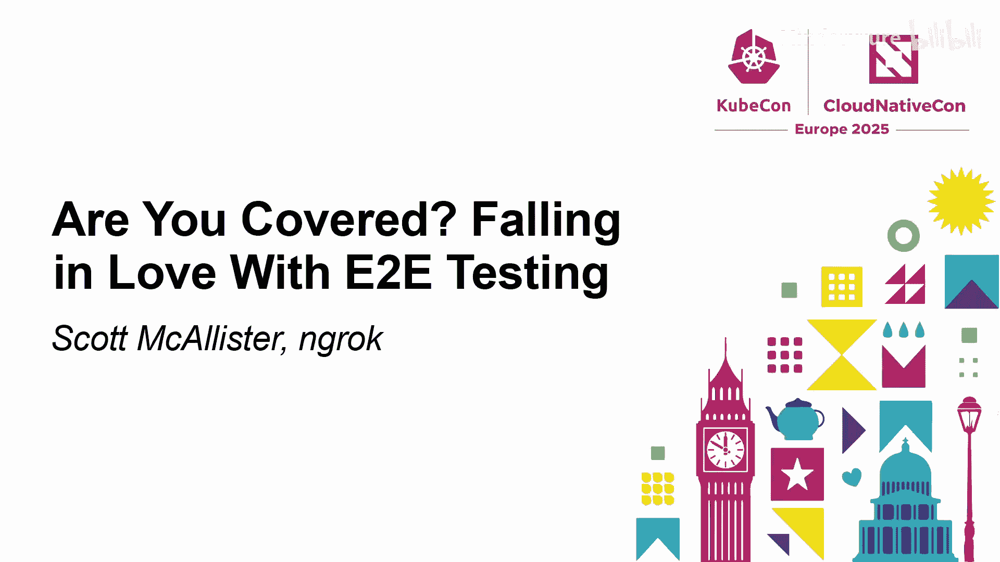

Thank you all for coming today。I need your help。I usually do a thing at the beginning of my talk to prove to my bosses that I went to a location and that actually did work。

 didnn't come to England just to watch Shocker， although I did。 and it was fantastic。😊。

I need you all to help me out。 Can you smile and wave。And this room is so big。

 We're gonna to do smile wave there。Awesome。Thank you all。Butut that always， we don't get distracted。

 If you are still here at Cubecon and you're in this room。

You're going to learn a little bit about testing， specifically end to end testing。

 And now I know each of you。Like me， because we're software， people were detail oriented。

 You read the description。Festidiously， you knew everything that I'm going to talk about today。 So。

 of course， not only were going to talk about testing。

 we're also going talk a little bit about gi ups。

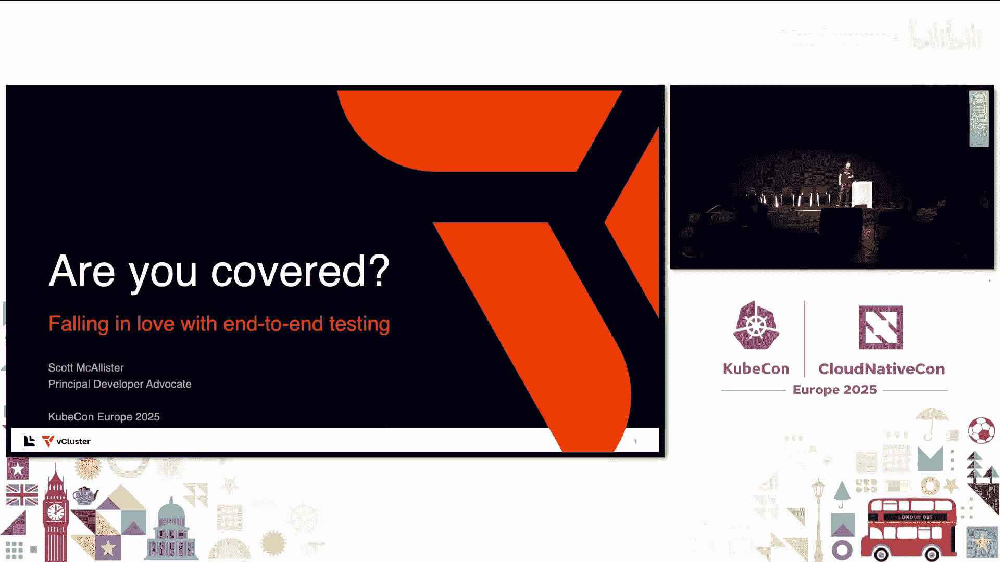

Not a lot， but I do want to talk about the whole process， right。

 where we take our code and we're going to build test and then deploy our application。

 And then we're going to talk about a few Gi ups principles in there， too that I wanted to share。

So testing， why do we do it。We do it to evaluate and verify that our code is going to act as expected。

Because honestly， two of the most important things in software development is that we make sure that our code works and that we can push changes out quickly。

 because if our code does something unexpected。And if our users hit something unexpected。

 that's usually called a bug， right。And we don't want that。 So with testing。

 we want to make sure we have our tests running， but we also have our tests automated so that we can push our changes out quickly and make sure that our software is running the latest things that we want the latest features that we want our customers to use。

😊。

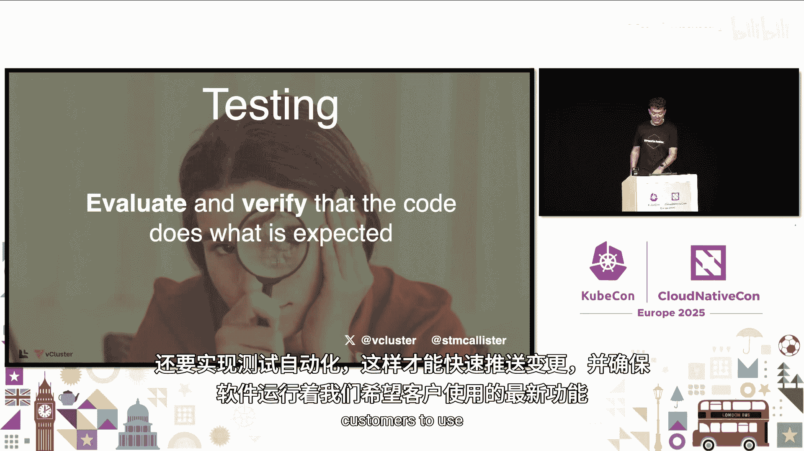

Our good friend Adler， also said this about testing。It can work as documentation。 I know for me。

 I've learned projects by getting into the tests first， running those， seeing how they。

 how they operate， how it affects the code， even tweaking them a little bit to make sure that I understand what's happening。

But then also， it can make it can make for clear design。And encourage productivity。

 We have confidence that our changes are not going to adversely affect our systems as we push them out。

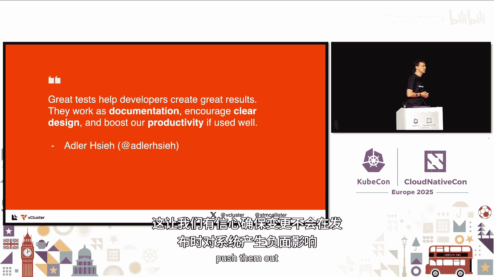

So end to end testing is that type of testing where we're gonna to be testing the entire flow。

 You have all different types of testing that you could be doing in your software development。

 You have unit testing where you're testing the most small objects possible。

 or even just a functionality on those objects。 Then integration testing。

 where we start snapping those things together。 and end to end testing。

 We're gonna to be experiencing what the user experiences。 So if you have a web application。

 a mobile application， We're going be testing out that U I that's going be interfacing with that back end。

 which is going to be interfacing with our data store。😊，So we want the whole thing to be covered。

And you might be sitting there thinking， yeah， Scott。That's a lot， though。So you think about it。

 these tests， you have to write them。 That takes time。

 You have to think about how they're going to affect your system。

 or at least how you're going to take that flow。 That takes time。

 how to set up a development or a test environment that takes time。 And it does。But。

Like weightlifting， good tests make our applications stronger。Not only end to end testing。

 but we should also keep the other types of testing in mind。

 whether unit testing and integration testing， we want to make sure each of those different aspects。

Are being covered。 The Internet reminds us why。

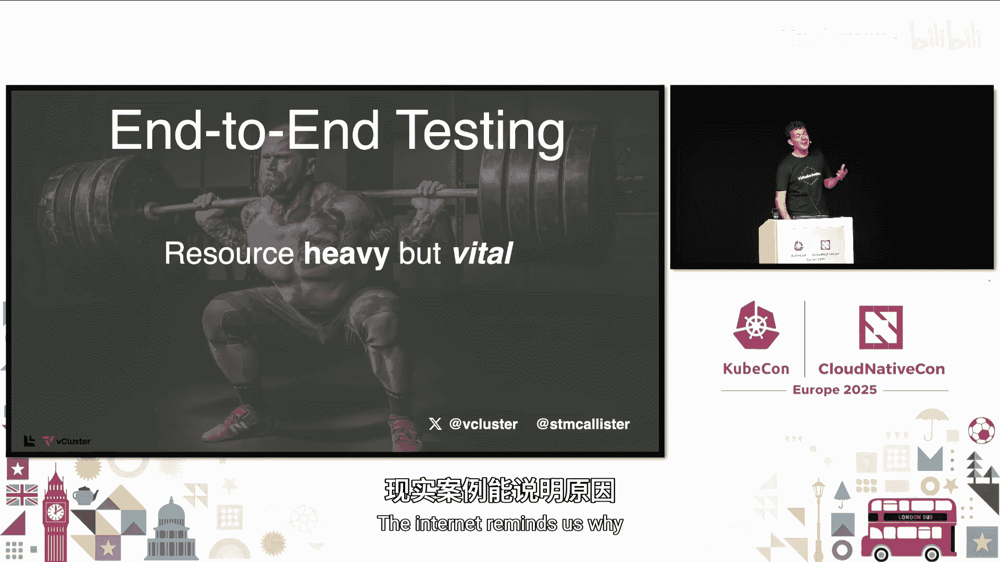

A real world example。 This lock was unit tested。 It totally works。Or it doesn't。

Who's written code like this。Me， too。 You wrote it to do one thing。 and then， oh， wait。

 It's doing this thing。 I didn't want it to do that。

 So you want to make sure that you have tests covering each of your situations。

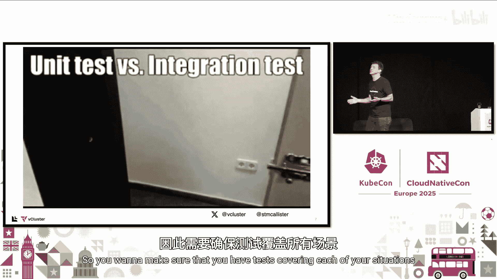

You also want to make sure that your test environment is as close to production as possible。

I know in my career， there's been situations where my test environment may may be running the latest and greatest。

But my production environment is more stable。So it's you're not making a lot of changes to that one。

 You want to make sure that the both of environments are the same， or at least as close as possible。

 Just like our little hero here， He sees that ramp。 And he's like， I got this。 I'm gonna to hit that。

 We'll be fine。 I can get through this course easy。 when in reality。

It looks more something like this。 Our users have possible pitfalls， memory issues。

 maybe lag or latency， things that could come up in production that aren't coming up in test。

So we want to keep our environments very， very similar。But isn't that the promise of containers。

Isn't that way we have containers。 We have application code dependencies all wrapped into one nice little container。

 And then now I can take my container and share it with you on your system and share it with you on your system。

 And it should。😊，Be the same。 It should be running the same。

But what about the configuration around that container and how that container is being run。

 Are they the same。Think about that。So， I want to。Share a demo that I built on a subject that's near and dear to my heart。

I love hamburgers。 Who here loves hamburgers。And so do I？All the time，8 days a week。

 I could have a hamburger， and they're fantastic。 So I built this application to track all the hamburger joints that I go to and that I want to keep remember。

 but also have my friends vote。😊，See what they like， see if they like them too。 And so I have this。

 And I wanted to show a picture of it， because I want you to see when we're writing tests for this interface。

 Okay， this is the interface that we're dealing with。

 has a list of hamburger joints has a ad button has some voting mechanism。 So you can visualize that。

 me。 I'm a visual learner。 I need to see this。 I need to see diagrams。 but also。

 I want to see code So I'm going try to show all three of those to you today so that you can each of those different types of learning。

 you can kind of see what's going on。 And the hope is， as I'm sharing these ideas。

 sharing these tools， you can take them back to your team。😊，The tools can be swapped out。Right。

 I might show you a testing framework or other types of tools in this discussion or in this demo。

 And you say， yeah， well， I don't use that， but I， I like this other one better。 And that's great。

 Hopefully， you can take the principles I'm talking about and still apply them to your team and make your tests a little bit better。

😊。

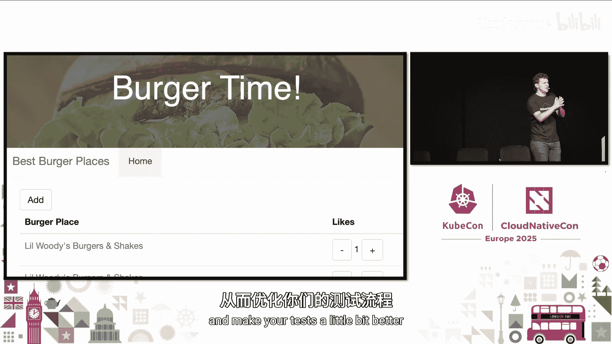

So speaking of tools for testing， I'm going to use Cyppress。

 Cyppress is an open source framework for jascript that allows you to write a jascript test inside of your or for your application that tests your application。

 And so Cyppress allows you to essentially assert things and check different aspects of your UI。

Find selectors in your dom。Maninipulates them a little bit and then sees if those changes are what you expect。

 In fact， let's look a little bit at our test code。We come out here to my project。

And my application that I have fairly straightforward。 I have a backend。

 a front end and my ET E directory。 E to these directories are going to be their own image。

 so they'll be their own containers inside of my application。

And so my test code looks something like this。Come here to Cyprus， E to E。And speck， there we go。

In here， I set a couple of different values。 First， I get a front end URL。

 That front end URL is going to test how Cyyppress is going access my application。

 because I want to test the entire flow， not just local hosts on some port。

 I want to actually test the ingress that's happening。

 And then I'm going have some data that I'm going to be passing in to my application。

 So I'm gonna put a new burger joint in there。😊，And then now I'm going to step through each of those tests。

 The first is texting to see if the page even loads because the page doesn't load。

No of the rest of tests are going to work， right， So you want to check that first that before each function is checking to see if the page even loads。

 And so we say we， we're visiting。The burger places sight。

Then we find an element on the screen or on the， on the page there on the window。 And we say。

 let's find this anchor tag that has an ad on it。 That's our addd button。Then in the next test。

 I'm going to click on that add button because I'm assuming I found it。

 And so you step through your UI。 You step through your process building on your flow as you go。

So I'm going to click on it。Then after I click on it， it's gonna to open， I hope it's going open a。

A form for me where I'm going to add my burger joint。

And then I'm going to save it and then check my list。

So this is what my test is going to do for my application。 My application， as I mentioned。

 is going to contain two containers。They。Are running。Here in a cluster that's defined like so。

I have a deployment。For my back end。That's going refer to my backend image， my burger back image。

 It's going to be tagged with an image label that will be defined during our build process。

Then I have a front end。Very similarly， okay。And then I have ingress that's defined。

Here at the bottom。There's lots of ingress providers out there today。 I'm gonna to be using Nrooc。

And we'll discuss why as I get through my， my， my process here。So that's the code。

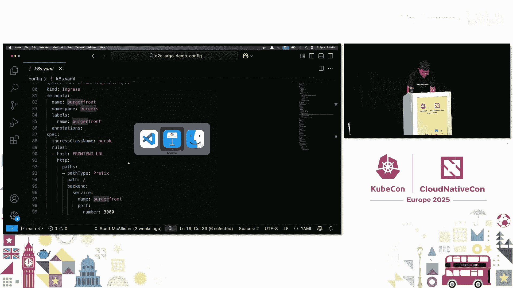

And so our environment is gonna to look something like this。 Again， I like see code。

 I like to see diagrams。 that way， I can visually see how things work together。😊。

I'm trying to make my production and my test site as， as even as possible， as similar as possible。

 Both of them are running front end back end pods。 And then I have my test code container that's going to be interfacing with my test cluster。

The flow。We're going see that in a second。 We're going to be using Github actions as our platform for running our C I process。

 our process to essentially build tests and then deploy our application。Inside of our Github action。

 we're going to be using K 3 S， super lightweight， nice Kubernetes distribution that allows you to spin up a Kubernetes cluster and then spin it down as you're running your Github action。

😊，And so our flow looks something like this。 As a developer。

 I'm going to have an app code repo that's going to have my Github action in it。

 running my K3 S cluster。 That's also going to be the cluster or the。😊。

Area where I'm going to have my Cypress code running。And then。I'm going to have my configure Po。

This touches on some of the get ups principles I want to talk about in this situation。

The Giops community recommends that you have your application code in your configuration code in two different places in two different repositories。

 because both of them have different life cycles。 You're gonna be making changes at different times to your application code。

 than you will be to your configuration code。 Even different teams are going to have probably have access to the two different repositories。

 And so in this demonstration， I wanted to separate them out just to show what what that might look like。

And so in this situation， we have our app repo， which is going to be checking out that configuration code during our Github action。

 It's going to be making some changes because it's going to be building our images and putting labels on them。

 right， So， and so our configuration repository needs to know about those changes。

 So it'll be commiting those code， those changes back to our configurationpo。😊，All right。So， now。

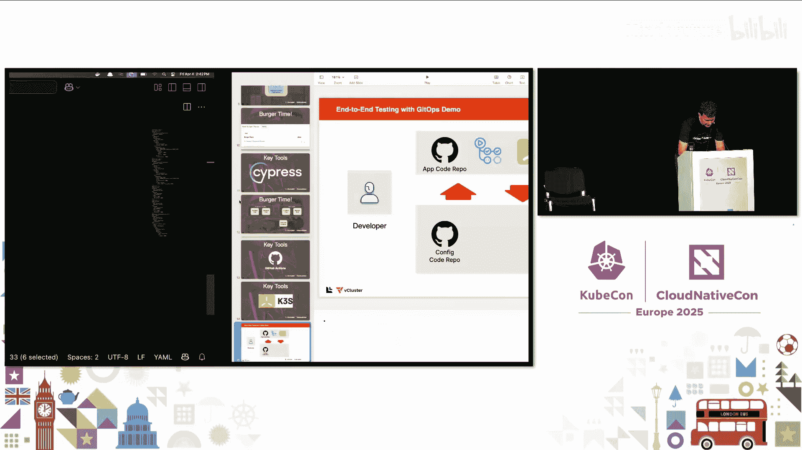

Let's look at。Our GiHub action。And I'm going be flying through this a little quickly。

 There's a lot going on in our Github action。 Rest assured。

 I'll have a link at the end to show you how to get to all these resources， both the repositories。

 the Github action， all the resources I talk about。 It'll be available at the end。😊。

So in I get up action here。I I'm going have it run on pull requests every time you open a pull request。

 not only when you open a pull request， but also what they say when you synchronize a pull request。

 So in GitHub or in any Git repository that you'll be using。

 you open a pull request or a merge request。 But then commonly。

 you're gonna be making commits to it after you open it。 That's what synchronizing is doing。

 It's gonna be running the test every time you make another commit on that。On that poll request。

It's going to be running out on any poll request that's trying to merge with Maine。

And then we get into our dependencies。 We're going to say that we want the Github action running on Yubutu。

We're going to check out the current repositororyiess code。 So the pull request is coming in。

Here's where we're gonna， we're going to specify that we're using K3 S。

Then we're going to log into Docker so that when we deal with our images and push them around and we want to push them up to Docker Hub to a Docker registry remote from where we're working so that it can be deployed and run in production。

😡，So we log into Docker。And then here， we start building。Our docker images。

 We're gonna build our backend and our front end。 We're going tag them with the shaw of the commit。

 Another great practice to have。 You always want to have your containers and your code commits to have the same identification that way you can say。

 oh， wait， this particular image， this particular container is running with this particular revision of code。

 Let's make sure that those are lined up and the same。😊，We push those images up to Docker Hub。

And then now we're going to be checking out our configuration code so we can check out code from another repo inside of our Github action。

 So I'm going to check it out from my config code repo。😊，And then， when I get that。I give it a path。

 I give it config repo path there in the middle where I that way I can identify that the， the。

 the code that I'm checking out from that repository。Inside of Config repo。

 it's a little big because I want to make it big so you can see it。

 So I'm going to scroll to the right here just for a second。I'm going to reference Config repo。

And inside the config directory， I have my Kubernetes manifest。

 My Kates manifest that we showed you before with my couple of deployments。

 my couple of services and my ingress。 I want to be able to perform a find and replace sort of action on this file。

😊，So I'm going to look for my placeholder values， the things in all caps。

 And then I'm going stick values for my shaw in there for my image labels。

And then for my front end URL。Vars dot， all caps。 These are values that you are variables that you save inside of your Gitthub repository that you have there。

And in this case， we're using the said command。 It's a command line command that allows you to do this type of find and replace inside of a file。

 In this situation， you could also use a templating engine， something like customizeizer Ginja。

Depends on what you want to use。 Again， it goes back to that conversation about there are many different tools for each step。

 And these are just the tools I'm using today。Next in our Github action， we have。

 We're going to be installing the helm charts that we need。 Or in this particular case。

 we need a helm chart。 We need the Nrock operator so that we can use that to provide our ingress。

The reason why we went with Enrock is because Enrock allows you to set up your URL to pass to the Nro service that's referring to that URL without having to know anything about that cluster aside from the fact that aside from the fact that it's tied to it using this Nro operators。

 so you don't need to know any IP addresses of services or anything like that。

 So that's why we went with NGoc today。Then， we apply。Arcade's file。And with that cluster running。

We're going to build。Our test container。 And then we're gonna run it。

We're going to pass in that frontend test URL that we have。

 We set that frontend test URL inside of our。 you saw that inside of our test code。

 but we also gave it inside of our Github Gitthub repository as well。

 Gitthub allows you to store variables and secrets and things。

 And that those are the values that you're seeing with the bars inside of this file。All right。

In fact， we'll go to that point in our。

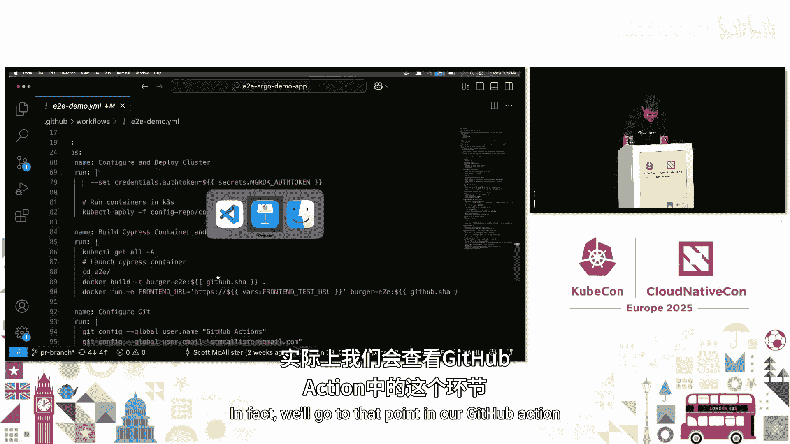

Get up action。And I recorded going through this。 What's the nice thing about video is that we can step through it。

 I can pause it。 I can go， I can skip through things。 Bad part is， I can't really change resolutions。

 So sorry about that。😊，But Ill， I'll get this going here。

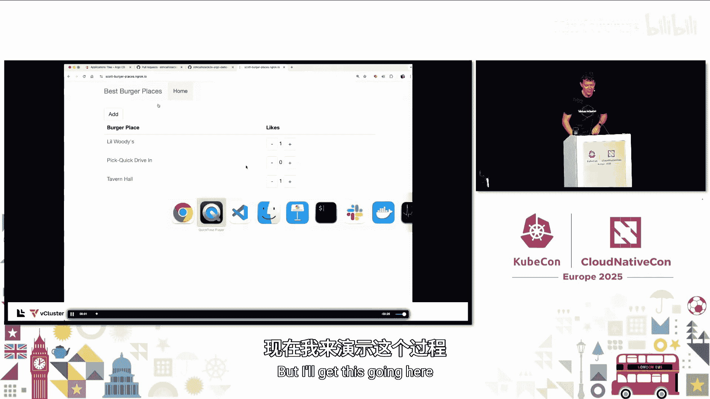

And essentially， what I'm doing。 and is I see a change that I want to make in my website。

 I want to change the title because I'm realizing this is not a burger joints list for all burger joints in the world just in Seattle。

 Washington， which is where I'm from。 And so Id make the change to say burger places of Seattle。😊。

And then I'm going to be pushing that code up。 So I'll commit that。And we can assume we know what。

 what's going on there。

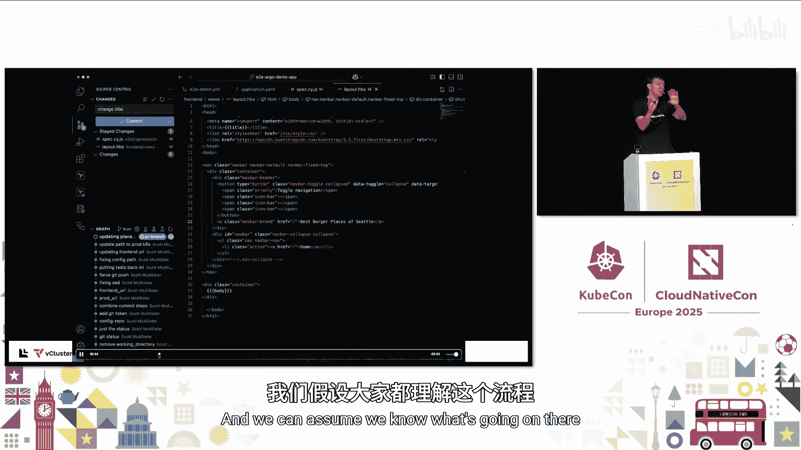

So I'm going to skip through that a little bit， and it's going to push that code up to Github for us。

And now I open a pull request。That pull request then launches。In to our Github action。

What's nice about watching this。 And I'm not going to make us watch the whole thing。

 but it's going to start giving it building and installing all of our dependencies。

 We we saw at the beginning there before it started spinning away that it was grabbing K3 S。

So that we could use that。 and now it's going to build the Docker images。Of our backend。

 and our front end。We're gonna skip across those。Cause that takes time。Again。

 it goes back to that whole slide。 Remember with the weightlifter， it does take time。And then， now。

We'll skip here to。Our test。And then， right here。Our tests ran。嗯。

It's always harder doing something in front of people。 There we go。 We're gonna watch。

 We're gonna see just three test pass， all four test path。

 I promise I don't want to spend time trying to scrub to it。 But we see how our tests pass。

And then it can move on to the next steps in our Github action。 If our tests don't pass。

Frameworks like Cyppress can provide resources like giving you a screenshot of what things looks like。

 And in this， for an example here。

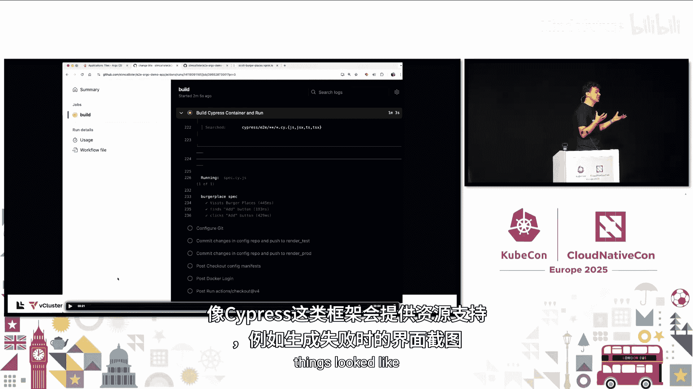

I can come out to my test code and say， oh， what does it look like when it failed？ And I say， oh。

 here's a screenshot when it couldn't load。

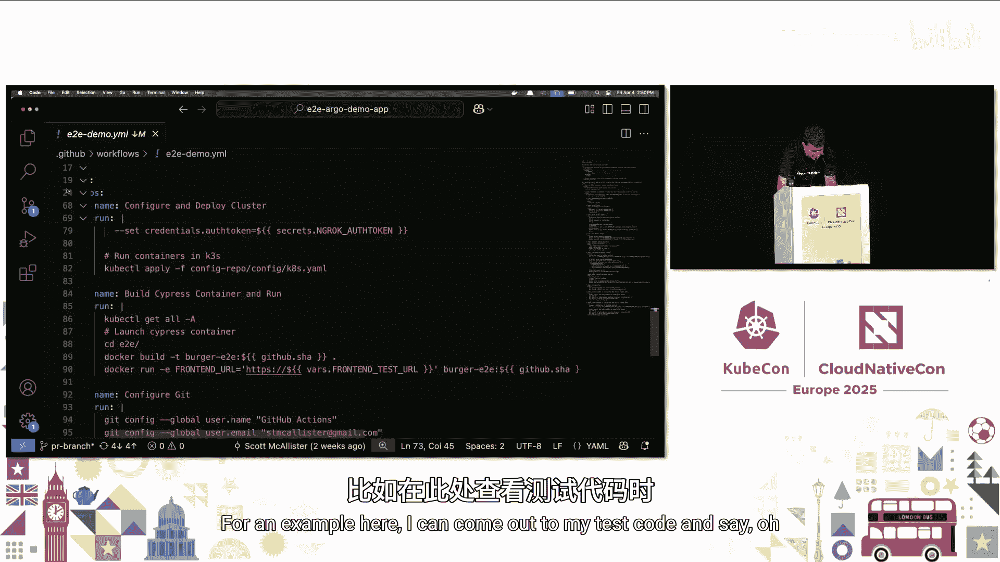

That very first test said， this is what I saw。That's what Cyprus is saying。

So you can have that as a resource。Why you're running your tests。

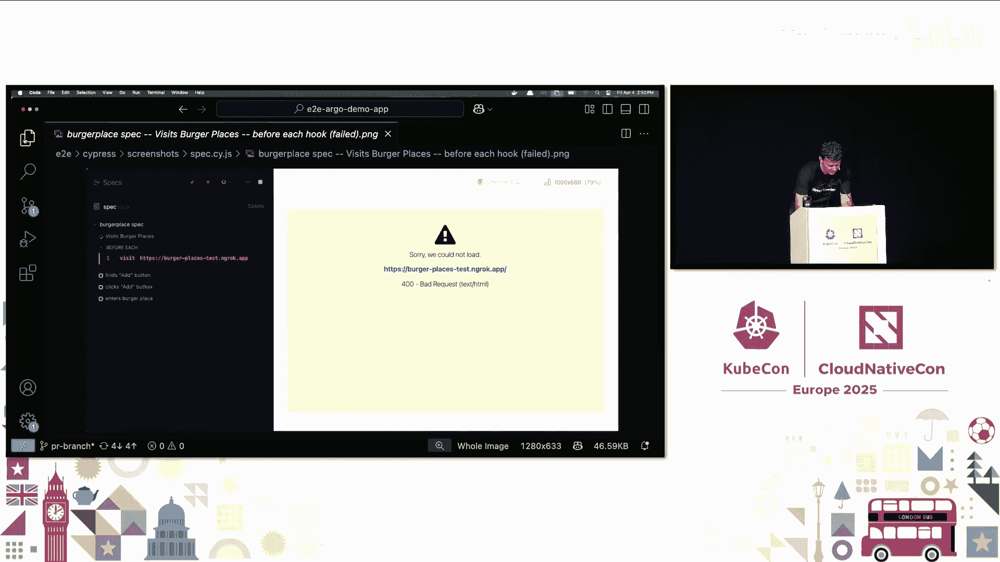

So our tests pass， and we skip into the next portion of our Github action。

 which is going to be doing a deploy。 And this is where I want to talk a little bit more about our Giops principles。

 Giops。😊。

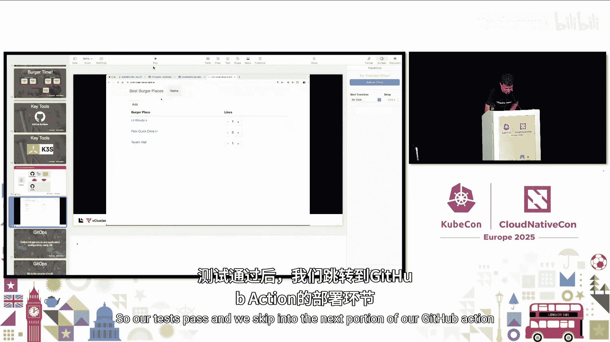

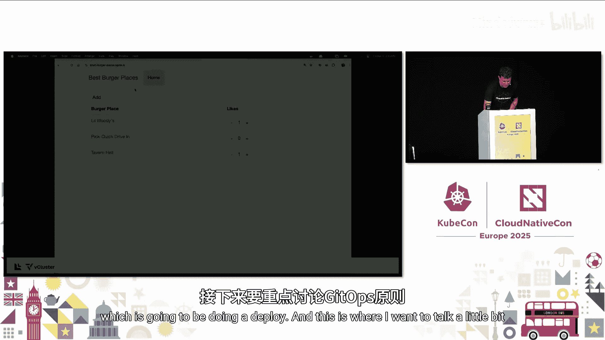

Is the philosophy of essentially saying our infrastructure is being defined as code。

 We should use Git。As that source of truth。Gt is where we should have everything。

 All our configuration stored。 You don't make changes by hand。

 You make changes by committing to our Git repository。 And then having a list that way。

 now you have a history of every change that you've made， you know exactly what changed。

 who changed it and when they changed it。 It's all happening inside of Git。 But then also。

 you have these processes， like the one we just saw the Github action。

 which is happening with our Git process where we're pushing the code up and we can start running automation on that code so that when we're pushing our configuration changes。

 we can test to make sure our configuration actually works。 and our application actually works。😊。

Get acts as our source of truth。 And then what I。Going to talk about next is an idea， again。

 in the Gitops community where they talk about the rendered manifest pattern。

This is a pattern where you have your manifests。 our cases config files that are actually going to be fully rendered with the values that we want to use to deploy。

 that are sitting waiting inside of our repository so that our C D process can pick those up。

 It's not gonna that C D process is not going be finding a template and then swapping out values。

 We're actually going to have the rendered version of that。Of that manifest。So in our case here。

 during our Github action， below the tests after the test passed， we had。

The Github action commit our changes back to the configuration repository。

 But instead of putting it in main。It actually created there are branches for testing。

 for render test and render prod。 And in this case。

 we made those branches that are never going to merge back to Maine。

There are gonna be their own spots that our C D process will watch for。

 Our main branch will keep having that template， the templated values。

 So that we have the placeholder values inside there， inside of here。 inside of the render branches。

 we have our fully rendered。Configurations， the nice thing about this。

 I'll let this run while I talk。 The nice thing about this is you'll have a full history again of the configurations of your application。

 not only for production， but also for tests for tests。

 those are the things that just ran inside of the Github action。 But that now you have that test。

 If you wanted to run additional tests while your application was out in the world。

 You can also do that。 Something called smoke screening。 to make sure that you can。😊。

Find things before your users find them。 You can find them first。So in this case here。

 we see that rendered manifest where we have the， the image labels。

 We have the URL value here in our test branch。And then we also have。Well。Yay for videos， all right。

 right？Here。We're not going to do this。 So today， are we。So you also saw that we had image labels。

 and they had the shws that were from the git commit and inside of our， of our。Our manifest there。

So we'll skip on to our next step。 now that we have rendered manifests and they're sitting in the branches。

 ready to be rendered， ready to be deployed。We're gonna introduce our last tool the day。

 And that is Argo C D。 Argo CD is gonna be watching our specific branches and saying， all right。

 I'm going watch the specific branch And when there's changes to that branch， I'm going to deploy it。

 In our case here， we'll look at the render Prad branch。😊，I'll have this video run。

 You'll want to watch。You see those turquoise sort of boxes down in the lower right hand corner。

 That's where you want to see the changes when something sinks。

That's gonna be processing our changes to our cluster before we push out to production。We see。

 We check。Make sure that our ingress is set。 Our deployments are set。

And then we can go and see that our production site。The changes has been made。

 So I made that change to the title， and I'm confident that I made changes that didn't adversely affect my system and then also did exactly what I wanted to do。

Now， to the keen eye， you'll notice that this list。Is 0。

Before they started filling out the form here。 and the previous one was not， well。

That's because this one， this application is running with local storage。 So in real invite。

 in real life， you'll want to have a persistent volume， some persistent storage so that you don't。

 you know， lose data every time you make a new image。So you might be thinking， Scott， that's nice。

My application is a little bit bigger than two deployments， or two services。

I have a lot more C Ds in my application。 This is going take a lot longer to build and a lot longer to test。

 And you're not wrong。I actually recently learned of a new project， not new。 I'm new to the project。

 V cluster， V cluster。😊，Is a Kubernetes distribution that allows you to have a cluster inside of a cluster。

 So in a sense， you can have an ephemeral， temporary Kubernetes cluster that's running inside of a host cluster。

 Now， how would this help with testing。 Imagine this for a second。

 You have your cluster that's sitting on your your cloud or environmental sitting in the world。

 And it's running a V cluster of your production environment。 And that's fine。

 But then it has all this the C Ds set up and installed inside of the host cluster。

 And you want to test with those same C D， the same versions of those C Ds with V cluster you're able to spin up a new V cluster。

 use all those same C Ds test the thing out and then spin it down。😊，You can do all that。 Actually。

 from a Github action， I joined the team last week。 So I don't have anything。Ready to show you。

 But what I do have is I have a link to some resources that my colgue， Siam。

 has made that is also available that I'll show you here in a Q R code。 in just a second。

 You can see how to do that。😊。

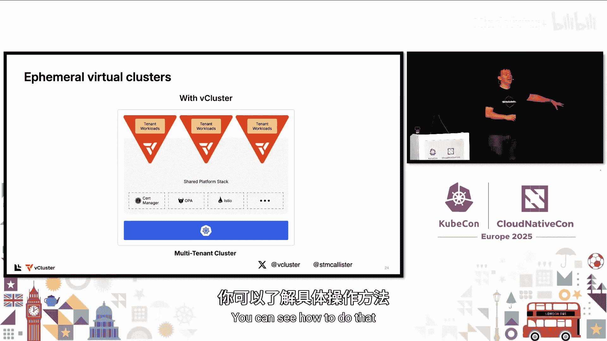

In fact， I do believe it is that Q R code。 I created a。

Channel on our community get our community Slas workspace。 It's for general discussion of testing。

 but also has a link to the slides that that I saw。

 It's actually an extended version of the slides because I had to chop a whole bunch of slides。

 and then also has links to the repositories， links to Siam's article on how to essentially。😊。

How to spin up an ephemeral environment in a pull request in a pull request similar similar to what I just did。

 but with V cluster instead。

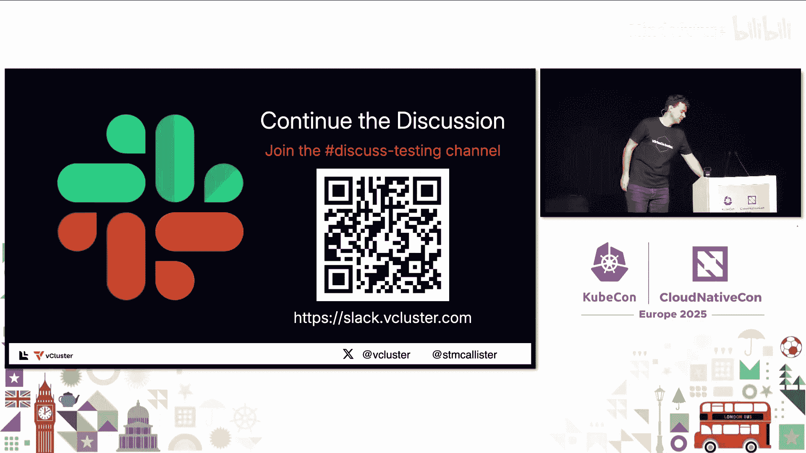

I'm Scott McAllister， a developer advocate who recently joined Gth Lab。

 the Makers of V clusterluster。 I want to thank you all so much for coming to my talk today and hope that you have a wonderful rest of your day and save travels after the next talk。

😊。