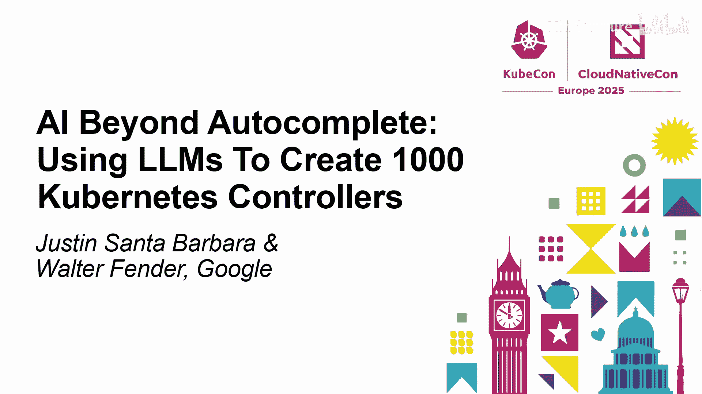
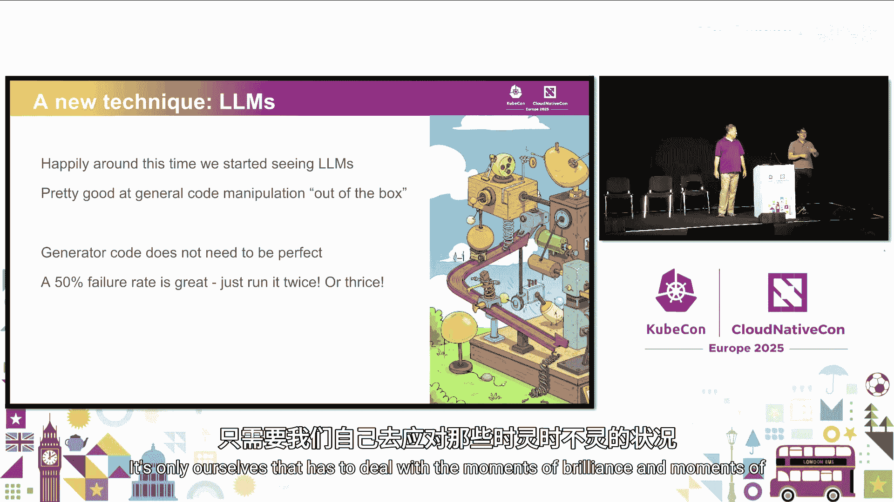
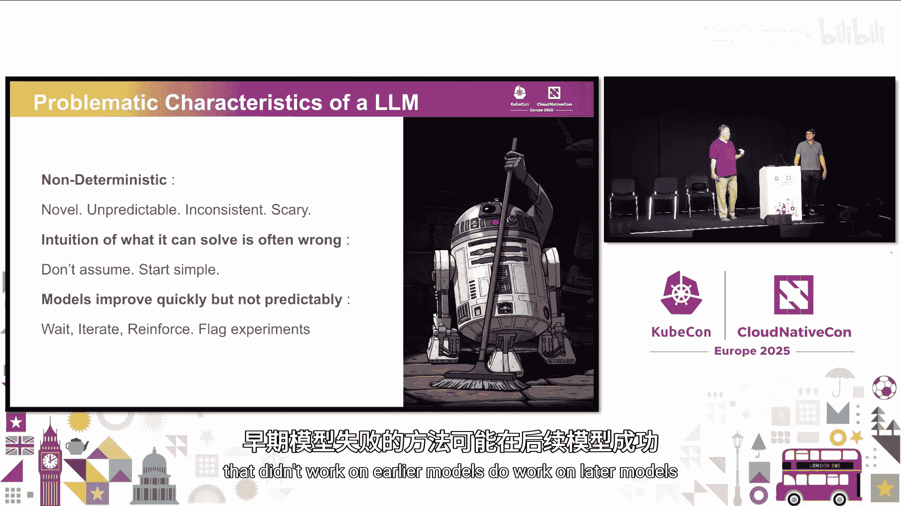
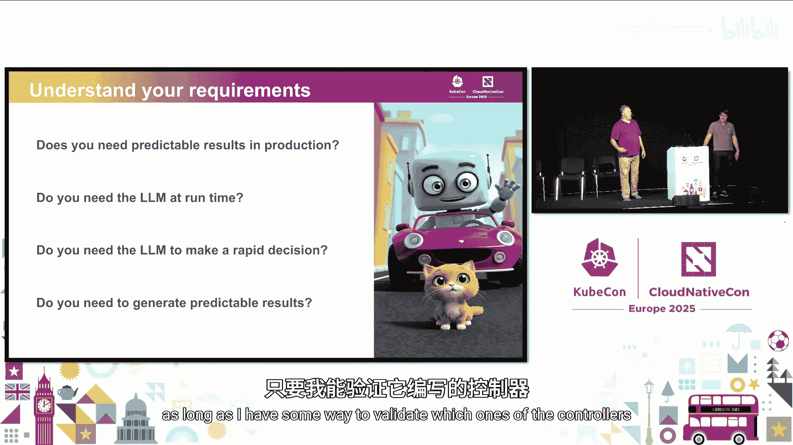
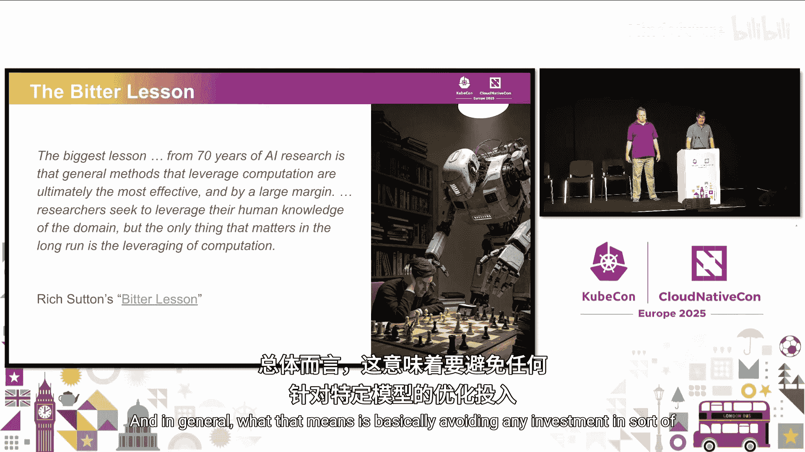
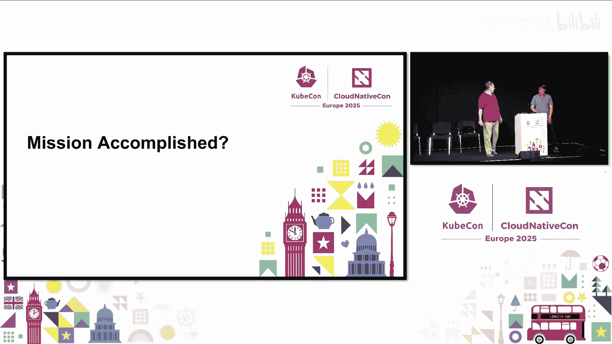
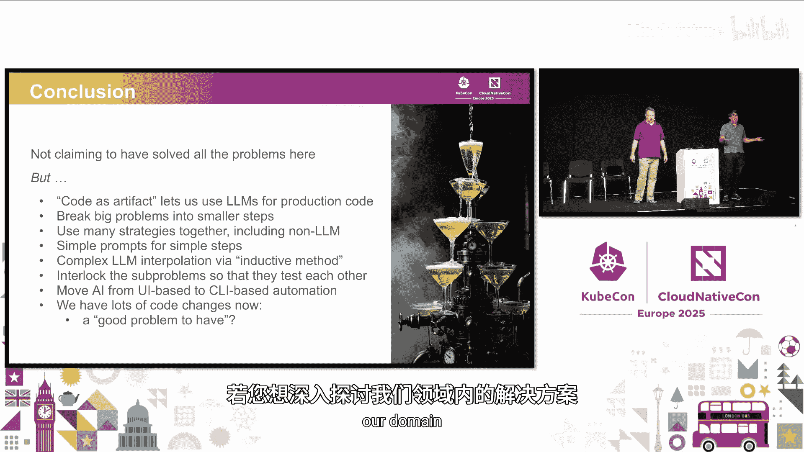
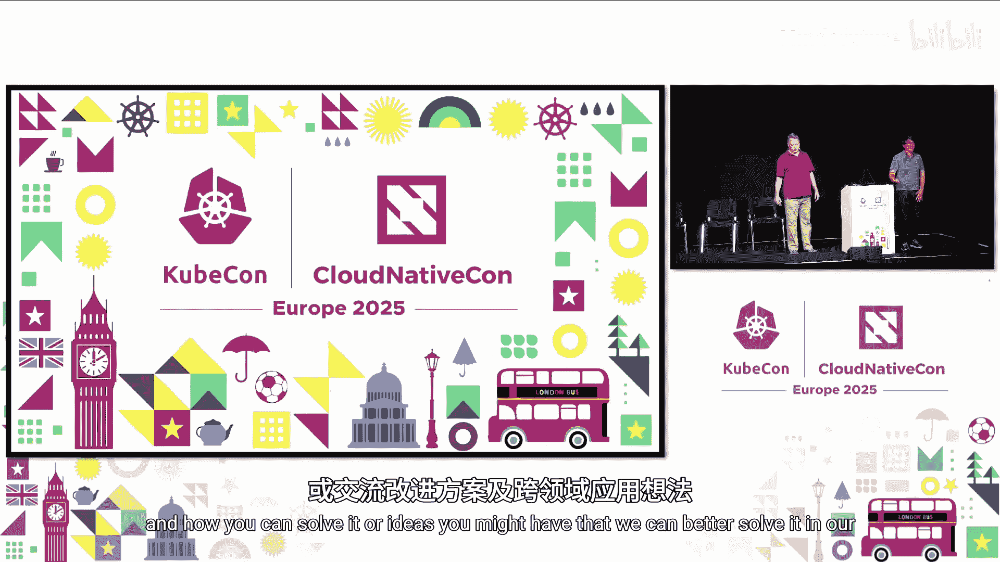
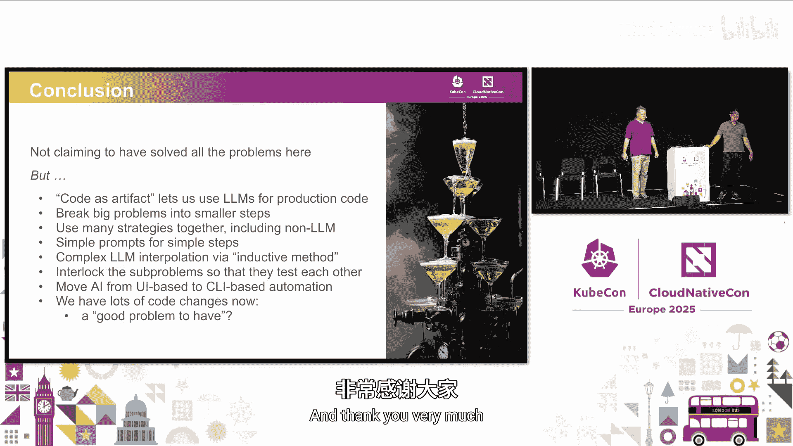

# KubeCon-+-CloudNativeCon-大会2025-｜-云原生计算-｜-可观测性-｜-Kubernetes-｜-Prometheus-p55-P55-AI-Beyond-Autocomplete---Using-LLMs-To-Create-1000-Kubernetes...-Justin-Sant--BV1Cd32zDEBG_p55-

Hello， everybody。Good morning。My name is Justin Santa Barbara。 I am a software engineer at Google。

 I work on a number of open source projects related to Kubernetes， one of which is Config connector。

 and we are going to be talking to you today about how we are using AI to generate those thousand controllers that make up Config connector。

 This is Walter。Hello， I'm Walter Fender， I also work on several open source Kubernetes projects。

 I'm both the software engineer and the EM on the Config Connector project as well as a few others。

Awesome， so we're not really going to dwell on Confi connector too much。

 This is really about the AI and Kubernetes controllers。

 but we are going to give a little bit of sort of our due due diligence about know。

 how did we come to a place where we ended up having to write 1000 Kubernetes controllers。😊。

So the basic idea of config Connector is we have RE GCP APIs to manage all the Google resources。

 it's very similar to what you would do for many of the other cloud providers。

But those rest APIs are not inherently Kubernetes native， and so。

Config Connector is our attempt to write a K RM Kubernetes resource model that allows you to control all the Google APIs。

 and there are similar projects like AK for AWS and ASO for Azure that have the same problem。

 and this means that if there are， and there are 1000 different rest APIs to control various things。

 we need to have 1000 controllers。Each of which has their individual business logic that is going to to allow you to do this。

 So， you know， we have one CRD in controller for SQL instance。

 We have another one for IIM service account。So then the question is， well。

 why not build on terraform。 And we tried。 Let me start with。 We tried。

 And the problem we get is it ends up being a magic machine。

 You have one core place that is the guts of your controller。 And any time you make changes to one。😊。

Resource to match something work， some other resource breaks and that magic machine is really hard and the more resources you try to do it this way。

 the more things break every time you make a change。

 and it becomes just too complicated having this one very huge intricate magic machine that is the heart of your controller。

And， and we want to emphasize that it's not a knock on terraform。

 This was true Also of other things we tried as well。 is。

 It is the nature of the magic machine that we become keepers of the magic machine。

 A customer will say， please fix this simple problem， which I could fix in one line。 And we're like。

 well， first， we have to go ask the magic machine to do this and this and this。

 And it becomes a week long escapade， as it were。So。How do we go from magic machines to L L Ms。 And。

 you know， as many of us who've used LL Ms， like， aren't they just the ultimate magic machine。

 I ask it something。 I have no idea how it's processing it。 And then it gives me a result。

 Isn't that the worst observation of what a magic machine is。😊，And I think the key here。

 the big breakthrough that enabled us to leverage the ultimate magic machine of LLMs is this idea。

 Balter actually created it of sort of code as the artifact。

 The problem with the terraform or DL magic machine was that that complexity。

 the complexity of the magic machine existed at runtime。

 We would ship it and customers would run that very complicated machine。

 and that runtime complexity made for project complexity。

 And what we wanted instead was we wanted lots of simple code。

 It's okay to have lots of code as long as each individual piece is isolated and simple。

 when we want to make a simple change， we simply make the change to the simple code。

 So we accept that we have a lot more code as long as each individual file is simpler and self-contained。

 and it is okay to continue to have magic to create that lots and lots of simple code。

 That is an asset。 and now we can leverage the magic machine for our own efficiency。😊。

But as long as we aren't shipping it and requiring customers to run that magic machine。

 we feel like we're in a much better place。 and the important thing here is we recognize also that the nature of the magic machine will improve over time。

 like we know that LLMs are going to get better tomorrow。

 We know that we will write better tooling to create particular problems we have。

 and we have people that are going to fix problems also both ourselves on the configectctor team and the community here right and we want to make sure that everyone。

 machines， humans tooling can all collaborate and work together on that code base。

 So a big requirement is that all of those tools and particularly the AI tools must be able to work with the code as it exists today。

 they must not assume that they created all the code。

 but they must just be able to make small incremental improvements。 So the code as it exists。

 It's the idea that the code is the primary artifact。

 The code is what defines our product and that is what we must work with。

 not some abstraction on the code。So we've mentioned before， this isn't the first time。

 and we actually came up with this idea of pull the magic machine to build time run from production。

 runtime before we even got to LLMs and so the first thing，I tried to build was an AST based tooling。

 right that standard classical approach， but that AST is complicated。 the processes are complicated。

 and it takes a huge amount of human investment。The generated code that we got out of it was better than with it's nice。

 simple code that we get in production。 But it's a very complicated build system to try and maintain。

 And every time something new happens。 you， you have to spend the time to make it better。

 It was an improvement。 but it wasn't as enough of an improvement to meet that thousand。

Conter goal that we had。And coincidentally or happily enough。

 this was actually around the time when L LM started appearing in the wild， as it were。

 The chat GP moment coincided with a lot of this exploration that we were doing。

 And one of the great things about L LMs is。😊，Most of them happen to be pretty good at manipulating code sort of straight out of the box。

 So we don't need to do a lot of that heavy lifting that we needed to do with the classical tooling。

 Another thing， you know， they're good。 but we also recognize that we didn't need the 100 percent reliability that we get with As T based tooling。

 We can accept the idea that you know， this can sometimes produce absolute garbage and sometimes produce wonderful results。

 We just run it twice， right， and that is a great asset because we aren't running that magic machine in production。

 It it's only ourselves that has to deal with the you know。

 moments of brilliance and moments of less brilliance。

So that sounds great。 problem solved， right Well， there's some interesting problems。

 we got to a little bit of it。 I mean， the first thing and it some of the problems are the LLMs and some of it is actually。

😊，Our assumptions， our fears， our interpretations of the L L Ms。LOMs are non deterministic。

 We can make them deterministic， but you lose a lot of the power when you do it。

And so for those of us with a very classical background in computer science， we're used to， you know。

 the AST or the other deterministic tools。It's kind of scary going to a non deterministic solution。

 a lot of there are assumptions。Just get thrown out the window。 It's like。

 if I have this new LOM tooling and I run a test and the test fails。 Does that mean my LOM is wrong。

 or does it just mean that I happen to hit a bad path through the LLM。 And if I just run it again。

 I'll get something better。 How many more times do I run it。You know。うん。Excuse me。

 If I make a change， you know， and I run the test and the test fails。Did my fix not work， I mean。

 was that prompt change not good， How many times do I have to run it， right。

 Sos that's a problem that we need to start learning how to deal with。

 And it's not just a problem on how to deal with it。But when you do it。

 whether you have an engineering team or teammates that are trying to use this tool。

 and they try it and the immediate response is， well， I tried it once it didn't work。 Well， okay。

 but you need to try it again， right， And so there is human elements to this as well。

Our intuition of how it works is also an interesting problem， right， We think， well。

 it didn't work this one time。 So I'm going to build this heavy solution on how to parse Yaml。 Well。

 I don't know。 we did this， right， And then I pulled all that yaml parsing out。 And I went。

 I'm just going to pass the Yaml in and see whether or not the LM can deal with it and surprise it can。

 right， so。Don't assume that it can't do things， even if you try it once and it doesn't and and start simple。

 See how much of the heavy lifting you can make the L L M do for you。

Also remember that you know these models keep working and they keep the people building them。

 keep making them better。 if you wait， you will get better results just by going to the newer model and you hear again and again。

 but there are other things you can do while you're waiting。

 you can come up with the right answer right you can iterate。

 you can generate the controller that is of the form that you want as a result。

That' then can be go back into the learning that reinforces。

 and that helps make that next model better。 I will also say。There is something you may try today。

 and it doesn't work。That doesn't mean it won't work on the next model。

 right So one of the things we found is it's very useful to flag our experiments so that they're easier to rerun on that next model because we've found things that didn't work on earlier models do work on later models。

It's also important that you understand your requirements， right。

 We've talked a little about this for our use case。 Do you need predictable results in production。

It's possible to generate an LLM that will give you predictable results in production。

 It won't run over the nice kitten。That's a lot of extra work。

 And do you need to run the LLM at runtime。 So we don't， right。

 And so we can get predict more predictable results at production time by running the LLM at build time and that。

 you know， and then have a much easier time determining which were the right results。

 Do you need the L M to make a rapid decision。 We don't。 We do things at build time。

 That means it's fine for our build system to go away while I'm sleeping and give me the results back when I get up。

 right。😊，Do we need to generate predictable results？ Well， yeah， I do， right， I mean。

 and but it doesn't have to be every time。 So to， to Justin's earlier point， I can run it twice。

 I can run it thrice as long as I have some way to validate which ones of the controllers that it wrote were the right ones。

I think one of the most interesting things I've read about AI is is Rich Sutton's the bitter lesson。

 And it is a great essay。 We've linked it there。 you can Google it。😊，It's mostly about AI research。

 but it is this idea that I think applies generally like to software engineering in our usage of AI also。

 And the idea is you， as a researcher or someone wanting to use AI as a person， will invest。

 you know your， your knowledge and try to get better results out of today's AI system。

 and you will get good results。However。you will be overtaken by the next generation of L L Ms by someone that puts more GPus in a box or uses the next generation of hardware。

 and essentially。What we have internalized here is the need to accept that。

 We have to accept the bitter lesson。 and we have to adopt strategies that do not fall down in the face of the bitter lesson。

 And in general， what that means is basically avoiding any investment in sort of model specific optimization。

 You know， you have to do your prompt tweaking。 But we're not going to spend weeks or months tweaking the prompts。

 because we know there's a new LLM coming and that new LLM will probably respond differently to the prompts。

 and all your work will then have to be thrown away。 So instead， focus on techniques。

 Things like how do we get the right information into the context。

 like LLMs are still obey the basic laws of information theory and computer science。

 garbage garbage out。 So if you want something to appear in the output。

 It sure is a lot easier to make sure that information appears in the input to the LLM。

 right It is much easier to do that than to rely on the training。

 that will be true of every foreseeable generation of LLMs to come。

 Can we break down big problems into lots of little。

bleRight that smaller problems should be easier problems and easier problems should be able to be solved more readily。

 Can we get the feedback loops going so that we can improve both each the way we do those strategies and sort of overall understand where we're going and how how we're doing and where we need to use more people and where we need to use more LLMs。

 Can we you know use the LLM for what they do today， What they're good at。

 like today that's exposing tools or functions to the LLM。 Can we basically do that and have it work。

😊，The idea is we want to be in a situation where when that new model is released。

 we see it purely as a win and not something that invalidates all our work。

 We use the broad techniques we used， like with the last generation。

 Maybe we tweaked the prompts a little， but we find that our results just get better and we aren't sort of clinging to the work we did in the past。

So jigs and interlocks。We're going to build lots of little tools。

 We're going to work out how to make those tools work together。

 and then we're going to work out how to do these things again and again as quickly as possible as reliably as possible。

 It's very similar for those of you who maybe do something like wworking， you build tools。

That are just there to help you build on tools and to do some one operation really easily。

 really quickly。And so one of the first chiigs， this is a simple one。

 We basically inject a variable substitute values into a prompt。

 We have a couple of functions that we've exposed to the LLM like write a file。 and we basically say。

 hey LLM， go do this relatively simple task。 You're also allowed it's in the three dots。

 but it's also allowed to run G cloud help， for example， here。

 So this is like a simple task where it reads the help files for G cloudud and tries to construct a test case。

 right This is a simple task so we think we can use simple tooling like basic prompt injection or prompt。

Templating with with tool usage。That works well for simple tasks。

 but I think one one of the things that we learned is it doesn't work well for more complicated tasks。

 So this is like more of the sort of vibe coding type task。 Can you actually write a hey LM。

 Can you write a fer， Can you write a controller， Can you write a CRD， right。

People are getting good results， but in general， we find that the more complicated tasks need a bit more structure to get the best results from。

 And so what we do is this， we call it induction is our little nickname for it。

 But if you look at this is actual code from the KCC project。

 This is a fuzzer for a TPU node or TU virtual machine。

 And you can see the important bit is these three bits at the three lines at the top where we basically have some structured input data。

 We're saying we want to run a fuzz gen。 It's just the name of a tool。 It doesn't really matter。

 And we are fuzzing a resource that has a proto representation as this particular kind or type and the CRD kind is TpU virtual machine。

And what we do is we take these as examples from the code base。

 and we sort of think of them as inputs and outputs。

 And what we're going to do is we're going to use the LLM to give it the input and ask it for the output for the next case。

 So in this case， you know， we can degrade it into just the annotations and the file， the file。

 which is the output。And then the way we feed that to today's LLM is by wrapping them in XML， which。

 of course， makes us sad。 But you， we move past that quickly。Then we come to the actual principle。

 which is we write a couple of these fers by hand。 We add those annotations to those first files。

 That's sort of the the first step of the inductive loop。

 And then now when we want to do the next one。 We write the annotations for that n plus one case。

 we have from our existing code basease， we scan the code base， Con those inputs and outputs。

 And we put those into the context。 And then we say， all right， here's the prompt， here's the input。

We take that output from the N LM。 We correct any issues that might exist。

 or we choose to run it again or whatever it is。 We might hang code it if it's that bad。

 but we commit that into the code base with code review。 That becomes the M plus one case。

 So this is a very powerful way to get from you know，2 to 3 to 4 to 5 to 1000。

 for all of these sort of sub problems that we are facing。

 And it works much better than simple vibe coding。So that sounds great。 How many steps are there and。

The answer is， I think right now， about 12，15 such steps。

Which sounds like a lot for creating a controller。 but you know。

 there are pre stepss for some of the steps。 One of the first things you saw from Justin's stuff was this G cloud what was the point of doing that G cloud。

 It turns out the point of doing that G cloud was so that we would make HtTP requests。

 see the HtTP response， capture that HTTP log。 That's one step。

 The next step is now that we understand what a request response looks like for that resource。

 now we can have the LLM read the templaized version in sample version of the of the induction loop and the logs and use those two pieces of information to then create the mock right and so what we have is breaking down and we we can do things like when we generate that HtTP log。

There are basic checks we can make on it to determine。If there are a bunch of 404s。

 then something went wrong。 and we should probably stop here。

 And so when we get either we need to regenerate the the G cloud commands or we need to rerun the the。

 the actual test。That generated those things。 And that's where we get this whole interlock。

 right so that that check for 404 is one of the interlocks。

 and we can run this stuff in parallel and the requests that get a 404 are paused。

 We capture the status， we go and investigate。 and other of the parallel change。

 which didn't hit a 404 gets a proceed。Yeah， I think this is， this is a hypothesis。

 but I think it's quite important。 Like we're not just breaking down the tasks because these smaller tasks are easier。

 It is the idea that， you know， we go over here with this task。 We go over here with the other task。

 If there is a hallucination on one of the two， we hypothesize that it is unlikely that these two different tasks will both fail in a way that's come together in a way that still works。

 right， so。The hallucination on one is caught hopefully caught by the correct output on the other。

 or at least。We think there are many ways for the LLM to hallucinate， but ideally。

 there is only one way for them to get it right。 And so is that is the core of the hypothesis of this interlock idea。

 Break down the problems。 Lots of independent steps。 If they can mesh together。

 Hopefully if they mesh together， that is evidence that they are meshing correctly。So。

Iterative improvement， many tools。There are varying things we can do。

 there are varying things we've built along the way。 we have examples of things like， well。

 I have an LLM。 I want it to be able to generate a CR from its newly generated CR day type so we we build something that can go talk to Kubernetes。

 download the open API schema and make that available to the LLM。I can then have it look at the mos。

 make the mocks available to the LLM， and when we start building， you know building these steps。

 the here's the build， here's the build output， each of these things that we make available to the LLM is one more thing that the LLM can then use to not hallucinate to understand when it had a problem。

And I think one of the interesting things is I think this is， you know， this is the cursor workflow。

 This is the agent workflow。 We've actually found this one hasn't worked as well for us yet as some of the other workflows like the iterative loop。

 This is the one we sort of expect to。 We should be able to give the LLL lots of tools ask it to fix a compiler error and have it work。

In our experience with the way we've built it， it doesn't， which is all credit to other tools， right。

 Of course， we haven't had as good results。 And so this is where like humans typically have to get involved today。

 We obviously hope that， you know， we will figure it out or the other thems will figure it out and that will go away or get lessened。

 But today， like a lot of the basic fixing of compiler errors has to be fixed by a person going in and fixing those things。

So， yeah， so we have。Thinking also about the way cursor works， right， that is a UI sidebar。

 and we don't want our engineers to have to go and type in into a little sidebar every time we have built a automated pipeline to basically combine those complicated or large large number of steps into a repeatable pattern。

 which Walter will describe。So decomose combined strategies。 We've kind of gotten a breakdown here。

 so。We've said there are 1215 steps that need to be run through to generate one controller。

 A lot of this needs to be metadata driven。 There's actually probably what I would say is there was a one time step before we even get here。

 which was asking the LLM to generate the metadata for 1000 resources Then I may have spent more hours than I want to recollect actually getting rid of the hallucinations in that metadata。

 but we get the metadata。 And now。We have a description of， you know， varying things。

 It can be the Git branch that we're going to make each resource in。 the name of the resource。

 where it can find the profile for the resource。All of these sort of things。

 And now we can basically just say， hey。It takes maybe 10 minutes。To run one step on one resource。

 But I have 1000 of them to do。 And if we've written that first step jig correctly。

 I can just go to bed and come back the following morning and see that it's run that first jig across 1000 resources and maybe 600 of them were successful right And now I can kick it off。

 running the second step on the 600 that were successful while I start debugging what went wrong on the 400 where it didn't work。

And in this way， we can get much better throughput。To get things actually working。

 And the other thing is， not all of these steps have to be L L M based， right。

 We can talk about hybrid solutions， so。If I've written something and I can like the rest or the go structure for what I want my CRD to look like。

 I don't need the LLM to generate the open API schema for me。 I can just go and have CRD generators。

 There are several of them out there that will do that next step for me。

And you can see here there are a lot of steps I'm not going to necessarily go through all of them。

 but some of these steps are we've kind of coded as they're ones that the LLM does。

 we've already talked a bit about the compile errors。

 there are classes of compile errors that we've actually gotten the LLM to do a good job fixing if it's a missing import。

 the LLM does a great job there are certainly other classes of errors that it doesn't do a great job on and you know this is why we have two passes。

We also have the compile as the validator for those sort of steps。

 And one of the things to remember is each of these steps is。

Some actual action and then some validation to determine whether that action was successful or not。

So how do we scale like we'， we've now written。A large number of controllers。

 And we know that sometimes L O M salucinate。So how do we create trust， right？

One option reviewing code。 right， if I can review the code and the code looks good， that's great。

But reviewing 100 controllers is a lot of code to review， right。

 It may be faster than writing the code， but we had the LLM write the code because it was going to take so long to write the code。

 So we have a new bottleneck， right。Excuse me。 And there are varying things we can do。

 There are members of this community who are doing things like creatinglinters for C Ds。

 We havelins for code。 that， that catches a certain number of the problems。

If we can have a way to generate tests that we trust。

 and one of the things we have in this particular domain space is。

If I have a known input and a known output。Then at some level。

 I can kind of trust that that test works by just checking that the input and the output makes sense。

 And even if I'm generating mocks。I can have an AB switch where I run the test with the Mos。

 I run the test with the live system， and if everything lines up。

 then I've generated a much higher confidence in my output。

I can also use a different LLM that knows how to find particular classes of problems right and this is a great way and we can use humans right。

 but the key is work out what the human is good at right so if what I want to do is determine my CRD is an API I'm going to have to support for forever and I want to make sure that that API seems like one that my team is willing to support that I want my best API reviewers to go and to review that API because that's a very hard thing to actually get an LLM today to say is this a good API or not？

So。Automating， we talked about these jigs， their automation。

 What we've been talking about is then automating that automation， right。

 It's how can I get the computer to do all the heavy lifting， And we have，ll send the code。

 The code is available。 It's in Github。 It's open to anyone to review。But。

I will say a couple of key takeaways are， you we're trying to work out how to scale up controlling creating controllers。

Make sure you're solving the problem you find。 we have made the mistake on multiple occasions of thinking。

 oh。I need to be able to run this thing in massive parallel so I can return it quickly。Do I。

 or can I just let it run overnight。嗯。Validation， validation is key， right， like。

Validation is the way that I know that I'm not building on top of a house of cards that's going to fall down。

And recording intention and results， if something went wrong。

 I want to know what I asked the LLM to do。 I want to know what the feedback was and what went wrong。

 And so it's really important that you record intention and results。Also。

 there may not be one true solution， right， We have to deal with both the。Greenfield。

 new resources that we've never had to write before。

 And so we can say what we generate is the right behavior as long as it does what a human expects。

But we have some of these old resources that we had built with terraform。

 And so we need to be backward compatible。 And so we actually have two different paths through our generator because we have。

Two different problems。 And they need to be a little bit different。So。O S S parallels， you know。

 optimize for more simpler code， lots of tests。You know when we did the when Justin and I did the initial analysis before we even got to LLMs of the AS T solution versus the non A T solution。

 our realization was the AS T solution was going to be 10 times more code than the magic module。

But the key is that the magic module solution， all of that code was processed on every request。😊。

So even though there's a lot more code for the A S T or in this case， the LLM solution。

 the actual executing code is 10 times smaller。 So when you are looking at an individual resource。

 there is much less code for you to understand when you're trying to work out what's going on。

There are a lot more resources， So there's a lot more code。

 but the actual code for any given request is much smaller。

 and that is sort of something we've worked very hard in the Kubernetes project。 Also。

 like we have tried to make sure that we can merge contributions from the wonderful community and have confidence in doing so。

 And we try to merge those things quickly， right， This is this is an open source problem。

 And so A AI and open source are not actually these completely different things。

 We have a huge head start here。嗯。So just to conclude quickly because I know it' over time。

 Have we finished， We're not claim to solve all the problems。

 We think there's a lot of applicability of our techniques that we've describedd here。

 I won't read out the slide because we're out of time。

 But if you would like to talk to us more about know how we've approached this problem in our domain。

 and you know how you can solve it or ideas you might have that we can better solve it in our domain or from your domain。

 please come and find us afterwards for questions。 And thank you very much。😊。

