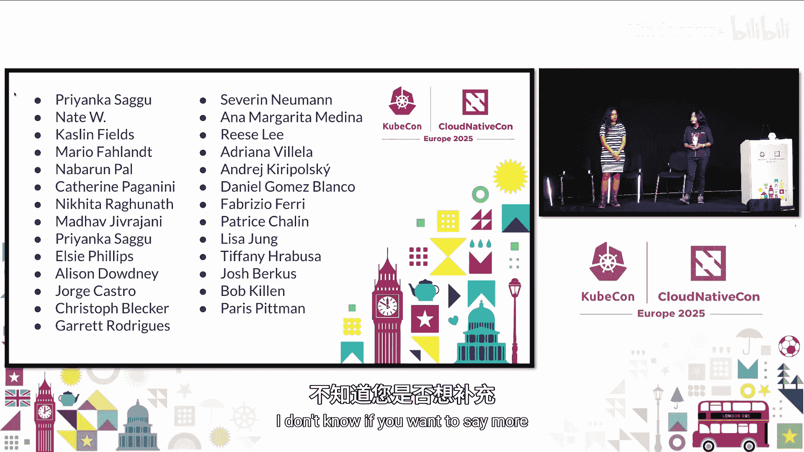
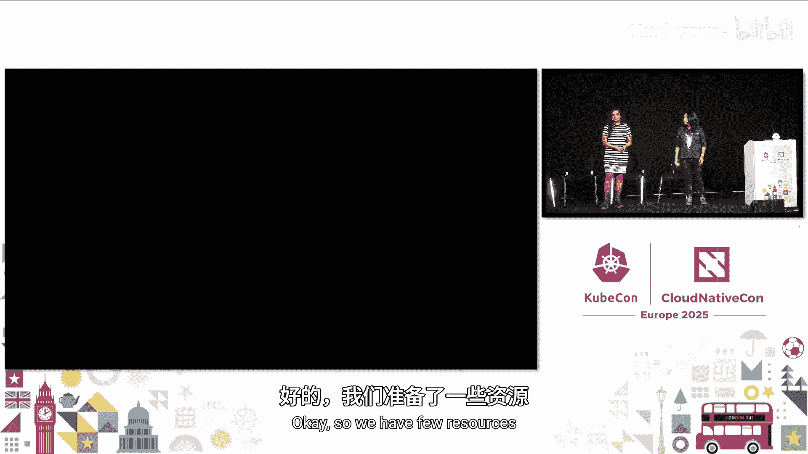
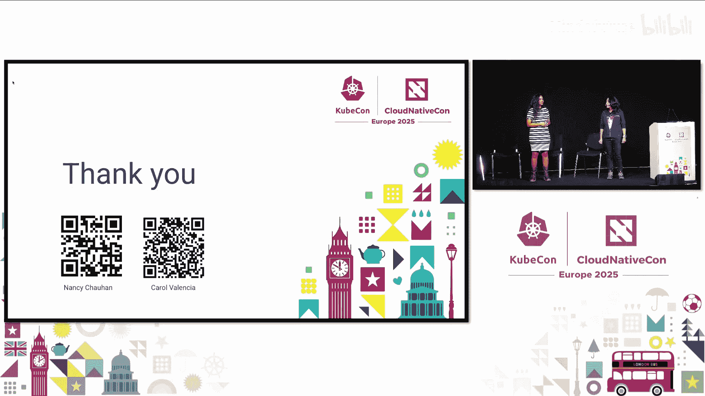
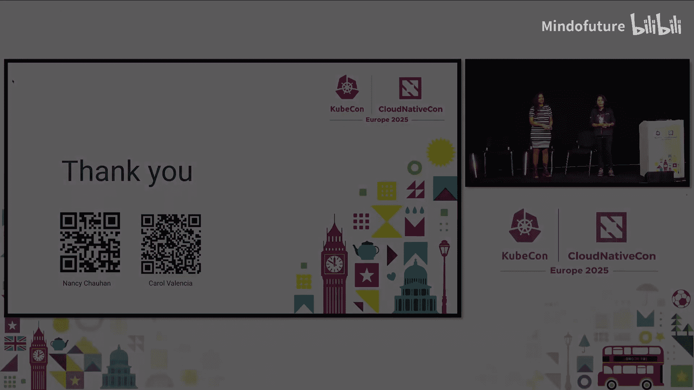

# KubeCon-+-CloudNativeCon-大会2025-｜-云原生计算-｜-可观测性-｜-Kubernetes-｜-Prometheus-p56-P56-No-Code-Needed---From-Emojis-To-Glory-on-the-Contribution-Ladder---Nancy-Cha--BV1Cd32zDEBG_p56-

Thank you so much， everyone。 So that's gbified me going with the trend。 I'm Nancy。 I love products。

 I work as engineer and developer advocate currently I'm doing my masters from Cornell University and previously I have worked at B Ki。

 which is an ecommerce startup。 I have worked with Gitford and local stack as a advocate。

 I am a CNC ambassador， I also founded women in Cloud native community。

 and that's where I met Carolroll and she became a very good friend， and we are giving a talk。

 so I'm super excited for giving the first talk with you。 I also led CNNC of Su Week。

 So I am a coch of Tg environment sustainability for all those people who are concerned about sustainability in tech。

 I love nature， I love CAs， and I love to travel。 and if you want to know more about me。

 you can scan the QR code。😊，Okay， well， here。 my name is Carol Valencia。 for nice to meet you。

 everyone。😊，I like cloud native security。 I used to work in aqua security。

 This is a very security company。 now Ianging El， but I really like the Dev bobs and cloud native topics。

😊，I am CNNCF ambassador also with Lake Nancy and also I am Club native chapter organizer for Latin America。

 like it will be in the city that I live that is so po and also I help with Lima Peru because I am from Peru and I trying to help my local community。

And I am doing also helping some K C don I think thats give me an overview of How is the community how can we help each other。

 especially with open source and on this tech。topicspics。 and also。

 I participate in the Kubernetes release team。 to also give me an a that what is some of the topics。

 So maybe how can we start to contribute。Even for of people that don't speak the language。

 is a foreigner and therefore。Another country that is not native。 And yeah。

 that's the reason that even I help with the Spanish localization。

 mainly that in the projects of Kubernetes and open telemetry。 And if you have any doubt。

 I reach my context to help you in any of these initiatives。Awesome。

 so why non code contribution matters？ We are going to talk about that。 But before we start。

 I just want to ask you how many of you are struggling with documentation， bad documentation。

 And you want someone to fix it。😊，Please don't be shy。 I see a lot of hands。

 So yeah that's that's the starting of her talk。 So I collected these things from the people of Cafe community and open source community。

 and one thing which I really liked at the top is known code contributors to open source projects are like multipliers for code contributions you don't have to write code to contribute to open source。

 then Movie says that she was overwhelmed I felt intimidated because I thought I had to write code or build complex software to fit in。

 but then she came across one of the great article that I'm proud to be a known code open source contributor and that's what motivated her and that's that's the whole idea for today's talk we would like to motivate you to enable more knowncode contributions。

😊，So nonC contributions are secret to open source success。

 they enable open source projects in many ways be it documentation。

 be it someone suggesting better UX be it someone suggesting someone giving the feedback there are so many nonC contributions which we are going to talk more about and in today's talk and maybe you can pick up which you want to contribute to。

😊，So let's look at one common example。 and this is something related to me to me as well。

 So when I started my career at Blink， we used to Grfaana。

 it was back in 20192018 and we used to use Graffaana open source version and then we used to use Grfaa and we had like a lot of feedbacks to Grfaa。

 and then we went to Kubernetes forum Delhi we had Grfaa team and we said that let's sit on the table and let's talk about it。

 we want to give you feedbacks can you can you please fix this in your codeb Can you have more features So yes。

 this is this is what I want to talk about this is also a contribution So users ask questions or provide feedback that hey I tried out your product I tried out this thing。

 maybe onboarding could be better documentation was not good maybe there are so many open issues you can you have first timer issues there are so many ways in which you can give feedback Mainers receive and listen to that input。

😊，Do we have any project maintainers in the audience， by the way。ow oh， we have。 So， yes。

 I I'm pretty sure you， you might feel like the feedback is super important。

 Then they gain insights and ideas。 They improve the features and experiment。

 deliver better software and create something which uses love。

 So this is one of the known code contribution， providing feedback。😊，So I just collected some data。

 so this is composition of people attending Cecon 2024 Paris。

 Kubcon Paris and we have business operations people， we have executive people。

 we have sales and marketing， we have product managers we also have professors and academic we have students so you see those percentage is a huge number and these are like those people who are directly related to product but they are not developers。

😊，So， yes， this is the data。 And why noncode contribution matter community is more than code for any open source project be it Kubernetes。

 We're going to touch upon that like how you can start contributing to Kubernetes。 be it Kubernetes。

 There are so many people behind that project。 There are so many people working on documentation。

 so many people working on the release teams and communications。

 So many people working on the issue triage。 So we have more。

 we have very we have a lot of people who are behind the success of open source project。

 Nocodeders drive impact。 be it the feedback collecting the feedback be it be it connecting with the community like we are we all are doing in this room。

 Nocodeders definitely drive impact。 So recognition isn't just for code。

 theres a space for everyone in tech。 So yes， that's why noncode contributions matter。😊，Yeah。Well。

 I here we have a list， a huge list that I think is if you can identify with any of this role。

 because you have many， like， we say documentations that maybe you would like to share your knowledge。

 creating a blog。Or helping with the translation in your language。

Communication is like you can see Sla is very important in all open source projects。

 like helping there is very important。 And if you think about it。

 you have the landscape scale for the CNC that is like more than 1000 projects。 we。

 we will focus on Kubernetes and open telemetry because there is a big projects that they have a big thing in this communications。

 But if you think about， you can apply all that we will。

We will talk in the thousands of the CNCF projects that you have and really they need attentions in issue triage。

 quantum modes， C ICD， backfix it。 and yeah it's so many things。

Here is an example about you have the contributor guide that is very common in the open source project。

 even if it's a open source project that is in the sandbox we have at template that they have this contributing guide that they have ways to contribute finding an issue testing you can find it and you can help。

And you have also more advances， maybe overwhelming contributor guides that is in Kubernetes and open telemetry。

 I think a good of starting is try to， Ri me all these contributor guides。Even if it's overwhelming。

 because sometimes。Is like some representation that you are going in the House of San else。

 Don't you have to read the rules of the House before to try only maybe open an issue and say。

 why is it is not working。 And yeah， and also some relationships So try to meet the people that is doing the。

The maintainers are changing to reach these people。 And that will be a good start that you。

 you can see if your contributions。Could be approved and and advanced because this is like the first step。

 know the people try to reach them and try to understand。

 and also reach the the rules of the House in of that as questions from is lack。

 that that would be like the first approach that everyone that want to start to contribute in the project。

Okay。And yeah， here I we have an abstraction that maybe focus a little more in documentation because maybe it's a big topic。

 And as you think about， we have for one side， the technical writers that are experts in this field。

 and for other the product manager。 But like maybe in the the box space。

 there sometimes they are not speaking each other。 So sometimes that's the reason that documentations could be tricky because。

Sometimes it's the distinguished engineer that is writing and it's very hard to read it。

 And then they have this usability or user experience to create a。EA quick start。 Dont。

 that could be our contributions。 Don't we need more people that from our perspective。

 try to create a better content。Thinking on all the， the。

 the kind of users that could use the open source project。And in open source。

 we don't have these roles dedicated。 Don everyone is like people that is donating their time。

 Don't you you have to think about that。 Maybe this is the timing because they take at times when they the people approve。

Your your request or giving contact， but yeah， it's a little tricky。

 but it's very I think the most important is you get in touch and you have this learning way。

And another point that I like is localizations because for people that we don't speak English。

 we are from other countries， this is。This will help to reach more people。

 Like maybe we don't have to translate everything， but at the basic。

 like like Kubernetes and open telemetry that they have。Complex。ECom knowledge， complex。

 you can translate this。 We have， like， for example。

 nice project like a grocery that they translate the basic concepts。

And it's not only about sometimes the open source project。 For example。

 we have that is some sample that I really like is the deaf and hard hearing。

Group that they already are creating a resource。 And， for example。

 we could help them translating to reach more people that they have that these belong from these minority groups。

 like translate White papers that is buildings and other text is a lot of things that you can do when you think about localizations。

 not only translated documentation only other documents that is across all the text and across all the CNCF。

And here we can see about the contributor ladder， but if you think you started as a contributor that tried to translate。

 tried to help with some issues， issues triage， or try to manage in this lack or help with the block content the release and you started as a contributor and after you。

E showshow their resilience to keep in time， because I think the most tricky is that you have to try to be on time like。

In mourn， when Jecho sometimes it' tricky to be consistent。After that。

 you could be a maintainer that and also here is a good example that we have good leads inside of the open source community that are thinking about how to grow up the community like。

 for example， in Kubernetes， we have building the brokeroli list that they try to create a blocks only to show what is the caps。

 the caps that it will be more features that is developed inside of Kubernet。

 thinking about the people that these new beginnings or the contributor experience that you will see when you are growing up in the contributor ladder。

 also you can create more projects that can reach more people about how to help each other。EYeah。

 here is like。I put this aside because it this Kubernetes community is very big。

 And I think it's one of the。amples about how can be organizing noncoding experience so you see the contributor experience is they have this GiHub that is in the slide。

 but each of these community， communities management。

 De Start event is a project It's a complete GiHub project that you can go there if you identify maybe with statistics or try to help with the mentoring mentoring is like you have to manage reach the people that maybe could。

Helping each other is's a lot of project management that you have to go and help enrich reach people。

 contributors， blog。 It's really like， for example， we have Kubernetes。

CV and the release blocks and all this manage is a lot of work that you have a lot of people that is working behind of that。

 is a different。Different groups， different that you can participate。 and also。

 you can replicate this in the other open source project。 Even they have a YouTube。

 I put it in the Kubernet's new contributor orientation that each week is recording how to。

Start how to be a new contributor inside of Kubernetes。 The last week that is a block。

 that is a project that try to。To list all the caps。

 all all the new news about Kubernetes for the people that is new user。

That's amazing information Carol so so Kubernetes community has done a lot of hard work creating this website which is about known code contributions so maybe you can scan the QR code and it's quite detailed and you want to get started with any of the known code contributions we're going to touch upon that it could be released teams it could be documentation you can take part in that the next one is testing which I touched upon initially as well you need to test to ensure that everything works as expected and everyone set up is different and that's a strength you give the feedback and there are diverse testers they find unique usability issues so there are different ways you can help the open source projects any open source projects under CNC or any any you can test the features you can report the bugs you can verify the fixes。

 you can try the issues you just run the project you are stuck you can just raise the issue that this is this is something which is not。

😊，Working on that's testing the features。 So I'm going to touch upon the issue triage it's a process by which its and it reviews the new Github issues and request。

 we have a lot of Github issues and request and if you go through Kubernetes project or maybe open to telemetry or any other big project they have like multiple issues and the request so you can basically become a tri and you can organize them to be action and you can take partis you can you can basically contribute in that way so it basically categorizes the issues and pull requests based on the factors such as priority or urgency so this gives you an idea about an insights about the Kubernetes project or any other project so this is one good way to get started or acknowledging yourself with the environment of the project and how things work across that open source project。

😊，So again this is a website， the community has been doing great work。

 definitely we have so many contributors so you can scan this and you can also you can get to know that how you can get started with this。

😊，So we have release teams so with every with every Kubernetes release with every version we have the release teams who are working hard and I'm going ask Carol a question because because I participated in release team under Coms so I was a comm's shadow but Carol has been in a lot of things she has been in the she has been the Docs one she has also been in the security I guess so Carol has better experience。

 but what I want to say is release teams has a very good opportunity for you to get acquainted with the Kubernetes project and the whole ecosystem how things work we have enhancement lead we have Coms lead release signal lead Docs lead release notes lead。

 so you can take part in different ways Carol， would you like to share your experience working as a。

😊，Yeah， I think in any release of software， you have a lot of projects management that you have to announce a blog。

 you have to you have to communicate with other groups， especially in Kubernetes。

 we have a lot of6 specialist groups。 But in other projects， you can have the same process。 yeah。

 I think。Be gun。That's great。 I know this is maybe this is not visible much。

 but like this is a visual release path it's on Github as well like if you scan this QR code basically it takes you to the Github repo of release team so it has so many parts it basically shows that when when there is a release of Kubernetes project any version so there there are so many parts related to it dogcs。

 comms， everything the CCD pipelines so yes， definitely we need more people on those spec who can contribute to these parts。

😊，Just one word before。 I think maybe Kubernetes could be a little scary。 That's。

 That's my recommendation。 Maybe start with a project that you have more affinity。

 like if you like storage or security try to go to this project。

 open source project have1 thousands of open source project。 You don't need to focus on Kubernetes。

 I think we are just showing the experience of the people that organize very well in communications。

 but not in all all the projects will have So so many groups that is exist in Kubernetes。

 another project like。Open telemetry that is a project that is with a lot of contributors。

 You can see that also communications， you can go to the open telemetry community。

 And it's similar to other projects。 They will have a Github project。Its。Communic communications。

 experience of communicating with this kind of thing。

That you can go to learn more about these non codingd roles。 like here in the community。

 and we have the end user sick。 That is very interesting。

 If you think about in open telemetry the end user， they are trying to。

EThey are trying to discuss how to be vendor agnostic。 So they do a lot of interviews。

 ands a lot of work that is not related with coding。all of these groups， communications。

 contributor experience， developer experience， they need help。

 And is this is just a sample that you can apply and replicate to other projects because everyone needs ads experience in their projects。

So I'm going to touch upon technical advisory group so with the name we think that it's gonna be more technical and we just have the code contribution。

 but that's not true。 I'm going to share my story So these are community led groups within CNf we have different groups environment sustainability app delivery network security observability network storage if you're interested in any of these topics you can take part in that it provides the expert guidance and drive collaboration across the focus areas。

 it is made up of maintainers users and ecosystem contributors there are different activities in which you can get yourself included like white papers best practices we release the white papers regarding the AI recently and there are so many white papers I worked in environment tag environment sustainability So those are the different areas where your known code contributions can really help those technical advisory groups you can host the working groups you can host the discussions。

😊，So there are different ways in which you can contribute to technical advisory group。

 I was part of technical environment sustainability group and then in that tag I once so recently like this year I led sustainability initiative in which we had to conduct meetups across the globe。

 So we had like 22 plus meetups across the globe so many people organizing this meetup meetups on sustainability。

 so many people talking about different projects which are under sustainability like Kelo cubebe green and I was basically maintaining that project so basically I was working as a project maintainer and that's a known code skill which was required for the success of this initiative。

 So this is one of the example in which you can contribute in technical advisory groups。

 and I'm pretty sure like each technical advisory group will have a need of knowncoding skills So you can the best part it's open to all so you can any time you can join the meetings you can contribute or you can。

😊，本。So where do you find the schedule if you just Google you are going to find the schedule of the meetings when the meetings happen for each tags。

 you can also join the CNC sla group and you can basically look for these tags and you will get to know you will get the notifications about the meetings so yes and then we have community building so that's also one of the way in which you can participate so community building is important when you have meetups across when you have meetups you meet you meet like minded people you're working on some stuff and you discuss with them or maybe sometimes you have like you have similar feedback you want to discuss so that' that's part of community building so you can check this website there are community groups across the globe and you can take part you can meet like minded people so that's also one of the known coding skills。

😊，Okay。Yeah， we are just ending and to this is like some tips because we try to talk a lot of people that is contribute with noncoding。

 and it's really nice advice to be successful that you can contribute and keep in there and maybe up in the ladder as a maintainer or something and lead some group or create some nice initiative inside。

😊，Of CNCF or other open source community。And yeah， I think the。

 the main thing is like try to choose some some topic that is related with your job or something that you really like it。

 because if not it will be very tricky that you maintain your work with some something different I think this is like personal advice that I try to do。

 I try to join if I am working on security， try to focus on some topic that is related to my job。

To be like。Helping me also with my career and I am learning， also with the translations and。And also。

 a nice advice is about collaborations and not to be competitions。 And at the end。

 these try to help each other when you are inside a team that you。

 you feel that this helping each other is more nice。 and also。

 you met more people and like you started to be more motivated to continue to do it。 Don't try to be。

😊，Help try to help each other。And here are some of the names that is really like a key figure that is contributing in noncoding。

 mainly is from the Kubernetes and open telemetry。 but is so many people that is doing this work behind。

 I know if you want to say more。

Okay， this is we had few resources。 we are going to upload the slides。 Okay， awesome。

 so we have these resources。 You can check these out。 It's mainly related to Kubernetes project。

 but these resources can help you with getting started。😊。

And yeah， thank you everyone。 If you have any questions， you can reach out to us on。😊，Yeah。

 on our socials。 So thank you so much， everyone for attending。😊。

