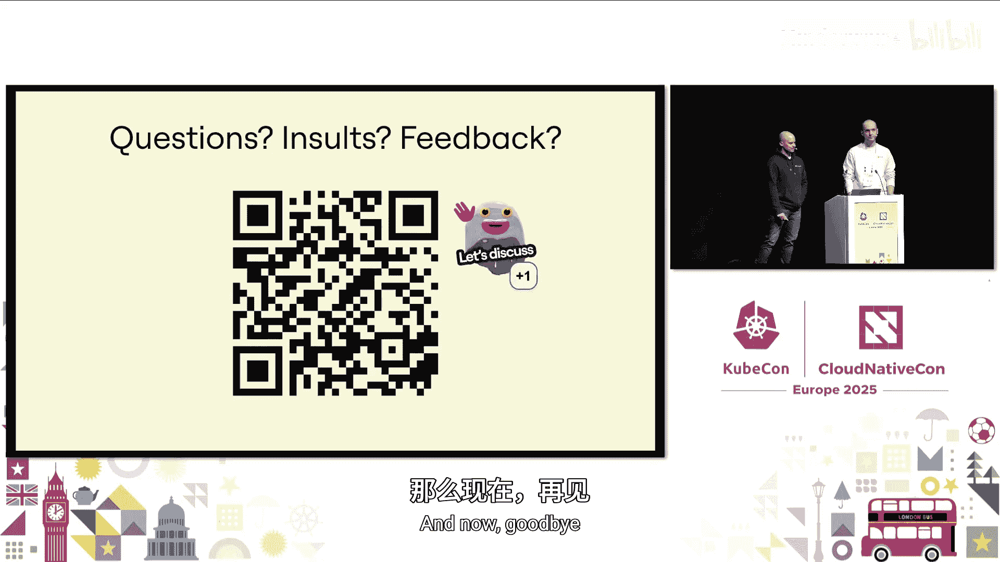

# KubeCon-+-CloudNativeCon-大会2025-｜-云原生计算-｜-可观测性-｜-Kubernetes-｜-Prometheus-p57-P57-Stateful-Connections-in-Kubernetes---The-Scaling-Secrets-Nobody...-André-Moc--BV1Cd32zDEBG_p57-

Good afternoon， everybody。 And thank you so much for joining Rodrigo and myself this late on a Friday。

 We realized we're one of the last things between you and your weekend。

 So we really appreciate that you signed up for our three hour lecture on Web sockets。😊。

I'm kidding it's just 30 minutes。First， allow me to start with a little intro of the two people thats are daring to address you right now。

 My co speakereaker Rodrigo is the reason we're here and the visionary behind Mi's evolution into cloud native technologies。

 our Kubernetes platform and CNCF adoption。AW is published case studies on his work。

 and we use him as cheat as a cheat code at Miro， since he's more effective than most L L Ms。

My myself， Andre， I'm a new Ih S RE compared to this title next to me。 Ive joined。

 I I've dared to venture into infrastructure and platforming after a decade of being a product engineer。

 and I will still write front end code when in danger。Like any good story。

 we'd like to offer a little bit of history。 set the stage， so to speak。

Rodrigo is going to walk us through a brief history of Miro， our product， our infrastructure。

 where we came from to where we are today。 Well aim to illuminate why long lived。

 stateful connections are so important to our product。Next。

 we'll take a look at how we used a platform built on Kubernetes to migrate Miro's Web socket manager into Kubernetes from a stateful E C2 service to a stateless service on Ekaas。

Reshaping our edge routing for web socket connections。

 reducing operational cost all while embracing cloud native technologies。

 We're going to dive a bit on some of the mistakes we made。

 the lessons we got so that nobody in this room has to repeat them。And finally。

 we're going to brag a bit with the results and hopefully do all of this fast enough so that we're out of here before midnight。

Just kidding its still 30 minutes。Thank you， Anda， for the sweet introduction。

 And thank you all for making this very last Qcon U 2025 talk。

 I would like to kick things off with a little bit of history about Mira's product。

 architecture and infrastructure。😊，EThis diagram shows simplified overview of one of our most important parts of the product。

And this is how Miro was born a few years ago。 You can imagine Miro as a game engine for enterprise collaboration。

 Currently， Andrea and I， we are here in what we call the mirror board running this presentation。

 But we， if we were to invite you all into this boards in your own devices。

 Our backend would be working tirelessly handling。😊，Real time collision detection。

 locking and everything that makes real time collaboration and seamless real time collaboration possible。

At the heart of this engine sits our bar server。 I stateful serves。

Cru show for performance in lowlay thingss。Every user。

 every user on a board needs to be connected to the same board server in our backend over a Web over a Web connection。

 the stateful nature of。Deserves or this the state nature here introduces a significant routing challenge。

How do clients know which server to connect to。Historically， we rely on F O B。 I。

 I open source H TP and TCP reverse proxy。Integrated with Heshcarp K for Ser discovery。

When a board server is started， it integrategrade。 It registered itself with console。In five。

 you dynamically updated its routing table。With a path based at routing。From the edge。

To from from the client， from the client edge to a board server in our， in our infrastructure。

 as you can see in this diagram， the last part of the URL literally represented the name of this C2 instance。

At the at the infrastructure site。This path base route in wirefunctional and introduced additional challenges。

Specifically， clients would have to re renegotiate with the backend server if， for example。

 the existing， the existing server that was rendermbling that that board went down。

Adding complexity to the connection management， there was also potentially split brain issues that might arise on infrastructure side。

As our internal board registerstrying the application logic could go out of sync with the council service Discover one on the infrastructure site。

Why we acknowledge that FabiO B and Ksu has brought us a long way， It was time for a change。

But before we get there， let me tell what was happening parallel at our organization。

 As you can imagine， our legacy architecture was not really cloud native。

Recognizing this back in 102021， we embarked in a transformative journey。

 rebuilding our compute platform from the ground up。

 We committed to Kubernetes and Amazon Ikes as the next generation applications。

 launching what we called our compute platform。Pored by Kubernetes。

 enhanced by the best in class operators and controllers。

 This platform provided a feature rich environment。😊。

For our developers to rapidly build and iterate over new features。

 primarily using a Microsoftserv architecture。As you can see in this slide。

 we adopted many technologies that we that we unfortunately won't have time to talk here today。

 For example， character as our cluster of scalealar on AWS and Kverno as our our dynamic a controllers sitting as a brain for every request coming in going through the Kubernetes API server。

But back to our topic here， fast forward to 2024， it was time to extend the benefit of this compute platform to our most critical workloads。

But let's start with an eye one why here， Why， if it a broke。Did we fix it。Kansvaas，2024。

Our mural lounge event was coming up。We wanted to show some really cool new features of our product。

😊，That would make。New real time collaborations possible。For example。Documents。

And data tables on top of our intelligent con。But clients would have variety hard limits on the amount of simultaneous open connections to the same domain。

Mostly because we are talking about browsers here。Breaking away from a monolithic design means clients should be able to open web sockets to end number of status workloads in our infrastructure or in our backend and not all one all to one like we had before。

This is prompt the need for a smartr， multiplexed web socket roty。

Several large connections at the backend side multiplexed over a single one。

 a single physical connection to the client。Now， we were a collection of engineers from three different teams that came together to create this piece。

 While Rodrigo and I are the ones in front of you， We are by no means the only ones that deserve credit。

So firstly， we had our cloud networking team。 They were responsible for the existing FbiO LB console and the load balancer configurations。

 Then we had the team Rodrigo and I are part of called Compute。

 We were responsible for the Ekas clusters， the operators that power power our microservice platform。

 and finally。The brains behind our new smart web socket proxy and our board servers。

 our collaboration runtime team。 Now， I really hope this context that was driving the need for change and the actors and the tools that we're wielding made a little bit of sense because it laid the important groundwork for。

Orre descendscent into the depths of stful connections in Kubernetes。And the scaling secrets。

 nobody talks about。But before we move into our implementation， let me unpack the game you are。

 we are playing。To understand the challenge we face it important to grasp the fundamentals of state full connections。

And to be honest。Each one of the topics that I'm going to to cover now could be having。

 could be having a talk on its own。And they were not always unique to state for workloads。

 as they can also be important for a stateless scenario。But they will for sure beat us much。

But much early on， when long living connections are in place。 So please bear with me。

Because you are going to get a little bit in in India。

The first thing before moving into any stateful implementation。

We should actually understand the nature of the protocol we are using。You choose。

 you choose case might differ。And might require different considerations regarding to the wire protocol use。

Like， for example， when establishing a secure connection to a database。

 have you ever considered if the handshake process of this connection。Is identical  to the1 for。

 let's say， done by a web browser。While both might be using T L S。

 the underlying protocol and connection management。Can introduce nuance In our case。

 since you are using web sockets， and that's pretty much what you are enforced to use on a browser。

Which in the case of Web socket is an extension of the HP1。1 protocol。

 The communication flow would go first over the process of establishing an encrypt it and secure H connection between the client and the server。

And then only after that， we'll be able to upgrade this connection to our Web socket one。

Meaning that we have true。Handshakes in this process。

One for D TL S part and the other for D HTP upgrade。And as I said， only after that。

 the bidirectional messages that are being exchanged between the clients and the server will be able to be sent and received。

Which makes at query new connections even more expensive in our， in our scenario。Increasing resource。

 consumption and tail lants when overloaded。This leads us to the next topic related to Keeppa lives。

 Unfortunately， Kipppa lives are a necessary evil that we must embrace here。But while doing so。

 we need to be careful and proper configure the idealle timeouts between each hop and the communication flow。

Which may， might sounds really already well now， right。

 But so we need to make sure that each part in this communication flow。

EWe reuse a connection that is never actually closed by the other party upstream。Finally， in the。

 in the Linux level， we encounter infer parts。These are the temporary port assigned by the professional system for client connections。

Why essential for communication， They come with integrated limits。For instance。

 the upper limit of a given connection Tpot， which is composed by the search I P and the destination I P and port。

Is a bit over 65000。In Linux， the range of available ephemeral parts is defined by a namespaced CCT L config。

And when running， it's in a Kubberes spot。It's configured by the fo， at around 28 K。

As you can see here， you can also increase and turn that out based on your necessities by changing and configuring it under the secured context of your pot。

But。Certainling back to the ephemeral part limits， If this range is exhausted。

 new connections can't be established。Leading to connection failures。

That can manifest as drop requests and poor and frustrating user experience。 Therefore。

 we must account for those port limits and design for scaling。Our applications。

 proper horizontal scaling of components is crucial here。

 Sometimes deploying smaller instances can be more effective than relying solelyly on vertical scaling。

 No matter how much you invest in vertical scaling， the female cho limits will always be there。Now。

 alongside ephemeral reports， we also encounter another crucial Linux component to consider。

Contracts or connection tracking， which is a core kernel Linux kernel feature that maintains a table of all active network connections。

😊，This table is essential for stateful virus， network added translation and other network functions。

However， the contract also has a finite size。When this table becomes full， new connections。

 attempts will be silently dropped， impacting application availability and loading in leading to difficult to diagnose issues。

And once again， it's important to know those limitations and proper size and proper account for。

 for example， for node sharing and neighborhoods on your node。

Which will lead for distributing the proper load as needed。Now。

 Rodrigo has drawn circles around the constraints we're operating under with Web sockets。

 New connections are expensive。The timing between the hops needs to be tuned。

 and there are hard limits that prevents us from scaling vertically indefinitely。Given this context。

 let's drill into how the first nerves were connected。

 We will be taking a look at our new in house bolt web socket manager。

How we routed the traffic there， how we kept the traffic secure for those sweet enterprise deals。

What we have here is an illustration of our system that will help to highlight the components as we talk through them and the problems they solve for us。

 So let's start with the star of our show。 The real time collaboration command Gway or R TC Gway。

 a replacement for FbiO LB and console。 Now， the work the team did deserves the talk all on its own。

 But a couple of highlights about this application。

 It uses threads equal to the number of VCPs to reduce contact switching。Additionally。

 all inbound and outbound connections are handled in the same thread。

 which significantly increases performance。 They also swapped out the default memory allocator for Ja Malck。

 which helps prevent memory fragmentation that comes from needing to handle packet sizes of wildly differing frequencies。

Now that we had our deployment there， How do we get traffic from our users devices onto our shiny new RTC gateway pods。

 The AWS load balancer controller swoops in to take all the glory here。😊。

It has native support for Kubernetes APIs like Ingri and services， and also。

 which is what we used in the end， a custom resource definition called the target group binding that allows us to configure how the A LB sends traffic to our Kubernetes bodies。

For those unfamiliar with what a target group is or the AWS concepts。

 it can be summed up as a resource that allows us to configure how the load balancing and and traffic protocols work to the pods。

Next， now we had our pods deployed。 We had the traffic flowing in。

 how do we ensure all of that data is encrypted in transit while preventing our SRs from exiting the building via windows or the fire escape because they have to rotate thousands of certificates frequently。

Here we have C manager that popped up another CNCF controller that is invaluable。

 It allows us to abstract away the majority of the work of maintaining the PKI for our cluster。

 In this case， we could provision certificates automatically that is valid for a year。

 They are rotated monthly and that combined with our node lifetime of max node lifetime of 30 days。

 meant every pod had a crisp certificate when it came alive。Now。

If you remember from the previous diagram Rodrigo showed we moved from a stateful service in E C2 to a stateless service in Ekes。

 And one of the first important things that we need to think about is。

 how are we going to handle our shutdowns。 How do we gracefully drain connections。

So we're going to be zooming into。The configuration between the A LB target group and our po shutdown life cycle。

 But first of all， what does graceful shutdown look like for our new artisticC gateway pods。

If we try to bring it back to the user experience， we don't want users to go into loops with stuttering connections where the connections are opened and closed frequently。

While we are scaling down or doing rolling deployments。

And the RTC Gway did exactly this from the application side by implementing a protocol where they could send close events to all connected clients that would then transparently to the user acquire new connections to existing ports so first we made sure the ALB gave plenty of time for the RTC Gway to do each thing。

We figured it should be able to drain all existing connections in about two minutes。

 So we doubled that as our de registration delay on the A L B。Next。

 we didn't want these closed connections to open to to the exact same port again。

So using our prestop hook， we ensured the pod was no longer in the load balancing pool before we started our connection draining sequences。

Now that our pods are terminating smoothly， we could start preparing for our expected load。 Now。

 Rodrigo has pointed out previously with limitations like the the ephemeral ports and contracting。

 How important it is to lean towards horizontal auto scaling instead of vertical auto scaling。And。

 traditionally。Scaling based on resource usage works really well for us in about 80% of our cases。

However， since this RTC gateway handles connections with varying packet sizes and frequencies。

 imagine a workshop like this where everybody is on the same board versus one person designing a spaceship in his house。

Resource based scaling might alone might not have been sufficient。Luckily。

 another way to manage saturation effectively for a proxy is to limit the amount of concurrent active connections per pot。

The team then ran extensive performance testing to understand the resource ratio profiles here。 Like。

 think how much CPU and Ram we need for how many open connections。

They were then optimized in sized to handle around 8000 connections per pod while they could peak well past that without seeing any degraded performance。

Entercaada。The operator that allowed us to scale based on the amount of open connections。Now。

 here we can see an example of what a k scaled object looks like。Also how we configured it。

 We optimized for scaling up quickly。 notice theres no limit on the up search。

 scaling down slowly at max1 po every five minutes。

 Also a rolling Windows sample to prevent scaling down prematurely during metric dips and a cool down period of five minutes to prevent flapping Now all of this you may say comes standard with the Kubernetes H。

 What Kada gives us， it allows us to scale on custom metrics like we have there under our triggers。

 In our case， active connections which allowed us to keep our deployment well under saturation levels。

Once we had our graceful shutdowns and auto scalinging configured， the next logical step was。

 was load balancing。 How do we make sure every pot was pulling its weight and not sitting there yawning while all the others were sweating。

We are considering the interaction and levers available again between our A LB and the R TC Gway。

And the two viable containing load balancing algorithms for web sockets that we considered were around Robin。

 the classic。And least active connections。After doing research， going into my cave。

 coming back out and feeling like I had a great understanding of how they'll behave with web sockets。

 I proudly suggested to the team why we should use least active connections because unlike roundund Robbin。

 they prevented the old pods from being overloaded。Can anybody guess what went wrong？Gold starts。

Angry ones。Like， I made this graph intentionally vague。 So the people in the back can't see my shame。

 But we were flooding the new pods with a barrage of web socket connections。

I did not anticipate all the CPU bound work like the T L A's handshakes that we needed to do on mass。

 as well as the latency spikes that we'd need to endure。

 The risk to the customer' experience was not acceptable here。 So back to the lab， we went。

We needed to reanaze both options round Robbin and least active connections to see how we could mitigate the drawbacks of either。

To mitigate the cold starts of least active connections， we could decrease the connection rate。

 but this isn't simple because slow start doesn't work with least active connections and。

Another thing we could try was to warm the application。

 but this was also not very simple because it would need us to figure out which code sites are responsible and which connections may need to be preoped。

So we've turned our gaze back to round Robin。How do we stop the old pods from being overloaded。Now。

 if we take a look at these two players。We realized that a single readiness endpoint usually works really well。

For normal H TTP traffic， however， the behaviors are quite different。

 and it becomes very visible with web sockets。If we're focusing on an old po on an old pod。

 when we fail readiness， two things happened in our current state。The A LB probe failed。

Which meant no new connections were opened to this spot。 since it was saturated， that was good。

However， if the Kubernetes probe failed。The， the pod would be removed from the service。

 It would be removed from the endpoint slices。 The AW A load balancer controller would observe these changes and start the draining sequence on the load balancer。

The po would eventually exceed the graceful draining period。

 and all existing connections would be terminated。 And since Rodrigo pointed out establishing new connections are expensive。

 and the user experience here is bad of losing the connections again， this was bad。

So we split out another endpoint especially for the target group so that we could individually signal how we handle new connections and existing ones。

 The team then updated the RTC Gway to report not ready to the target group when it went above 10。

000 connections and ready again when below 9000 while continuously telling Kubernetes that it is ready so we don't touch those existing connections。

Success。No more gold starts。 load， balanced。And to finish our journey here related to HA。

 I would like to guide you through through true interesting experience we have with it。

The first one is related to the green H algorithmal itself。EThe algorithmpo has a beauty intolerance。

Which is by default four defined as 10%。 In our case， as we are using Amazon yes。

 we cannot really control or change that because we don't have。

 you don't have access to the cube controller manager settings。And perhaps in many cases。

 this is not really important。 But when we are talking about scaling based on open connections and talk about saturation and avoiding things go wrong in that scenario。

 that becomes a big deal。So in our case， the developers really want to scale based on the defining threshold。

 or at least have a predictable understanding of where what that threshold will be。So in this case。

 it's pretty much about understanding， understanding the tolerance and accounting for that when defining your threshold in these cable objects。

And the second issue here shows how sensitive the H can be regarding to metrics that would sharply flap。

And why you should actually define scale scale up behaviors on your scale object or your H itself。

 As Andre pointed out in the beginning， when he showed the the scaled object definition。

 we didn't have a scale up policy in the beginning。And interesting enough。

 there was a talk back on Wednesday from one of the Qada's maintainers。

 and they were discussing best practice in terms of scaling in in Kubernetes。

 And their first good practice advisor there was to use scale scaleable policies。

 which we didn't do at that time。But specific about our problem here after a little bit of blame gaming between our observability components and kda itself went through the code of the code controller manager。

 the code for the Kida Promefuus scalar and also adding a proxy between kda and our promefuus read points。

 we actually find out and we're able to narrow down that our monitoring system was actually misbehaving here and giving away wrong data points for the query。

 even though if you were query that historically in graphs or or in dashboards later on。

 that misbe misbehaving misleading information was not there anymore。

 but this just brings even more visibility into how the HP system would blindly and happily follow that misbehaving data。

Then the solution is pretty simple here。 It's pretty much about defining scale policies。

 which by default， it comes with 10 percent of scaling1 hundred percent of scaling up。

 So that's why we got the double of of pods in a given scale E scale event。

 And here we mitigate that by controlling and reducing the amount of pods that could be could be created in a given minute time frame。

Finally。Now， we've rushed through this journey on how we moved our Web socket manager into Kubernetes。

 We've highlighted some of the operators that made it possible。

 as well as some of the scaling and balancing errors we， I mean， the secrets we found。

Let's take a look at our results。Here， we have。Active connections per pod over a day in one of our regions。

 There are three events I would like to draw your attention to。

 The yellow line marks when reinforcement starts being called in。

When our averages starts getting around 8。8 k， the red line marks when the older pod stops reporting ready to the target group。

 The blue line marks when they start reporting ready again。When this happens。

 we can see how the rate of new connection sharply increases on the newer pos。 But by now。

 they're ready， warm and basically shouting taunts at the A L B。😊。

Our initial connection latency went down 10 x， allowing us to keep it down keep it real， real time。

And also moving from the stateful setup on EC C2 to a stateless setup on E K S allowed us to save around 40 K per year。

 which made our Phop team smile and wink at us。😊，And now that I've rounded out the results。

 I'd like to hand back to Rodrigo for a sneak peek into Miro's next steps in our cloud platform and a theory goodbye。

 Thank you。Goodbye。👏No。And here just to tell you that we are happy to share that after a few years were any container containerized workloads in production on top of Kubernetes。

 we are ready as an organization to take one giant step forward。

 And for the specific part of architecture here coveredd here today。

 It means that we are also moving our board servers to Kubernetes。

 which is a direction that we are having as an organization in terms of compute and cloud consolidation。

😊，And by the way， if you are ever find yourself wondering by Amsterdam， please come by to our office。

 We will be happy to host you there。 And now goodbye。 Thank you。😊。

