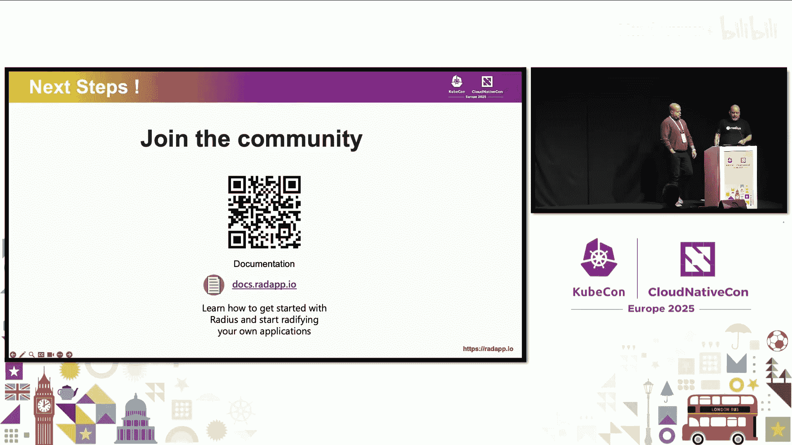

# KubeCon-+-CloudNativeCon-大会2025-｜-云原生计算-｜-可观测性-｜-Kubernetes-｜-Prometheus-p59-P59-How-Millennium-Bcp-Leverages-Radius-To-Empower-Developer-+-Operator...-Nuno--BV1Cd32zDEBG_p59-

Hello everyone， welcome to。Hel Milllennium BP leverages Radius to empower developer and operator collaboration。

I'm Nouggez。I work at， Well， Millennium VP， and I'm the head of Public cloud。 And with me， I have。

 I am Jonathan Smith。 I'm the head of product management for the Azure Open source Incubations team at Microsoft and honored to be on stage with my friend and colleague Nna。

😊，So first of all， show of hands。Are you familiar with？Radius， besides the network protocol。Oh， good。

 nice， nice。 That's good。 That's a star。 We'll increase that number over the next 30 minutes。

Do you want to share a bit about what this， sure， so we will we'll do a couple of things here。

 I'll start off and give some basic context about what radius is， some demos of how it works。

 and then Nuno will walk us through some of the cool work he's done at NBCP to adopt radius as part of their internal developer platform。

 including getting workloads to production on radius starting in last December。

 so here we go with some context。 as I mentioned， I'm in the Azure Opensource Incubations team at Microsoft。

 and we've donated several projects to CNf。 Today， we're gonna focus as we said on radius。

 but hopefully you'll have a chance to take a look at some of the other projects that are listed here Dappper and Kada。

 there's a lot of folks and I talked to at Cuubbecon that are familiar with those that are already graduated CncCf projects。

 There's newer projects。 I won't touch on here too much。 but just take a look at Copotic。

 you see in the lower left corner。And Dsy two new， super interesting projects like everything else on the list here。

 They are available freely on Github under the Apache 2。0 license。 So if you get a chance。

 check them out。So in the context of radius， Nno and Ill talk mostly about radius features that help platform engineers like his team build IDPs that better serve their developer and operator customers。

And I get to work with a lot of platform engineers。

 And they've taught me a ton about like the challenges they face and the platforms that they're building。

And the way different open source technologies help accelerate that product development。

 And I think this graphic from Canoe does a great job sort of laying out a canonical reference architecture showing a lot of the common elements in an IP and a lot of the open source technologies that serve those platforms。

 And Nuno and I found common ground around an important concept and technology that we felt was missing and this landscape。

 And that's the notion of an application model or an application platform。

 that gap matters because developers sort of live and breathe applications。

 It's what they design and build and support It's what they reason about day to day。

 But in the world of distributed systems and cloud native technologies。

 It's got an increasingly difficult to reason about an application as an entity。 and even a lot。😊。

agreegree on what an application is。 and that ambiguity。

 in addition to all the other challenges around cloud native development。

 just adds that the cognitive load that developers struggle with。

 And it's exactly that load that the IP are， are designed and built to address。 So， you know。

 we felt that that was an important gap to fill。And so， platform engineers will have。

An open source project to draw from just like they draw from so many other technologies on this slide。

 and one that allows them to add an application model to their IDP。

 so developers have a more application centric kind of experience。

 And that's where where radius comes in。So radius， you can think of at the highest level as a cloud data application platform。

 It allows you to define an application one time and then deploy it across on premise， AWS and Azure。

 You can use it standalone or with its companion technology dapper， which I mentioned earlier。

 But more importantly， what we're seeing most early adopters of radius do is integrate it as newno and team are doing into their existing internal developer platform so they can offer that application model and enable those kind of application centric scenarios。

😊，And we've， we've worked with a lot of platform engineering teams over the last several months。

 and the feedback we're getting is really consistent。

 So our strategy from the beginning with Radius was for it to be at CCF project。

 open source and cloud agnostic。 And the feedback that we get from platform engineering teams that is total alignment there like that's table stakes。

 pretty much for every team we talk to。 And then there's a few other。

Killer sort of baseline features that platform engineering teams have kind of have brought us along about that。

 we weren't as focused on one of those is gi ups integration。

 flux is the first get ups integration we have， particularly for Nno's team， it was a priority。

 Argo will be coming soon after。 And then the second big feature that platform engineering teams educated us about was the requirement for radius to be extensible at the resource level。

 So the ability to produce custom application resource types that allow a platform engineering team to expose resources and exactly the way their developers need to use them。

 So if it's a cloud storage resource， for example， the ability for a developer to just ask for a particular type of storage and say。

 I need small medium or large。 instead of lots of detailed configuration。

 So that level of customization is really。Is really critical as well。

 And there's four ways you can think about how radius might help your application teams and your internal developer platform efforts。

 One is that radius improves enterprise application team collaboration。

 Part of that is by enabling developers to really focus on their app and a lot less a concern with。

 with infrastructure configuration and deployment。Now， at the same time。

 Radius offers a feature to operators called infrastructure recipes。That allows operators to。

 in advance， define exactly how infrastructure will be defined if。

 if an app is deployed on premise or if it's deployed on AWS or on Azure。

 They define that upfront and then developers get very much kind of a self serve access to those infrastructure resources and we'll see a demo of that in a second。

Then the application graph is also a feature that helps teams collaborate。

 and it's super powerful feature。 Every time you deploy a radius application。

 it creates a graph that shows every aspect of the application， So every container， database， cash。

 frontend backend and how they're connected。 So it makes it trivial for everybody in the team SRs。

 developers， architects， operators to know exactly what's been deployed into production。

 And then lastly， it's cloud neutral， as I said before。

 So you have a consistent experience deploying across onpre。

 AWS and Azure and integration with your existing GiOs workflows。😊，So， I'll make this。

More concrete with a couple of demos。And in the first demo。

 I'll show how radius can be used to deploy applications unchanged。 First。

 we'll go across on premise and AWS。 What you'll see is on premise。

 the application deploys and leverages a Redis cache on a Kubernetes cluster and AWS A recipe automatically deploys memory DB in the AWS environment。

 So we'll walk through that。And you'll see me running the demo through the radius C I。 But obviously。

 in a production environment， those would be Gi ups， workflows。 So let's。Kick this off。

 So I've already set up。A radius control plane on premise and an AW S。 And you see。

I have two workspaces， one for each of the environments。 And as I mentioned， radius。Sorry about that。

Radius。You start that over。So Radius knows how to deploy resources using recipes。

 And what you'll see here is on premise。I have a。A bi separatepper recipe。

And that's going to deploy Redis to a Kubernetes cache。Or a Kubernetes Schor， excuse me。

And then on AWS， I've got a terraform recipe that will deploy the memory Db。

And so I'll put on my developer hat。And actually go look at the application definition。

 And you'll see the application simple。 It's got a front end container and a Redis cache。

 And those are both native resources supported in in radius。 The front end container has an image。

 a port。 And then this really powerful feature。 that is a connection。Connections enable radius。

To do a lot of work behind the scenes for the developer。

 including making those explicit connections that show up in the application graph。

 but also injecting details like connection strings and credentials into the container as environment variables。

 And that that tells the container how to connect to Redis， no matter where Redis is deployed。

So back in the terminal， we'll run RAd， run deploy。Or rat run the app。

 And that's going deploy the app。And give us support forward so we can actually see the application working。

And you can see the deployments in progress。The cash is deployed。 The front end is deploying。Okay。

 so the app's running now。And we'll navigate to。The port forward to local host 3000。

And when the app opens， we'll be up in a container info tab。

 And that's going to show me all the environment variables that Radius automatically created in the context of that connection that we were just talking about。

Then we can click on the to do list tab and just see the application actually working。 right。

 So we're gonna enter a to do item， integrate radius into your IDP。

 Everybody should have that on their to do list。嗯。And then it's just basic functionality， right。

 I can complete the task and delete the task。 And so just so you see that the application is up and running。

 then we'll look at this radius dashboard， which is cool。

 this is a backstagebased UI that allows you to see everything that's in your radius environment。

 your applications， the recipes that you're using to deploy the app and then this GuI a representation of the application graph that I mentioned now。

 this is a super simple graph right it's just two nodes but you see that explicit connection between the cache we deployed and the frontend container that we deployed in a more complex application that's when you really see the power of the graph you think about multiple team members working on a big complicated application seen it represented in this way is super helpful。

 So that was the local deployment that we were just checking out。

 Now let's deploy to AWS we deploy it to AWS using the terminal on the left and then on the right will redeploy。

To that local environment， we're going to use rad， deploy。Command here。

 And that just doesn't give us the port forward， but we'll look at the application graph in the context of the CLI this time because we want。

 I want you to see the comparison of what gets deployed on AWS on the left and what gets deployed locally on the right。

So the deployment's done， we're gonna to run RAD app graph and what what you'll notice with AWS on the left local on the right。

 the frontend configuration or deployment is the same on both sides。

 What's different is the infrastructure that got deployed。

 So you can see in the bottom left hand pain AWS specific resources。

 memory Db cluster and subnet group for example， on the right is just the Kubernetes resources for running Redis locally。

 So that shows you hopefully how easy it is to use radius to separate。

Applications from the infrastructure that's deployed to enable those applications。Okay， so that's。

That's one quick demo。And what we saw in that demo。Remember。

 there was a container resource and a Redis cache。 Those are native resources that are supported by radius。

And those are helpful。 They get you up and running。 There's also databases， message cues。

 and the like supported in the box with radius。But what platform engineering teams really need is the ability to create custom application resources and catalogs for those resources。

And that kind of customer resource enables platform teams to build really customized developer experiences。

😊，And custom application resource catalogs with browsable。

 integrated documentation and model sort of any type of resource。

 It could be abstract like a web service or something really concrete。

 like a document D B and those the custom resources function really as a contract between the developers that are consuming these things in the platform that that's providing them。

 So the next quick demo shows how we create a custom radius resource and use it to add a new feature to the same to do app that we've been showing And obviously。

 it's。😊，It's 2025。 So we our demo app has to have AI。 So that's that's what we'll add。

 The feature we'll add using on a custom resource。 So what I'll show is how to extend radius using this custom open AI resource。

 how to define it and then deploy it with a recipe。 And then as a developer。

 how I would use that resource in the application。So here's the same to do this application。

And you see there's a feedback button beside the add button now。And so we ask copiot for feedback。

 but it fails， right， because there's no， we haven't added that support yet。

 So the first step is to create a new resource type definition。 And it's called open API or Open AI。

 excuse me。My company dot app is the namespace。And then we have some boilerplate code。

Plus a capacity property。 This is where I define that all my developers have to indicate as a t-shirt sizing of a small。

 medium or large， which is their preference for interacting with with a custom resource like this。

So now that we have that the definition in that file， we're just going to upload that file to create。

 to let radius know that this new resource exists。 So we'll use the resource type。

 create command here。And it just takes that file。That we were just editing and uploads it to radius。

And that basically sts the radius API。 So it knows about this new resource and supports it just like a native resource that we saw in the earlier demo。

So then we'll register a recipe for this open AI resource。

 just like we used recipes in the previous demo。And I've got a template that deploys a GT Trbo model using Azure Open AI。

And we'll use that template。So there's the recipe。 So we go back into the app now。 So as again。

 with the， what the developers hat on。嗯。Will， will add this resource to the application。

 And you can see V S code and Copit now understand this resource， right， It's。

 it's treated as a first class citizen by the the developer tooling experience。

And it's prompting us for all the required properties that were defined in that resource file。Now。

 the capacity was not required。 So the developers adding that capacity value now。

 and they get a nice tool tip， right that says you can choose a t-shirt size for that resource。

So capacity set， the last thing as we saw before right， we had a connection。

 we had a connection between this container and the new AI resource。

 so we get that coppit integration that we're looking for in that front end container。

So we'll do RAd run again， just like we did in the previous demo。

It's going give us that port forward。 We'll go see the new application installed。

 This is running on Azure。 So Radius will create the model using Azure Open AI， right。

 It's Azure specific infrastructure for this deployment。 The cash will be Azure cash for Redis。

The front end container gets deployed on a Kubernetes cluster。Radius creates a service account。

 exposes that service。 Then here， back in the U I on the container info， we see that new resource。

 We see the environment variables that were injected based on the creation of that connection。

Then we can go into the app and test that copilt integration。So， again。

 we're integrating radius in the IP。 Everybody put that on your list。 We ask for feedback。

 This is funny to me。 Copit says。😊，We've got a complex task ahead。

 we're finding it's pretty easy to integrate radius。

 So I think there's some model training that would benefit Copit。 But。

 but you see how easy it is to use radius， both to deploy across different environments and to extend it for use in a custom IP。

Thanks， man。Cool stuff， right。As you see。On the bottom right。Our story didn't start with radist。

 We have a lot more boxes。There on that diagram。 So our story starts。In 2021， we started the program。

That we ambitiously called from 8 days to8 minutes。 The idea was。

All of the build and deploy to all environments of a microservice shouldn't take more than 8 minutes。

And the driver there was really accelerating service delivery。

We needed to push away from this guy's building some infrar resource for that guy to deploy the app。

But still， we needed to respect the fact that those are two different life cycles。And not only that。

 we wanted to， well， it was ambitious and it is ambitious。 We wanted to cover not only infrra stuff。

 but the whole I T lifecycl。 So registering the app in the CMDB， for instance。

 and all of the stuff you can imagine， we as a regulated industry company need to do for everything we run。

But again， given that time and money have limitations， we do not want to reinvent a wheel。

 We do not want to say to people tomorrow， you'll use this brand new thing。Good luck。

And we had stuff in place like we had and still have a big terraform module library。

 Everything is terraform。Or was。So。The most important livery we identified at time was， sure。

 we know how to do infrastructure as codes。 We know there are many tools sets to do。

Continuous compliance， drift reconciliation， all of the typical I T resource lifecycle management things what we're missing is application as a first class entity application as an API。

 And because now we we all know。How software development。Should kind of work。 We know versioning。

 We know deployment patterns， We know all of that stuff。 We wanted to do the same for Infrra。So。

Back in 21。This was what we started building。I want to do a new microservice for my。Business domain。

 sure， you've got templates on a Web Ui。 You pick a template to fill out the name of the the name of the thing。

 The business domain is going to run under topology， technology dependencies。 Yeah。

 it's going to need cash。 It's going to need the relational database。 It's going to messaging know。

 whatever。And besides all of the cool stuff， we give the development team automatically when this is filled out。

Rs， pipelines， security stuff， all of that。We captured that， in a file。Jason， no。

 everything and everyone knows Jason。This file。Which sits on the code Ripo for the app。

Its editable anytime by the developers， says， these are my F details。

My app can be exposed to the Internet。 It has these operations。 Op。

 you can put S L Os under each one of those operations you have。Messaging details， schemas。

 the the appars。 Yeah， it has an admin role。 It has a reader role。 It has， you know， you name it。

Does it need redish cash， persistency details， whatever It's in Jason。Why。Because。

After we have that file。Back in 21， we would convert apart of that。To。

Open application model definition， O OEM。And pass it along to Gi up， Fl， Gvela， and。

Infrastructure Eco， tool sets。And we were almost there。Still。

 the gap was enough for us to get together and do a lot of whiteboarding。For almost three years。

 yeah。And say， okay， now we know the gap。 when it's cover the gap between this design。And this one。

And well， and basically， the， the gap is what Jonathan was showing that that sort of user experience and。

User defined types。As easily as you saw today that needed to be brought into this model。So。Today。

 what we're doing。Is bringing people over。I've shown you an old Jackson file。Now。

 this is what we're trying to do。 Tru have C I that converts Jason to Yal。You， by the way。

 did not see Yamo on the previous demos。 You saw bicep， right， And some people may think， oh， yeah。

 bicep another Microsoft format。嗯。We do Yl。Same thing。And if you look at it。

It's the standard Kubernetes C D。 It's It's called deployment templates。

And this deployment template is just picking up the parameters for。The recipe in this case。

 this is just a reaction S basic app。So the parameters are things like it's an extra small app。

Image repo is over there。 It is observability with Prometheus and a couple of other things。And that。

The， the， so lineing 29 the templates。Is the adjacent representation of the bicycle you saw earlier。

 the same sort of thing。For those of you that are kind of familiar with Azure。

 you might recognize this is an arm template。Worth extensions。 No， it's importing radius。And this。

File， Yal file， Gi ups process， and so on does what you just saw in the demo spins infrastructure up。

 wires it to the app。Well， and things run。So。If you're a developer on your vacuum machine。

 you just register the version of the static front end recipe that runs it locally。

Even if you're calling out to open AI， the radius control plan is local to you。

 So you run it locally。 If you are deploying it to shared infrra， sure。

 use a recipe that takes advantage of that shared infrra， press plane，terraform， all of that。However。

 you use it。 So if you do QCDL on a pipeline， if you use giups。

 if you use customize to specify values for each environment， if you have a helm chart for error app。

 just drop the deployment template into the helm chart。You version infrastructure， as part。

 is the application。 That's the deliverable， so。Where's the box。It's just another CRD。

But you get the infrra for that version of your app。What we've learned so far from this。

Enable the right conversations。 You no longer talk about。

 Do I have the database schema that I need for this opportunity up。 You talk about future testing。

 progressive rollout and all that stuff。 You should be talking about my opinion。

And you look at best of implementations。 So you have five teams doing。

This is how I spin up my databases。 Pick one and get everyone on that pattern。

 Put that pattern to your recipe。And because everyone suing it the same way with as much knobs as you want to have。

Predefin SUs， predefin S Ls and independent life cycles。

 So if our guys know what they need to support， It's in the S L A is in the contracts。Defts。

I just want to medium sized cash。You know what the throughput， memory size， all of that needs to be。

Now， do whatever you want without that information， but do it the right way。And。

We all know how to do it for apps。Do it for。Solve the right problems with the knowledge that you have。

For the apps apps， app definitions。Push Era， aligned with the same。Maturity that we have to push out。

That's what we've been trying to do。 And that's what we're doing more and more。G revit up。 Sure。

 thanks， Ben。 thanks everybody for the time。 So one of the key kind of messages that Nno and I wanted to share is that we see this application model kind of capabilities that radius brings to the open source community as a general purpose or requirement for most IDps。

 if not all Ips。 So it's a plea to join the community。

 We've seen a lot of companies go out and kind of roll their own type of abstraction similar to radius in a lot of ways we can avoid a lot of redundancy and get a lot of value out of collaborating together so you can get to the radius documentation from this QR code that also has links to our Github to our community activity information about monthly community calls so please join us if you have questions。

 reach out on discord。 We got a very active support channel and would love to see more folks from this room involved。

 So thanks everybody for the time。 Thanks Nno。😊。

