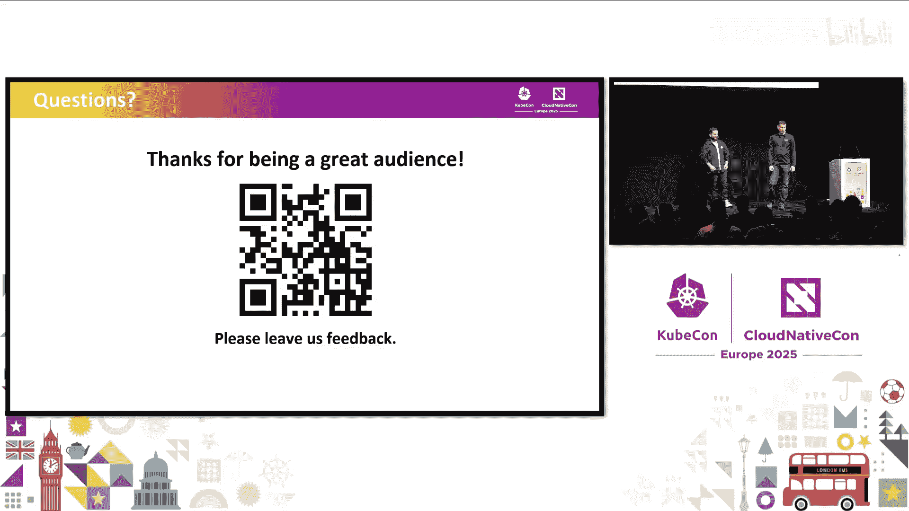

# KubeCon-+-CloudNativeCon-大会2025-｜-云原生计算-｜-可观测性-｜-Kubernetes-｜-Prometheus-p60-P60-Type-safe-Feature-Flagging-in-OpenFeature---Lessons-Learned-F...-Michael-Bee--BV1Cd32zDEBG_p60-

Hello， everybody。 Welcome to our talk。 today， we are going to talk about Typeafe feature flagging in open feature and kind of the lessons that we were learning across Google。

 My name is Florian and I've been a software engineer at Google for three years。

 and my work is kind of revolving around feature flags and making rollouts across Google Cloud platform safer。

 And for a while now， I've been an active open source contributor in this project that we are going to talk about today。

 there。 I'm Mike Beamer。 I'm a product manager at Diyatrece。

 I've been in software for quite a while now with a number of different roles。

 I'm an active open source contributor。 I'm also a co-founder of open feature。

 and on the governance committee。😊。

That's very cool。 So I'm going to start off with one question towards all of you。

 I'm wondering who here is using feature flags in their code and who here has used a feature flag in their code。

😊，Why， no I'm kidding feature flags are really， really cool。 and hopefully if you're using them。

 you get to keep using them。 And yeah so you know just to walk you a little bit through the agenda。

 I'm going talk about for those of you who don't know what feature flags are。

 I'm going to talk a little bit about them I'm going talk about how we are using feature flags at Google our approach and a few lessons that we've learned across the way and some findings that we thought would be useful to share with everybody And then Mike is going to walk you through the cogeneration open feature CI the thing we're here to show you today。

 and stay tuned until to the very end to find out how you can use it and more even importantly。

 how you can also contribute to it if you like what you see here。😊，Cool， So what is a feature flag。

 feature flags kind of represent this very， very cool way to you know。

 kind of dynamically change the behavior of your binary without creating a new binary release every time right we are allowed to dynamically enable or disable a particular a particular a particular feature。

 you don't have to modify the source code。 So what is the advantage of something like this。

 I think the biggest advantage that there is is to allow for more progressive rollouts of feature flags。

 So it allows more granularity that you couldn't do with a binary release。 you could slowly， slowly。

 slowly gradually enable a new feature functionality of your code。

 And with that kind of comes the risk reduction as well。 know。

 you have a more safer way of enabling them and even quicker way usually disabling。

 if you figure out something goes wrong into production just know quickly disable the feature rampant down and the problem is is mitigated。

 And know， usually that takes a bit less time than it would with a normal binary release。😊。

And lastly， a very， very big advantage is allowing you to experiment， right， So a very。

 very common use case of feature flags are is a B testing。 you know， how do we use them at Google。

 I think we use them more or less the same way as anybody would do it。

 but I wanted to point out that we started using at Google for a。

 long time So way back since 2009 feature flag was the first time that Google was giving it a try at feature flags。

 I was at that time I was， caring about video games and stuff。 So Google said yeah。

 lets do feature flags。 So but here I am to talk about something that happened's been happening for a while is what I'm trying to say and this has pretty much become a de facto way of introducing new functionalities and releases most of our developers use feature flags。

 So about 70% of them like on a regular basis I would bet that most of them。

Use it at least once you know at least once。 And with that kind of comes also like the huge large codebase of feature flags that we have。

 So as you see， there is more than 150 but with that I want to clarify what active feature flags means is how many of them exist in the codebase。

 not how many are in the middle of a rollout because one of the things people like to do with feature flags is introduce them。

 one of the things people don't like to do with with feature flags is clean them up。

 So that is the least everything of any developer to do the cleanup afterwards。

 And one of the interesting thing or tidbit that I can share from Google is that YouTube a while back had this very。

 very funny policy that if you wanted to introduce a new feature flag。

 you had to clean up two other feature flags in return to to start cleaning up the codebase and keep it like well maintaineded sort of to say。

 So yeah the way we use it is pretty much the way that I just explain before gradual rollouts A testing。

And it allows us for a more way of safely changing what is like pretty much a very。

 very large code base， so I think that's a really crucial thing for us to make sure that we prevent outages and we can mitigate them very。

 very， very quickly。So let's take a look next at like how you might use a particular feature flag in your in your call like how you may have come to know it or be familiarized with it right so let's say we have this react example over here you we want to introduce a feature flag which we'll show a new message in our homep page or something like this and you can see there we are using this flag called new message you see there on the second line is use flag new message and if the flag is enabled then you know we're going to show the new message else just show the classical old the old way of the message。

Except what if you know what if somewhere in the flag management system where we initially introduced this feature。

 we call it in a completely different name。 Maybe the developer was out of sync with the PM。

 something happened and is just like a completely different name。

 And when trying to query the value for this flag we cannot find it in our flag management system then what Well。

 in that case， know you would default to the cold default value， which is true。 And in this case。

 what happened is just because we let's say we weren't paying attention。

 we completely enabled the feature overnight we enabled it for all of the users instead of like getting that functionality of gradually enabling enabling the feature。

 and that kind of begs the question when you have a flag service and an app know who's right。

 know somebody has a value of true。 And then your flag service， the flag is kind of disabled。

 So yeah， who is right in that case， who has the absolute source of truth or what the value of the flag should be evaluated towards。

 And with that kind of comes those multiple sources of truth。

We want to talk about we have know we have this drawing over here。

 I'm going only to focus on the green part and the blue part and Mike will go a little bit in depth into like what is inside this very nice blue box So you have like the service and the app and that's kind of the whole trick with feature flags that it allows you to pretty much change something in the service。

 change something in the flag service， which in turn will impact the behavior of your of your host application So your app is squing the flag service and trying to figure out like what is the value for your feature flag。

 And as far as the flag service， which is serving the flag to the host application。

 is usually updated very， very frequently or rather should I say propagated we want as soon as we make the changes of our flag to be to enable it or ramp it up or ramp it down we want those changes to be propagated pretty quickly。

 which usually is the case the flag service the changes are propagated in a pretty quick manner。

Then we have， you know， our， our app， which， you know， usually is updated on。

 on a more less frequent cycle at least less frequent than， you know。

 we would think about the the flag service， right， you might have your weekly or， you know。

 few other days， you know， release cycle for， you know， for your app。

 And that's kind of interesting because the flag is kind of referenced in both of those places。

 And yet。It is being rolled out in a different release different release cycle。

 So that kind of puts us in this space where you end up with maybe the flag existing in in your flag service。

 but it's not yet in your host app or maybe the flag is in your host app but it's not in in your flag service or what have you。

 So then know what should the value be or what is the actual perspective of what we should evaluate the value towards。

 And know with that kind of comes the idea to really properly think about like how do you how do you actually introduce。

 how do you roll out the flag and the proper life cycle of a feature flag。

 So I put here like a few few of these steps。 So you create create the flag and you introduce it in your flag service and it's gonna be your host application as we discussed。

 you gonna manage it slowly ramp it up the feature， maybe quickly ramp it up。

 And then nothing we stop there because we've established that people don't like to deprecate and clean up and clean up the flags。

 No I'm kidding。 if we do our due diligence and we try。do our job to the very very end。

 We deprecate it， we make sure that we remove all of those references from the flag from the code。

 And afterwards， when the flag is no longer present in in the code。

 we're going to go ahead and delete it from our flag service service as well。

But where should we update first， like where should the flag first be present。

 should it first go into the code， should it be in the flag service And what we've come to realize at Google is that it's。

 it's very， probable that if you introduce it into the code first。

 you might evaluate it to some default value which is not really really safe。

 But if you introduce it into the flag service first。

 then what happens is usually the flag is present there， but it's not affecting anything。

 So the general perspective that we have is that the flag must first be defined into the flag management system before it even allowed to exist to the host application。

 So we completely disallow a flag existing into the host application。

 if it's not present in the flag service and how to check that because this can kind of be a pretty tedious thing you as a developer must check if it's there the flag service if it's in your app or what have you。

We kind of have to still somehow reach this eventual consistency when introducing the flags。

 like what is present in the flag service should be present also like in your host application or what have you。

And we with those problems also came like with all those challenges， not just something like。

 you know what if you know， these are things usually actually came across。 So， you know。

 just to show you like a few outages， which you know。

 they are just human errors and can happen to to all of us。

 I will not say whether one of those three examples was caused by me。 But you know。

 it could happen to it could have been me for all， know。

 So one time like somebody just had like a flag name and they just accidentally added added like a trailing white space。

 And that pretty much caused， as you've seen in the previous example a few slides back。

 there just was an unexpected flag value and that just had like you know。

 dropped the the usage of a particular feature。 And then there was like a mismatch。

 like somebody was defining like what default should be in the code。

 But then that didn't really match with what was the default in the flag management system so。

Overnight， the feature was like fully launched， and there was an outage related， related to that and。

Lastly， what I was explaining before， like somebody was in their flag service。 Oh， I think I。

 I think we've cleaned up all of the references to this particular feature flag。

 We are now ready to remove it from our， from our flag service。

 And they just remove the flag service。 And what happened to the flag。

 it defaulted to the to the code default， you know， default value and you know。

 like it just pretty much cause another outage and you know， pretty much disable that you know。

 that feature because we weren't really careful。 But when we're talking about careful。

 I think as developers， we always think like， yeah， it's good to be careful。

 but it's good to even just try to not even consider careful as we just how can we help as developers to。

😊，To just solve the problem before we even need to check into the code of all the flag references。

 make sure all these things are in sync。 It should just be smooth， right。

 So the perspective of like why we're here and this talk and Google was the perspective of it is that we came up with idea to introduce the code So we're generating all of these flag accessors we're generating typesa flag accessors based based on the flag configurations。

 And that kind of really helps out really helps out in a multitude number of reasons。 know。

 one is the fact that it allows you to you know to mitigate all of those mistakes of putting the wrong flag name and things like that。

 And it also offers you direct source of truth of what the flags which are able to be referenced in in the binary are。

 So at Google， what happened when we introduced the code we completed this allowed reflective access towards towards the flag。

 So the only way to access that is with。I is with the colgen tooling and the types accessoriesors。

 And you know that that's the you know complete and exhaustive list of flags that you can actually access in your binary。

 And that pretty much allows you to kind of check like what is present in the binary and more easily validate that check And also when you're deprecating the flag that's also very cool because it stuffs being codegen。

 So if there's any sort of like stale reference to the flag that you might have missed might have forgotten about your cost application were not compiled and that would be like a great thing。

 And with all of these learnings， we wanted to take all of these stuff to to the open source I think it's a really beneficial beneficial tooling。

 So for the past half of a year or so me and like Mike have been talking about how to develop like a cogen and something which would fit into the context of open source and glad open feature community was welcoming me with very very open arms was just having a great time and to learn about what we've been working on in open feature I'm going to hand it。

😊，Over to Mike， who is going to talk to you about the amazing thing that we worked on the for the past months。

Allright， thanks， Floren。 So yeah， I'm gonna talk about openfe real quick。 It is a C andCF project。

 We' we're incubating now。 and it's basically an open specification for feature flagging。

 It's really trying to unify the SDK is the way developers interact with feature flags and it works across many different vendors。

 You can hook it into your homemade solution as well。

 And it's even a way to like wire in multiple provider simultaneously。

 So's really powerful abstractions。 And it's really an ideal way to use feature flagging if you're just getting started。

😊，Why would you even want to standardize though。 So one of it is to avoid vendor lockin。

 You basically have references your code all over the place。

 and it can be quite challenging to like migrate depending on your business case。

 The other one is just building a community around this。

 Like I get the opportunity to work with Floren now because we're doing this all together。

 it's actually quite exciting to see how many people care about feature flags。

 And it's quite fun to like learn other use cases and challenges people are running into。

 And then based on that community， we're building nice tooling that we can share with everyone。

 And that's what we'll talk about today。😊，As you can see。

 the open feature ecosystem's quite large at this point， hopefully we have your tech stack covered。

 if not， let us know we're adding these all the time。 and yeah， really。

 really happy to see this ecosystem expand。😊，So let's dive into the architecture of open featuresature。

 This is going back to the slide we saw earlier。 On your right。

 the flag management system can basically be anything。 On the left is your application， of course。

 but we'll dive in and look at the orange section。 So this is kind of where open feature fits in on the left side here is our SDK。

 And on the right is what we call the provider and the providers basically the interface that will talk to your other systems。

 You can easily build your own if you'd like， but we also have like hundreds at this point in our ecosystem。

Let's look at a no JS example。 So at the top you see we're registering the provider this should happen once in your application。

 we can create a client then and then use the client to basically interact with your feature flag。

 In this case， it's a silly example， of course， but we're using the with CAs flag and then controlling the counsel output based on that。

But one thing you'll probably notice is we're using hard coded strings。

 This has been basically the status quo for years。 Most people do it like this。

 Some ways to work around this is to basically hard code your own con file that does this。

 And so you can do it in a more unified way。 But you know， after chatting with Floren and others。

 it become very， very clear that this is not exactly what you probably want。

So that's where the open feature C I comes in。 This is a brand new initiative。

 We just started the SG probably three months ago or so。 So it's。

 it's something we're meeting weekly。 We're actively developing this stuff。 And it's。

 I think it's gonna be the obvious way to start interacting with feature flags in the future。

The openfeature C I is a command line tool。 We're really trying to improve the developer experience。

 We think there's a big opportunity there。 And there's really like three core components to it。

 You know， first is like hooking into the flag management system。

 We're gonna make that vendor agnostic。 So it's one that should work with any tool。

 including hopefully your own homemade solution。 if you have one。😊。

We also have this concept of like a local manifest。

 So we want to be able to fetch from that flag management system and keep a reference of the flags in your repo。

 And then using that， we can do code generation。 There's also a lot of other opportunities that we won't touch today。

 But I think the future is quite bright with this relatively simple concept。

Let's like take a look at the user flow。 So usually what you would do is you'd create a feature flag。

 In this case， we're just adding it into this like hypothetical management system。

 going back to the with cows example。 You can see here。

 this is the key that you would typically reference in your code。

 this is the thing that maybe a PM would create the feature flag and their tool。

 And then maybe in ajira ticketet or something。 put the link to the flag that you need to reference in your code。

 It's right there。 And then typically， you would add some kind of nice description。 But again。

 that's in that management tool。Then we basically would fetch that last known state。

 So we would pull from that flag management system。

 And this is just the Json file that represents like the base of the flag。

 It doesn't have any sophisticated targeting or anything like that。

 It's just basically the flag key thing that we just saw us not going to go and then other useful metadata like what what happens if something fails And。

 and this is the source of truth for you know， the behavior that would be expected in that case。

Then we can go ahead and generate a client。 So in this case， we're just running the C I。

 We're running the generate node Js command。 And you can see that we use that manifest to spit out in this case。

 an open feature T S file。And all that changes with all that work is basically the one line here。

 So you see， it's， it's basically identical。 But instead of calling the kind of unfriendly Boolean value and passing a string。

 we have the， the with cow method now。So really， like it's， it's a small change。 It it is。

 but it improves the developer experience quite significantly。 So you see at the top。

 That's what it used to look like。 And then down below is。

 is the new stuff that we can do with the codegen。 And it effectively eliminates human error。

 It also provides some really， really rich I DE integrations。 And then， as Laen mentioned。

 it basically lets the compiler fight some of our battles in terms of code clean up and things like that。

😊，So let's give it a quick demo。 It's usually risky to do a demo at a conference， but we'll。

 we'll see how it goes。All right， so here。Al we go off to a good start。 Allright。

 here's our demo application。 You can find it on the Openfeature org if you're interested。

 It's the toggle shop， and it is a convenient place to buy switches and toggles。 As you can see here。

 we have a little banner here。 It's teasing， you know， free shipping on orders over $50。

 And this is controlled by a feature flag。😊，If we dive into the code real quick。

 its hopefully everyone can see this。 This is the code for the landing page。

 And we can see here we're using kind of the old style of， of， you know。

 interacting with a feature flag。 And， and just to show you how it would work。

 maybe we remove part of this。😊，Alright， the， the flag key here。 So I'll just。Move that。

 And then if we go back and give it a quick refresh， you'll see that the banners gone now。

 And that's because we're basically defaulting back to the old functionality or the default value because the key no longer exists。

 And so feature flags typically do not impact at least they're designed to not impact runtime behavior negatively if something goes wrong。

 So you're supposed to have good defaults。 But this may not be what you want to serve to customers。

 So that just shows how easy it could be to have typos。Going back to here。

 if we look at our flag manifest file， we can see we actually have a reference now to like this offer free shipping feature flag。

 And if I go ahead and just open up our terminal。And generate， in this case， we'll do the。

 the react generation。 You can see that we're spitting out some react hooks here。

 And I'll just show you the diff real quick。 This is the generated code for this new like react accessor。

 And because we have all that additional metadata， we can generate some pretty nice， in this case。

 JS docs to get more additional information that I think significantly helps improve the developer experience。

😊，So going back to here， let's go ahead and just replace this one。And。

So it's the use offer free shipping。 But the nice part is， if you go here。Offer free shipping。

 it even like autocomps。 And you can see it right here。Imports it for us。 And if you hover over it。

 we can see there's， again， the JS docs。 We have all the reference。

 We have the reason for why this exists， and we didn't have to change anything else。

 It just basically ties in is exactly like you'd expect。If I were to go ahead and save it， hopefully。

 yeah， the banner is already back。 So everything's working。

 And just to you know prove that this isn't some kind of demo magic。

 We'll go ahead and turn this feature flag back off again。 And hopefully， if we did everything right。

 is gone again。 So you can see that we basically just adding this nice you。

 developer experience using the code gen， using some of the lessons learned， know。

 from what Floren was mentioned at Google and hopefully applying these best practices in a way that you know。

 anyone could use without having to develop it themselves。😊，Moving back to the presentation。Just。

Just to kind of bring it home。 So basically once this thing shows again。 there we go。 So yeah， today。

 we basically talked about what feature flags are。 hopefully to know get everyone up to speed what we're talking about here how Google uses feature flags and some of the lessons learned some of the pains that they've experience over their 10 plus years can be applied to open source software and hopefully everyone can benefit from that and then basically how that all came what we're here with open feature C and really wanted to invite people if're interested。

 is our repo you can take a look at what we have so far definitely give the star add some comments and then join us really like this is an community can you back too fast。

 so while you're scanning and everything elaborate a little we're looking for two things basically like if you'd like to。

😊，and integrate this and play out and give it a try with the cogen and how it works。

 We'd love to hear some feedback on like just to understand also like the user journey and maybe if we're missing something or there's something which we kind of missed。

 we'd love to just work and understand how we can make it that you hopefully want to integrate this into the future And the second thing is we're also open for people to contribute hopefully me and Mike was working in such a way that it should be pretty easy other developers to come on board and if you see that we're maybe missing support your favorite language or framework or have you again we have those things on a weekly basis right now so we just really love it for you to come with make sure you scan that yeah。

Yeah， absolutely。 yeah。 And then just like there's a lot of other resources。

 if you're interested in just learning more about openfeature。 We have openfeature do dov。

 We have a Github org that has like 60 repoos at this point。 it's growing quite aggressively。

 And then we're very active on the open feature or the CNCF S。

 You can find us under open feature or open feature dash like whatever your favorite technology or framework is。

 Yeah， thank you very much。 You've been a great audience。

 please scan the Q R code if you'd like to provide feedback。

 And we'll be around here for a little bit。 and we'll also be in the project pavilion until about2。

 So if you have any questions love to hear from you。 Thank you very much。😊。

