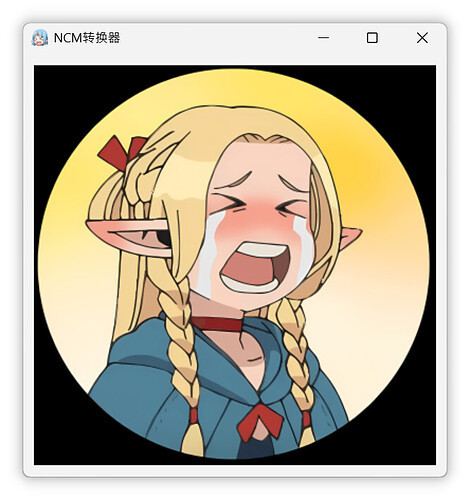
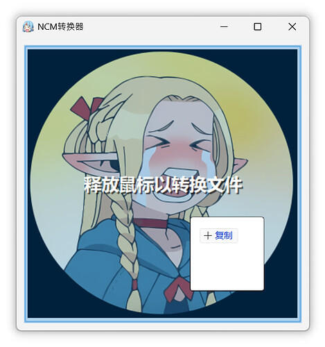
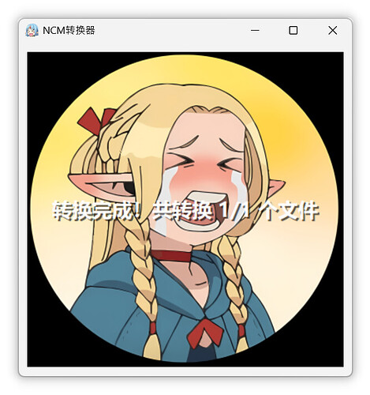
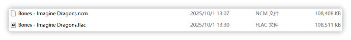
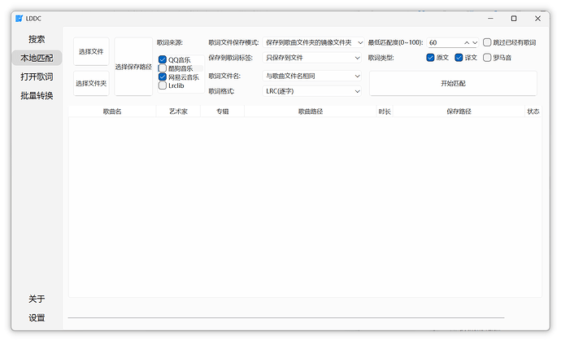
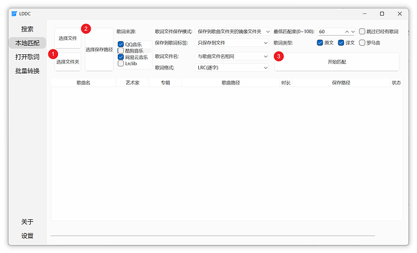
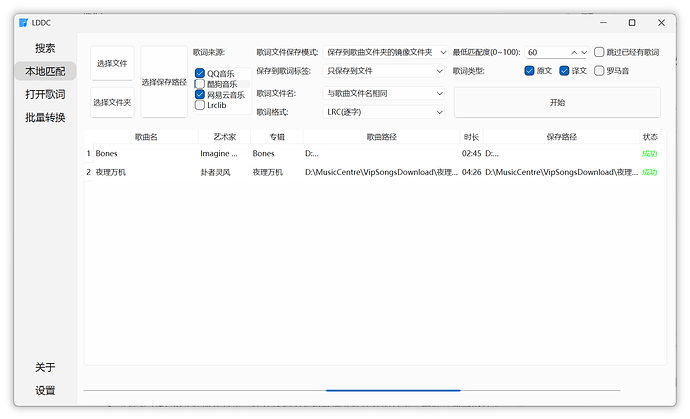

---

id: 1002200

title: 网易云音乐无损下载并写入歌词图文教程

created_at: 2025-10-01T06:08:56.715Z

username: firmant

display_username: 朱陵

---

# 网易云音乐无损下载并写入歌词图文教程

## 前言

通过本教程，读者应当可以独立完成网易云音乐的下载、解密、歌词匹配，从而实现本地享受网易云音乐无损音乐的目的。本教程中使用的所有资源将会贴出原链接。为方便读者使用，所以资源已打包上传至网盘，可在文章末尾进入下载。

文章中使用的工具存在较多替代，本文的流程并不是唯一可行的流程。如果实际使用中存在问题可以尝试使用其他类似工具。

> 建议读者通读后再开始操作。

## 名词解释

- ncm：网易云自有加密格式，加密会员音乐

- flac：一种常见的无损音乐格式

## 操作步骤

### 1. 源文件下载

由于本教程使用网易云音乐，因而下载步骤非常简单，只需要进入网易云音乐，点击想要下载的歌曲进行下载即可，注意设置下载路径。

### 2. NCM格式解密

本教程使用 NCM Tool进行解密，将待解密文件拖入工具即可获得解密后的flac文件。

1. 如图1所示，我们在网易云下载得到一首NCM格式音乐。

   

2. 打开NCM Tool，界面如图2所示。

   

3. 如图3，将NCM文件拖入工具，转换成功后结果如图4和图5所示。

   

   

   

保留flac文件进行下一步操作。

> 作者同时提供了Web使用办法，因本文未使用不做赘述。

### 3. 歌词匹配

本教程使用LDDC进行歌词匹配并下载，使用时选择LRC逐行歌词可以在播放时获得更好的体验。

1. 打开LDDC，进入本地匹配，根据喜好勾选歌词来源、歌词文件名、歌词格式，如图6所示。

   

   > 建议歌词格式选择：与歌词文件名相同，便于下一步批量修改标签

2. 选择文件夹和保存位置后，开始匹配。匹配完成后如图8和图9所示

   

   

   

## 资源下载

[资源打包下载](https://www.123pan.com/s/xxx)

---

*来源: https://linux.do/t/topic/1002200*