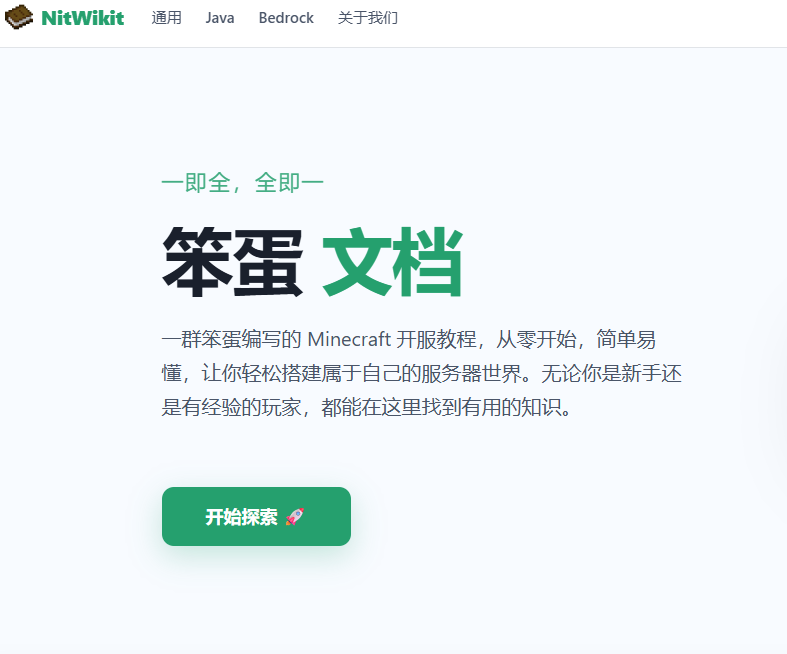
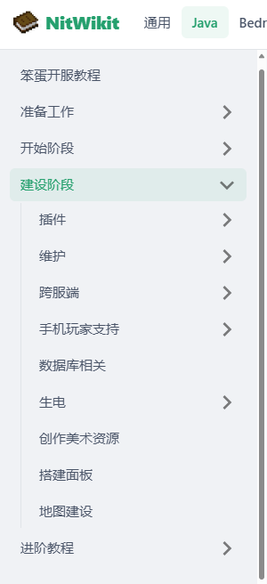

---

id: 1003597

title: "Minecraft 开服教程 - NitWikit"

created_at: 2025-10-02T00:55:15.204Z

username: lilingfeng

display_username: "aeroides"

---

# Minecraft 开服教程 - NitWikit

Nitwikit 这个项目去年 1 月就开始立项了,一直编写到今天,我敢说我们文档的简单程度,知识面(当然没有开发)都是数一数二的

主仓库:

### [GitHub - 8aka-Team/NitWikit: 笨蛋开服教程](https://github.com/8aka-Team/NitWikit)

笨蛋开服教程

主网站:

- [主页 | 笨蛋 MC 开服教程](https://nitwikit.8aka.org/)

- [主页 | 笨蛋 MC 开服教程](https://nitwikit.8aka.cn/) 国内 CDN 版的

其他项目:

- [在 Docker 上开 MC 服务器](https://docker.8aka.org/)

- [TabooLib](https://taboo.8aka.cn/)

- [主页 | 插件翻译文档](https://plugins.8aka.cn/)

- [Typewriter | Typewriter](https://typewriter.8aka.org/)

- [PurpurMC 文档](https://purpur.8aka.org/)

- [基岩版Wiki | Bedrock Wiki](https://bedrock.8aka.org/)

- [首页 | Invero](https://invero.8aka.org/)

- [免费的反作弊配置](https://github.com/8aka-Team/Talents-AntiCheat-Config)

---

*来源: https://linux.do/t/topic/1003597.json*

