---

id: 1004220

title: "【数学笔记】谓词逻辑，一阶谓词逻辑。"

created_at: 2025-10-02T06:53:14.723Z

username: goddog3210

display_username: "蹲神"

---

# 【数学笔记】谓词逻辑，一阶谓词逻辑。

唔……多数为ai整理。

重点是对概念的厘清~我区分不出这些主语谓语

好好学习一下~传统的命题是一大坨的，谓语逻辑是深入语言的结构，进行更精细的操作。

也就是对传统逻辑的现代化和形式化……

主语一般是个体常项，谓语一般表示属性，关系等等。

逻辑符号比较好理解，但非逻辑符号有点绕……特别是函数符号部分，

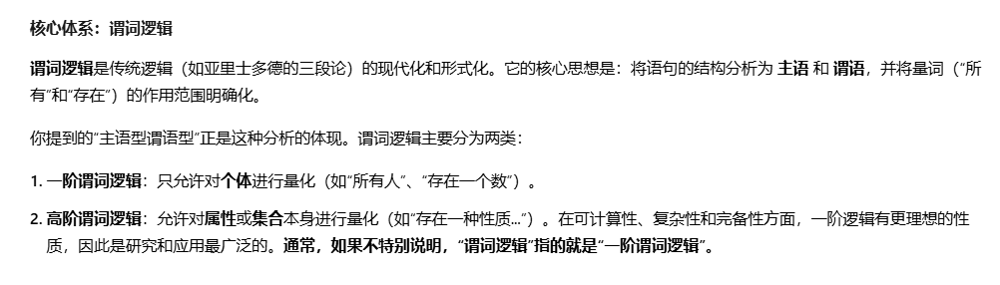

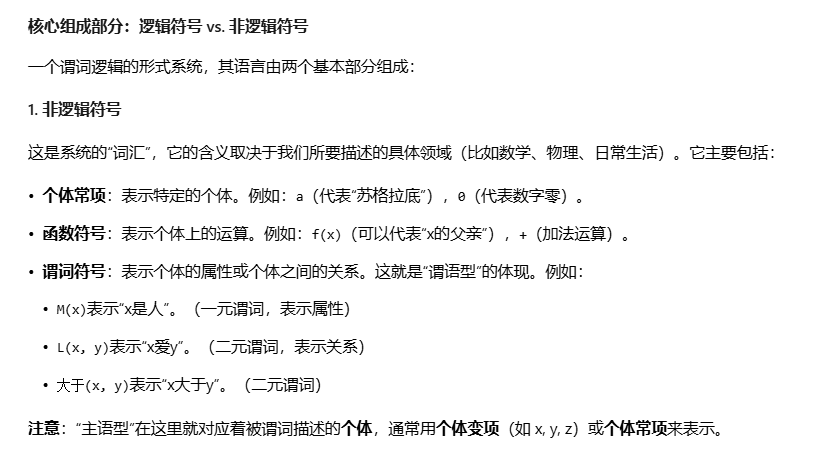

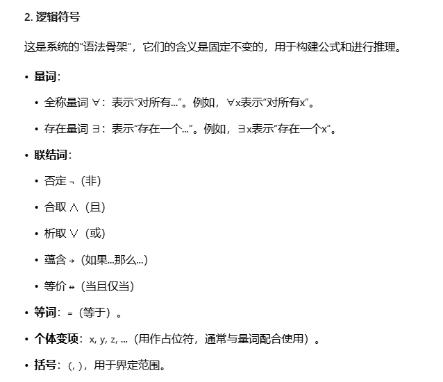

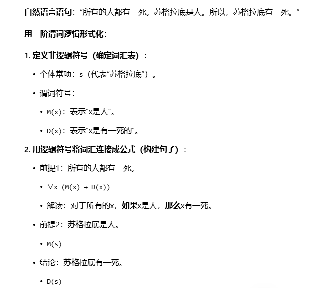

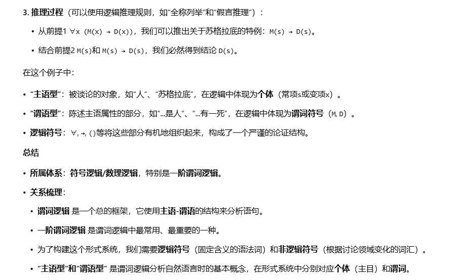

对谓语逻辑的深入探究，主要是对传统命题逻辑的升级和深入：

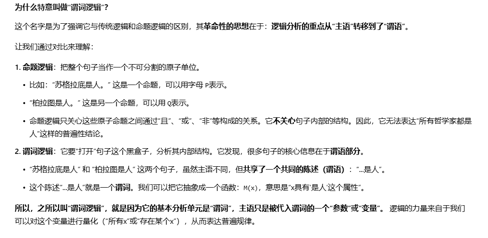

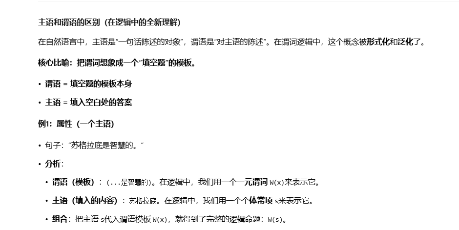

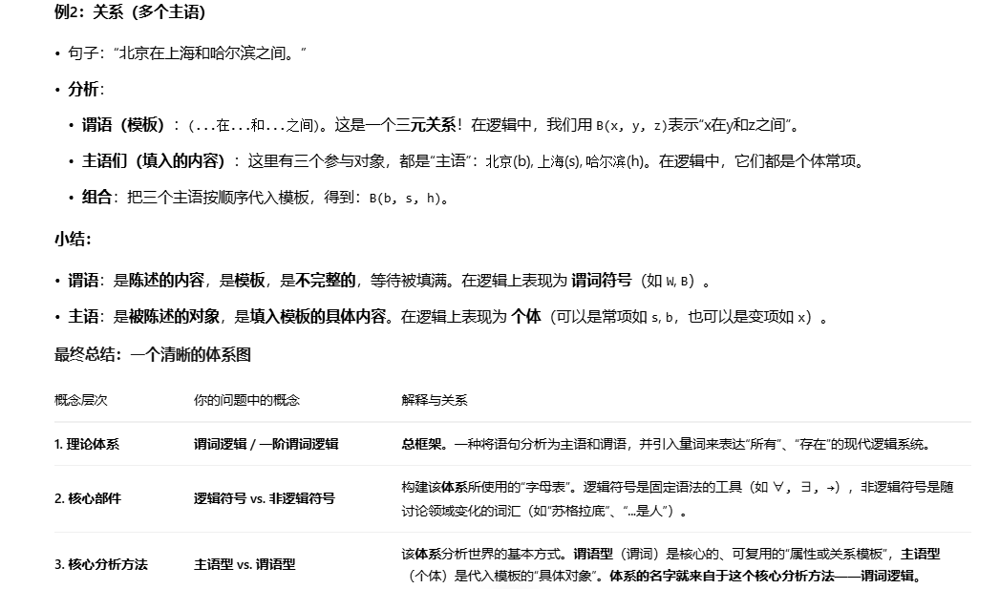

对函数和谓语中关系的厘清：

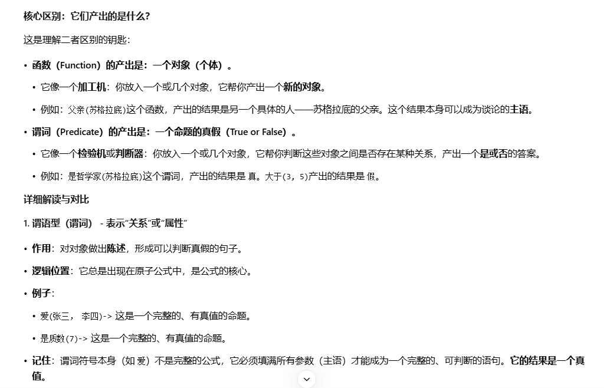

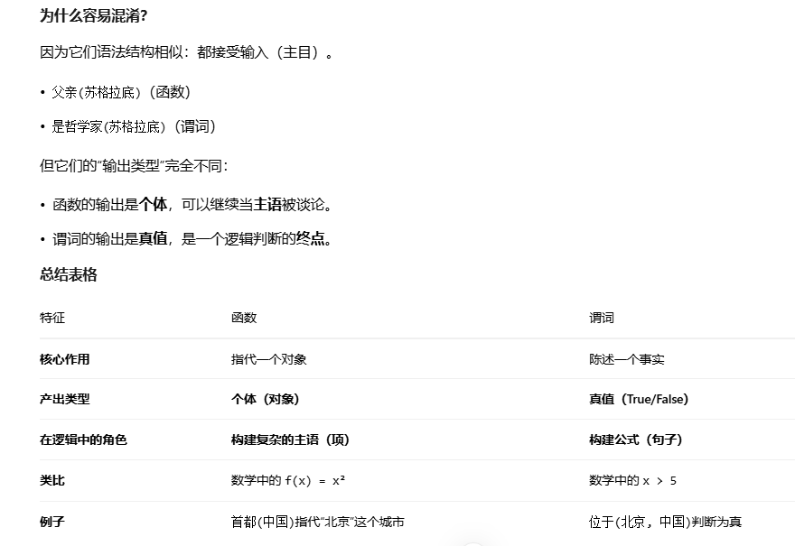

最后是一阶谓词逻辑和高阶谓词逻辑。

一阶的有很多很好的性质，而高阶的牺牲了这些性质获得了更强的表达能力。

> [!tips]高阶逻辑（特别是二阶逻辑）虽然表达能力更强，但确实远不如一阶逻辑常用。这背后是深刻的理论权衡，核心在于 **“表达能力”** 与 **“良好性质”** 之间的取舍。

>

> 简单来说：**一阶逻辑为了获得强大、可靠的数学工具，牺牲了一些表达能力；而高阶逻辑虽然表达能力更强，却失去了这些至关重要的数学工具。**

>

> 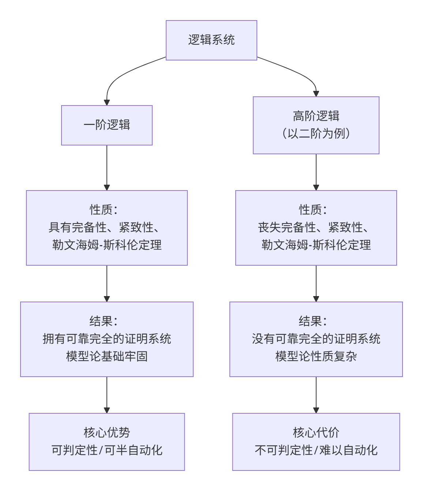

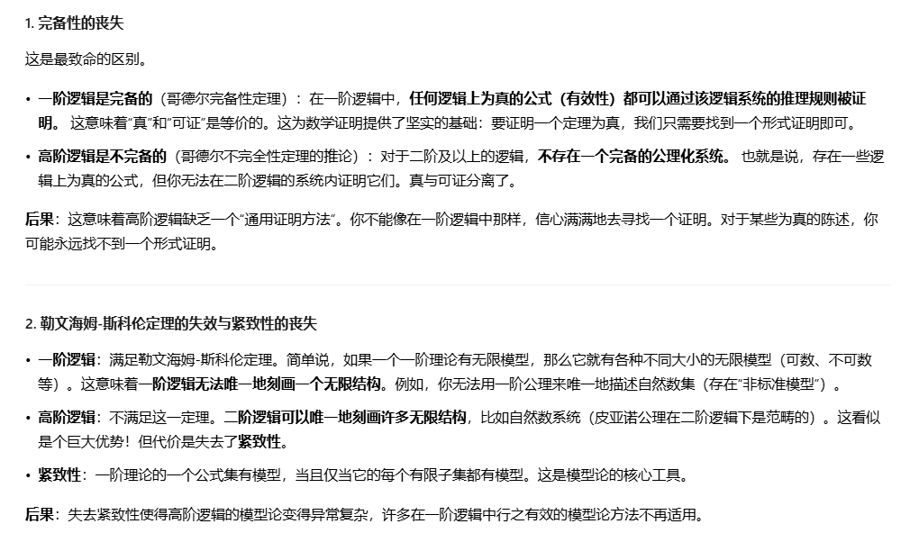

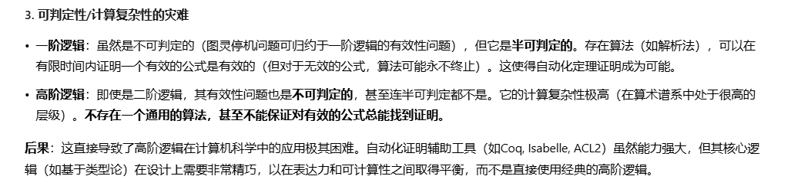

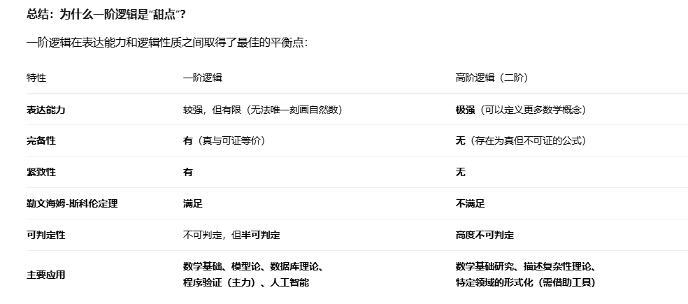

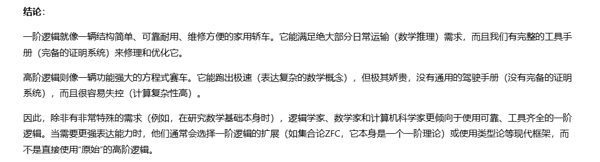

> ![!important]数学家的脑子真好使~

>

> 让我们拥抱一阶谓词逻辑吧~~~

---

*来源: https://linux.do/t/topic/1004220.json*

