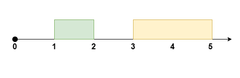
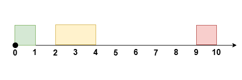

---

id: 1011319

title: "程序设计#4%1【经典算法】双指针和滑动窗口·第二部分"

created_at: 2025-10-05T13:51:30.620Z

username: Karlbaey

display_username: "Seroton Karlbaey"

---


# 程序设计#4%1【经典算法】双指针和滑动窗口·第二部分


[程序设计#4 - 【经典算法】双指针和滑动窗口·第一部分](https://linux.do/t/topic/980569) [


文档共建](/c/wiki/42)

> 上期指路→

>

>

> 原文 URL 请到文末查看！感谢支持！

>

> 书接上回。

>

> 双指针算法（two-pointer algorithm）是处理序列（如数组、链表、字符串）的强大技巧。它通过维护两个指针（索引）来追踪序列中的某个范围或元素，从而高效地解决问题。

> 它尤其擅长解决子数组或子串的相关问题（特别是滑动窗口）。子数组就是一个完整数组里连续的一段，子串就是字符串里连续的一段。

> 对于输入所给…

原文 URL 请到文末查看！感谢支持！

---

[上一期](https://karlbaey.top/articles/program-design-two-pointer-algorithm-and-sliding-window-sep-one/)中，我们接触了双指针算法的两种基本用法：**快慢指针**和**对撞指针**。其中，快慢指针适用于解决去重问题以及解决有环的链表的问题；而对撞指针适合在排好序的数组中寻找元组（例如元组中每个数的和恰好是定值）。

我们提到，双指针算法就像是在漆黑的走廊里派出两名干员。现在我们把干员换成一盏大功率探照灯，它能够一次把走廊中的一部分照亮，原来的两名干员就变成了光照亮之处的左右端点。

有没有发现，这段被照亮的地方就好比在走廊中打开了一个窗口。所以，这种算法思想就叫做**滑动窗口算法**。

## 滑动窗口 - 长度固定

我们从简单的情况说起。

假设我们在大数组里寻找一个长度固定为 `k` 的子数组，并且让小数组元素的平均值最大，因为子数组长度固定，所以我们需要让子数组元素的和最大。

我们可以使用 `now` 来记录当前窗口内的和，`ans` 每次循环都与 `now` 比较取较大值。

```
ans = max(now, ans)
```

这也就是 [leco634 子数组最大平均数 I](https://leetcode.cn/problems/maximum-average-subarray-i/description/) 的过程。

### 子数组 - 和最大/最小

leco643：

> 给你一个由 `n` 个元素组成的整数数组 `nums` 和一个整数 `k` 。

> 请你找出平均数最大且 **长度为 k** 的连续子数组，并输出该最大平均数。

> 任何误差小于 10-5 的答案都将被视为正确答案。

定长滑动窗口其实就是速度相同且同向而行的双指针，因此我们只要用快慢指针的思想改一改即可。在这个过程中我们需要在 `now` 加上每个窗口右端点（用 `nums[r]` 表示）的值，并且在窗口长度已经达到 `k` 时，减去窗口左端点的值（用 `nums[l]` 表示）。也就是说：

1. 窗口右端进入（`now += nums[r]`）

2. 判断 `r >= k`


`true`：更新 `ans` 的值（`ans = max(now, ans)` ）

`false`：什么也不做，进入下一次循环

3. `now` 减去左端点的值 `nusm[l]`

> `l == r-k+1` 的原因：

> 数组中，从 `nums[l]` 到 `nums[r]` 应该有 `k` 个元素。也就是说，从 `l` 开始数，数 `(k-1)` 个数就是 `r`。如下所示。

> `l == r-(k-1) => l == r-k+1`

**注意**：因为要求找的是数组中的**最大平均值**，所以必须把 `ans` 初始化为一个很小的数。把 `ans` 初始化为 `0` 的话，如果数组中的每个数都是负数，那就会出现返回值是 `0` 的错误（此时 `ans` 必然大于等于任何情况下的 `now`）。*这是一个坑点，我自己就踩过好几次。*

写成代码，如下所示。

```
func findMaxAverage(nums []int, k int) float64 {
    var now int
    var ans int = -2147483647 // 一个小到不可能的数
    for r := range nums {
        now += nums[r] // 一定要窗口右端先进！

        l := r-k+1
        if l < 0 { // 窗口长不足 k
            continue
        }

        ans = max(ans, now) // 取最大值

        now -= nums[l] // 左端出窗口
    }

    return float64(ans) / float64(k)
}
```

当然了，对于字符串，我们也可以用类似的方案。例如 [leco2379](https://leetcode.cn/problems/minimum-recolors-to-get-k-consecutive-black-blocks/description/)。

> 给你一个长度为 `n` 下标从 **0** 开始的字符串 `blocks` ，`blocks[i]` 要么是 `'W'` 要么是 `'B'` ，表示第 `i` 块的颜色。字符 `'W'` 和 `'B'` 分别表示白色和黑色。

> 给你一个整数 `k` ，表示想要 **连续** 黑色块的数目。

> 每一次操作中，你可以选择一个白色块将它 **涂成** 黑色块。

> 请你返回至少出现 **一次** 连续 `k` 个黑色块的 **最少** 操作次数。

这道题实际上就是在问：**一个长为 k 的子串中，'B' 的最大数目是多少？** *也可以是问 'W' 的最小数目。*

所以运用与上面类似的思路，就能得到如下的代码。

```
func minimumRecolors(blocks string, k int) int {
    var now, ans int
    for r := range blocks {
        // 这里是求最多的黑色
        // 如果换成 if blocks[r] == 'W' {} 那就是求最少的白色
        if blocks[r] == 'B' {
            now++
        }
        // 下方操作同 leco643
        l := r-k+1
        if l < 0 {
            continue
        }

        ans = max(now, ans)

        if blocks[l] == 'B' {
            now--
        }
    }
    return k-ans // 这里因为求到的是 B 的最大值，所以要用 k 去减
}
```

我们能够从上面的过程推导出一个**定长滑动窗口**的标准流程。

1. **进入窗口**：右端点进入窗口，常常写作 `now += nums[r]`。

2. **判断边界**：因为我们已经知道，左端点 `l` 实际上就是 `r-k+1`，所以必须确保 `l >= 0`（否则会超出索引），这样能确保窗口长度必定在等于 `k` 时才会更新数据。


如果不满足 `l >= 0` 就进入下一次循环，不更新数据。

3. **更新数据**：如果第 2 步的判断为 `true`，那就把当前 `ans` 和 `now` 中的较大值赋给 `ans`。这样到最后 `ans` 就是子数组和的最大值。

4. **退出窗口**：`now -= nums[l]`。

上面四步是定长滑动窗口的模板解法，适用于每一个定长滑动窗口问题。**通常来说，最困难的部分就是寻找窗口大小和起始点。因为窗口不仅能从左往右滑，也可以从右往左滑。通过合适地确定 r 值能将这两种情况合并到同一个循环中。**

> 时间复杂度：`O(n)`。右端点需要访问每一个元素。

> 空间复杂度：通常为 `O(1)`，但如果需要用哈希表等记录窗口内元素信息，则可能为 `O(k)` 或 `O(字符集大小)`[[1]](#footnote-9188087-1)。

那么接下来就看一些寻找符合条件窗口的问题。

### 子数组 - 数组内元素唯一

现在我们给窗口增加一个限制：子数组必须保证有若干个元素互不相同。

这可以用 Go 中的**映射**（map）来记录元素出现次数。*像这样，在一个数据类型中，一个值对应另一个值的，我们叫它哈希表（Hashmap）。下同。*

```
freq := map[int]int{}
```

上面就是一个统计字符出现顺序的哈希表。我们可以使用 `freq[num]++` 和 `freq[num]--` 来修改元素出现顺序。

以 [2841. 几乎唯一子数组的最大和 - 力扣（LeetCode）](https://leetcode.cn/problems/maximum-sum-of-almost-unique-subarray/description/)和为例。我们至少需要让 `len(freq) >= m` 才更新 `ans`。*2461. 长度为 K 子数组中的最大和 - 力扣（LeetCode） 则只需要让 len(freq) == k 即可。*

> 给你一个整数数组 `nums` 和两个正整数 `m` 和 `k` 。

> 请你返回 `nums` 中长度为 `k` 的 **几乎唯一** 子数组的 **最大和** ，如果不存在几乎唯一子数组，请你返回 `0` 。

> 如果 `nums` 的一个子数组有至少 `m` 个互不相同的元素，我们称它是 **几乎唯一** 子数组。

> 子数组指的是一个数组中一段连续 **非空** 的元素序列。

在这里，每当右端点进入窗口时，就需要 `freq[nums[r]]++`；左端点出窗口时，则需要 `freq[nums[l]]--` 并且注意删到 `0` 就要清空哈希表中的这一项。（因为我们实际用到的是哈希表的长度）

```
func maxSum(nums []int, m int, k int) int64 {
    var ans, now int
    freq := map[int]int{} // 统计字符出现次数

    for r := range nums {
        now += nums[r]
        freq[nums[r]]++

        l := r-k+1
        if l < 0 {
            continue
        }

        if len(freq) >= m {
            ans = max(ans, now)
        }

        // 如果是 leco2641
        /*
        if len(freq) == k {
            ans = max(ans, now)
        }
        */

        now -= nums[l]
        freq[nums[l]]--
        if freq[nums[l]] == 0 {
            delete(freq, nums[l])
        }
    }
    return int64(ans)
}
```

### 子数组 - 窗口有破洞

现在的走廊上有无法照亮的地方，即使我们用探照灯，也什么都看不见。但是幸运的是，我们不需要考虑破洞的元素是否需要加入窗口里，因为无论如何答案里都会加上破洞（**无需考虑的元素**）的值。

我们看看怎样把这部分破洞正确处理。

[1052. 爱生气的书店老板 - 力扣（LeetCode）](https://leetcode.cn/problems/grumpy-bookstore-owner/description/)

> 有一个书店老板，他的书店开了 `n` 分钟。每分钟都有一些顾客进入这家商店。给定一个长度为 `n` 的整数数组 `customers` ，其中 `customers[i]` 是在第 `i` 分钟开始时进入商店的顾客数量，所有这些顾客在第 `i` 分钟结束后离开。

> 在某些分钟内，书店老板会生气。 如果书店老板在第 `i` 分钟生气，那么 `grumpy[i] = 1`，否则 `grumpy[i] = 0`。

> 当书店老板生气时，那一分钟的顾客就会不满意，若老板不生气则顾客是满意的。

> 书店老板知道一个秘密技巧，能抑制自己的情绪，可以让自己连续 `minutes` 分钟不生气，但却只能使用一次。

> 请你返回 *这一天营业下来，最多有多少客户能够感到满意* 。

我们总结一下题目，能够得到这样的事实。

- `minutes` 是窗口长度。

- `grumpy[i] == 1` 则应该将 `customers[i]` 加入窗口。

- `grumpy[i] == 0` 则应该忽略 `customers[i]`。

- 无论 `grumpy[i]` 是多少，`customers[i]` 都会占用窗口长度。


*也就是说窗口内满足 grumpy[i] == 0 的 customers[i] 可视作 0*。

我们可以使用一个数组 `sat` 来记录，`sat[0]` 表示老板不生气时的顾客数目，`sat[1]` 表示老板生气但是抑制住情绪（即仍然满意）的顾客数。

接着用条件控制 `customers[i]` 的进出窗口，如下所示。

```
var sat = [2]int{}

if grumpy[r] == 1 {
    now += customers[r]
} else {
    sat[grumpy[i]] += customers[r]
}

// ...

if grumpy[l] == 1 {
    now -= customers[l]
}
```

知道了怎么处理破洞的窗口，那就很好写出完整的实现代码了。

```
func maxSatisfied(customers []int, grumpy []int, minutes int) int {
    var sat = [2]int{} // 最多满意的顾客数
    var now int // 老板愤怒时的顾客数（窗口长度为 minutes）
    for r, c := range customers {
        // 下面的 if else 用来分流老板状态不同时的顾客数
        if grumpy[r] == 1 {
            now += c
        } else {
            sat[grumpy[r]] += c
        }

        l := r - minutes + 1
        if l < 0 {
            continue
        }

        sat[1] = max(now, sat[1]) // 更新最多的老板愤怒时的顾客数

        if grumpy[l] == 1 {
            now -= customers[l]
        }
    }
    return sat[0] + sat[1]
}
```

#### 自己挖破洞 - 抛弃元素问题

我们把上面的*数组内元素唯一*和*窗口有破洞*结合起来。我们此时需要保证窗口内有不超过 `m` 个相同的元素，多了要扔掉。

扔掉的元素不再计入窗口内元素之和，但是仍然占用窗口长度。

这就是 [leco3679](https://leetcode.cn/problems/minimum-discards-to-balance-inventory/)。

> 给你两个整数 w 和 m，以及一个整数数组 arrivals，其中 arrivals[i] 表示第 i 天到达的物品类型（天数从 1 开始编号）。

> 物品的管理遵循以下规则：

>

> 每个到达的物品可以被 保留 或 丢弃 ，物品只能在到达当天被丢弃。

> 对于每一天 `i`，考虑天数范围为 `[max(1, i - w + 1), i]`（也就是直到第 `i` 天为止最近的 `w` 天）：

>

> 对于 任何 这样的时间窗口，在被保留的到达物品中，每种类型最多只能出现 `m` 次。

> 如果在第 `i` 天保留该到达物品会导致其类型在该窗口中出现次数 超过 `m` 次，那么该物品必须被丢弃。

>

>

>

> 返回为满足每个 `w` 天的窗口中每种类型最多出现 `m` 次，最少 需要丢弃的物品数量。

只要用哈希表记录元素出现次数，并且在**抛弃元素后把被抛弃的元素设置为 0 即可**。*这是因为原题中的数据范围决定了 arrivals[i] >= 1，如果有 0 就不能这样做。*

剩下的部分与常规滑动窗口完全一致。

```
func minArrivalsToDiscard(arrivals []int, w int, m int) int {
    var freq = map[int]int{} // 记录元素出现次数
    var ans int
    for r := range arrivals {
        freq[arrivals[r]]++
        if freq[arrivals[r]] > m {
            ans++
            freq[arrivals[r]]--
            // 易错点！否则出窗口时会导致已经抛弃的元素再抛弃一次
            arrivals[r] = 0
        }

        l := r - w + 1
        if l < 0 {
            continue
        }

        freq[arrivals[l]]--
    }
    return ans
}
```

### 寻找窗口

#### 窗口初始位置不同 - 循环数组

**循环数组**的意思是，一个数组的最后一项的下一项恰好是第一项，这就意味着这个数组对于任何大于等于零的索引[[2]](#footnote-9188087-2)都不会 `panic`。

一个循环数组的第 `i` 位索引可以表示为 `nums[i%len(nums)]`。

在这样的数组里，窗口端点索引可以大于等于数组长度，因此滑动窗口既可以从右向左滑，也可以从左向右滑。**但是！通过合理地选择窗口起点，完全能把这两种情况合并到一起。**

[leco1652 拆炸弹](https://leetcode.cn/problems/defuse-the-bomb/description/) 就是这样的一道题。

> 你有一个炸弹需要拆除，时间紧迫！你的情报员会给你一个长度为 `n` 的 **循环** 数组 `code` 以及一个密钥 `k` 。

> 为了获得正确的密码，你需要替换掉每一个数字。所有数字会 **同时** 被替换。*（注：这一句可以忽略）*

>

> 如果 `k > 0` ，将第 `i` 个数字用 **接下来** `k` 个数字之和替换。

> 如果 `k < 0` ，将第 `i` 个数字用 **之前** `k` 个数字之和替换。

> 如果 `k == 0` ，将第 `i` 个数字用 `0` 替换。

>

> 由于 `code` 是循环的， `code[n-1]` 下一个元素是 `code[0]` ，且 `code[0]` 前一个元素是 `code[n-1]` 。

> 给你 **循环** 数组 `code` 和整数密钥 `k` ，请你返回解密后的结果来拆除炸弹！

先观察一下窗口运行的特点。*设解密后的数组为 ans*。

- **k > 0**：`ans[0]` 填入的就是 `code[1 : k+1]` 求和的值。

- `k < 0`：`ans[0]` 填入的就是 `code[n+k : n]` 求和的值。

将这个结论推广下去。（省略循环数组的取余操作）

- **k > 0**：`ans[i]` 填入的就是 `code[i+1 : k+i+1]` 求和的值。

- `k < 0`：`ans[i]` 填入的就是 `code[n+k+i : n+i]` 求和的值。

把窗口的起始点搞明白之后，先写初始化窗口的代码。

```
n := len(code)
r := k + 1

// 然后 k < 0
if k < 0 {
    r = n
    k = -k
}
```

上面的代码完全仿照了一开始的推导，那么接下来就写滑动窗口部分。

```
// 把第一个窗口内的和计算出来
var now int
for _, c := range code[r-k : r] {
    now += c
}

// 窗口开始滑动
var ans = make([]int, n)
for i := range code {
    ans[i] = now
    // 在第一个窗口的基础上开始滑动
    now += code[r%n] - code[(r-k)%n] // 因为循环数组，所以要取余运算
    // 这里的 r-k 就是左端点
    r++
}
return ans
```

也就是这样。

```
func decrypt(code []int, k int) []int {
    // 先写 k > 0 的情况
    n := len(code)
    r := k + 1
    // 然后 k < 0
    if k < 0 {
        r = n
        k = -k
    }

    // 把第一个窗口内的和计算出来
    var now int
    for _, c := range code[r-k : r] {
        now += c
    }

    // 窗口开始滑动
    var ans = make([]int, n)
    for i := range code {
        ans[i] = now
        now += code[r%n] - code[(r-k)%n] // 因为循环数组，所以要取余运算
        // 这里的 r-k 就是左端点
        r++
    }
    return ans
}
```

这就是*拆炸弹*的解法。这里不需要特判 `k == 0` 的情况。因为此时的 `r` 与 `r-k` 是同一个数，滑动时会互相抵消。

#### 寻找窗口 - 重新安排活动时间

[3439. 重新安排会议得到最多空余时间 I - 力扣（LeetCode）](https://leetcode.cn/problems/reschedule-meetings-for-maximum-free-time-i/description/)

> 给你一个整数 `eventTime` 表示一个活动的总时长，这个活动开始于 `t = 0` ，结束于 `t = eventTime` 。

> 同时给你两个长度为 `n` 的整数数组 `startTime` 和 `endTime` 。它们表示这次活动中 `n` 个时间 **没有重叠** 的会议，其中第 `i` 个会议的时间为 `[startTime[i], endTime[i]]` 。

> 你可以重新安排 **至多** `k` 个会议，安排的规则是将会议时间平移，且保持原来的 **会议时长** ，你的目的是移动会议后 **最大化** 相邻两个会议之间的 **最长** 连续空余时间。

> 移动前后所有会议之间的 **相对** 顺序需要保持不变，而且会议时间也需要保持互不重叠。

> 请你返回重新安排会议以后，可以得到的 **最大** 空余时间。

> **注意**，会议 **不能** 安排到整个活动的时间以外。

我们观察一下活动时间与空余时间的关系。





容易发现，每一段**活动时间**的*左侧*都有一段对应的空余时间，而在最后又有一段空余时间（空余时长为 `0` 也计入）。

这也就意味着，设原题给出的 `startTime` 长度为 `n`，空余时间的段数就是 `n+1`。

我们把空余时间抽象成一个数组 `free`，其中 `free[i]` 表示第 `i` 段空余时间的长度（可以是 `0`）。

然后我们发现，每操作一段会议时间，实际上是合并了两段空余时间。

推广下去，操作 `k` 段会议时间就是合并了 `k+1` 段空余时间。**而且！**这 `k+1` 段空余时间在 `free` 数组中是连续的。

有没有觉得很熟悉？没错，问题就转化成了**在 free 数组中寻找长为 k+1 的子数组，并保证子数组内元素和最大。**

这又是一道经典的定长滑动窗口，直接套入模板。但在开始前需要写一个生成 `free` 数组的代码。

```
func maxFreeTime(eventTime int, k int, startTime []int, endTime []int) int {
    // 生成 free 数组
    n := len(startTime)
    free := make([]int, n+1)
    free[0] = startTime[0]
    for i := 1; i < n; i++ {
        free[i] = startTime[i] - endTime[i-1]
    }
    free[n] = eventTime - endTime[n-1]

    // 开始滑动窗口

    var now, ans int
    for r := range free {
        now += free[r]
        l := r - k
        if l < 0 {
            continue
        }

        ans = max(now, ans)

        now -= free[l]
    }
    return ans
}
```

## 滑动窗口 - 长度不固定

当窗口长度不定时，此时我们不能再用上面的 **进-判-出** 三步走，这时候进出窗口完全靠我们自行判断了。

先用一道模板题试试水。

[3. 无重复字符的最长子串 - 力扣（LeetCode）](https://leetcode.cn/problems/longest-substring-without-repeating-characters/description/) *这道题还有一个兄弟版本 leco3090。*

> 给一个字符串 `s` ，请你找出其中不含有重复字符的 **最长 子串** 的长度。*子串是字符串中连续的非空字符序列。*

这可用下面的流程表示。

1. 右端点进入窗口

2. 判断现在进入窗口的字符是否已经出现超过 `1` 次。


`true` 收缩左窗口直到当前字符出现次数等于 `1`。

`false` 不做处理，继续。

3. 用一个变量 `ans` 在每次循环末尾存储当前 `ans` 与 `r-l+1` 中的较大值。

上面流程清晰易懂，所以直接展示代码。

```
func lengthOfLongestSubstring(s string) int {
    var freq = map[byte]int{}
    var l, ans int
    for r := range s {
        freq[s[r]]++ // 右端点进入窗口
        for freq[s[r]] > 1 { // 左端点离开窗口的条件
            freq[s[l]]--
            l++
        }
        ans = max(ans, r-l+1) // 取较大值
    }
    return ans
}
```

可视化：

```
将要操作的字符串: abcabcbb
当前窗口: a
当前窗口: ab
当前窗口: abc
当前窗口: abca
⚠️  发现重复字符 'a' 窗口收缩
当前窗口: bca
当前窗口: bcab
⚠️  发现重复字符 'b' 窗口收缩
当前窗口: cab
当前窗口: cabc
⚠️  发现重复字符 'c' 窗口收缩
当前窗口: abc
当前窗口: abcb
⚠️  发现重复字符 'a' 窗口收缩
当前窗口: bcb
⚠️  发现重复字符 'b' 窗口收缩
当前窗口: cb
当前窗口: cbb
⚠️  发现重复字符 'c' 窗口收缩
当前窗口: bb
⚠️  发现重复字符 'b' 窗口收缩
当前窗口: b
最终答案: 3
```

### 不定长窗口 - 反向窗口

所谓**反向窗口**，就是我们实际求得的窗口是恰好与答案相反的。

我们这里会提到一个非常重要的思想：**正难则反**。

顾名思义，如果我们正向求解一个问题是困难的，那不妨从答案的**对立事件**入手，然后用全集减去对立事件，这样可能会方便一点。

例如抽卡问题：[1658. 将 x 减到 0 的最小操作数 - 力扣（LeetCode）](https://leetcode.cn/problems/minimum-operations-to-reduce-x-to-zero/description/)

> *注：这里把数组看作一排卡片，每个元素就是一张卡片。*

> 给你一个整数数组 `nums` 和一个整数 `x` 。每一次操作时，你应当移除数组 `nums` 最左边或最右边的元素，然后从 `x` 中减去该元素的值。请注意，需要 **修改** 数组以供接下来的操作使用。

> 如果可以将 `x` **恰好** 减到 `0` ，返回 **最小操作数** ；否则，返回 `-1` 。

如果我们真的从左边和右边开始，一张一张抽卡试探，那是很麻烦的。

那我们换个思路，看看抽完卡之后剩下的卡片有什么特点。

设 `nums` 全部元素求和的值是 `s`，那么如果能够让 `x == 0`，抽完之后的卡片求和就是 `s-x` （设为 `target`）。

那我们就可以在这排卡片中寻找最长的一段，让这一段的卡片数字之和等于 `target`。

有没有发现这就是*越长越好的不定长滑动窗口*？那我们就用模板代码写出来。

```
func minOperations(nums []int, x int) int {
    var now, l int
    var ans int = -1 // 默认找不到 x

    var target int = -x
    for _, i := range nums {
        target += i // 这样求出来就是上面所说的 s-x
    }

    if target < 0 {
        // 此时的 x 大于 nums 所有元素之和
        // 找不到，直接返回
        return ans
    }
    // 下面就是模板代码
    for r := range nums {
        now += nums[r]
        for now > target {
            now -= nums[l]
            l++
        }
        if now == target { // 只有在 now == s-x 才更新
            ans = max(ans, r-l+1)
        }
    }

    if ans < 0 {
        return -1
    }
    return len(nums) - ans
}
```

### 不定长窗口 - 越短越好

这里的越短越好指的是**窗口覆盖所有所需元素时，窗口越短越好。**

这大多出现在**寻找最短子串问题**中，例如 [76. 最小覆盖子串 - 力扣（LeetCode）](https://leetcode.cn/problems/minimum-window-substring/description/)。

> 给你一个字符串 `s` 、一个字符串 `t` 。返回 `s` 中涵盖 `t` 所有字符的最小子串。如果 `s` 中不存在涵盖 `t` 所有字符的子串，则返回空字符串 `""` 。

> **注意：**

>

> 对于 `t` 中重复字符，我们寻找的子字符串中该字符数量必须不少于 `t` 中该字符数量。

> 如果 `s` 中存在这样的子串，我们保证它是唯一的答案。

*这还是道困难题，解开你的困难题解答数就 +1 了*。

因为 `s` 和 `t` 中只有英文字母，所以考虑用长为 123 （比 `z` 对应的 ASCII 码点 `122` 多 `1`。因为索引从 `0` 开始，所以这样能方便运算）的数组 `freq` 来标记 `t` 与 `s` 中存储的字符。

然后用一个变量 `types` 来记录 `t` 字符种类数，每当检测到 `freq[i] == 0` 时 `types--`，这样就能够做到同时统计字符数和字符种类。

当 `types == 0` 时，意味着已经搜索到了一个含有 `t` 中全部字符的子串，就考虑收缩窗口寻找更优解。

```
func minWindow(s string, t string) string {
    var freq = [123]int{}
    var types int // t 的字符种类数
    for i := range t {
        if freq[t[i]] == 0 { // 新的字符种类
            types++
        }
        freq[t[i]]++
    }

    var l int
    ansl, ansr := -1, 2147483647 // 大到不可能的边界
    for r := range s {
        freq[s[r]]--
        if freq[s[r]] == 0 { // 窗口中 s[r] 这个字符的数量，刚好满足了 t 的要求，不多也不少
            types--
        }
        // 找到了 t 中所有的字符（数目也一致）
        for types == 0 {
            if r-l < ansr-ansl { // 更新答案
                ansl, ansr = l, r
            }
            // 在把 s[l] 移出窗口之前，s[l] 是一个数量刚刚好的关键字符
            // 也就是说，这时候还将 freq[s[l]] 移出，就不满足要求了
            if freq[s[l]] == 0 {
                types++
            }
            freq[s[l]]++
            l++ // 边界收缩
        }
    }
    if ansl == -1 { // 特判未找到的情况
        return ""
    }
    return s[ansl : ansr+1]
}
```

把搜索过程可视化，就是这样的。

```
输入：
s := "ADOBECODEBANC"
t := "ABC"

t 包含的字符种类数: 3
==================================
搜索进度:  1 / 13
当前子串包含的字符种类数: 1
当前扫描得到的子串: "A"
==================================
搜索进度:  2 / 13
当前子串包含的字符种类数: 1
当前扫描得到的子串: "AD"
==================================
搜索进度:  3 / 13
当前子串包含的字符种类数: 1
当前扫描得到的子串: "ADO"
==================================
搜索进度:  4 / 13
当前子串包含的字符种类数: 2
当前扫描得到的子串: "ADOB"
==================================
搜索进度:  5 / 13
当前子串包含的字符种类数: 2
当前扫描得到的子串: "ADOBE"
==================================
搜索进度:  6 / 13
当前子串包含的字符种类数: 3
当前扫描得到的子串: "ADOBEC"
满足条件！将尝试收缩窗口。当前子串："ADOBEC"
==================================
搜索进度:  7 / 13
当前子串包含的字符种类数: 2
当前扫描得到的子串: "DOBECO"
==================================
搜索进度:  8 / 13
当前子串包含的字符种类数: 2
当前扫描得到的子串: "DOBECOD"
==================================
搜索进度:  9 / 13
当前子串包含的字符种类数: 2
当前扫描得到的子串: "DOBECODE"
==================================
搜索进度:  10 / 13
当前子串包含的字符种类数: 2
当前扫描得到的子串: "DOBECODEB"
==================================
搜索进度:  11 / 13
当前子串包含的字符种类数: 3
当前扫描得到的子串: "DOBECODEBA"
满足条件！将尝试收缩窗口。当前子串："DOBECODEBA"
满足条件！将尝试收缩窗口。当前子串："OBECODEBA"
满足条件！将尝试收缩窗口。当前子串："BECODEBA"
满足条件！将尝试收缩窗口。当前子串："ECODEBA"
满足条件！将尝试收缩窗口。当前子串："CODEBA"
==================================
搜索进度:  12 / 13
当前子串包含的字符种类数: 2
当前扫描得到的子串: "ODEBAN"
==================================
搜索进度:  13 / 13
当前子串包含的字符种类数: 3
当前扫描得到的子串: "ODEBANC"
满足条件！将尝试收缩窗口。当前子串："ODEBANC"
满足条件！将尝试收缩窗口。当前子串："DEBANC"
满足条件！将尝试收缩窗口。当前子串："EBANC"
满足条件！将尝试收缩窗口。当前子串："BANC"

最终答案: "BANC"
```

## 额外部分

其实定长滑动窗口还可以优化，例如 [leco634 子数组最大平均数 I](https://leetcode.cn/problems/maximum-average-subarray-i/description/) 可以这样写。

```
func findMaxAverage(nums []int, k int) float64 {
    var now int
    // 计算第一个窗口和
    for _, x := range nums[:k] {
        now += nums[r]
    }
    for r := k; r < len(nums); r++ {
        now += nums[r] - nums[r-k]
        ans = max(ans, now) // 取最大值
    }
    return float64(ans) / float64(k)
}
```

这种优化思路就是，**先计算第一个窗口值，然后把第一个窗口值作为 ans 的初始值，然后从 k 处开始遍历寻找窗口**。

在这之后只要将 `now += nums[r] - nums[r-k]` 就能实现更新窗口值。

---

*因为写了一篇困难题的解决思路，就把它作为双指针和滑动窗口的第二部分结尾吧，第三部分讲一些特殊的窗口。*

滑动窗口实际上是在维护一个**队列**（queue），队列遵循**先进先出**（First In First Out, FIFO）的原则。

这个队列最多只会遍历整个数组或字符串一次，因此单纯滑动窗口算法的时间复杂度只有 `O(n)`，比暴力搜索高效得多。

> 队列有一个头和一个尾，头就是窗口的左端点，尾就是窗口的右端点。元素不断地从右端点进入窗口，又不断地从左端点离开窗口，这就对应了队列的“**入队**”（enqueue）和“**出队**”（dequeue）操作。

> 这就是滑动窗口的本质。因为队列在原序列中必然连续，因此滑动窗口极其适合解决子数组/子串问题，并能把至少 `O(n^2)` 的暴力搜索优化到 `O(n)`。

这是 *双指针与滑动窗口* 的第二部分，在这里，我们接触了定长滑动窗口的模板，并且看了一些窗口位置藏得极其诡异的题目。

然后给下一期的不定长滑动窗口起了一个头。因为滑动窗口本质是在维护一个队列。

这个队列当条件满足时入队，条件不满足时出队。

本期教程就到这里，下一期（第三部分）就涉及一些特别的窗口问题。

撒花！

原文 URL


### [Haku](https://re.karlbaey.top)

Karlbaey's Cardboard Box

---

1. 常用 `O(|Σ|)` 表示。 [↩︎](#footnote-ref-9188087-1)

2. 如果是实际代码，还是会的。 [↩︎](#footnote-ref-9188087-2)


---


*来源: https://linux.do/t/topic/1011319.json*

