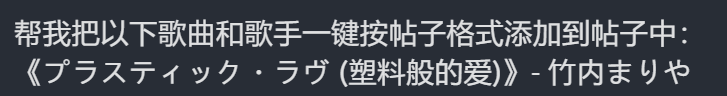

---

id: 1013652

title: "争做L站最全好听日语歌收集！还有歌手！"

created_at: 2025-10-06T14:39:05.677Z

username: Acheron

display_username: "白日星梦DSD"

---


# 争做L站最全好听日语歌收集！还有歌手！


# 注意事项及说明（必读）

RT。收集起来放歌单里！

前 7 个是本人爱听的（就看了一部番，听过的日语歌不多，抱歉不能分享很多）

米津玄师，八爷的歌还没收集，不过都很好听就是了 （注：所以不一定是二次元！）

有没有热心佬帮我整理一下格式

已才整理到 #4（现不记录）

有什么歌随便添！换个行加个歌就行！记得留下自己的名字！

觉得太累可以用AI一键添加哦！记得先检查一下！



**看到别人正在编辑，请不要争抢！请立马复制全文，并保存，防止帖子内容冲突和丢失！**

## 格式指导

输入日文假名有困难的佬友可使用这个工具：

### [[日语]罗马字—假名转换器V2.0 - Toz's Blog](https://tozzger.com/romaji)

---

L 站编辑器支持 Markdown 注释，语法如下。

```
这是文本[^1]。

这是另一段文本[^2]。

[^1]: 这是文本的注释。
[^2]: 这是另一段文本的注释。
```

**请仔细观察注释编号，不要弄错了，并将注释内容摆在主帖最底下。**

[暂未加入的内容 - 深海幽域 - LINUX DO](https://linux.do/t/topic/1014401)

# 歌名及介绍：

**介绍引用至百度百科，萌娘百科，维基百科等。**

## 1.《One Last Kiss》

- 是[宇多田光](https://baike.baidu.com/item/%E5%AE%87%E5%A4%9A%E7%94%B0%E5%85%89/207334?fromModule=lemma_inlink)创作、演唱的歌曲，是动画电影《[新·福音战士剧场版：终](https://baike.baidu.com/item/%E6%96%B0%C2%B7%E7%A6%8F%E9%9F%B3%E6%88%98%E5%A3%AB%E5%89%A7%E5%9C%BA%E7%89%88%EF%BC%9A%E7%BB%88/57320662?fromModule=lemma_inlink)》的片尾曲，先后收录于她的首张音乐EP《[One Last Kiss](https://baike.baidu.com/item/One%20Last%20Kiss/56905993?fromModule=lemma_inlink)》和《[Bad Mode](https://baike.baidu.com/item/Bad%20Mode/59956882?fromModule=lemma_inlink)》中，于2021年3月9日通过索尼唱片发行。

## 2. 《アイドル》(Idol / 偶像)

- （日文名：アイドル，英文名：Idol）是[YOASOBI](https://baike.baidu.com/item/YOASOBI/54112719?fromModule=lemma_inlink)创作并推出的歌曲

## 3. 《ファタール》(Fatal / Fatale)

- 是 TV 动画《[【我推的孩子】](https://mzh.moegirl.org.cn/%E3%80%90%E6%88%91%E6%8E%A8%E7%9A%84%E5%AD%A9%E5%AD%90%E3%80%91)》第二季的[片头曲 ](https://mzh.moegirl.org.cn/%E7%89%87%E5%A4%B4%E6%9B%B2)，由 GEMN（中岛健人、[キタニタツヤ](https://mzh.moegirl.org.cn/%E6%9C%A8%E8%B0%B7%E9%BE%99%E4%B9%9F)）演唱。

## 4.《前前前世》

- 是[RADWIMPS](https://baike.baidu.com/item/RADWIMPS/1836722?fromModule=lemma_inlink)演唱，[野田洋次郎](https://baike.baidu.com/item/%E9%87%8E%E7%94%B0%E6%B4%8B%E6%AC%A1%E9%83%8E/10359955?fromModule=lemma_inlink)作词作曲的歌曲，动画电影《[你的名字。](https://baike.baidu.com/item/%E4%BD%A0%E7%9A%84%E5%90%8D%E5%AD%97%E3%80%82/19127928?fromModule=lemma_inlink)》主题曲

## 5.《なんでもないや》(没什么大不了)

- 是日本乐队RADWIMPS演唱的歌曲，由乐队成员野田洋次郎作词、作曲及编曲，收录于2016年8月24日发行的动画电影《你的名字。》原声专辑中。

## 6.《夢灯籠》(梦灯笼)

- 是日本摇滚乐队[RADWIMPS](https://baike.baidu.com/item/RADWIMPS/1836722?fromModule=lemma_inlink)于2016年8月24日发行的歌曲，由主唱[野田洋次郎](https://baike.baidu.com/item/%E9%87%8E%E7%94%B0%E6%B4%8B%E6%AC%A1%E9%83%8E/10359955?fromModule=lemma_inlink)独立完成词曲创作及编曲，收录于动画电影《你的名字。》原声专辑，

## 7. 《スパークル》(Sparkle / 火花)

- 是日本乐队RADWIMPS演唱的歌曲，由野田洋次郎作词、作曲并编曲，作为动画电影《你的名字。》插曲于2016年8月24日随电影原声带发行电影版本（movie ver.）

## 8. 《RAINY DAY》

- 是今井美树演唱。

## 9. 《だから僕は音楽を辞めた》(所以我放弃了音乐)

- 收录于 YORUSHIKA 一专[^1]《だから僕は音楽を辞めた》。

## 10. 《僕が死のうと思ったのは》(曾经我也想过一了百了)

- 秋田弘词曲，出羽良彰编曲，收录于中岛美嘉录音室专辑《TOUGH》中。秋田弘的创作理念是，“为了描写浓烈的希望，必须先描写深层的黑暗”。2010年，迎来出道十周年的中岛美嘉宣布自己因耳咽管开放症暂停一切音乐活动。在疾病的影响下，歌唱对她而言变得无比艰难。

- 中岛美嘉起先向 amazarashi 提出合作请求，希望乐队能为自己创作一首节奏明快的歌曲，但随后秋田弘向她播放了乐队一首未发行的样本歌曲，并认为该曲很适合由她来演唱。收到该曲时，中岛美嘉起先感到十分惊讶，但听到最后泪流不止，感到自己的心变得柔和，便立即要求演唱该曲。录制过程中，中岛美嘉将自己的心声融入到了该曲中，希望能将力量传达给低迷苦闷的听众。2013 年《曾经我也想过一了百了》发行后，当年的日本自杀人数从 3.0 万降低至 2.7 万，直接锐减 10%，并成为 16 年来日本自杀人数最少的一年。

# 歌名与歌手

注：以下链接均指向  佬的 [HE-Music](https://yy.wjhe.top/)。其中链接的的第一个搜索项即为歌手所唱歌曲。（太累了，不干了 ）

## 1. [《One Last Kiss》](https://yy.wjhe.top/#/search?keyword=%E3%80%8AOne+Last+Kiss%E3%80%8B)–宇多田光–Acheron

## 2. [《アイドル》](https://yy.wjhe.top/#/search?keyword=%E3%80%8A%E3%82%A2%E3%82%A4%E3%83%89%E3%83%AB%E3%80%8B--YOASOBI)–YOASOBI–Acheron

## 3. [《ファタール》](https://yy.wjhe.top/#/search?keyword=%E3%83%95%E3%82%A1%E3%82%BF%E3%83%BC%E3%83%AB(%E6%97%A5%E6%9C%AC%E8%AA%9E%E7%89%88))–GEMN–Acheron

## 4. [《前前世世》](https://yy.wjhe.top/#/search?keyword=%E3%80%8A%E5%89%8D%E5%89%8D%E4%B8%96%E4%B8%96%E3%80%8B-RADWIMPS)-RADWIMPS–Acheron

## 5. [《なんでもないや》](https://yy.wjhe.top/#/search?keyword=%E3%81%AA%E3%82%93%E3%81%A7%E3%82%82%E3%81%AA%E3%81%84%E3%82%84(%E6%B2%A1%E4%BB%80%E4%B9%88%E5%A4%A7%E4%B8%8D%E4%BA%86)(Movie+ver.)--RADWIMPS)–中岛健人–Acheron（此为搜索栏第二项）

## 6. 《梦灯笼》–RADWIMPS–Acheron

## 7. 《スパークル》–RADWIMPS–Acheron

## 8. 《RAINY DAY》–今井美樹–xuanxu

## 9. 《だから僕は音楽を辞めた》 - YORUSHIKA - Karlbaey

## 10. 《僕が死のうと思ったのは》 - 中岛美嘉 - Karlbaey

# 歌手及团队

**著名歌曲和事迹由 Grok-4-fast 给出，不能保证正确性。**

## 1. 米津玄师

- 著名歌曲和事迹：著名歌曲包括《Lemon》（日剧《非自然死亡》主题曲，全球销量超300万张，连续两年日本Billboard百大单曲榜首）、《Peace Sign》、《がらくた》、《打上花火》（DAOKO演唱）以及《パプリカ》（东京奥运应援曲）。事迹：2009年以“HACHI”名义在NICONICO平台发表VOCALOID作品如《マトリョシカ》，奠定基础；2018年凭《Lemon》夺Billboard Japan年度排行TOP Artist，并与宇多田光等跨世代合作，确立日本音乐鬼才地位。

## 2. 今井美樹

- 著名歌曲和事迹：著名歌曲包括《PIECE OF MY WISH》（百听不厌的励志经典）、《PRIDE》以及《黄昏之独白》（1986年出道单曲）。事迹：1986年正式出道，歌曲融合爵士元素，被封“气质女王”；2000年专辑《太阳与海明威》登ORICON TOP2，2001年《AQUA》融入Bossa Nova等多元素；职业生涯多次获唱片大赏，婚后仍活跃于乐坛30余年。

## 3. 宇多田光

- 著名歌曲和事迹：著名歌曲包括《First Love》（1999年单曲，历代销售前十，《魔女的条件》主题曲）、《Automatic》（出道单曲，销量超206万）、《traveling》、《光》以及《花束を君に》（NHK剧首度创作）。事迹：1998年出道单曲掀起日本R&B风潮；凭《First Love》、《Distance》、《DEEP RIVER》等多张畅销专辑确立歌姬地位；2022年Netflix剧集重现其经典，结束六年“人间活动”后正式回归乐坛。

## 4. RADWIMPS

- 著名歌曲和事迹：著名歌曲包括《前前前世》（《你的名字》主题曲）、《没啥》、《有心論》（乐团原点，结构独特易背）以及《週刊少年JUMP》（纪念少年漫画杂志50周年）。事迹：2001年成立，主唱野田洋次郎包揽词曲，歌曲常融入内心情感与现代社会议题；2016年凭《你的名字》爆红，2019年画乐结合作品进一步提升影响力，成为日本摇滚代表。

## 5. 中岛健人

- 著名歌曲和事迹：著名歌曲包括《MONTAGE》（动画《推理要在晚餐后》主题曲）、《Fatal》（与GEMN合作，《我推的孩子》主题曲）、《Scene29》（自作曲，纪念20世代最后时光）以及《Unite》（演唱会安可曲）。事迹：2009年参演电视剧《吸血鬼男孩》出道，2011年以Sexy Zone成员发行单曲《Sexy Zone》正式出道；2025年发行专辑一半自作曲，活跃于偶像、演员与音乐领域，首次海外专场献给台湾粉丝。

## 6. YOASOBI

- 著名歌曲和事迹：著名歌曲包括《夜に駆ける》（出道单曲，YouTube超1亿观看，Billboard Japan年度单曲）、《Idol》（《我推的孩子》主题曲）、《怪物》（基于小说创作）以及《群青》（励志代表）。事迹：2019年由VOCALOID作曲家Ayase与歌手ikura（几田りら）组成，以小说、漫画为灵感创作J-POP歌曲；出道即爆红，歌曲中毒感十足，迅速成为现象级组合，2024年获多位韩星喜爱。

## 7. 冨田恵一

- 著名歌曲和事迹：著名歌曲包括《STARS》（为中岛美嘉编曲）、《Everything》（为MISIA编曲）、《Ring》（为平井堅编曲）、《WILL》（为中岛美嘉编曲）以及《Joyous》（Tomita Lab.代表作）。事迹：1962年出生于北海道旭川市，1980年代起活跃于音乐制作，以Tomita Lab.名义发行多张专辑；作为ポップス界マエストロ，为众多艺人创作ヒット曲，擅长优雅サウンドメイク，获压倒性支持。

## 8. 原由子

- 著名歌曲和事迹：著名歌曲包括《花咲く旅路》（陈慧娴《飘雪》原曲，高胜美《蝶儿蝶儿满天飞》原曲，日剧《对不起我爱你》主题曲）、《旅情》（与桑田佳祐合作）以及《マンハッタン・キス》（翻唱经典）。事迹：1956年出生，1970年代以Sadistic Mikaela成员出道，丈夫为桑田佳祐；1970-1980年代活跃于日本乐坛，歌曲融合流行与民谣元素，六七十年代红极一时，婚后持续发行作品。

## 9. 椎名林檎

- 著名歌曲和事迹：著名歌曲包括《ここでキスして》（1999年出道单曲，票选最高）、《本能》（MV经典白护士服）、《ギブス》、《NIPPON》以及《長短祭》（人生百态主题）。事迹：1998年出道，以独特嗓音、多元乐风及日本元素风格闻名；2009年获日本藝術選獎文部科学大臣新人奖，歌曲常探讨爱欲与现代情感，MV张扬视觉确立“苹果女王”地位。

## 10. さかいゆう

- 著名歌曲和事迹：著名歌曲包括《Story》（出道代表，独特歌声融合SOUL/R&B）、《君と僕の挽歌》、《DOWN TOWN》（feat. 土岐麻子）以及《100%》（为小泉今日子提供）。事迹：1986年生，高三突醒音乐热情，20岁上京，22岁赴LA独学钢琴；2010年出道，原创性强，获一流音乐家信任，为SMAP、Sexy Zone等艺人创作，提供シンプルで美しい歌词与サウンド。

## 11. 横山剣

- 著名歌曲和事迹：著名歌曲包括《Train-Train》（CRAZY KEN BAND热門曲）、《BROWN METALLIC》（专辑代表）、《いいね！横浜G30》（横浜主题）以及《Tree Shadow》（2022出道25周年专辑）。事迹：前THE BLUE HEARTS主唱，1990年代解散后以CRAZY KEN BAND继续活跃；为艺人创作多首ヒット曲，2022年发行第22张专辑，擅长摇滚与ポップ融合，获“社歌”作曲人美誉。

## 12.  ロクデナシ

- 著名歌曲和事迹：著名歌曲包括《草々不一》（官方MV，情感压倒性）、《イオ》（卫星名与五百意象，神秘感强）、《脈拍》（2025发行，钢琴伴奏版）以及《逢瀬のままにあなたのもとへ》（ninjin自作曲，真実体温）。事迹：由網路創作歌手ninjin发起，与MIMI等创作者合作音乐企劃；2024年起发行多首MV，歌曲穿梭真实与虚幻，唯美惆怅风格，获2M观看量，2025年持续活跃于ピアプロ平台。

## 13. 竹内まりや/竹内玛莉亚

- 著名歌曲和事迹：著名歌曲包括《Plastic Love》（全球再红代表）、《マンハッタン・キス》（1992ヒット，ミリオンセラー）、《純愛ラプソディ》、《いのちの歌》（2014现场版）以及《One Night Stand》。事迹：1978年出道，1992年《Quiet Life》专辑ミリオン；1980年資生堂CM《不思議なピーチパイ》知名度急升，30-40代专注家庭后回归，2020年回顾42年轨迹，歌曲融合都市感与情感深度。

## 14. ヨルシカ / YORUSHIKA

- 著名歌曲和事迹：著名歌曲包括《だから僕は音楽を辞めた》（物语核心，沉浸感强）、《Elma》（情感故事结尾）、《藍二乗》（靛蓝乘方，忧伤代表）、《六月は雨上がりの街を書く》（雨街描绘）以及《パレード》（巡游经典）。事迹：2017年由VOCALOID创作者n-buna与歌手Suis组成，专注“物语音乐”以小说为蓝本；2019年专辑《だから僕は音楽を辞めた》爆红，歌曲温柔忧伤充满故事，获国内高播放量，成为新生代代表。

## 15. 滨崎步

- 著名歌曲和事迹：著名歌曲包括《SEASONS》（2025排名1位）、《M》（排名2位）、《BLUE BIRD》、《Voyage》、《appears》以及《Dearest》（ミリオンヒット）。事迹：1998年以《poker face》出道，2000年ミリオン連発，首登紅白歌合戦；作词主导风格，CD総売上超5000万张，日本歴代女性ソロアーティスト1位，カリスマ人気持续25年。

## 16. 仓木麻衣

- 著名歌曲和事迹：著名歌曲包括《Secret of my heart》（首柯南主题，2000年）、《Time After Time》（柯南经典）、《delicious way》（金唱片最佳摇滚）、《NEVER GONNA GIVE YOU UP》（专辑先行）以及《愛が落ちてくる瞬間を。（21首柯南主题之一）。事迹：1999年以《Love, day after day》出道，2017年获吉尼斯“同一歌手为同一动画演唱最多主题曲”（21首）；全部42张单曲Oricon前十，柯南“歌姬”地位确立，2024年网罗主题曲专辑热卖。

# 注解

[^1]: 事实上是三专。原因是前两张专辑《夏草が邪魔をする》以及《負け犬にアンコールはいらない》是作为迷你专辑发表，不计入总专辑数。

# 贡献人员

[@Acheron](/u/acheron) [@Karlbaey](/u/karlbaey)


---


*来源: https://linux.do/t/topic/1013652.json*

