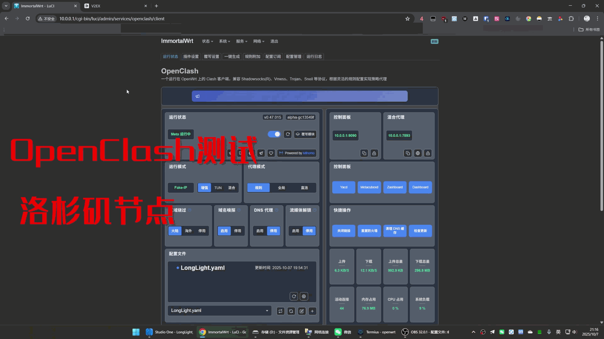

---

id: 1016957

title: "OpenWRT主路由透明代理，singbox vs openclash实测对比"

created_at: 2025-10-08T06:20:51.610Z

username: LongLight

display_username: "LongLight"

---

# OpenWRT主路由透明代理，singbox vs openclash实测对比

之前分享过sing-box和mihomo的客户端使用体验上的不同:[电子斗蛐蛐之 mihomo vs sing-box 客户端使用体验](https://linux.do/t/topic/837139)

这一帖来一个更显著的实测对比：

1. immortalwrt主路由，分别使用sing-box裸核和openclash作透明代理，同样使用fakeip模式，无痕窗口访问google对比加载速度

2. 节点均采用洛杉矶gia线路（瓦工DC1），本地电信

3. 切换透明代理前重启软路由端的dnsmasq，刷新windows本地dns缓存，重启chrome进行测试

> [!tip]补充：受3L大佬 [@randname](https://linux.do/u/randname)指正，sing-box在fakeip模式下，调整action:resolve位置，sing-box的初次加载速度能得到一定提升，但与openclash仍有显著差距

以下是实际对比：

并且日常使用中，油管加载速度都很优秀：

[9K81IswCg773PJPw5XtRyDpYY0Xvg3YB673×320 47.3 KB](https://cdn3.ldstatic.com/original/4X/a/b/3/ab35e0e57e94def761c2521bd9d57c0c08d1316f.webp)

需要说明的是，sing-box使用tun+auto_redirect，而openclash则采用默认推荐的fakeip-增强，因此并不能说明两种核心效率上的高低。

以下是分别使用的sing-box核心配置及mihomo核心配置：

[mihomo](https://github.com/LongLights/sing-box_template_merge_sub-store/blob/main/mihomo/mihomo.yaml)

[sing-box v1.13 with fakeip](https://github.com/LongLights/sing-box_template_merge_sub-store/blob/main/sing-box_v1.13/singbox_fakeip.json)

---

*来源: https://linux.do/t/topic/1016957.json*

