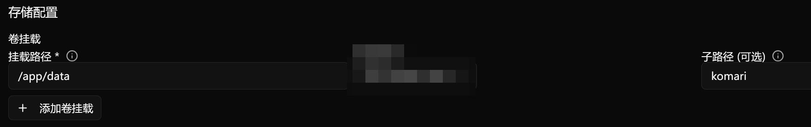
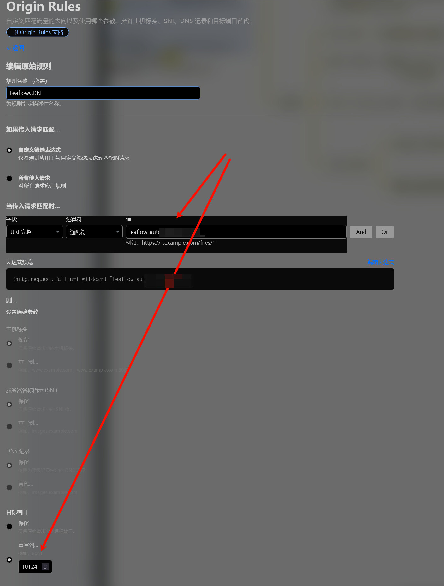

---

id: 1017292

title: "站里有不少leaflow的部署教程 简单整理一下吧"

created_at: 2025-10-08T08:47:19.398Z

username: Lumen_Sky

display_username: "ℒ𝓊𝓂𝑒𝓃"

---

# 站里有不少leaflow的部署教程 简单整理一下吧

# 前言

站里最近leaflow的部署教程很是热烈 简单整理一下吧

也希望平台能做好稳定性保障呀

## 注意

因为是摸鱼的时候整理的

我本人也只是部署了几个项目而已 经验不是很多 也不认识几个容器

不少内容还是留待佬友们补充吧

才不是想建一个wiki让大伙一起刷勋章的 

发表于20251008

可能随平台更新而失效

## 疑惑

有一些问题 希望佬友们能解答一下

1. 本站的搜索引擎会自动直接搜索到帖子里的内容吗 例如在搜索vaultwarden时 本帖会作为结果之一

2. 如何让本帖变成wiki方便大家编辑？

# 基础内容

> [!Note]+ 工作区特点

>

>

> 香港（容量已满）

>

>

> 非优化线路

>

>

> 十堰

>

>

> 深圳（容量已满）

> [!Note]+ 相关概念

>

> [!Note]- Stateful/有状态 Deployment/无状态

> [!Tip]- 省钱技巧

>

> 公测阶段好像也没必要省钱吧 

>

> 存储子文件夹

>

>

> 建立存储后 可以在部署应用的时候 填写子文件夹

> 

> [!Tip]- 细节补充

>

> 网站提供的证书应该是GoogleCA签发的 可通过CF严格模式(弄错了好像 之后check一下)

>

> 部署docker不推荐使用:latest标签 建议指定版本 [@linuxdo](/u/linuxdo) [@pluto233](/u/pluto233)

# 新手任务

网址： [https://checkpoint.leaflow.net/](https://checkpoint.leaflow.net/)

# 具体例子

太多太多了 粗陋一点了

肯定遗漏了很多 

> #TODO

>

> 可能需要对教程/应用进行一个简单区分 并加上标签或者留言 当然排版也需要优化。。。

>

> 例如

>

> [Leaflow自动签到](https://linux.do/t/topic/936028) #普遍需要

> [Vaultwarden部署](https://linux.do/t/topic/1013084) 留言 → 如何接入LinuxDo登录 & 介绍了部署清单

> …

---

## 常用

> !example

>

> [[9.28更新]Leaflow自动签到控制面板](https://linux.do/t/topic/936028)

>

> 我来补充个吧，说实话单独部署一个专门签到的docker属实有点浪费，我是直接安装的qinglong，然后用的这个[项目](https://github.com/agluo/ql-script-hub.git)，部署完你们还可以用qinglong运行一些其他东西

>

> [leaflow 部署qinglong(手摸手教程)【接投稿，有什么想部署的docker项目但自己不会的，可以喊我（有时间了会折腾）】](https://linux.do/t/topic/1016956)

## Ai

[手把手教你在 Leaflow 上免费部署 Veloera（内含有一个官方的福利！）](https://linux.do/t/topic/870453) [

开发调优](/c/develop/4)

> 前言 / Introduction

> L 站终于来了一个让我激动不已的富可敌国——Leaflow，我很看好！Leaflow 目前看来比 Sealos 可配置项更多更灵活，努努力有机会做出一番事业的。

> 借着 LLM 的东风（蹭一下 N 佬的流量）来手把手教大家如何在 Leaflow 上部署 Veloera

>

> 前期准备 / Preparations

>

> 一个 Leaflow 账号，已创建对应的工作空间

> …

[leaflow部署donehub并使用自定义域名接入edgeone cdn加速](https://linux.do/t/topic/876681) [

开发调优](/c/develop/4)

> 今天写一篇利用leaflow部署done-hub，并使用edgeone cdn自定义域名加速教程

> donehub项目地址

>

> 其实也没啥好写的，这里主要介绍一下如何接入edgeone cdn

> 首先，创建工作空间，选择可选的区域，创建应用部署done-hub

> 具体环境变量参考：

>

> 部署流程参考：

>

> 实际上，如果你不想用leaflow提供的存储

> 可以选择无状态的容器，找一个免费的mysql…

EdgeOneCDN

这里补充一下

如果没有使用平台自带的网站服务并希望使用CF

则在DNS配置好以后建立一个Origin Rules即可

[Leaflow 一键部署 sillytavern 酒馆教程](https://linux.do/t/topic/972182)

[Leaflow 平台免费部署 SillyTavern 云酒馆教程](https://linux.do/t/topic/964921) [

开发调优](/c/develop/4)

> [!info] 开始之前

>

> 站内官方贴：[【福利第一弹】全栈PaaS容器云平台公测，公测期平台功能&部署云资源全白嫖](https://linux.do/t/topic/849086)

> 目前平台公测中，每日签到赠金1-5元，单酒馆项目每月消耗4.66元赠金，因此暂时可以永动。

> 注册需验证邮箱和手机号。

>

>

>

> 1. 部署清单一键部署

> 在 [部署清单](https://leaflow.net/apply) 页面，完整复制粘贴以下内容，点 应用/更新 按钮一键部署。

> kind: Storage

> name: sillytav…

[使用 Leaflow 免费部署 New-API](https://linux.do/t/topic/940330) [

开发调优](/c/develop/4)

> 前言

>

>

> 首先，非常感谢站内大佬为我们带来了 Leaflow 这个便捷高效的 Docker 部署平台。

> [https://linux.do/t/topic/849086?u=lowmonster](https://linux.do/t/topic/849086)

>

>

> 值得期待的是，Leaflow 的香港地区也即将上线新的服务器，欢迎大家届时体验！

>

>

> 考虑到 New API 是一个应用广泛且颇受欢迎的项目，我特地整理了这篇详细的部署教程，希望能帮助大家在 Le…

[在PaaS平台部署一个Cli反代的教程，支持cc, codex, gemini, qwen等](https://linux.do/t/topic/935555) [

开发调优](/c/develop/4)

> 此处使用的软件是 [CLIProxyAPI](https://github.com/luispater/CLIProxyAPI),不是本人开发，是之前一位佬友开发的，我目前正在使用。鉴于当前codex风头正盛，确实应该部署一个反代来方便使用。

> 此软件是golang开发，占用资源较少，所以选择此软件。

> 同时使用的部署平台，这里选择了站内Leaflow作为演示，其他PaaS平台操作类似。（其实vps部署挺好，不过PaaS平台有免费额度）。

> 首先我们找到左侧的配置映射，我们将配置文件…

[手把手用leaflow布置T佬的load-gpt](https://linux.do/t/topic/853030) [

搞七捻三](/c/gossip/11)

> [【福利第一弹】全栈PaaS容器云平台公测，公测期平台功能&部署云资源全白嫖](https://linux.do/t/topic/849086)

> 实在没办法，claw天天烂，为了避免竞争看到了新大佬的leaflow!

> 教程来了！

>  ![[image]](https://cdn3.ldstatic.com/original/4X/a/5/f/a5f96612193a12dbe976e490f94ff387c24d751a.png)

> 先创建应用！

> 选有状态

> 名称 load-gpt

> 服务名称：load-gpt

> 容器名称:load-gpt

> 镜像：[Package gpt-load · GitHub](http://ghcr.io/tbphp/gpt-load:latest)

> 网络配置：

> 名称：port0 端口 3…

## 监控

> !tip

>

> [leaflow 部署komari(手摸手教程)【接投稿，有什么想部署的docker项目但自己不会的，可以喊我（有时间了会折腾）】](https://linux.do/t/topic/1015459)

>

> [Leaflow最快部署Uptime Kuma](https://linux.do/t/topic/888748)

>

> [【教程/带图超详细】手把手教你在Leaflow上免费部署uptime-kuma（适用于大部分应用）](https://linux.do/t/topic/883707)

>

> [在Leaflow免费搭建哪吒面板dashboard端](https://linux.do/t/topic/1012163)

## 实用工具

> !tip

>

> [Leaflow 免费部署 clip-relay轻量云剪贴板教程](https://linux.do/t/topic/980439)

>

> [手把手教你免费在 Leaflow 上部署 Vaultwarden 并接入 LINUX DO Connect 登录](https://linux.do/t/topic/1013084)

>

> 如何接入LinuxDo登录 & 介绍了部署清单

## 不知道咋分类的/不认识的容器/没空看的

[【教程】使用leaflow免费部署OrangeTV](https://linux.do/t/topic/1057675) [

开发调优](/c/develop/4)

> 本帖旨在帮助新手小白免费部署OrangeTV，实现免费观影，本人第一次发技术类话题，欢迎佬友们批评指正。

> 在这里感谢[程序员橙子](https://linux.do/u/orange_tang/summary)佬的OrangeTV项目。

> 首先，准备一个leaflow账号（无AFF，放心使用，每日签到可获得余额）

> [Leaflow - 企业级云原生应用平台 - Leaflow](https://leaflow.net/)

> 然后，新建一个工作空间，名称任意，后期有免备案绑定域名的需求可选香港。

>  ![[image]](https://cdn3.ldstatic.com/original/4X/9/2/7/92776c5fd491f5d91653eae7d7f372d0f6594598.png)

> 接下来…

[【教程-流程简化】使用leaflow容器云10分钟搭建你自己的openwebui服务端](https://linux.do/t/topic/854909) [

搞七捻三](/c/gossip/11)

> 修改：简化了部署流程，现在可以只用一个配置文件，修改3个变量后就可以直接部署了

> Leaflow帖子： [【福利第一弹】全栈PaaS容器云平台公测，公测期平台功能&部署云资源全白嫖 - 福利羊毛 - LINUX DO](https://linux.do/t/topic/849086)

> 1.前置工作

> 首先，工作区域选香港（选成都区域的话部分镜像会拉取的很慢很慢）

> 进入工作区后点击储存管理-右上角创建储存卷，创建一个名为openwebui的储存卷

> 复制下面的配置…

[教你在Leaflow上免费部署汉化版n8n-低代码工作流自动化平台](https://linux.do/t/topic/886249) [

开发调优](/c/develop/4)

> 教你在Leaflow上免费部署汉化版n8n-低代码工作流自动化平台

> 本文参考[手把手教你在Leaflow上免费部署uptime-kuma](https://linux.do/t/topic/883707)、[手把手教你在 Leaflow 上免费部署 Veloera](https://linux.do/t/topic/870453)和[n8n 汉化版部署：解锁更灵活的自动化工作流](https://linux.do/t/topic/718854)三篇文章，感谢[@柠雾时夏-jun](https://linux.do/u/yrjjun)、[@VrianCao](https://linux.do/u/VrianCao)和[@kayin](https://linux.do/u/krik)三位大佬。

> 因为我在部署n8n时遇到了一些问题，特此分享出来供各位佬友参考。适配n8n版本为1…

[Leaflow 简单部署 n8n 汉化增强版](https://linux.do/t/topic/1009649)

[【教程】Leaflow 平台部署 VoceChat（并用 Cloudflared 内网穿透）](https://linux.do/t/topic/886320) [

开发调优](/c/develop/4)

> 前情提要

> 之前我的 VoceChat 一直是部署在 ClawCloud Run 上的，但是由于 ClawCloud Run 有免费的 $5 额度，这就导致非常多的人在用这个平台部署，资源很有限，部署上了还好说，一不小心容器自动重启或者手动重启就分配不到资源了，所以我就用了站内的富可敌国大佬目前公测的 Leaflow，支持每日签到并有大量赠金

> [https://linux.do/t/topic/84…](https://linux.do/t/topic/849086)

Cloudflared 穿透访问

[【赚点积分】在leaflow上部署自己的tailscale dreper中继节点](https://linux.do/t/topic/969427) [

搞七捻三](/c/gossip/11)

> 参照 [906051999](https://linux.do/u/906051999)大佬的原贴[【最好的虚拟组网】为Tailscale部署使用IP的Derp节点](https://linux.do/t/topic/168570)

> 在leaflow上部署了自己的tailscale drep节点，水一贴，赚点积分

>

> 镜像选择：选用这个镜像(https://hub.docker.com/r/yangchuansheng/ip_derper)

> 只使用TCP和UDP两个端口

> leaflow部署

> 在leaflow上新建应用

> 名…

[leaflow 部署clewdr(手摸手教程)【接投稿，有什么想部署的docker项目但自己不会的，可以喊我（有时间了会折腾）】](https://linux.do/t/topic/1015683) [

开发调优](/c/develop/4)

> leaflow 部署clewdr

> 官网：[leaflow](https://leaflow.net)

> 创建账号和工作区就不需要多讲了

> 工作区一定要选香港

> 存储管理

>

> 点击 [存储卷管理](https://leaflow.net/storages)

> 点击创建存储卷，名称clewdr，容量默认128不管。

>

> 创建应用

>

>

> 点击 [创建应用](https://leaflow.net/applications/create?suggestion=true)

>

>

> 无状态->名称：clewdr

>  ![[image]](https://cdn3.ldstatic.com/original/4X/7/0/2/702fdd989a56837350879018e01c242e0eb46b90.png)

>

>

> 镜像：

>

>

> ghcr.io/xerxes-2/clewdr:0.11.18

>

> 

> 验证失败的镜像

>

>

> 资源限…

# 坛友互助？

#TODO 不确定是在主题帖里直接写下部署问题好 还是在回复帖子里互助更好

---

*来源: https://linux.do/t/topic/1017292.json*

