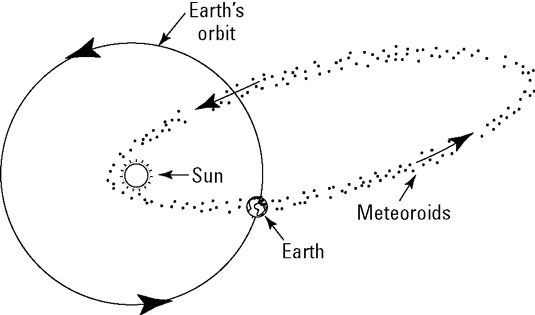
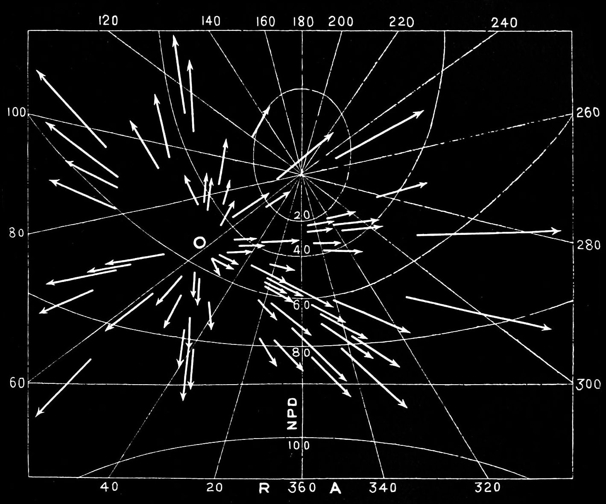
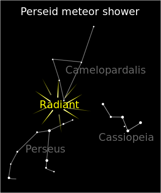
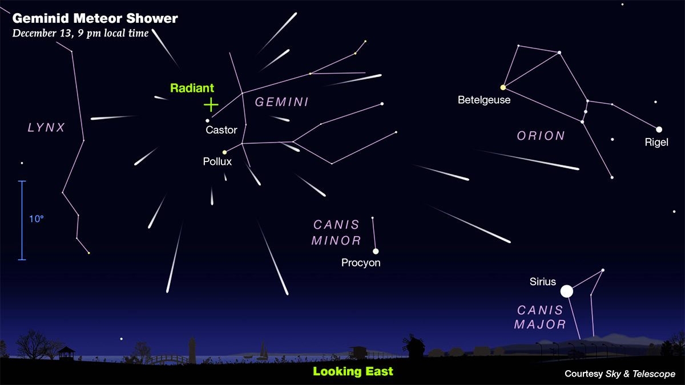

---

id: 104651

title: "流星雨观测指南"

created_at: 2024-06-05T02:33:48.575Z

username: coca

display_username: "哥伦布⛵"

---

# 流星雨观测指南

马上三级了，在自己专业领域内，为各位佬友贡献点有趣有用的知识。

# 太长不看版 TL;DR

| 季节 | 方位 | 建议观测时间 | 每小时数量 ZHR | 建议观测地点 | 特点 |

| --- | --- | --- | --- | --- | --- |

| 夏季 | 英仙座流星雨 | 8月12~13日 | 50-100 | 我国西北地区 | 流速快，亮度高 |

| 冬季 | 双子座流星雨 | 12月13~14日 | 100-120 | 云南 | 流速慢，亮度高 |

## 观测建议

- **云量**：晴朗无云的夜空。

- **月相**：月亮较暗或新月时期，即靠近农历初一。

- **时段**：午夜后至黎明前观测效果最好，因为此时地球正面迎向流星雨尘埃带。

- **地点**：远离城市灯光的郊外或野外，视野开阔无高大树木、建筑物遮挡。

- **温度**：温度适宜，注意防寒保暖。

# 基础知识

## 流星雨是怎样形成的

流星雨的形成通常与彗星有关。当彗星接近太阳时，它的冰和尘埃蒸发，形成一条尘埃尾巴。这些尘埃和碎片在彗星的轨道上留下，形成一个尘埃云。地球围绕太阳公转运动，当穿过彗星或小行星留下的尘埃带时，这些尘埃颗粒进入地球大气层，在高速摩擦下燃烧发光，形成一道道短暂的光迹。这些光迹就是我们看到的流星，当流星数量较多，形成一定频率时，就被称为流星雨。

## 流星雨是如何命名的

流星雨通常以辐射点所在的星座命名，例如著名的英仙座流星雨、狮子座流星雨等。**流星雨的高峰期通常每年都会在相近的日期出现，这是因为地球每年都会在同一时间穿过同一尘埃带。**

# 英仙座流星雨

英仙座流星雨出现的大致方向是英仙座，它是由斯威夫特-塔特尔彗星（109P/Swift-Tuttle）留下的尘埃和碎片引起的。每年 7 月中旬就能看到流星雨，8 月 9 日至 14 日是活动高峰期。在高峰期，流星的速度达到每小时 60 颗或更多。由于流星雨的辐射中心位于英仙座方向，英仙座流星雨主要在北半球可见。

**观测建议**：每年8月中旬，我国西北地区天气干爽，适合观测。

# 双子座流星雨

与其他大多数流星雨不同，双子座流星雨的母体不是彗星，而是一颗名为3200 Phaethon的小行星。它与象限仪座流星雨一起，成为**唯二不是源自彗星的主要流星雨**。双子座流星雨的流星移动缓慢，在 12 月可以看到，通常在 12 月 4 日至 16 日左右达到顶峰，12 月 14 日上午是强度最高的一天。最近的流星雨在最佳条件下每小时可看到 120-160 颗流星，一般在当地时间 02:00 到 03:00 左右。

与其他流星雨相比，双子座流星雨的速度中等，大约为每秒 22 英里（35 千米/秒），因此非常容易被发现。现在，许多人认为双子座流星雨是**最稳定、最活跃**的年度流星雨。

**观测建议**：每年12月中旬，我国云南地区干燥晴朗、气温较高（相对北方），适宜观测。

---

*来源: https://linux.do/t/topic/104651.json*

