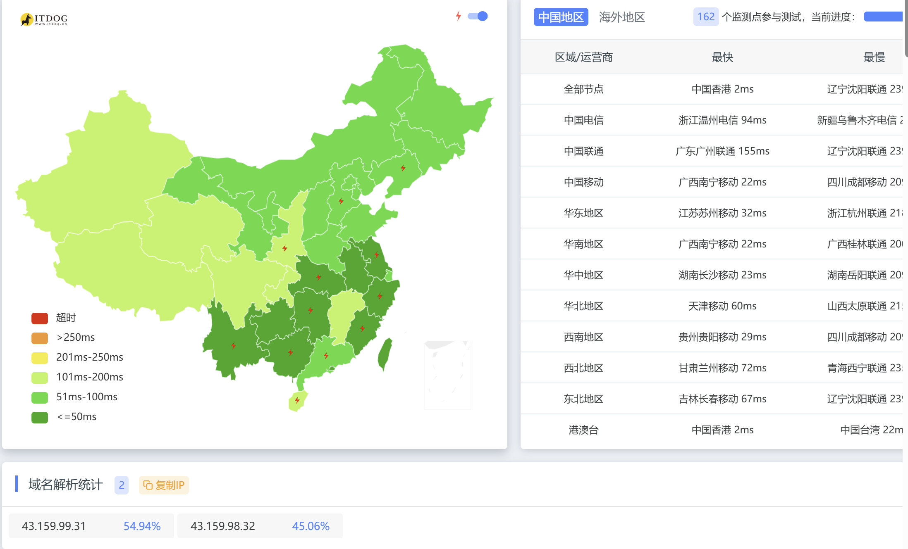
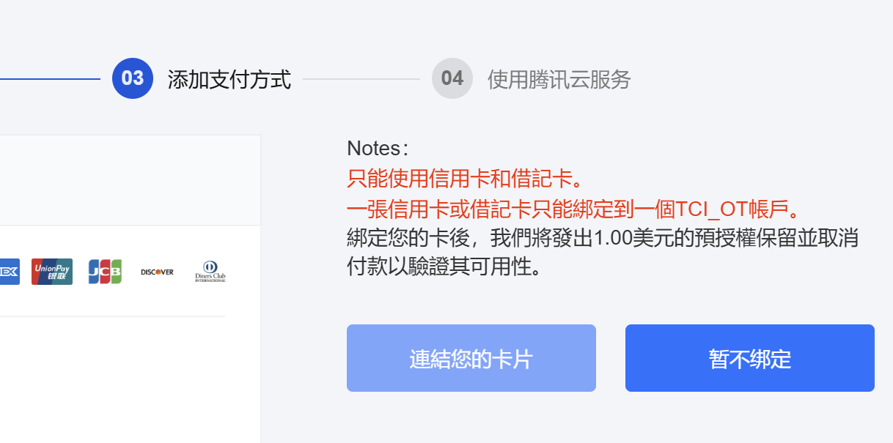
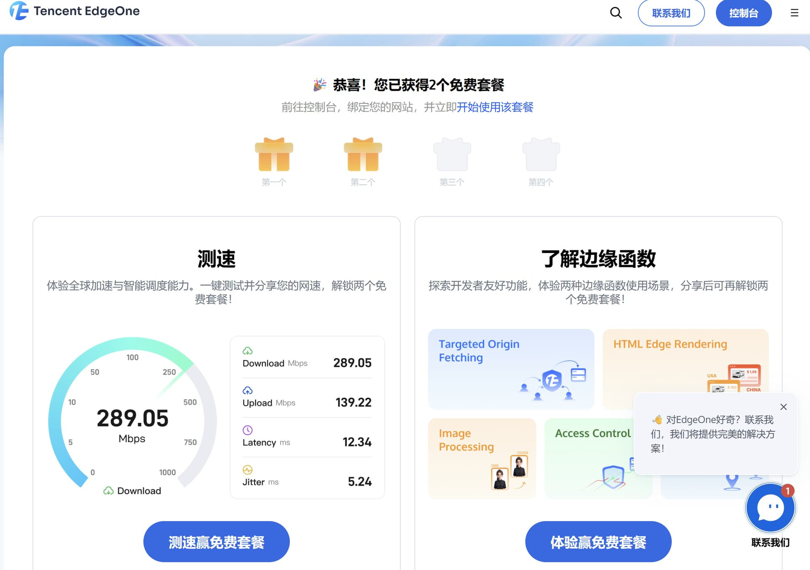
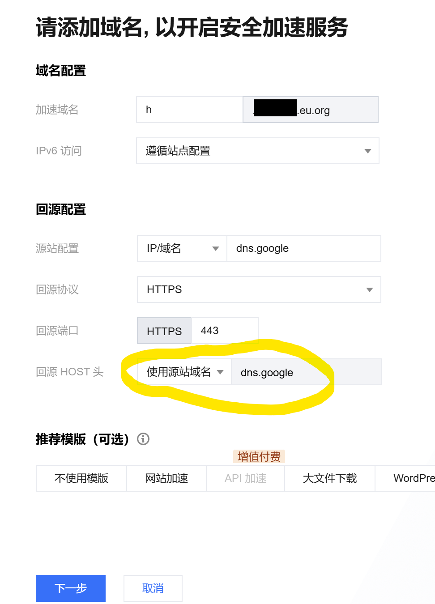
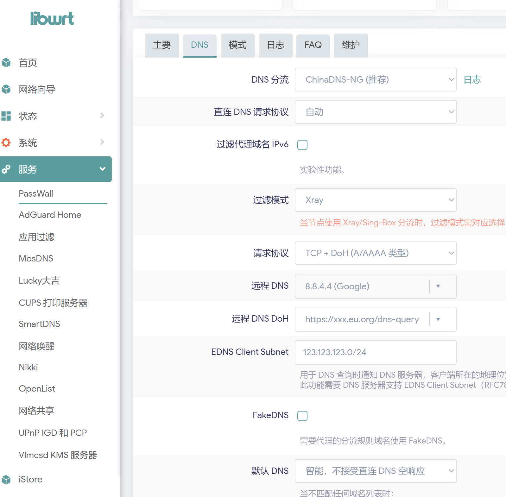

---

id: 1053812

title: "利用edgeOne海外版搭建纯净DNS(DoH)"

created_at: 2025-10-17T03:18:13.077Z

username: liet_xia

display_username: "lietxia"

---


# 利用edgeOne海外版搭建纯净DNS(DoH)




---

# 现在进入正题

注册之类的就不讲了，大家都是技术达人，绑卡是可以跳过的



# 1.测速白拿额度。



[https://edgeone.ai/zh/get-free-plan](https://edgeone.ai/zh/get-free-plan)

# 2.接入站点选：全球可用区（不含中国大陆）

如果选了【包含大陆】再去反代谷歌，海外能访问，大陆不能访问。

所以要选【不含中国大陆】

# 3.设置好回源域名



这是edgeone为数不多比CF大善人好的地方，可以随便反代别的东西。

为什么要选谷歌DNS呢？

谷歌DNS支持**ECS(EDNS Client Subnet)**，cf的DNS不支持

ecs可以传入一个ip，然后返回适合这个ip的DNS结果

# 4.在梯子上使用DoH

去 [http://ipip.net](http://ipip.net) 看自己公网ip

最后一位改成`0`，加上`/24`，最终变成`123.123.123.0/24`

## clash系列

写 `ecs=123.123.123.0/24` 来使用ECS

```
dns:

enable: true

ipv6: true

nameserver: ["https://xxx.eu.org/dns-query#ecs=123.123.123.0/24"]
```

## 路由器passwall



## smartdns

改 smartdns.conf

```
server-https https://xxx.eu.org/dns-query -subnet 123.123.123.0/24
```

# 总结

如果你想更加极致一点，

可以用edgeone国内版套娃国外edgeone，

用国内版edgeone pages的函数反代中转edgeone,甚至支持http/3


---


*来源: https://linux.do/t/topic/1053812.json*

