---

id: 1058066

title: "OneClickVirt教程1：All in Docker，面板和节点都使用Docker，自建容器分发平台"

created_at: 2025-10-18T08:05:34.368Z

username: ECS

display_username: "oneclickvirt"

---


# OneClickVirt教程1：All in Docker，面板和节点都使用Docker，自建容器分发平台


开源项目地址：[GitHub - oneclickvirt/oneclickvirt: Universal Virtualization Management Platform 可扩展的通用虚拟化管理平台，支持 LXD / Incus / Docker / Proxmox VE](https://github.com/oneclickvirt/oneclickvirt)

之前的教程

[可扩展的通用虚拟化管理平台，支持 LXD / Incus / Docker / Proxmox VE](https://linux.do/t/topic/992800) [


文档共建](/c/wiki/42)

> 一个可扩展的通用虚拟化管理平台，支持 LXD、Incus、Docker 和 Proxmox VE。

> 开源的仓库：[GitHub - oneclickvirt/oneclickvirt: Universal Virtualization Management Platform 可扩展的通用虚拟化管理平台，支持 LXD / Incus / Docker / Proxmox VE](https://github.com/oneclickvirt/oneclickvirt)

> 开发的缘由：没有一个…

没有从0到1完整教授如何部署和纳管节点进行操作，这里重新写一篇完整的操作教程。

用到的服务器只有一台：[https://bandwagonhost.com/](https://bandwagonhost.com/)


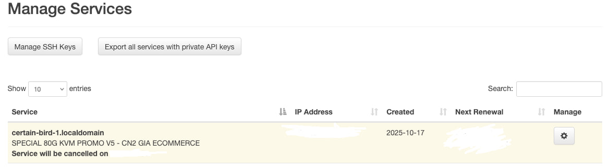

点击齿轮进入 KiwiVM Admin Controls 需要重装一下系统，确保环境干净

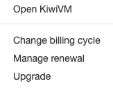

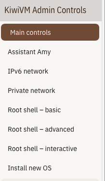

重装前请确保 Stop 掉服务器，否则无法直接进行重装

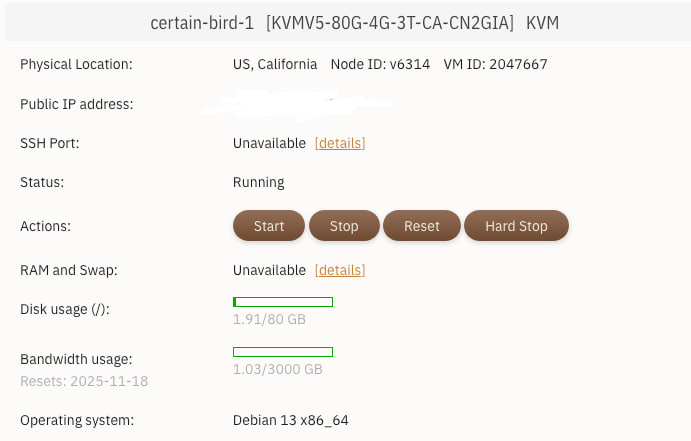

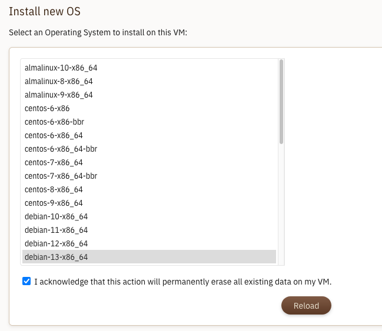

装一个Debian13占用足够小

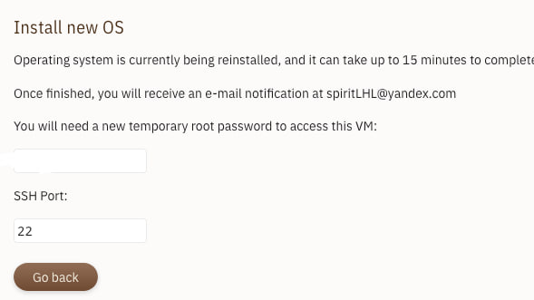

记录好SSH密码和端口，本地用任意方式连接上它，然后执行以下命令装一些必备的工具

```
apt update
apt install sudo curl wget lsof vnstat -y
```

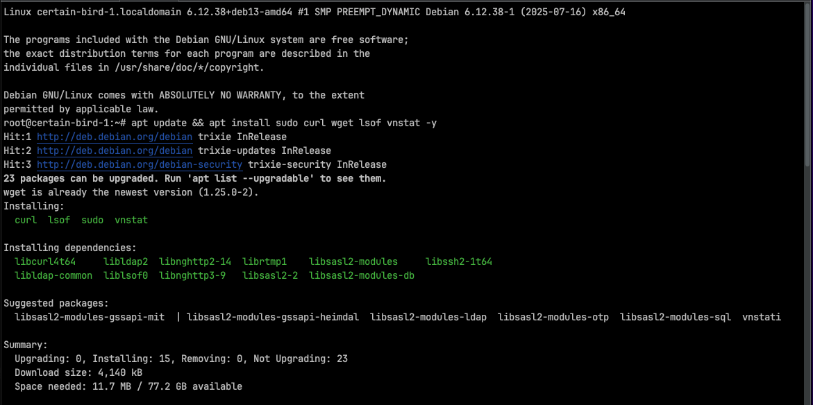

安装完毕后，需要打开

### [库苏恩](https://www.spiritlhl.net/)

开源、易于使用的服务器虚拟化项目

查阅对应的Docker虚拟化的环境安装：

### [前言 | 一键虚拟化项目](https://www.spiritlhl.net/guide/docker/docker_install.html)

开源、易于使用的服务器虚拟化项目

这一步请不要使用其他docker安装脚本，仅使用这里提供的安装方式，因为非本教程的docker安装方式不支持一键设置存储池进行容器的硬盘大小限制，本教程有特殊适配。

先开设虚拟内存：

```
curl -L https://raw.githubusercontent.com/spiritLHLS/addswap/main/addswap.sh -o addswap.sh && chmod +x addswap.sh && bash addswap.sh
```

可见


足够了，不开设也行，我这里就不再进行虚拟内存设置了。如果你的服务器内存不够用，还是建议开一点避免内存爆炸。

然后到对应的环境安装

```
curl -L https://raw.githubusercontent.com/oneclickvirt/docker/main/scripts/dockerinstall.sh -o dockerinstall.sh
chmod +x dockerinstall.sh
bash dockerinstall.sh
```


执行过程中会提示是否需要限制硬盘大小，我这里选择需要限制输入y进行回车，因为我需要docker容器能限制硬盘大小。如果不进行限制，也是能使用OneClickVirt平台进行管理的，只不过就没法限制硬盘大小罢了。


然后这块因为我的选项需要输入Docker的安装路径，我的这个服务器只有一个系统盘可用，所以回车使用默认的路径就够了，如果你的服务器有多个盘，选择一个较大的盘安装会比较好，没必要死磕装系统盘上。


然后会提示我输入Docker存储池的大小，我的服务器有80G硬盘，我选择60G硬盘作为存储池。你需要多少GB大小的存储池就填对应数值，总的容器硬盘大小会受这个限制。

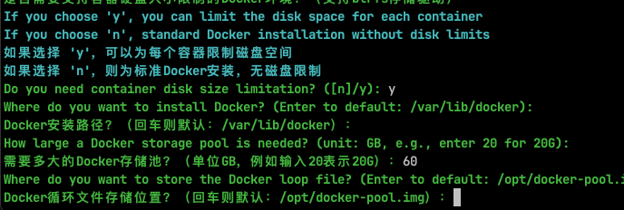

提示我输入循环文件存储位置，我直接使用系统盘所以回车默认足矣，如果你的是多盘，那么你需要和上面的安装路径一样，保持一致挂载的路径，这是实际存储容器硬盘数据的位置。

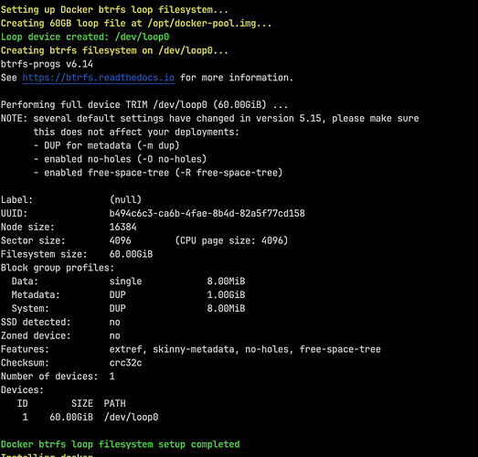

安装过程中可见安装路径和创建的loop设备的地址，证明一切正常

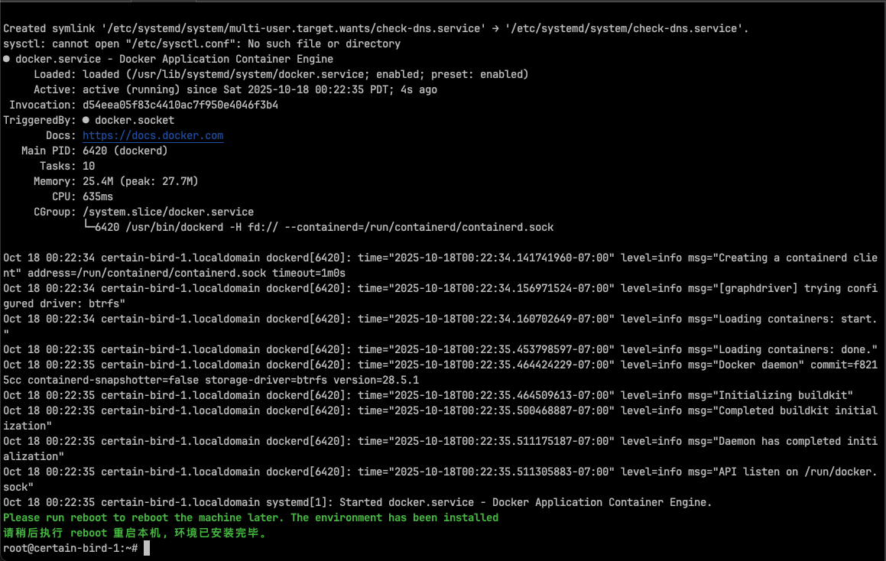

执行完毕后可见已安装完毕了，重启一下服务器加载一下设置

```
reboot
```

重启后重新登录，现在受控端的环境就算安装完毕了，可以开始安装控制面板了。

### [OneClickVirt | 一键虚拟化项目](https://www.spiritlhl.net/guide/oneclickvirt/oneclickvirt_install.html)

开源、易于使用的服务器虚拟化项目

按照说明的提示直接安装面板端，由于我暂时不打算绑定域名，所以这块直接使用最简单的一体化安装版本，无域名版本：

```
docker run -d \
  --name oneclickvirt \
  -p 80:80 \
  -v oneclickvirt-data:/var/lib/mysql \
  -v oneclickvirt-storage:/app/storage \
  --restart unless-stopped \
  spiritlhl/oneclickvirt:latest
```

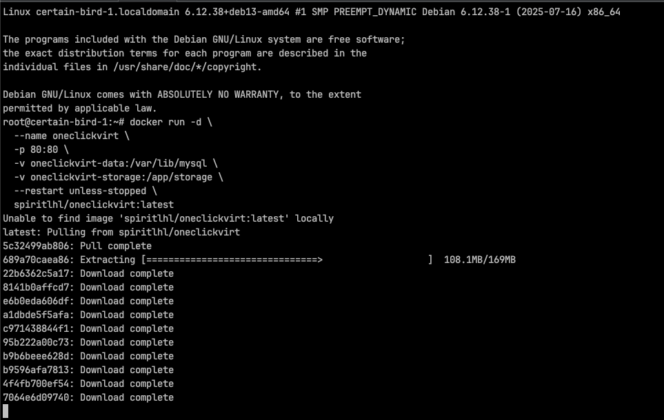

平台容器启动完毕后，执行

```
docker ps -a
```

可见启动成功，且等待超过了12秒，数据库已延迟启动成功

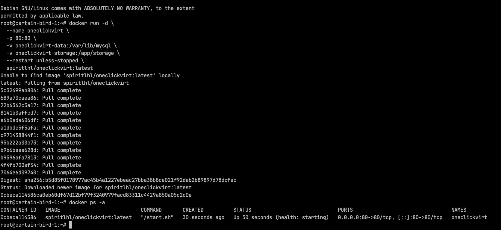

这时候，直接打开当前服务器的IP地址，可见自动跳转到了初始化界面

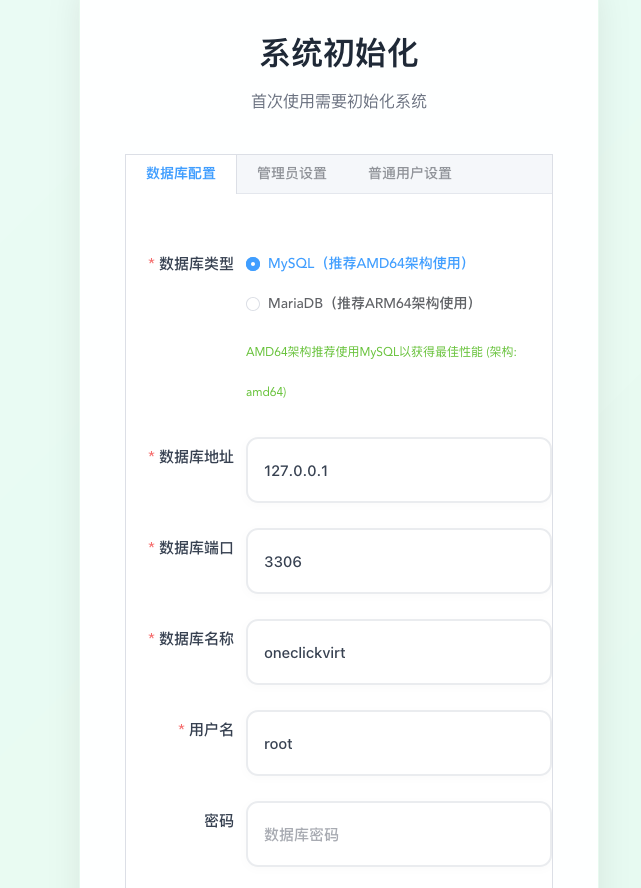

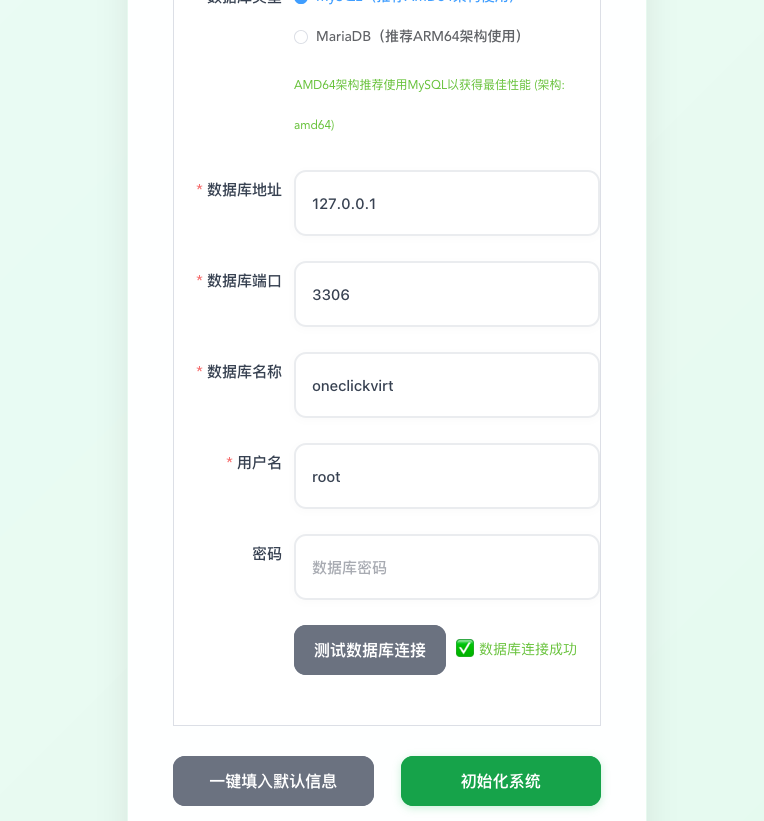

点击测试数据库连接，没问题

点击一键填入默认信息，没问题

点击初始化系统进行初始化

耐心等待5~10秒，不要重复点击初始化按钮，将自动跳转到首页

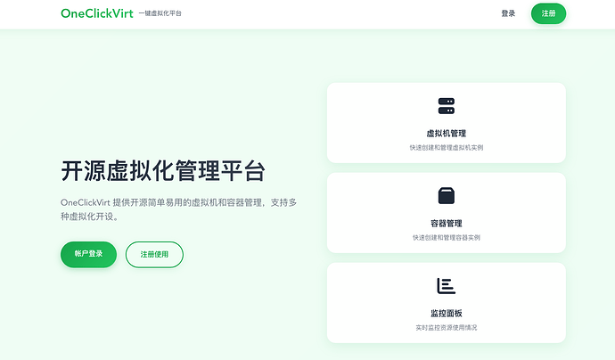

点击账户登录，进入登录页面

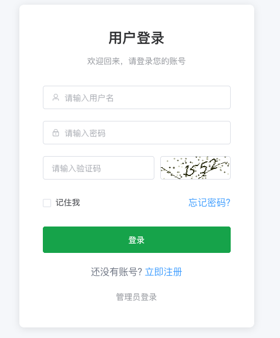

点击管理员登录，进入管理员登录界面， 管理员账户名密码分别为：

```
admin
```

```
Admin123!@#
```

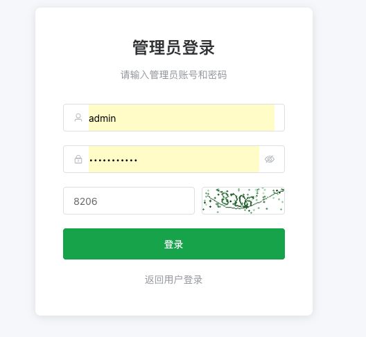

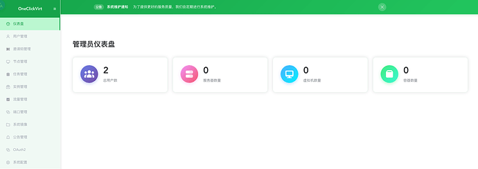

左侧栏点击进入用户管理界面，重置一下管理员密码，避免被爆破

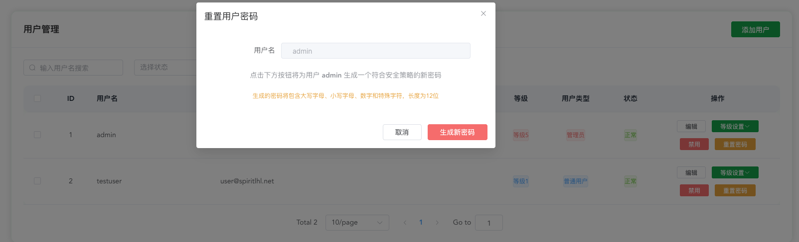

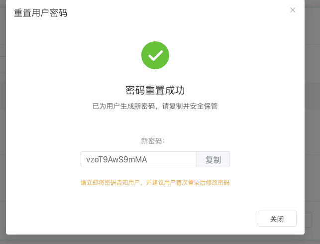

记录并保存好密码

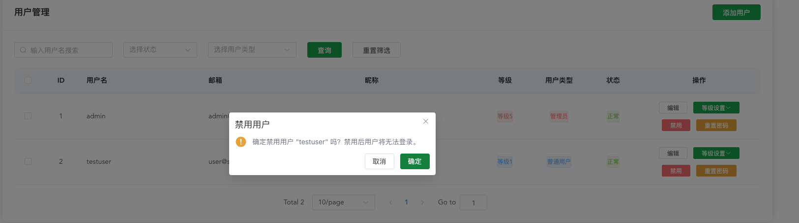

禁用测试用户，避免滥用

左侧栏点击系统配置，配置公开注册保存配置，配置用户等级限制，配置实例权限限制

然后到重头戏纳管本机作为节点，说明如下

### [使用说明 | 一键虚拟化项目](https://www.spiritlhl.net/guide/oneclickvirt/oneclickvirt_usage.html#%E7%BA%B3%E7%AE%A1%E8%8A%82%E7%82%B9)

开源、易于使用的服务器虚拟化项目

配置录入完毕后，可见

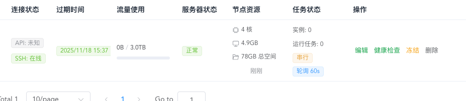

正常可用了

此时右上角点击头像，切换为普通用户视图进行测试

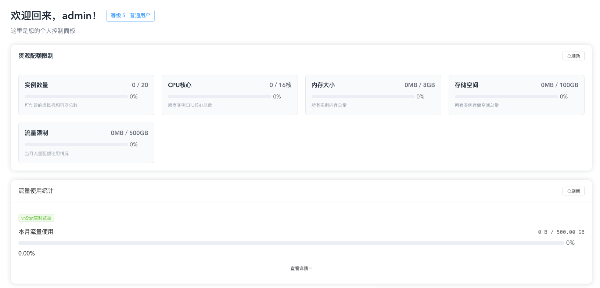

左侧点击申请领取跳转

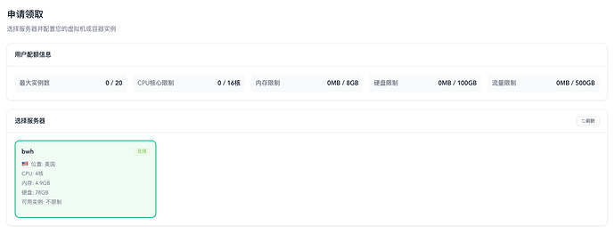

选择配置和系统测试提交申请

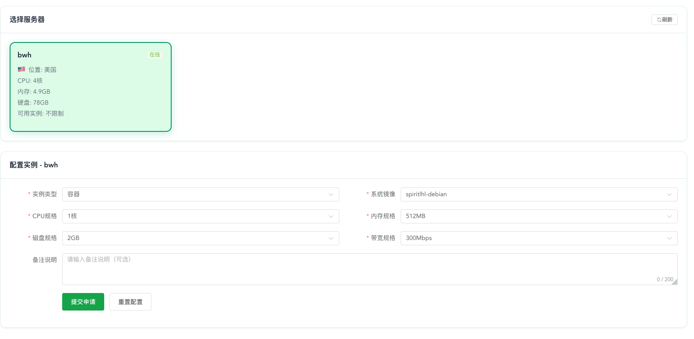

自动跳转任务列表，刷新一下可见任务执行中

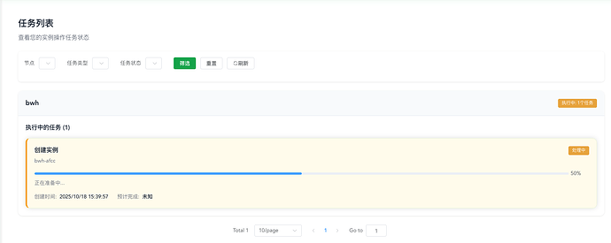

执行完毕了可见

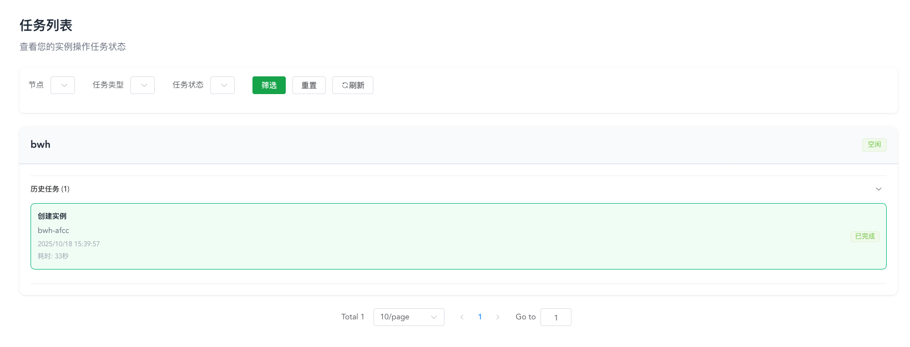

点击左侧栏 我的实例

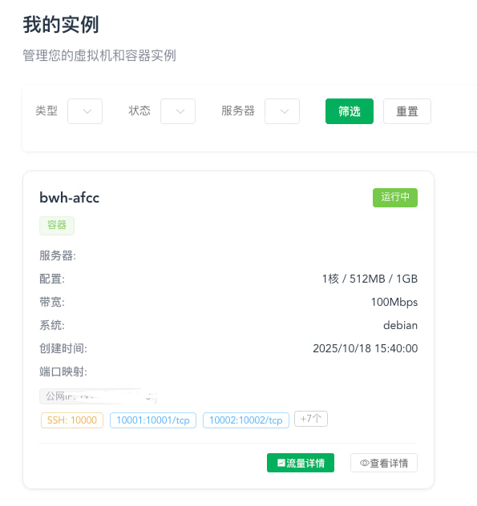

可见对应的实例，点击进入查看详情

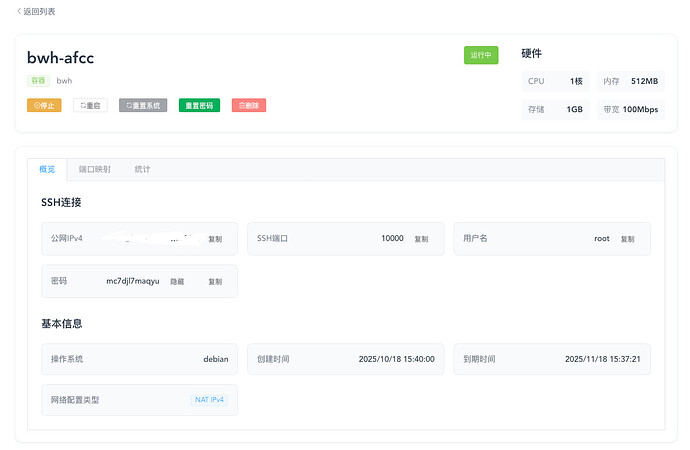

可见相关连接信息

本地测试一下连接可见

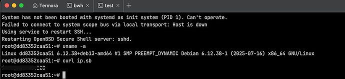

NAT映射没问题，可登录且有网络

现在可以删除它并丢给用户申请使用了

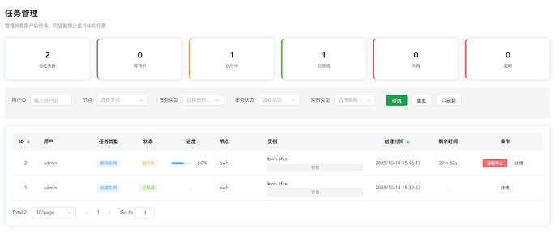

本教程教授完毕


---


*来源: https://linux.do/t/topic/1058066.json*

