---

id: 1060932

title: "Snow CLI 手摸手的完整食用指南，以及配置结构讲解（更新至v0.5.9）"

created_at: 2025-10-19T09:47:46.875Z

username: Mufasa_Dot

display_username: "Mufasa"

---

# Snow CLI 手摸手的完整食用指南，以及配置结构讲解（更新至v0.5.9）

# 一、安装

`$ npm install -g snow-ai`

也可前往：[GitHub - MayDay-wpf/snow-cli: An intelligent AI-powered CLI tool for developers](https://github.com/MayDay-wpf/snow-cli) 使用源码编译安装

# 可用命令

- 启动：`$ snow`

- 更新：`$ snow --update`

- 版本查询：`$ snow --version`

- 恢复最新的对话记录(完全复刻Claude Code)：`$ snow -c`

- 无头模式：`$ snow --ask "Hello"`

- 默认yolo：`$ snow --yolo`

- 恢复最近一次对话并启用yolo：`$ snow --c-yolo`

- 异步任务：`$ snow --task "Hello"`

- 异步任务面板：`$ snow --task-list`

# 二、API & Model Settings

### 在最新的`v0.3.x`版本中移除了所有官方SDK(依赖太重了),所以配置会有轻微区别，启动后进入 `API & Model Settings` 可以看到如下内容

- `Profile` 用于切换或新建配置，Snow现在支持保存多套API和模型方案

- `Base URL` 请求地址，由于移除了官方SDK所以，OpenAI和Anthropic需要补`/v1`,Gemini需要补 `/v1beta`

- `API Key` 没啥好说的，Key呗 

- `Request Method` 请求方案，按照你的需要选择：`Chat Completions`、`Responses`、`Gemini`、`Anthropic`

`Anthropic Beta` 只有选择`Anthropic`请求方式才会出现这个复选框，如果勾选，A÷的请求URL会自动补一个 `beta=true`的参数，方便大家兼容Claude Code API，当然在后续更新中，根据 A÷的调整，可能会取消

`Thinking Enabled` 只有选择`Anthropic`请求方式才会出现这个复选框，如果勾选则启用Claude思考

`Thinking Budget Tokens` 只有选择`Anthropic`请求方式才会出现这个输入框，用于设置思考长度

- `Advanced Model`、`Basic Model`、`Compact Model` 这三个分别设置：高级模型干活的、小模型总结的、压缩模型压缩上下文用的，这三个模型都来源于上面设置的 `BaseURL`和`API Key`,系统会自动请求对应的 `/models` 接口获取列表,支持键入过滤,当然遇到模型接口列表不完善的API,应用提供了 `Manual Input (Enter model name)`选项，可自行输入模型名称

- `Max Context Tokens` 模型的最大上下文窗口，用于计算上下文百分比用的，可以根据模型实际情况填写，例如 `gemini` 一般是 1M上下文，就填 1000000，这个参数不会影响实际的模型上下文，只会影响界面的计算结果，且影响上下文自动压缩，所以建议按模型的真实上下文填写

- `Max Tokens` 这个不能乱填，这个参数会直接加入API请求体中，作为 `max_tokens` 参数

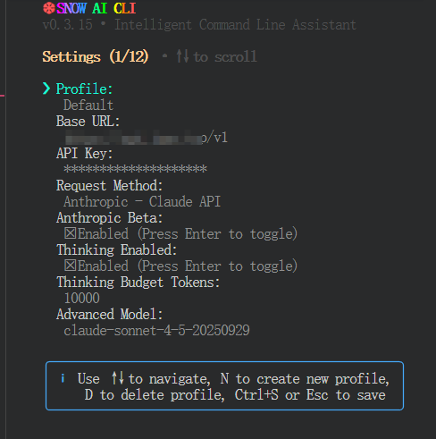

# 三、Proxy & Browser Settings

### 用户设置系统代理端口，以及联网搜索的搜索引擎，一般情况下，这是不需要修改的，因为即便不设置，实测也会自动走代理除非有特殊抓包需求要走特定端口。同时，应用会自己寻找可能的搜索引擎路径，Edge/Chrome 系统只要装了，基本都可以用，除非手动修改过Edge的下载位置

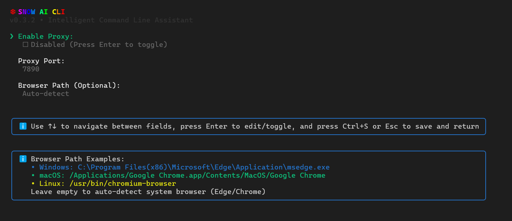

# 四、System Prompt Settings

### 顾名思义，用户可以自己设置系统提示词，需要注意的是，这并不能替换Snow本来的系统提示词，当用户设置了系统提示词，Snow自带的系统提示词将降级为用户消息，补充到第一条用户消息中，在`Windows`系统中，应用会自动唤醒`记事本`，`MacOS/Linux`中会启用系统自带的终端文本编辑器，编辑完保存即可生效，Snow会关闭，并提醒用户重启应用生效 `Custom system prompt saved successfully! Please use `snow` to restart!`

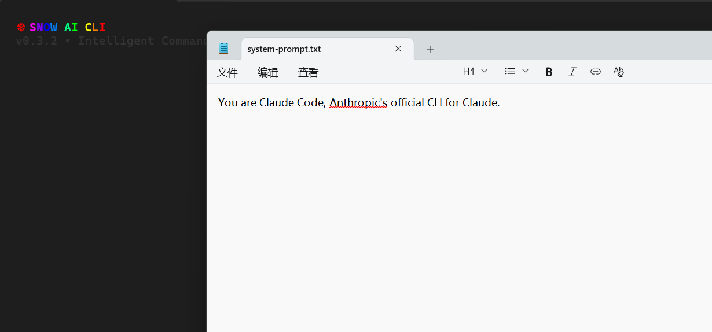

# 五、Custom Headers Settings

### 用户可以自定义添加请求头，注意是添加，用户无法覆盖Snow自带的请求头(其实Snow的请求头是很干净的，没有任何自定义的 x-* 所以这个功能其实是方便各位，具体方便什么我就不提了嘿嘿 )

# 六、MCP Settings

### 基操，用来配置MCP的，方法和设置系统提示词一模一样，Json格式和Cursor一模一样

# 七、一切准备就绪进入到对话页 `Start`

- 如果你在`vscode`等编辑器中启动，Snow会自动使用 `Snow CLI` 插件连接 IDE，你会看到这样的信息，插件都已经发布线上版本，直接在插件市场搜索 `Snow CLI` 即可安装，不放心的用户也可以前往GitHub下载源码自行编译离线安装，都是一样的

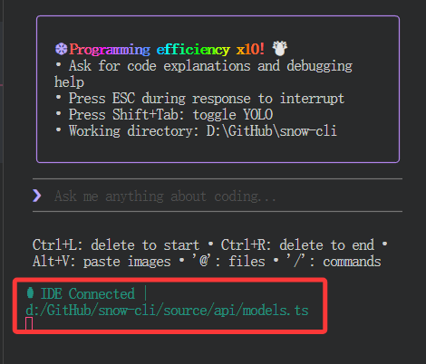

- 使用 `@` 可以选择文件，当然vscode最方便的操作还是长按`shift` 拖拽文件，效果一致

- 使用 `@@` 可以全局搜索文件内容并引用

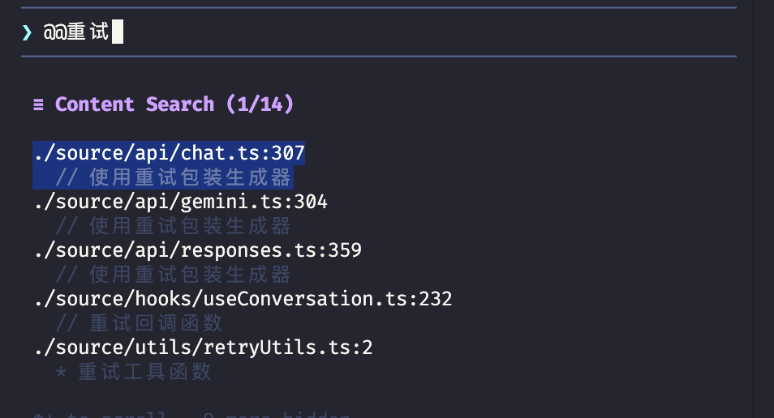

- 使用 `/` 可查看可用命令,

`/init` 构建项目说明书 `SNOW.md`

`/clear` 新建会话

`/resume` 恢复历史记录

`/mcp`查看MCP连接状态，以及重连

`/yolo` 无人值守模式，任何工具调用都不会二次确认，比较危险

`/ide`手动连接IDE，基本不需要使用，因为会自动连，如果安装了IDE插件的话

`/compact`压缩上下文，很少使用，因为压缩后AI效果并不佳

`/role` 项目根目录创建 `ROLE.md` 为Agent提供自定义约束

`/export` 导出对话上下文

`/home` 回到 WelCome&Setting 页

`/review` 本次分析git变更记录审查是否有严重问题

`/usage` Tokens用量分析

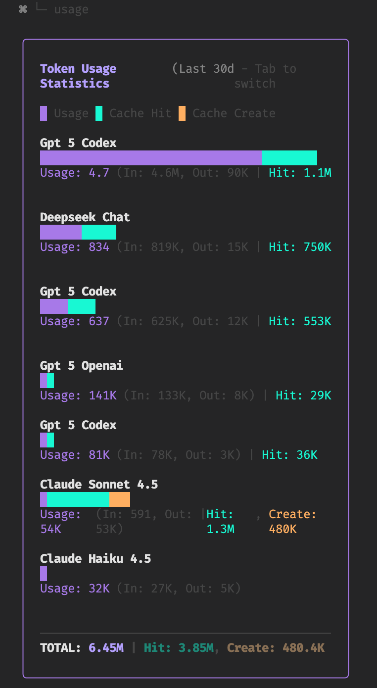

`/agent-` 选择强制使用某些子代理

`/todo-` 扫描项目所有TODO注释的地方，避免未完成的TODO遗漏

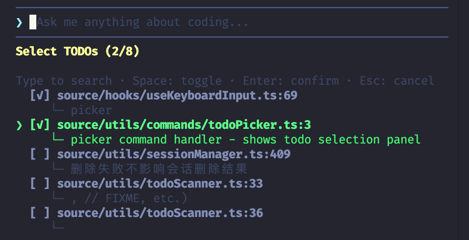

`/custom` 自定义命令

`/skills` 创建技能模板，兼容Claude Code Skills

`/add-dir` 添加工作目录

`/plan` 启停Plan模式

`/vulnerability-hunting` 漏洞猎人模式，用于审查代码并提供报告和测试脚本

`/reindex` 重建代码库索引

- 快捷键

Windows:`Alt+V` 粘贴图片、MacOS/Linux:`Ctrl+V`(会有提示)

`Ctrl+L` 从光标位置开始向左清空输入框

`Ctrl+R` 从光标位置开始向右清空输入框

`Shift+Tab` 启用或禁用 `Yolo`、`Plan`、`Yolo+Plan` 模式

Win:`Alt+P`、MacOS:`Ctrl+P` 快捷更换API配置

`ESC` 中断AI生成

双击`ESC` 回滚对话（系统自带检查点，可回滚文件）

- Token 使用情况（输入框下方会显示上下文占用百分比和token数、缓存命中token数、缓存创建token数）

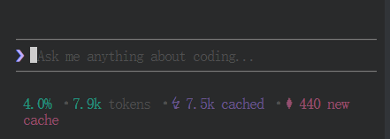

- 无头模式: `$ snow --ask "Hello"`

# 八、Snow的系统文件

### 在用户目录的 `.snow` 文件夹中有Snow的所有文件，下面一个一个解释

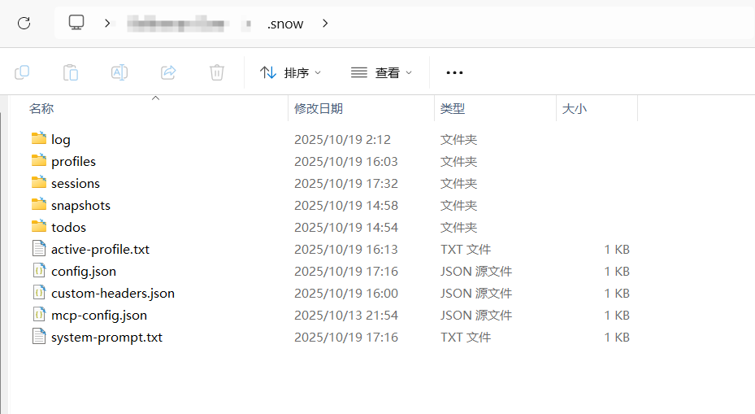

- `log` 该目录主要记录了运行日志，这些日志不会上传任何远端，仅留在本地用于出现BUG时方便定位，可任意删除

- `profiles` 前文中提到，Snow支持多个配置文件切换，用户自定义的多个配置文件都将保存在这个目录

- `sessions` 该目录保存了用户的所有对话记录，同样是用于 `/resume` 以及其他功能实现的必要目录，不会上传任何远端

- `snapshots` 该目录保存了AI自动编辑文件前的快照，用于文件回滚，一般情况无需查看该目录，一切都是自动的

- `todo` 该目录文件是每次对话的 `todo` 列表持久化，避免因为意外退出，而导致AI忘记任务的情况

- `active-profile.txt` 因为Snow的早期版本不支持多个配置文件，所以为了向下兼容，新建了一个文本文件，用于标识用户当前使用的是哪个配置文件

- `config.json` 无需多言，最重要的API配置信息

- `custom-headers.json` 自定义请求头的内容

- `mcp-config.json` 自定义MCP服务的内容

- `system-prompt.txt` 自定义系统提示词的内容

# 九、子代理（v0.3.5及以上） Sub-Agent Settings

### Snow CLI 已支持自定义子代理，可以自定义某专业领域的Agent，并设置工具使用范围，在对话中即可自动被触发

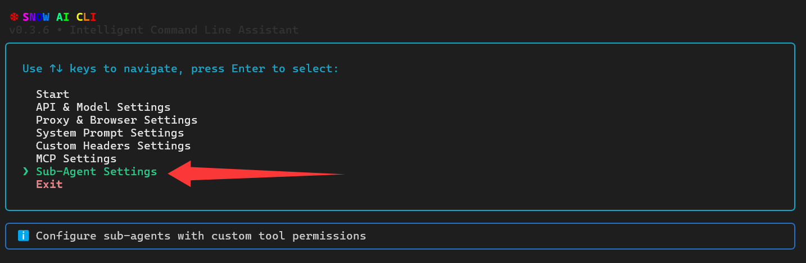

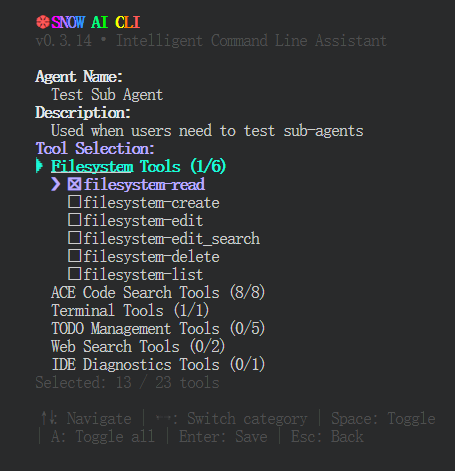

# 十、结语

写这个文档好累啊，将会持续更新这个文档，觉得项目不错就给一个Star吧，别逼我求你

感谢各位佬友的支持，这个项目会持续更新并优化体验，近半个月已经更新了30多个版本了，变化特别多，不妨试试看~

---

**更新摘要：**

- v0.5.9

优化了Codex的使用体验

加入思考显示

支持多窗口多配置混合使用

加入`漏洞猎人` 模式，检索漏洞，强调证据链和提供可复现或调试脚本

- v0.5.0

解决了绝大部分的400异常，是否还有未处理400需要继续测试

加入了简易模式，开启位置：主题设置->简易模式

支持了在对话界面切换API配置（共享上下文兼容性还有待观察）

加入 /add-dir 指令添加工作区，唯一作用：支持@ 所有工作区的文件

Codebase强化精度，并支持Ollama的本地嵌入模型

DeepSeek R1 已支持在 Chat Completions 请求方案中使用

调整系统提示词，减少上下文占用

Skills完整兼容

完整支持Gemini 3 Pro 的思考签名新特性

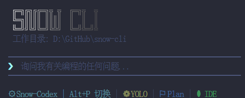

- v0.4.36 兼容Claude Code Skills

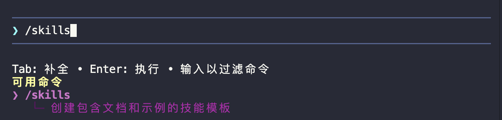

- 在v0.4.34【以下】版本中出现使用Claude Azure API出现严重兼容性BUG，请立即更新

- 在v0.3.32及以上版本中，加入了 `codebase` 工具，支持对项目文件生成代码库，并实时更新，使用嵌入+召回方案，支持自定义嵌入模型和向量维度以及并发方案

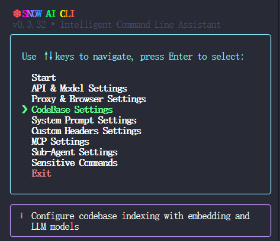

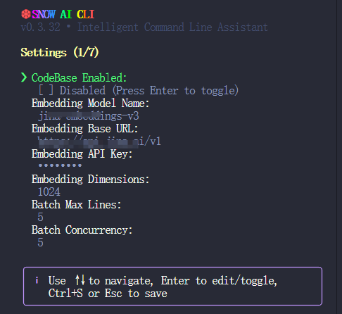

- 在v0.3.24及以上版本中，加入了终端命令敏感词系统，内置了部分高危命令，同时支持自定义命令，支持使用通配符`*`进行模糊匹配，在任何时候执行敏感命令时都会暂停等待用户确认

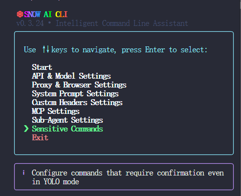

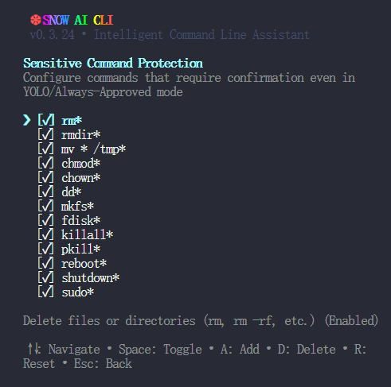

- 在v0.3.23及以上版本中，加入了全供应商思考预算设置，包括 OpenAI、Gemini、Claude

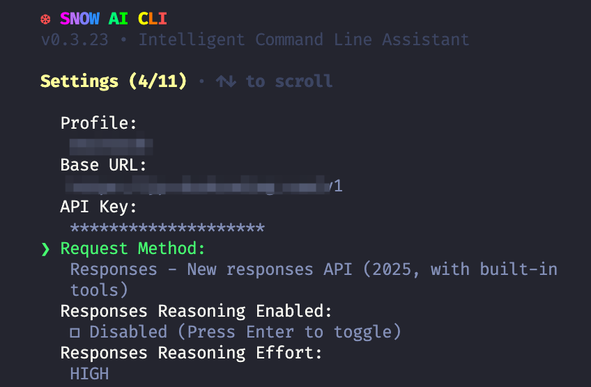

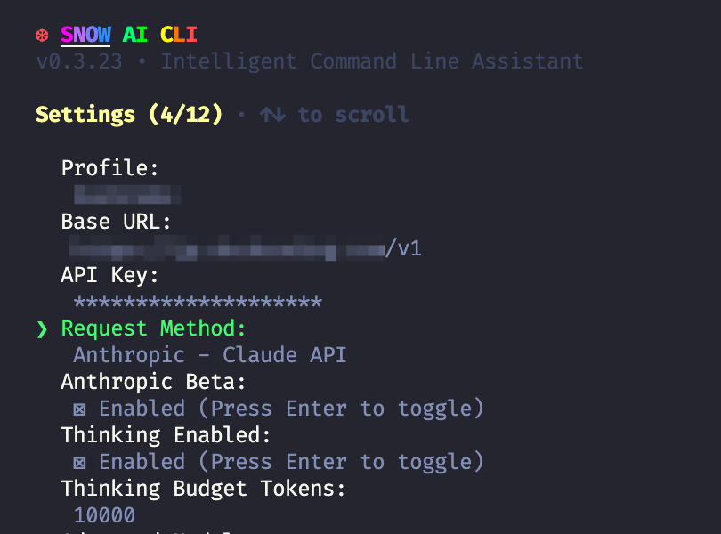

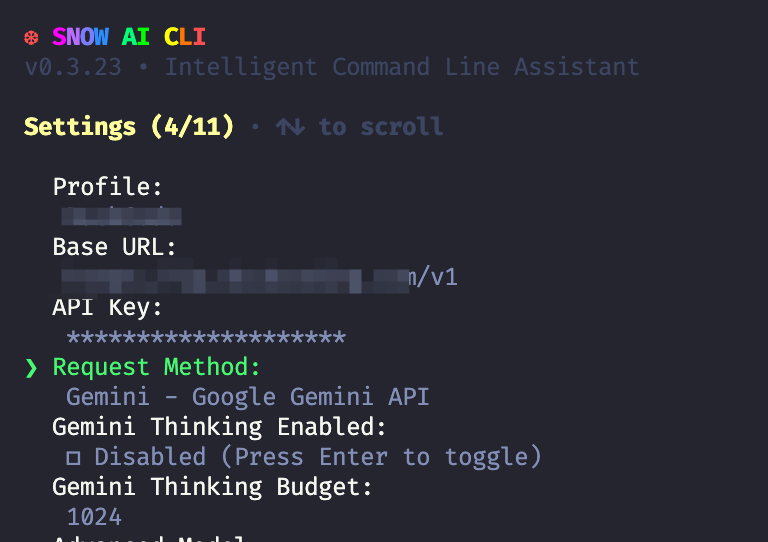

---

*来源: https://linux.do/t/topic/1060932.json*

