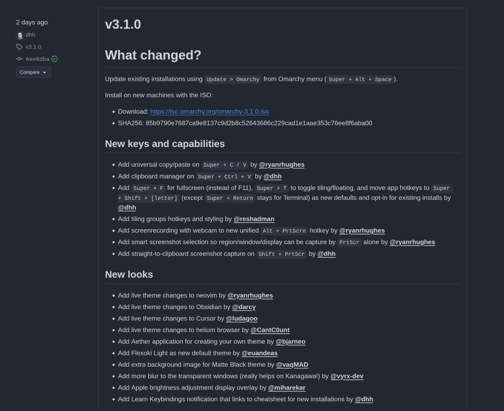

---

id: 1065669

title: "Omarchy v3.1.0 开始支持默认的 `Super + C` 复制"

created_at: 2025-10-21T01:56:36.834Z

username: capgrey

display_username: "鹅顶鸭"

---

# Omarchy v3.1.0 开始支持默认的 `Super + C` 复制

之前我分析过复制粘贴快捷键的合理性： [个人认为， Mac 的修饰键布局比其他的更合理 - V2EX](https://v2ex.com/t/1066300#reply12)

除此之外，自带剪切板历史管理工具，快捷键 `Super + Ctrl + V` 呼出

—

越来越喜欢了

---

*来源: https://linux.do/t/topic/1065669.json*

