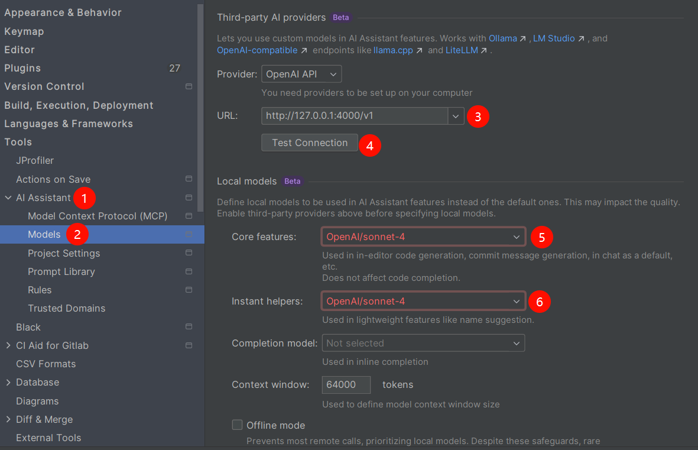
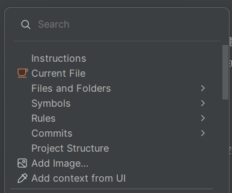

---

id: 1095102

title: "在IDEA Assiatant 使用自定义的API"

created_at: 2025-10-27T03:13:49.734Z

username: pixu

display_username: "𝓹𝓲𝔁𝓲𝓾"

---


# 在IDEA Assiatant 使用自定义的API


由于IDEA aiassiatant 不支持输入apikey

然后就搜索到了liteLLM 这个网关可以做代理，下面是具体的实现步骤，以及过程中遇到的问题。


我的系统是：windows

## 安装LiteLLM Proxy

```
pip install "litellm[proxy]"
```

## 配置liteLLm proxy

```
model_list:
  - model_name: sonnet-4         # 对外暴露的“别名”，客户端只需用这个 模型可以配置多个
    litellm_params:
      model: openai/claude-sonnet-4-20250514   #  三方真实模型名（OpenAI兼容前缀）这里的前缀写openAI 消息格式会使用openai 兼容方式，不写好像是A社/messages的方式，具体没有测试过，佬友们可自行测试
      api_base: https://api.oaipro.com/v1      #  以 /v1 结尾
      api_key: ${OAIPRO_API_KEY}               #  这是你的apikey
      # 如需增加超时、重试、额外header，可在下方添加
      # timeout: 60

router_settings:
  timeout: 60
  num_retries: 2

# 限流/预算/访问日志/鉴权等
# rate_limits:
#   - model: sonnet-4
#     rpm: 60
# general_settings:
#   logging: stdout
```

这里以始皇的OAI 作为示例：


需要注意的是配置文件中最好不要出现中文，否者启动的时候可能出现编码报错的问题，当然你也可以自己解决编码问题


配置文件可以放在任何位置都行

## 启动

```
export OAIPRO_API_KEY="你的_api_key" #如果写死在yaml中可以省略这里
litellm --config router.yaml --host 0.0.0.0 --port 4000
```

## 在IDEA中进行配置

等待liteLLm proxy启动完成后就可以进行配置了，测试连接后就可以根据配置的模型进行工作了



虽然IDEA自家的AI 做的比较差，但是上下文还是做的可以的，可以直接通过UI来选取上下文




---


*来源: https://linux.do/t/topic/1095102.json*

