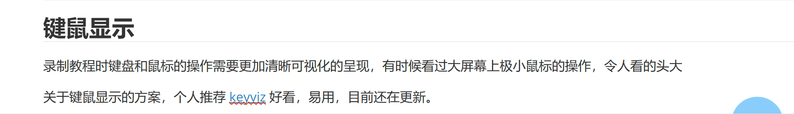

---

id: 1115680

title: "【经验分享】如何优雅的制作软件使用教程或者参考文档（键鼠显示、鼠标缩放录制、点击自动记录截图）"

created_at: 2025-11-01T21:28:20.246Z

username: Tranquility

display_username: "Tranquility"

---

# 【经验分享】如何优雅的制作软件使用教程或者参考文档（键鼠显示、鼠标缩放录制、点击自动记录截图）

# 【经验分享】如何优雅的制作软件使用教程或者参考文档（键鼠显示、跟随鼠标缩放录制、点击自动记录截图）

之前为了给新生教学如何使用我自己编的自动化程序，在论坛找了相关资源发现汇总的很少，故建立此贴，互相交流学习。文案有AI润色痕迹，见谅。

制作高质量的软件教程或操作文档时，清晰的演示是关键。一个微小的鼠标指针或被忽略的快捷键，都可能让观众看得一头雾水。

本文将分享几类实用工具，帮你从 **“键鼠显示”**、**“鼠标缩放录制”** 和 **“自动截图”** 三个方面，全方位提升教程的专业度和观感。

##  一、 键鼠显示：让操作清晰可见

录制教程时，最怕观众看不清你的键鼠操作。将按键和鼠标点击以可视化的方式呈现出来，是提升教程质量的第一步。

### 推荐方案 1：[keyviz](https://mularahul.github.io/keyviz/)

关于键鼠显示的开源方案，个人首推 [keyviz](https://mularahul.github.io/keyviz/)。

- **优点**：界面美观，设置简单，上手即用，且项目目前仍在积极更新。

- **工作原理与局限**：它采用屏幕**顶层渲染**技术，在大多数应用中表现良好。但在某些特定场景（如部分全屏应用）下可能会暂时“消失”，不过这基本瑕不掩瑜。

**鼠标演示效果：**

**键盘演示效果：**

**设置菜单：**

### 推荐方案 2：[OBS input overlay](https://github.com/univrsal/input-overlay)

如果你的需求更高，例如：

- **录制者“免打扰”**：不希望键鼠提示遮挡 *自己* 的屏幕，只让它出现在 *录制画面* 中。

- **全场景稳定**：希望在任何应用（包括全屏游戏）中都能稳定显示键鼠操作。

那么，**OBS + input-overlay 插件** 是一套更专业、更高效的方案。它提供了极高的自定义空间，其键盘操作显示是一个服务监听，具体内容可以看[input-history-windows](https://www.google.com/search?q=https://github.com/univrsal/input-overlay/tree/1f1b532caa6dc9b55901bcdcb5429bfe99a57b3a/presets/input-history-windows)。

> **使用提示**：安装插件后，记得在OBS的 **工具 → 输入叠加设置 → 远程连接** 中，勾选 **“通过websocket服务器转发事件”** 才能生效。

>  进阶美化：

> 如果你还想替换酷炫的鼠标样式，可以使用 GitHub - upgradeQ/cursor-skin-fx 这个光标替换插件来获得更好的视觉效果。

> 

### 相似软件推荐

1. **Carnac**：开源免费的键盘按键显示工具，支持自定义显示位置、样式（颜色、大小、透明度等），能实时显示按键组合，轻量且兼容性好。

官网：[GitHub - Code52/carnac: A utility to give some insight into how you use your keyboard](https://github.com/Code52/carnac)

2. **KeyCastOW**：开源工具，不仅能显示键盘按键，还支持鼠标点击显示（左键、右键、中键），可自定义显示时长、字体、颜色和位置。

官网：[https://github.com/soarqin/KeyCastOW](https://github.com/soarqin/KeyCastOW)

3. **ScreenKey**：主要面向 Linux 系统的按键显示工具，支持自定义快捷键、显示样式和过滤重复按键，轻量且易于配置。

官网：[screenkey / screenkey · GitLab](https://gitlab.com/screenkey/screenkey)

4. **KeyPress OSD**：功能简洁的 Windows 工具，能实时显示键盘输入和鼠标点击，支持调整显示位置、透明度和字体大小，操作简单。

官网：[https://keypressosd.com/](https://keypressosd.com/)

##  二、 跟随鼠标缩放录屏

为了突出显示操作的重点区域，让观众的注意力始终跟随你的鼠标，动态的缩放效果至关重要。

### 方案 1：[Cap](https://github.com/CapSoftware/Cap) (先录制，后加工)

Cap 是 Loom 的一款开源替代品，是一款视频消息工具，允许您在几秒钟内录制、编辑和分享视频。

- **工作流**：它采用 **“先录制，后加工”** 的模式。它会先录制完整的原始视频，然后提供一个编辑器，你可以在后期处理时，自由选择需要跟踪鼠标并缩放的片段。

- **优缺点**：优点是有很大的后期处理空间；缺点是**导出速度较慢，且录制质量一般**。

### 方案 2：[obs-zoom-to-mouse](https://github.com/BlankSourceCode/obs-zoom-to-mouse) (实时缩放，一步到位)

这是一款极其好用、符合直觉的OBS插件。在录制时直接实现效果，作者的原始版本目前没有对OBS高版本支持，于是我拿AI给它来了个**汉化的高版本适配**[obs-zoom-to-mouse-zh](https://github.com/HYK-X/obs-zoom-to-mouse-zh)

#### 原版效果展示

#### 汉化版效果展示

> 注：左上角键盘操作显示来自OBS input overlay

- **工作流**：**“所见即所得”**。在录制过程中，你可以通过快捷键，想让画面放大就放大，想缩小就缩小。录制完成即获得成品，无需后期编辑。

- **优缺点**：优点是效率极高。弊端是**后续无法二次修改**，录制时如果缩放错了或忘记缩放，那就真的录不到了。

- **建议**：**配合副屏一边录制一边监看**，确保缩放效果无误。

### 相似软件推荐

- **FocuSee**：一款智能屏幕录制软件（Win/Mac），能自动跟随光标并应用动态缩放效果，还具备多源录屏、视频编辑等功能。**（部分收费）**

官网：[https://focusee.imobie.com/](https://focusee.imobie.com/)

- **Screen Studio**：一款 Mac 专属录屏工具，能自动识别关键操作，镜头自动跟随鼠标并放大，录完可自动生成带动效和美颜的成品视频。**（部分收费）**

官网：[https://screen.studio/](https://screen.studio/)

- **eSearch 超级录屏**：基于 Electron 开发的跨平台软件（Win/Mac/Linux），其超级录屏功能通过自动缩放与焦点跟踪技术，智能分析鼠标行为并自动聚焦。

官网：[GitHub - xushengfeng/eSearch: 截屏 离线OCR 搜索翻译 以图搜图 贴图 录屏 万向滚动截屏 屏幕翻译 Screenshot Offline OCR Search Translate Search for picture Paste the picture on the screen Screen recorder Omnidirectional scrolling screenshot Screen translator 支持Windows Linux macOS](https://github.com/xushengfeng/eSearch)

- **ZoomIt**：微软官方的轻量级免费演示工具，支持屏幕放大、涂鸦、录屏等。**（微软Powertoys已自带，但缩放时可能略有卡顿）**

官网：[https://docs.microsoft.com/zh-cn/sysinternals/downloads/zoomit](https://docs.microsoft.com/zh-cn/sysinternals/downloads/zoomit)

##  三、 截图教程文档生成

如果你需要的不是视频教程，而是图文并茂的步骤文档（SOP），下面两类工具可以帮你实现“自动化”。

### 1. 网页操作截图文档生成

这类工具通常是浏览器插件，以侧边栏形式存在。它能读取浏览器元素和鼠标点击位置，自动生成每一步的截图和文字说明。

- **优点**：生成速度极快，50步以内的操作基本免费。

- **缺点**：无法录制浏览器之外的任何桌面应用。

- **建议**：生成文档后，最好丢给 AI（比如我）进行文案的后处理和润色。

- **海外工具**：

[https://scribe.com/](https://scribe.com/)

[https://www.tango.ai/](https://www.tango.ai/)

- **国内工具**：

[igenflow.com](http://igenflow.com)

### 2. Windows下所有软件截图文档生成

**PSR (步骤录制器)**：这是 Windows 系统自带的“神器”。

- **优点**：它能智能识别 Windows 窗体控件并自动高亮点击区域，为你的 *每一步操作* 生成截图和文字说明，最后打包成一个 .mht 文件（可用浏览器打开），非常舒适。生成后同样可以丢给AI进行后处理。

- **使用指南**：[如何使用问题步骤记录器 - Microsoft 365 Apps | Microsoft Learn](https://learn.microsoft.com/zh-cn/office/troubleshoot/settings/how-to-use-problem-steps-recorder)

> **重要提示**：微软已宣布将在未来的 Windows 版本中**正式移除PSR（步骤录制器）**。虽然目前仍可用，但请酌情使用或开始寻找替代品。

## 四、个人方案和建议

个人目前使用 keyviz 来显示鼠标，用OBS input overlay+obs-zoom-to-mouse 来实现录制。 教程文档靠PSR（步骤录制器） 然后丢给Gemini二次加工形成文档

---

*来源: https://linux.do/t/topic/1115680.json*

