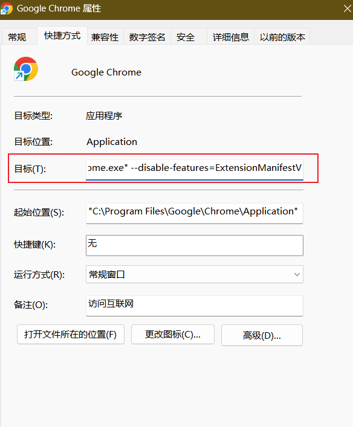

---

id: 1150655

title: "在chrome中允许v2扩展的解决方案(Chrome 150方案已失效)"

created_at: 2025-11-09T07:45:54.389Z

username: qntm

display_username: "qntm"

---


# 在chrome中允许v2扩展的解决方案(Chrome 150方案已失效)


# 起因

有很多佬友想使用v2扩展同时体验chrome最新功能，于是就写了这个教程

---

3.24 update:在Google移除v2引擎之前这种方法似乎将一直可用

# chrome143 开始：

感谢 楼下佬友提醒

> –enable-features=AllowLegacyMV2Extensions --disable-features=ExtensionManifestV2Unsupported,ExtensionManifestV2Disabled,ExtensionsManifestV3Only

> 最新版是这个命令

参数换为

```
--enable-features=AllowLegacyMV2Extensions --disable-features=ExtensionManifestV2Unsupported,ExtensionManifestV2Disabled,ExtensionsManifestV3Only
```

---

然后就可以愉快的使用v2插件了

---

- Windows：chrome快捷方式=>属性=>目标，追加上述指令，直接无感启动





上述方法只可用于快捷方式启动,通过其他应用唤起需要改注册表.


[chromeEnableV2.7z](/uploads/short-url/42z1jnwItwdt6W6yWANEQy8NzBT.7z) (455 字节)

- macOS：使用快捷指令，创建一个app，等我找下教程，之前有佬分享过


[Chrome140 MacOS上相对优雅的启动插件V2的支持](https://linux.do/t/topic/964693)

## 题外话

Google正在收紧v2扩展支持，如果v2扩展是刚需，那现在可以考虑提前准备迁移游览器了。楼主已经准备迁移到edge和firefox上了。


---


*来源: https://linux.do/t/topic/1150655.json*

