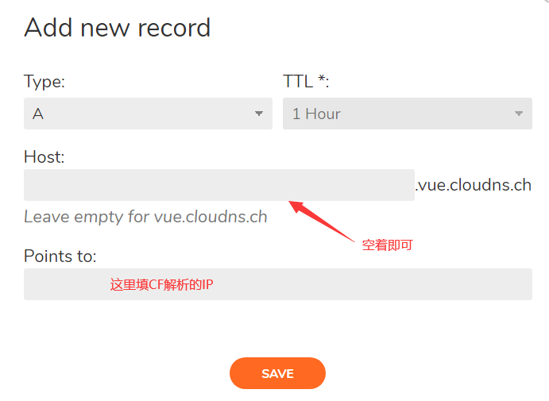
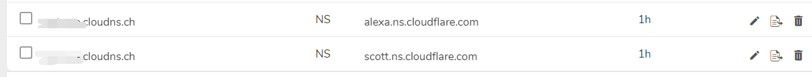
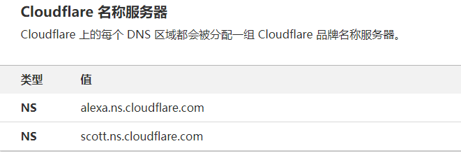
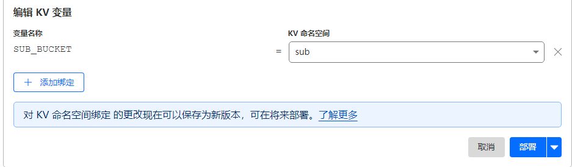

---

id: 115563

title: "开一发教程：Cloudns域名加CF搭建订阅转换"

created_at: 2024-06-19T06:43:18.535Z

username: cself

display_username: "cself"

---

# 开一发教程：Cloudns域名加CF搭建订阅转换

**域名注册**：[https://www.cloudns.net/](https://www.cloudns.net/)

注册完以后托管到CF 这里不介绍了 懂得都懂

注册完成后 需要到cloudns那里添加一个A记录：

---

*来源: https://linux.do/t/topic/115563.json*

