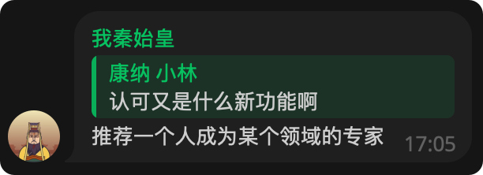
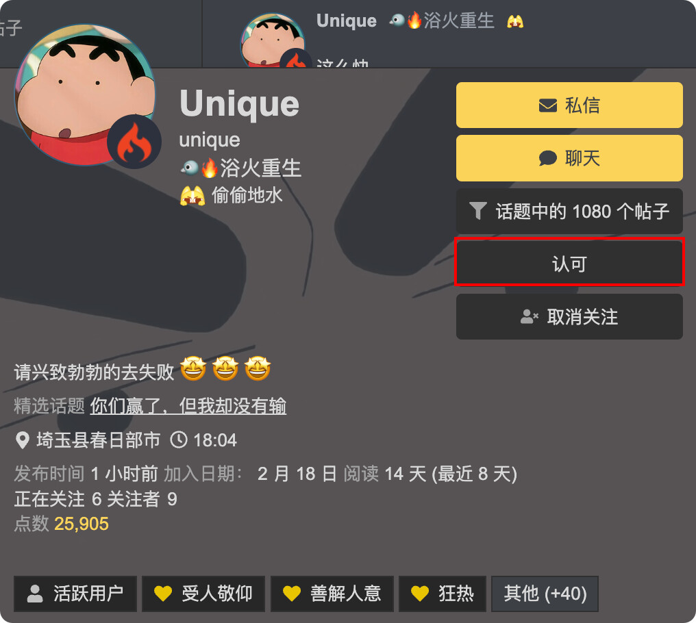
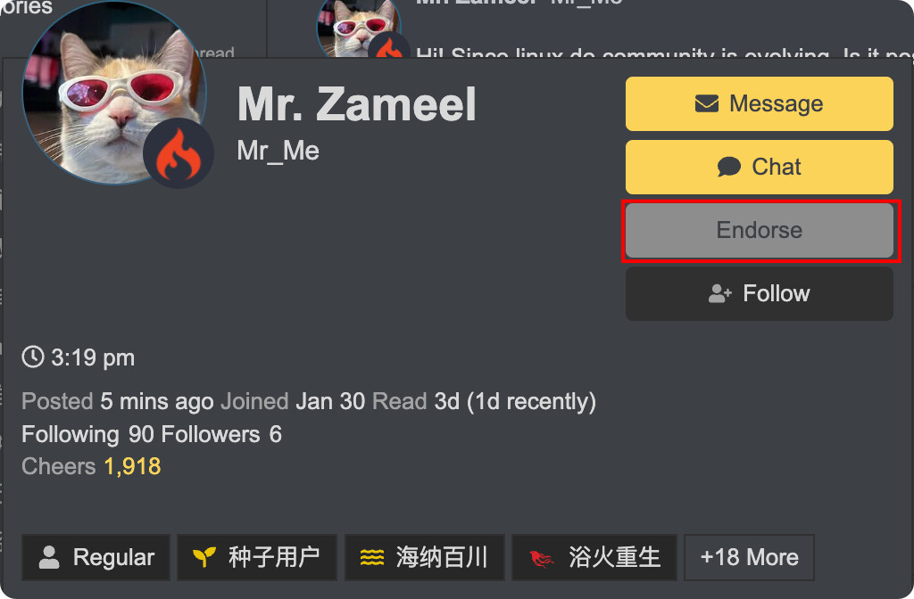
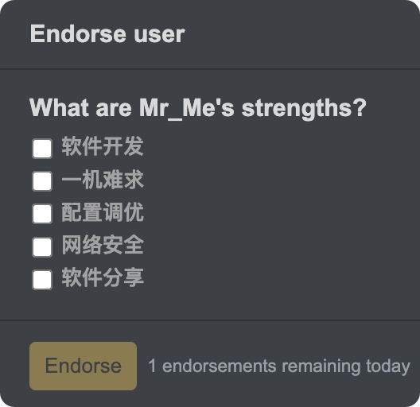
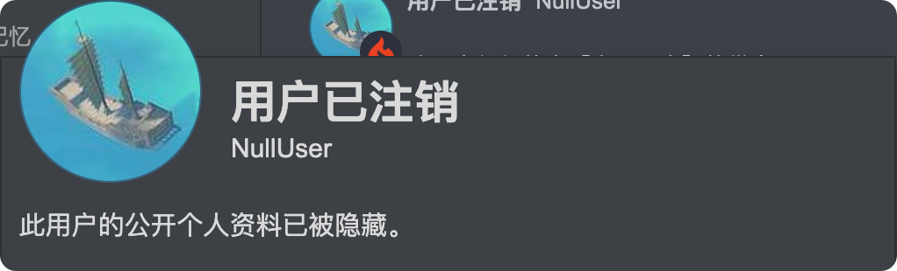
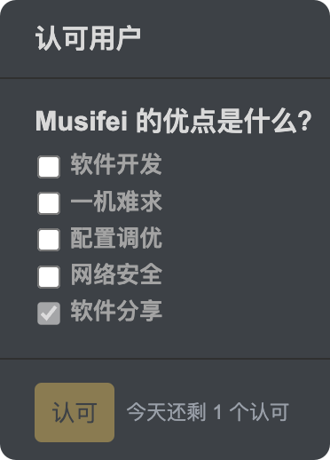
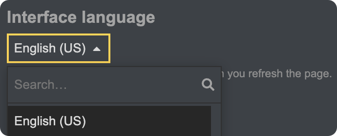

---

id: 117341

title: "【论坛功能】认可专家功能"

created_at: 2024-06-21T09:02:39.949Z

username: delph1s

display_username: "威震天"

---

# 【论坛功能】认可专家功能

# “认可”是什么？ What is “Endorse”?

[【今天最后一帖】社区领域专家：蓝V](https://linux.do/t/topic/117407) [

运营反馈](/c/feedback/2)

> 很高兴为大家带来一个新的功能：领域专家！

> 这个功能我其实很早就想开的，奈何之前有严重BUG。我反馈给官方两个多月后终于被修复。

> 为什么需要？

> 对于专业佬友来说，能力需要被认可。对于有问题需要请教的佬友来说，需要更精准地请教。

> 如何认可？

> 现在你可以点击任意佬友（前提是他未隐藏资料）头像，在其资料卡上有 认可 按钮，点击可以对佬友进行某些领域的认可。

>  ![[image]](https://cdn3.ldstatic.com/original/3X/9/4/94db23c7f9e71ac8ff5bd02392170f0306247326.png)

> 当某位佬友收到了 10 …

> “认可”是推荐一个人成为某个领域的专家

>

> “Endorse” means recommending someone to become an expert in a specific field.

点击这个[链接](https://linux.do/g/category-experts/members)可以查看我们的专家列表分组已被隐藏

## 认可原则

> Principle of endorse

> 这个不可以随便认可，要慎重。因为被认可达标且审批通过的人，会成为领域专家，同时获得一个角标。代表他在某方面是权威。

> This cannot be endorsed lightly; it must be done with caution. Those who are endorsed, meet the standards, and pass the review will become experts in the field and receive a badge. This signifies that they are an authority in a specific area.

> 要审批的你以为

> To become a forum expert, you need to be approved by the administrators.

## 点击头像可以对大佬进行认可

> Click on the avatar to endorse the expert

中文：

English:

## 每天可以给两个认可

> You can give two endorsements per day

中文：

English:

## 大佬们快关闭隐藏让我认可一下

> Experts, please unhide your personal information so I can endorse you.

## 唉嘿，上次开放时点的数据还在

> Aha, the endorsement data from the last time this feature was available is still there.

## 界面语言[在这里](https://linux.do/my/preferences/interface)修改

> The interface language can be changed [here](https://linux.do/my/preferences/interface).

> Hi! Since linux do community is evolving. Is it possible to add English interface in the community?

> It’s getting hard for me to understand topics.

---

*来源: https://linux.do/t/topic/117341.json*

