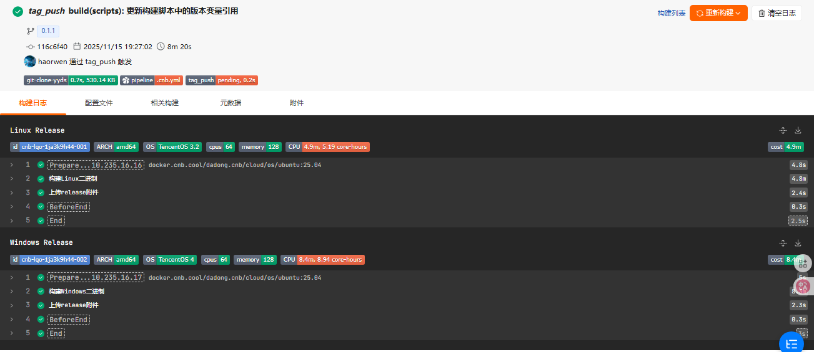
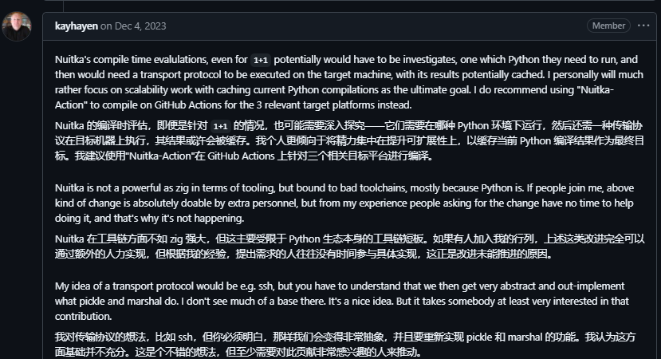
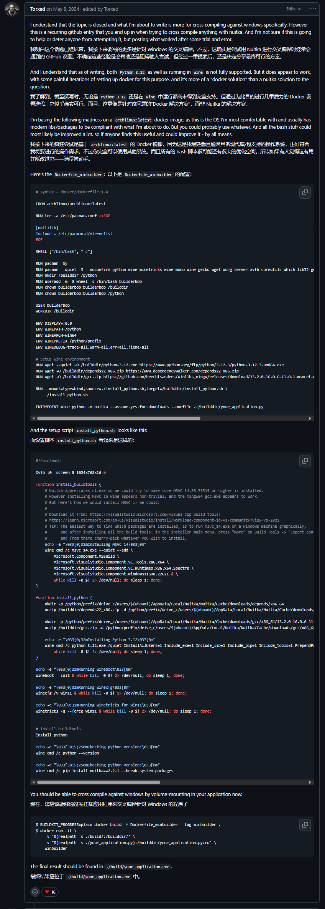
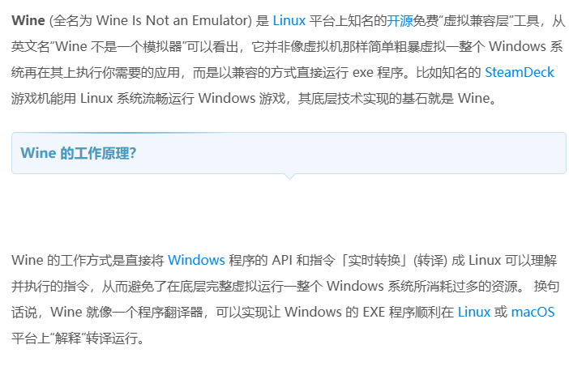
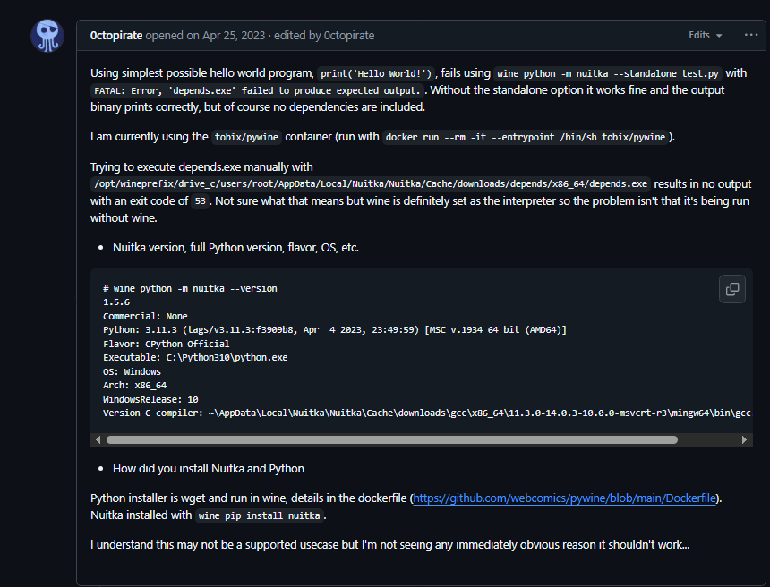

---

id: 1174465

title: "[笔记][python]如何在linux下为windows平台编译nuitka程序"

created_at: 2025-11-15T13:54:24.402Z

username: haorwen

display_username: "haorwen"

---


# [笔记][python]如何在linux下为windows平台编译nuitka程序


> [!note]

>

> 这是一个笔记，所以会按照时间顺序记录我的探索，想要解决方案的直接点击右边的目录跳转就好啦w

# 起因

我写的一个Python项目需要使用nuitka进行构建（pyinstaller单文件慢得很爱谁用谁用（bushi）），总之准备写一下ci，linux二进制构建没有问题，但因为使用了CNB托管所以workflow只有linux环境，所以折腾了一下午终于实现了windows二进制的构建



# 解决过程

## 一、搜索

遇到问题首先肯定是去各大搜索引擎搜索啦，但是搜了一圈并没有找到太多信息，大多数都是建议直接去用Github的action工作流



## 二、wine

接着，我找到了这个： [Would it be possible to enable cross-compilation ? · Issue #43 · Nuitka/Nuitka](https://github.com/Nuitka/Nuitka/issues/43)



```
20 20.37 0058:err:service:validate_context_handle Handle is of an invalid type (1, 2)
#20 20.39 0050:err:vulkan:vulkan_init_once Failed to load libvulkan.so.1
#20 20.41 0050:err:ole:start_rpcss Failed to open RpcSs service
#20 21.51 0050:err:ole:start_rpcss Failed to open RpcSs service
#20 21.52 The XKEYBOARD keymap compiler (xkbcomp) reports:
#20 21.52 > Warning:          Could not resolve keysym XF86OK
#20 21.52 > Warning:          Could not resolve keysym XF86GoTo
#20 21.52 > Warning:          Could not resolve keysym XF86VendorLogo
#20 21.52 > Warning:          Could not resolve keysym XF86MediaSelectProgramGuide
#20 21.52 > Warning:          Could not resolve keysym XF86MediaSelectProgramGuide
#20 21.52 > Warning:          Could not resolve keysym XF86MediaSelectHome
#20 21.52 > Warning:          Could not resolve keysym XF86MediaLanguageMenu
#20 21.52 > Warning:          Could not resolve keysym XF86MediaTitleMenu
#20 21.52 > Warning:          Could not resolve keysym XF86AudioChannelMode
#20 21.52 > Warning:          Could not resolve keysym XF86MediaSelectPC
#20 21.52 > Warning:          Could not resolve keysym XF86MediaSelectTV
#20 21.52 > Warning:          Could not resolve keysym XF86MediaSelectCable
#20 21.52 > Warning:          Could not resolve keysym XF86MediaSelectVCR
#20 21.52 > Warning:          Could not resolve keysym XF86MediaSelectVCRPlus
#20 21.52 > Warning:          Could not resolve keysym XF86MediaSelectSatellite
#20 21.52 > Warning:          Could not resolve keysym XF86MediaSelectCD
#20 21.52 > Warning:          Could not resolve keysym XF86MediaSelectTape
#20 21.52 > Warning:          Could not resolve keysym XF86MediaSelectRadio
#20 21.52 > Warning:          Could not resolve keysym XF86MediaSelectTuner
#20 21.52 > Warning:          Could not resolve keysym XF86MediaPlayer
#20 21.52 > Warning:          Could not resolve keysym XF86MediaSelectTeletext
#20 21.52 > Warning:          Could not resolve keysym XF86MediaSelectAuxiliary
#20 21.52 > Warning:          Could not resolve keysym XF86MediaPlaySlow
#20 21.52 > Warning:          Could not resolve keysym XF86NumberEntryMode
#20 21.52 > Warning:          Could not resolve keysym XF86RefreshRateToggle
#20 21.52 > Warning:          Could not resolve keysym XF86Accessibility
#20 21.52 > Warning:          Could not resolve keysym XF86DoNotDisturb
#20 21.52 Errors from xkbcomp are not fatal to the X server
```

看来是没有现成的解决方案了，但是至少给了我一个方向：使用wine


如果有人不知道wine是什么，那么贴一段介绍：





## 三、调试

跑起来之后我打算写一个Dockerfile配好环境自己构建一个带uv的镜像，但不知为何一直报错

```
#9 80.54 Fatal Python error: _Py_HashRandomization_Init: failed to get random numbers to initialize Python
#9 80.54 Python runtime state: preinitialized
```

可能是我在dockerindocker环境的原因，但是直接运行原本的镜像是没问题的，所以我就手动进容器配了下环境后docker commit了，注意wine内nuitka似乎识别不到python路径，需要构建时手动指定


尝试nuitka过程中还发现py3.12以上似乎会报错，切换回3.12后问题解决

# 总结&解决方案

可以使用我配好的镜像docker.cnb.cool/haorwen/cnb-cli/nuitka-build-wine，如果需要其他版本的python可以按照我上面的过程自己跑一遍，（或者踢一下我，我有空推个镜像w）


使用我的docker镜像的构建脚本：

```
#!/bin/bash
# Windows构建脚本 - 使用Docker和Wine环境

set -e

# 默认应用程序文件
APP_FILE=${1:-"main.py"}
BUILD_DIR="build"
OUTPUT_FILENAME="cnb-cli.exe"

# 清理并创建构建目录
echo "清理旧的构建文件..."
rm -rf $BUILD_DIR
mkdir -p $BUILD_DIR

echo "构建Windows可执行文件..."
echo "应用程序文件: $APP_FILE"
echo "构建目录: $BUILD_DIR"

# 运行Docker容器进行构建
echo "运行Docker容器进行构建..."
tar cf - \
    --exclude=".git" \
    --exclude=".venv" \
    --exclude="${BUILD_DIR}" \
    . | docker run -i --rm \
    -v "$(pwd)/$BUILD_DIR":/src/dist \
    -w /src \
    docker.cnb.cool/haorwen/cnb-cli/nuitka-build-wine:py3.12 \
    sh -c "tar xf - -C . && \
    wine uv sync && \
    wine uv run nuitka \
    --onefile \
    --standalone \
    --remove-output \
    --include-package=cryptography \
    --lto=yes \
    --python-flag=no_asserts \
    --jobs=\$(nproc) \
    --enable-plugin=upx \
    --python-for-scons=C:/Python/python.exe \
    --product-version=（windows必填！） \
    --file-version=（windows必填！） \
    --onefile-no-compression \
    --output-dir=dist \
    --output-filename=${OUTPUT_FILENAME} \
    ${APP_FILE}"

echo "Build completed! Executable in $BUILD_DIR/${OUTPUT_FILENAME}"
```


---


*来源: https://linux.do/t/topic/1174465.json*

