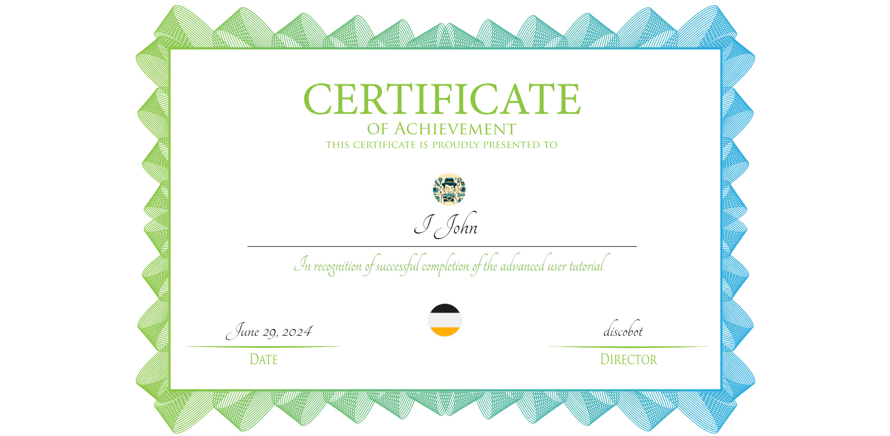

---

id: 117995

title: "Linux.do论坛升级、发帖指南"

created_at: 2024-06-22T08:43:04.712Z

username: iJohn

display_username: "耕读🛡️"

---


# Linux.do论坛升级、发帖指南


## 1.**图片折叠或隐藏功能**：

1.1 说明


Linux.do论坛不仅支持文本输入，还可以支持图片直接上传；在内容输入框左边上传图片，成功上传后，会在左边的框内生成一张图片链接，

``

并在输入框右边生成图片。此时，我们需要获得这个图片CDN网址。方法：将这个生成的图片，在浏览器另一个标签中打开，完整复制以`https://cdn.ldstatic.com/`开头的网址即可。

1.2 示例

图片CDN网址：

``

图片内容：


1.3 实现的语法

```
<details>
  <summary>点击查看图片内容</summary>
  
</details>
```

其中，“点击查看图片内容”是可自定义的、对图片的描述词，src=“图片的URL”。

[@iJohn](/u/ijohn) 20240622 16:48  编辑

其他Markdown语法：参考：[Markdown Reference](https://commonmark.org/help/)

## 2.**创建、发布、编辑Linux.do文档**

2.1 说明

Linux.do文档类似于飞书文档、语雀文档、Notion文档等，特点在于支持多用户协助编辑。

2.1.1 参看Linux.do文档方法

Linux.do文档地址是`https://linux.do/docs` ；

或者在Linux.do首页左侧，点击更多——文档即可查看Linux.do文档。

2.2 发布Linux.do文档的方法：

2.2.1 创建Linux.do文档方法

创建文档的方法跟创建普通帖子的方法近乎一样，**差异**在于，目标是放置在Linux.do文档的帖子，在帖子**类别（Category）处，选择文档**（Document）即可。

2.2.2 发布文档：对于编辑好作为“文档”的帖子，点击创建话题（Creat topice）即可。

2.2.3 Linux.do文档创建、发布的完整流程：

进入Linux.do首页——>创建话题——>编辑帖子和内容（包括输入帖子名称即文档名称，帖子类别，帖子标签以及帖子的内容）——>点击“创建话题”，完成编辑好的文档或帖子。

2.2.4 编辑Linux.do文档。

编辑Linux.do文档，需要进入到Linux.do文档的地址，如[本文档地址](https://linux.do/t/topic/117995)，然后点击“查看文档讨论（View the Discussions of this topic ）”。然后，选择“编辑（Edit）”


2.3 **说明**：

2.3.1 文档和帖子之间是可以相互转换的：只要你将帖子的类别从“文档”修改为别的类别如“人工智能”，即可将帖子从Linux.do文档转移到“人工智能”；反之亦然。

2.3.2 如果帖子是**文档**时，其他人可以参与协助编辑，但帖子创建者具有最终的修改权；同时，帖子为文档时，目前是游客可见；对于Linux.do用户而言，其他人只能通过查看文档的方式查看，不能像其他类别的帖子一样被查看到。

[@iJohn](/u/ijohn) 20240622 19:06 编辑

## 3.论坛制度、设置等

3.0 [论坛守则](https://linux.do/guidelines)；

3.1.**论坛等级制度**

论坛的等级，参考： [了解Discourse信任度 ](https://linux.do/t/topic/2460)

论坛升级要求，参考： [萌新如何优雅的升级](https://linux.do/t/topic/23574)

如何删帖？如何找帖子？参考：[@musifei](/u/musifei) [遇到难题了吗？让我们一起解决！](https://linux.do/t/topic/88916)

其他设置，参考：[萌新论坛指南 ](https://linux.do/t/topic/26306)

**建议**：通过 @ [@discobot](/u/discobot) 学习论坛教程，教程学习完成后会**颁发证书**。



3.2 **设置**

3.2.1 私信和聊天的差异

私信/Message和聊天/Chat之间，其共同点是，无法被传输信息的第三方看到；而差异在于，聊天/Chat保存的时间较短，而私信/Message（理论上）可以永久保存。

## 4.其他。欢迎补充。


---


*来源: https://linux.do/t/topic/117995.json*

