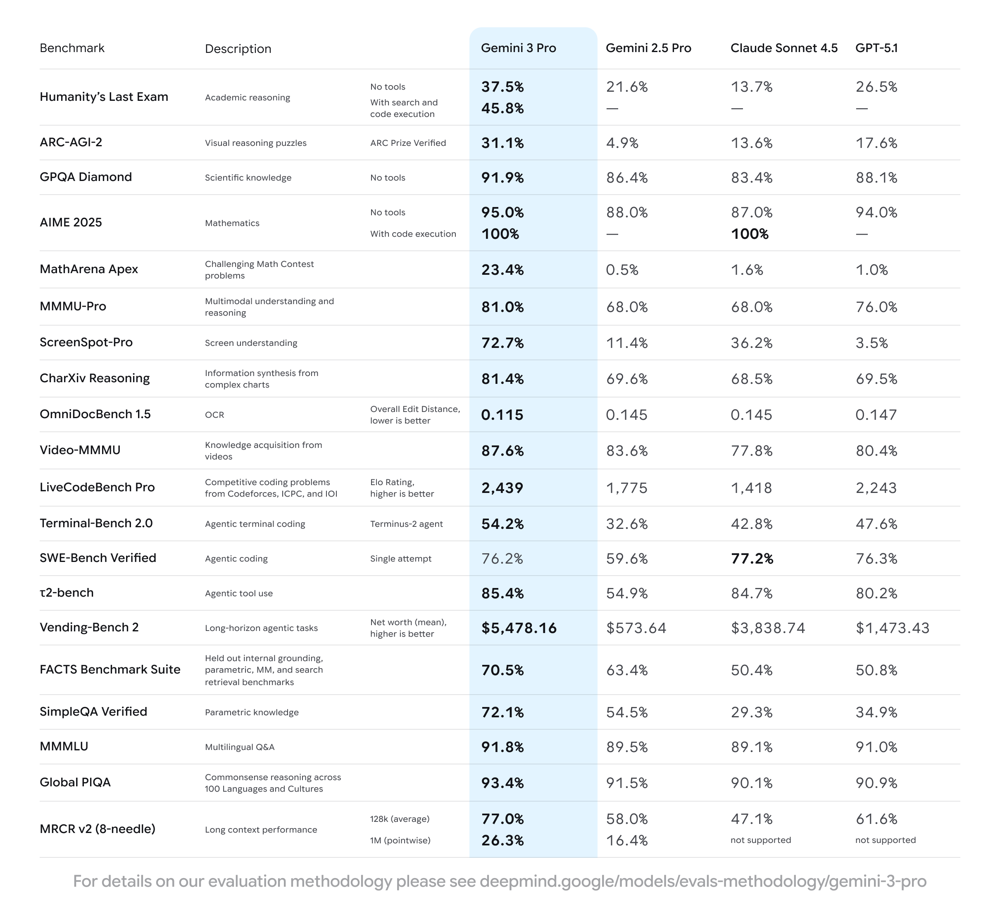
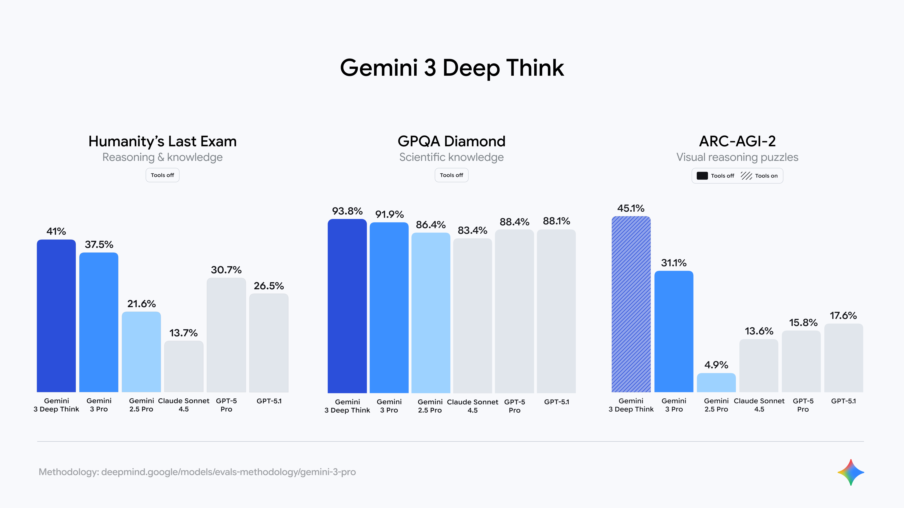
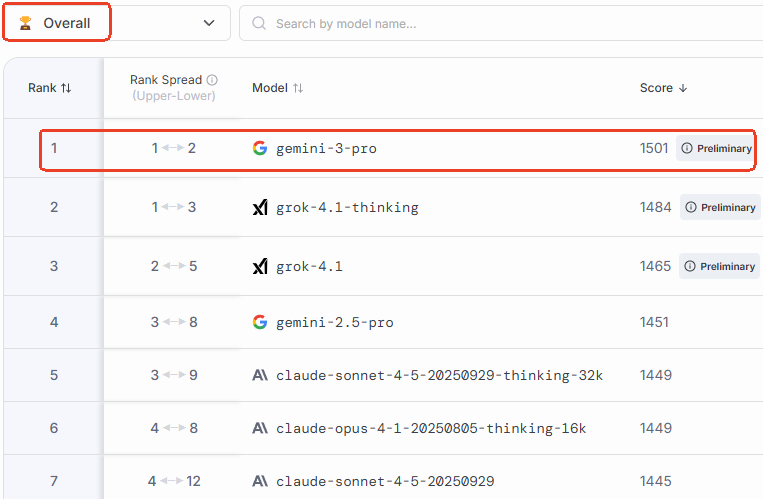
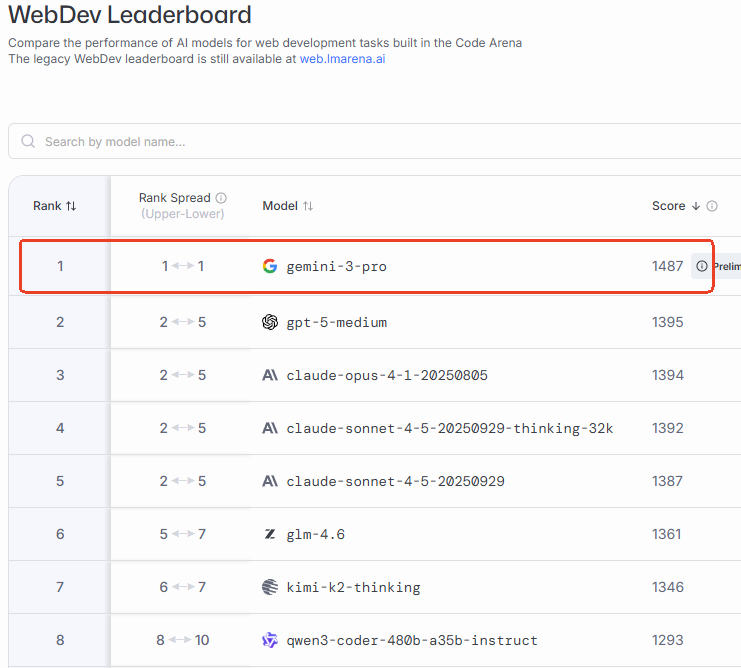
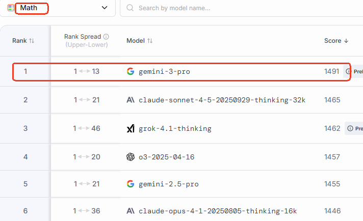
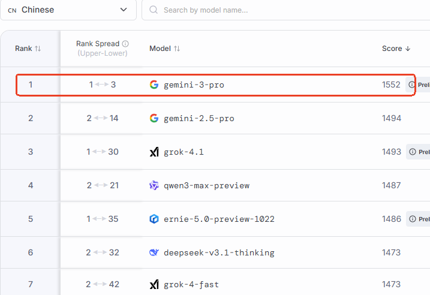
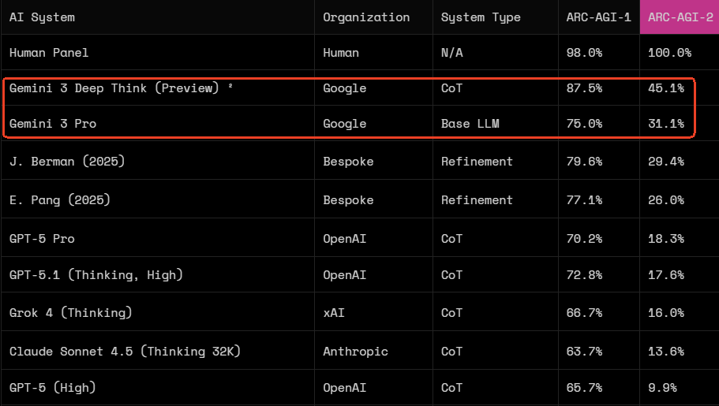
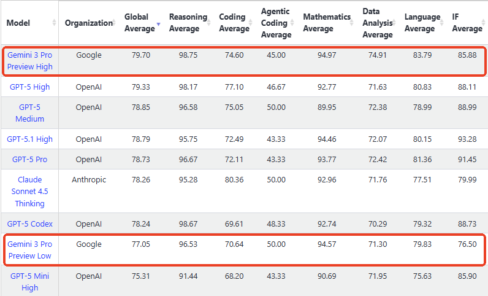
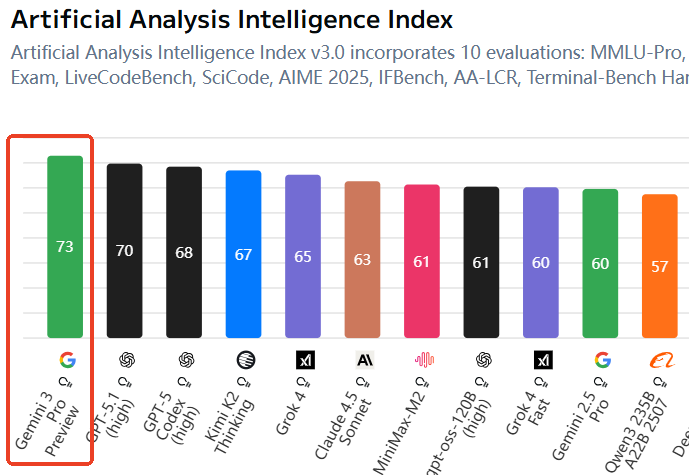
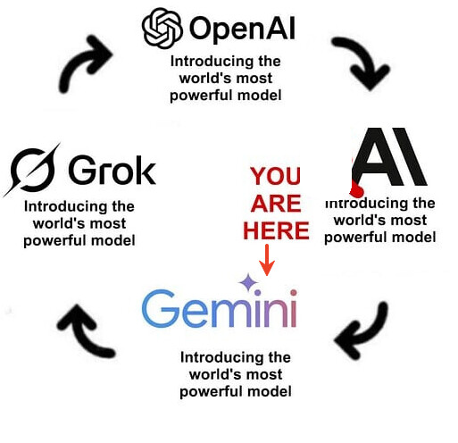

---

id: 1184740

title: ":fire:【大模型系列17】关于Gemini-3-pro，你想知道的一切【底楼更新Deep think】"

created_at: 2025-11-18T16:15:49.729Z

username: dwqxq1

display_username: "dwqxq1"

---

# :fire:【大模型系列17】关于Gemini-3-pro，你想知道的一切【底楼更新Deep think】

## 底楼加入gemini-3-flash的评分

## 官方资料

**价格**：200k以下，输入$2/mt，输出$12，参考2.5-pro是$1.25/$10

200k以上，输入$4，输出$18，参考2.5-pro是$2.5/$15

输入涨价60%，输出涨价20%

**上下文**：1M，与2.5-pro一样

**最大输出（含思考）**：64k，与2.5-pro一样

官方：默认情况下，Gemini 3 的输出详细程度较低，更倾向于提供直接、高效的答案。如果您的使用情形需要更具对话性或“聊天”风格的角色，您必须在提示中明确引导模型（例如，“以友善健谈的助理的身份解释一下”）。

64k是理论数值，大约理论思考32k，理论输出32k

实际输出以前2.5-pro可以跑满32k，3-pro一些人反应可能只有6千字左右

参考：[gemini3 长文本输出变少 在偷懒吗](https://linux.do/t/topic/1185895)

**速度**：暂时80tps左右，与2.5-pro差不多

**知识截止日期**：25年1月，与2.5-pro一样

**思考**：不能禁止思考，新增参数thinking_level=“low"或"high”，默认high

medium暂未推出，以后会有

官方说：请将thinkingLevel参数与Gemini 3 Pro搭配使用。虽然2.5-pro老的thinkingBudget参数可兼容3-pro，但可能会导致性能欠佳。

不能在同一请求中同时使用 thinking_level 和旧版 thinking_budget 参数。这样做会返回 400 错误。

参考：2.5-pro思考参数是thinkingBudget = 128到32768，-1代表动态，无法禁止思考

来源：[https://ai.google.dev/gemini-api/docs/thinking?hl=zh-cn#thinking-levels](https://ai.google.dev/gemini-api/docs/thinking?hl=zh-cn#thinking-levels)

**提示词**：输入提示应简洁明了。Gemini 3 最适合处理直接、清晰的指令。它可能会过度分析用于旧模型的冗长或过于复杂的提示工程技术。

**温度**：对于 Gemini 3，我们强烈建议将温度参数保留为默认值 1.0。

虽然之前的模型通常可以通过调整温度来控制创造性与确定性，但 Gemini 3 的推理能力已针对默认设置进行了优化。更改温度（将其设置为低于 1.0）可能会导致意外行为，例如循环或性能下降，尤其是在复杂的数学或推理任务中。

**媒体分辨率**：参数 media_resolution 参数用于控制 Gemini API 处理图片、视频和 PDF 文档等媒体输入的方式，方法是确定为媒体输入分配的最大 token 数，从而让您在响应质量与延迟时间和费用之间取得平衡。

来源：[https://ai.google.dev/gemini-api/docs/media-resolution?hl=zh-cn](https://ai.google.dev/gemini-api/docs/media-resolution?hl=zh-cn)

官方视频（短）：[https://www.youtube.com/@googledeepmind/videos](https://www.youtube.com/@googledeepmind/videos)

官方价格：[https://ai.google.dev/gemini-api/docs/pricing?hl=zh-cn](https://ai.google.dev/gemini-api/docs/pricing?hl=zh-cn)

官方博客：[Gemini 3: Introducing the latest Gemini AI model from Google](https://blog.google/products/gemini/gemini-3/)

官方开发指南：[https://ai.google.dev/gemini-api/docs/gemini-3?hl=zh-cn&thinking=high](https://ai.google.dev/gemini-api/docs/gemini-3?hl=zh-cn&thinking=high)

官方开发博客：[Gemini 3 for developers: New reasoning, agentic capabilities](https://blog.google/technology/developers/gemini-3-developers/)

谷歌搜索与Gemini3：[Google brings Gemini 3 AI model to Search and AI Mode](https://blog.google/products/search/gemini-3-search-ai-mode/)

模型卡(没啥内容)：[https://storage.googleapis.com/deepmind-media/Model-Cards/Gemini-3-Pro-Model-Card.pdf](https://storage.googleapis.com/deepmind-media/Model-Cards/Gemini-3-Pro-Model-Card.pdf)

## 评测

### 官方自评

---

### LMArena评测

文字，前端开发，数学，中文等都是第一，而且分数大幅领先第二名

来源：[Overview Leaderboard | LMArena](https://lmarena.ai/leaderboard)

---

---

---

---

### ARC-AGI评测

来源：[ARC Prize - Leaderboard](https://arcprize.org/leaderboard)

---

### LiveBench评测

来源：[LiveBench](https://livebench.ai/#/)

---

### FictionBench长上下文评测，截止251119 02:19尚未上线

来源：[Fiction.live](https://fiction.live/stories/Fiction-liveBench-Mar-25-2025/oQdzQvKHw8JyXbN87)

---

### ArtificialAnalysis分数

不是单独的评测，而是对10种第三方评测的综合分

---

## Chat渠道

### AIStudio已上线，免费

### Gemini App暂时免费用户灰度中

但是不能用2.5-pro的历史聊天记录

灰度不稳定，可能给了你gemini3，过一会又收回

佬友说用flash刷新几次，可能刷出来gemini

佬友说回答4，5个问题就因为没有免费额度被强制切到flash了。想再用就要等明天

很多人反应，相同的提示词，App版表现比AIStudio版差

对于复杂问题和长文，上下文和思考预算，aistudio > gemini app收费会员 > gemini app免费会员。对于普通问题，相差不大

来源：[Gemini 3 已经在Gemini Web可用 - #23，来自 a192212595](https://linux.do/t/topic/1184811/23)

### OpenRouter Chatroom已上线

消耗自己余额，或者自备AIStudio/Vertex的APIKey

来源：[OpenRouter](https://openrouter.ai/chat)

### LMArena Direct Chat已上线，免费

但上下文长度只有几k

来源：[LMArena](https://lmarena.ai/c/new?chat-modality=chat&mode=direct)

---

## API渠道

### AIStudio API已上线，收费

免费层级API Key不能用Gemini3，2.5-pro是每天50次

Tier1层级API每天1000次，每分钟50次，与2.5-pro一样

API限额与AIStudio Chat限额应该是分别计算的，没有关系

### Vertex已上线

### OpenRouter已上线

来源：[Gemini 3 Pro Preview - API, Providers, Stats | OpenRouter](https://openrouter.ai/google/gemini-3-pro-preview)

### 中转站：部分中转站和公益站已上线

具体L站里搜索

---

## 编程IDE渠道

### Google Antigravity已上线

新出仿Cursor的IDE，VSCode分叉，与Gemini3同步上线，详见三楼专题

免费，有限额

### Gemini CLI已上线

上线了新版

### Cursor已上线

软件里说200k上下文

有佬友说超50K就开始删代码

### Copilot已上线

不分high/low消耗1x

佬友说貌似砍了上下文，多轮对话很快就用满了。参考5.1也是砍到128k

### Warp.dev已上线

比5.1贵

### Windsurf已上线

high消耗2x，low不确定

### kilo code、roo code、cline自备API

### Claude Code，Codex理论上也可以

需要点技术，具体效果不知道

来源：[https://linux.do/t/topic/1185279/10](https://linux.do/t/topic/1185279/10)

---

最后发张梗图，祝大家与Gemini3愉快地玩耍

---

*来源: https://linux.do/t/topic/1184740.json*

