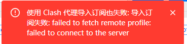
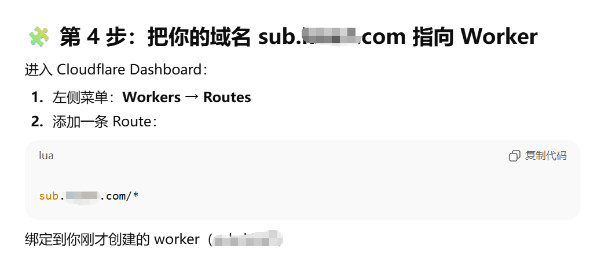
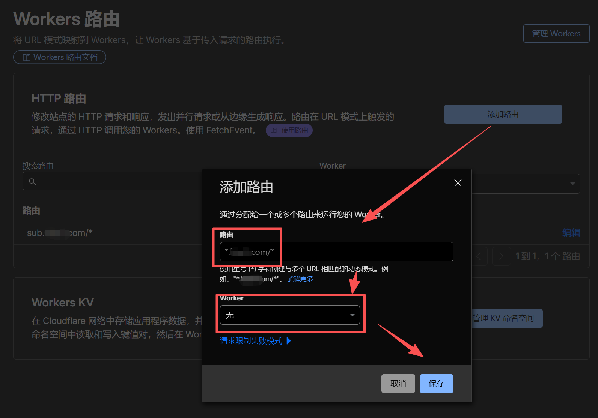
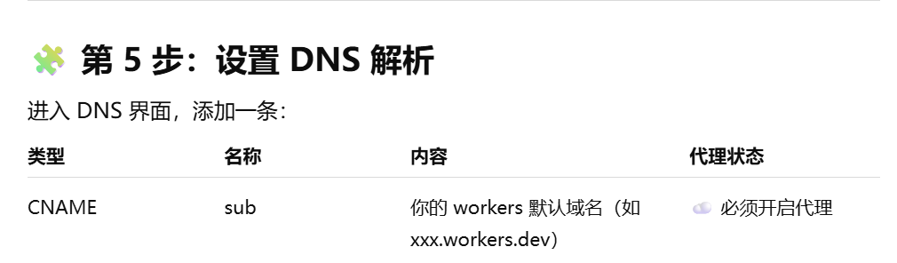
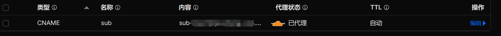
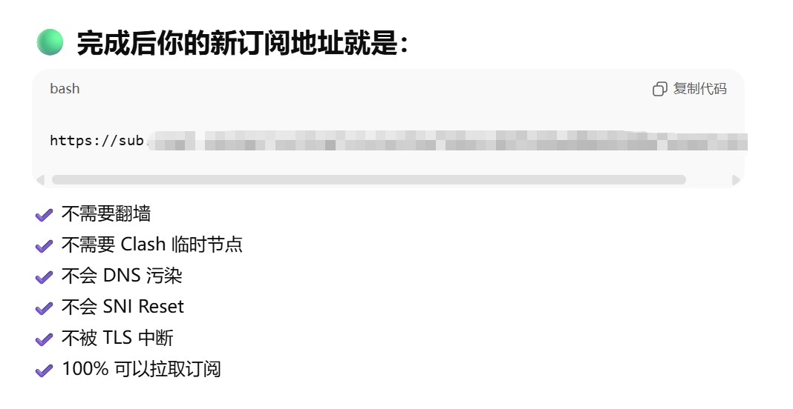

---

id: 1188144

title: "即昨天cf大善人躺平一会，gfw发威，解决订阅拉取方法"

created_at: 2025-11-19T10:41:27.777Z

username: skylusheng

display_username: "skylusheng"

---


# 即昨天cf大善人躺平一会，gfw发威，解决订阅拉取方法


## 订阅故障现象



## 处理方法，这里感谢大善人的GPT

首先的有两个域名在cf上托管


然后建立一个Workers

```
const TARGET = "https://xxxxx";   // 你的真实订阅服务器（不要加路径）

export default {
  async fetch(request) {
    const url = new URL(request.url);

    // 将请求路径与参数原样转发到真实订阅服务器
    const targetUrl = TARGET + url.pathname + url.search;

    let newReq = new Request(targetUrl, {
      method: request.method,
      headers: request.headers,
      body: request.method !== "GET" ? request.body : null,
      redirect: "follow"
    });

    return fetch(newReq);
  }
}
```











## 然后就订阅正常了

## 还有超时的问题没想好怎么解决在dns enable=true状态


---


*来源: https://linux.do/t/topic/1188144.json*

