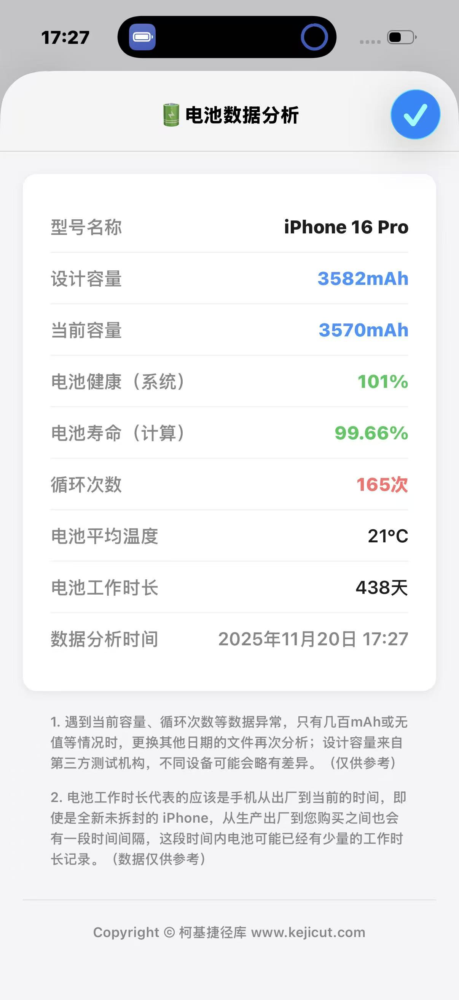

---

id: 1199956

title: "iOS快捷指令收纳（持续更新ing）"

created_at: 2025-11-20T10:14:55.581Z

username: Papain233

display_username: "木瓜蛋白酶Tea🎋"

---

# iOS快捷指令收纳（持续更新ing）

# 收纳我从各地搜刮过来的快捷指令（20251120版）

部分快捷指令会用到联网操作，可能泄露您的隐私，我将标注，快捷指令内存在的广告务必不要相信（该话题设置为wiki便于编辑，如有补充欢迎添加，最好在评论区贴上您的添加记录，我觉得不太合适或有风险的快捷指令会被移除）

本帖的教程会在我有时间时补充

# 正文（点击蓝字跳转，要关梯子）

## [超级按钮Super Button](https://www.icloud.com/shortcuts/98694e03e09e4faeab0dacebf2595590)

效果如图，配合action button食用最佳

# [电池寿命查询](https://www.icloud.com/shortcuts/f89761a3906d44b6ae4dad0bf74d8a38)

生成如下的电池健康报告

警告，本快捷指令需要联网，原作者：[柯基指令库](https://www.kejicut.com/206.html)

## 教程

[https://photo.459122.xyz/i/f0217b1f6dbaf8150668d82820533ab8.mp4](https://photo.459122.xyz/i/f0217b1f6dbaf8150668d82820533ab8.mp4)

# [App Settings](https://www.icloud.com/shortcuts/d5c62e01c6034bb1bdc4251ecb2e8bfe)

本快捷指令一定要添加到控制中心，仅系统版本大于等于iOS26可用，点击运行后可以快速跳转当前页面app的系统设置处，便于快捷更改权限

# [长图拼接](https://www.icloud.com/shortcuts/7ddb09e67e094803be0e9ba463957b74)

可以把多个图片拼接成长图（只支持纵向）

# [截图翻译（进阶版）](https://www.icloud.com/shortcuts/0e9f8835c19e476db5d25cb31a49d75d)

可选择文本后翻译（建议添加到控制中心）

# [截图翻译（纯翻译版）](https://www.icloud.com/shortcuts/50de32b8e2b448a8b47e471247592cd7)

全屏翻译且无排版优化（建议添加到控制中心）

# [丑头像生成器](https://www.icloud.com/shortcuts/8b58a1c9ff904968a268fe52083271f4)

生成下图风格的丑头像

# [提取屏幕文字](https://www.icloud.com/shortcuts/db9cf341dd0241aa943767fe4221087f)

利用iOS系统级OCR提取屏幕文字，准确率较低（建议添加到控制中心）

# [人生最后一件事](https://www.icloud.com/shortcuts/b2b27e91f4be4e57a0667beb40c125b2)

运行后查询watch返回的实时心率，为0时格式化Safari的浏览记录 

# [自动亮度](https://www.icloud.com/shortcuts/eb2ac2416bd944979bbdf35504a6525b)

利用iOS 系统URL Scheme自动跳转系统设置处（建议添加到控制中心），快捷开启/关闭自动亮度

---

*来源: https://linux.do/t/topic/1199956.json*

