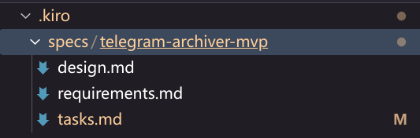
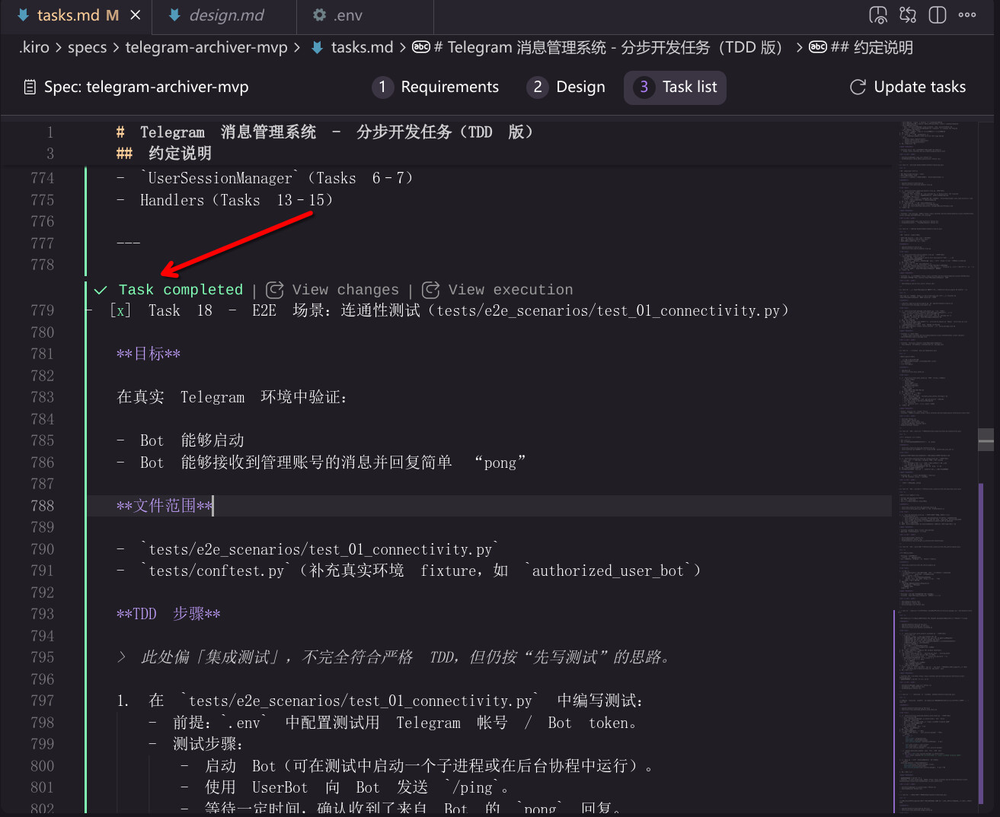
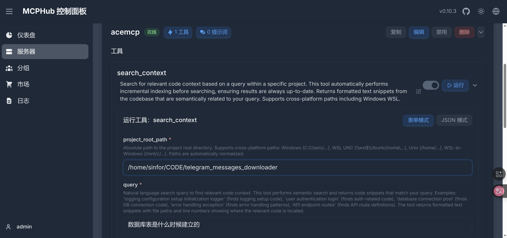

---

id: 1200213

title: "编程小白对vibe coding的思考🤔：如何不让项目成为屎山"

created_at: 2025-11-20T11:26:24.976Z

username: sinfor

display_username: "Elon Musk"

---


# 编程小白对vibe coding的思考🤔：如何不让项目成为屎山


## 引言

目前，AI模型写个中小项目不在话下。越来越强的AI让vibe coding成为现实，一句需求就能写个大项目。但实际上，vibe coding从前期的快速迭代，到后期很容易变成不可名状的屎山。本文通过对两个核心问题总结，给出解决方案。

### 屎山案例

使用kiro code的spec模式

### 结果：

臭不可闻的大屎山

### 原因

1.拆分任务 不够细，特别是模块。具体来说在计划不够，tasks.md拉一大托

2.测试非真实环境，假PASS，在真人交互时一大堆bug。测试对我是黑盒

3.AI（kiro的claude 4.5s 不思考）不遵从指令

4.笨蛋AI虾季把写，文档不看，mcp不用

5.我没有动脑，没审核

### 启发：

完整的spec：需求-技术栈讨论-细节敲定-文件结构-架构图

按需加载的上下文，可以参考claude code的skills

使用acemcp更精准的上下文。

使用hook，subagnet或者手动将上下文狠狠注入到不思考的AI脑子里

用联网思考模型如GPT5.1 T审核文档，效果优秀。

## 核心问题

现在AI编码能力强，但用起来感觉拉，核心问题有两个，一是**没有清晰准确的上下文** 2.是**没有良好的工程管理**

解决问题1，可以通过“**规范先行**”的模式，就是先写一堆文档，然后才开始写代码。有了文档计划，AI就知道了做什么，怎么做；然后就是手操提示词，因为我注意到AI很少用MCP，所以就手动调用context7、acemcp，把相关内容，狠狠地塞到上下文里。

解决问题2，用控制论的思想。控制论的核心就是反馈，所以我整了两个重要反馈。一个是AI看的端到端测试，换句话说，就是让AI用代码，模拟一个真人的操作，把程序走一遍。我让AI不使用mock（模拟），使用完全真实的环境。相比mock或者调用函数，在我体验中，几乎可以避免bug。所以我觉得，端到端测试是必须的。


第二个反馈是AI和人之间的反馈，就是人一定要给AI**及时**的反馈，AI要给人**能看见**的反馈。这是句废话，但是很重要。人要在AI完成一个小任务检查一下，看下他写的代码、日志等。

以下展开说下，我个人摸索的编码流程。这肯定不是最好的，**真正有价值的内容都分散于佬们的脑子里**，希望佬们批判、指正、补充、建议，集思广益。

## 专有名词解释

1 [acemcp](https://linux.do/t/topic/1165603)：调用ACE，用来在代码库里搜索，可用自然语言查询。ACE全称Augment Context Engine，佬友评价它是Augment code的护城河


2.context7：MCP工具，用来联网搜索文档


3  [spec-kit](https://github.com/github/spec-kit)：Github官方出品的工具，核心是几个文档，用来告诉AI文档怎么写。或者叫speckit为规范驱动开发的工具包


4.TDD： 软件开发方法，核心是 写测试-写通过测试的代码-重构代码


5.宪章： 这里指一个文档，地位类似CLAUDE.md AGENTS.md

**用思考模型来进行文档的编写，因为质量高**

# 编码流程

## 文档编写阶段

主要是五个文档：宪章、需求、技术栈讨论（架构设计）、文件列表、任务分解

### 宪章

在claude code或codex等地方使用spec-kit的`/speckit.constitution`，如果你有自己的AGENTS.md或者CLAUDE.md可以跳过这条


我会这样


`/speckit.constitution 0.当我表达模糊，用多轮提问澄清。可质疑我的思路，考虑更优的选择 1.使用中文对话和我 2.我是初学者，解释高于我水平的内容 3.代码实现遵循TDD 4.使用mcp工具 5.当信息不足时,使用 MCP 工具获取准确信息或者问我 6.生成的测试要能够给我信息反馈 7.日志分级 8.模块可扩展、耦合度低


然后通过多次对话调整，我会让AI简化


我习惯把它复制成AGENTS.md，这样就会自动调用给codex和kiro code用

### 需求

使用spec-kit的`/speckit.specify`生成需求文档，重点是是什么和为什么，而不是技术栈。


`/speckit.specify 作为用户，我希望通过bot，登陆用户账号，然后程序通过这个用户账户从telegram下载历史消息到数据库，下载后，我可以通过数据库搜索消息，包括中文消息。作为开发者，我希望希望这个项目便于维护和扩展，可以使用docker compose部署。请你补充需求，也可以问我来明确 现在先不讨论如何实现和技术栈`


这个文档可能需要多次对话才能得到想要的。


然后我会把生成的文档发给网页思考模型，比如GPT5.1Thinking，考虑是否要要完善


让他按照kiro code中requirements.txt的格式修改

```
### 需求 4：消息下载配置与执行

**用户故事：**

作为用户，我想为选定的聊天源配置下载范围（如最近 N 条或某一时间段），并将这些消息归档到数据库中。

#### 验收标准

1. WHEN 用户选择了一个聊天源，THEN Bot系统 SHALL 提示用户配置下载范围，至少包括：

- 默认选项：最近 1000 条消息

- 可选：按日期范围（起始日期和结束日期）

2. IF 用户输入了非法的日期格式，THEN Bot系统 SHALL 提示“日期格式无效，请使用 YYYY-MM-DD”，并允许重新输入。

3. Bot系统 SHALL 在内部统一使用 UTC 时间存储消息时间字段，并在与用户交互时使用预设的时区（例如亚洲/上海），确保时间范围解释一致。

4. WHEN 用户确认下载配置，THEN Bot系统 SHALL 创建一个下载任务，并向用户反馈“已开始下载，请稍候”的消息。

5. Bot系统 SHALL 使用 Telethon 从所选聊天源拉取消息，并将每条消息保存为一条消息记录，其中至少包含：

- chat_id

- message_id

- sender_id（发送者）

- content（文本内容或 caption）

- date（发送时间）

- edit_date（编辑时间，可为空）

6. Bot系统 SHALL 使用 PostgreSQL 数据库存储消息记录，并在 Message 表的 content 字段上创建 PGroonga 全文索引。

7. IF 下载成功完成，THEN Bot系统 SHALL 向用户报告“下载完成，共下载 X 条消息”。

8. IF 下载过程中发生不可恢复错误（如数据库连接失败），THEN Bot系统 SHALL 中止当前任务并向用户报告错误原因。

---
```

### 技术栈和文件列表

这一步骤我会和网页思考模型讨论，让AI参考之前的两个文档和网络，确定技术栈


然后确立架构，确立架构可能也需要多轮，让AI生成架构图


确认后让网页AI生成文件列表，精确到类与关键函数，例如

```
telegram-archiver/
├── .env.example                    # 环境变量模板 (必须包含 REAL_MODE=True/False, TEST_WHITELIST_CHAT_ID)
├── .gitignore
├── .dockerignore
├── docker-compose.yml              # 定义 App 和 Postgres-PGroonga 服务
├── pyproject.toml                  # uv 依赖定义 (sqlalchemy, telethon, loguru, asyncpg, pydantic-settings)
├── uv.lock                         # uv 锁定文件
├── Dockerfile                      # 生产环境构建文件
├── README.md
│
├── app/                            # 应用源码
│   ├── __init__.py
│   ├── main.py                     # [入口] 程序启动，初始化 DB，启动 Bot 和 UserBot 客户端
│   │   └── func: main() -> void
│   │
│   ├── config.py                   # [配置] Pydantic Settings
│   │   └── class: Settings
│   │       ├── func: get_db_url()
│   │       └── func: validate_prod_safety_settings() # 确保在测试模式下配置了白名单 ID
│   │
│   ├── logger.py                   # [日志] 集中化日志配置 (Loguru)
│   │   └── func: setup_logger(level: str, log_file: str) -> void
│   │       # 拦截 logging 标准库，统一路由到 Loguru，配置 Rotation 策略
│   │
│   ├── bot/                        # [界面层] Telegram Bot 交互逻辑
│   │   ├── __init__.py
│   │   ├── loader.py               # Bot 实例加载
│   │   │   └── func: create_bot_client() -> TelegramClient
│   │   │
│   │   ├── middlewares.py          # 权限与安全拦截
│   │   │   └── class: AuthMiddleware
│   │   │       └── func: check_admin_permission(user_id) -> bool
│   │   │
│   │   └── handlers/               # 命令处理器
│   │       ├── __init__.py
│   │       ├── auth.py             # /login, /logout
│   │       │   └── class: AuthHandler
│   │       │       ├── func: handle_login_request(event)
│   │       │       ├── func: handle_2fa_password(event)
│   │       │       └── func: handle_verification_code(event)
│   │       ├── download.py         # /download
│   │       │   └── class: DownloadHandler
│   │       │       ├── func: list_dialogs(event)
│   │       │       └── func: start_download_task(event)
│   │       └── search.py           # /search
│   │           └── class: SearchHandler
│   │               ├── func: execute_search(event)
│   │               └── func: render_result_buttons(results) # 生成跳转链接按钮
│   │
│   ├── core/                       # [核心层] 业务逻辑 (UserBot 行为)
│   │   ├── __init__.py
│   │   ├── session_manager.py      # 管理 UserBot 的 Session 生命周期
│   │   │   └── class: UserSessionManager
│   │   │       ├── func: is_authorized() -> bool
│   │   │       ├── func: sign_in(phone, code, password)
│   │   │       └── func: keep_alive() # 定期心跳检测
│   │   │
│   │   ├── downloader.py           # 核心下载逻辑
│   │   │   └── class: HistoryDownloader
│   │   │       ├── func: sync_chat_history(chat_id, limit, offset_date)
│   │   │       ├── func: _process_message_batch(messages) # 批量入库
│   │   │       └── func: _handle_incremental_update(latest_msg_id)
│   │   │
│   │   ├── search_engine.py        # 搜索业务封装
│   │   │   └── class: SearchEngine
│   │   │       └── func: search_full_text(query, chat_id, time_range) -> List[Message]
│   │   │
│   │   └── safety.py               # [安全守卫] 防风控与限流
│   │       ├── class: FloodWaitHandler
│   │       │   └── func: run_with_retry(coroutine) # 捕获 FloodWaitError 并自动休眠
│   │       └── class: GlobalRateLimiter
│   │           └── func: acquire_permission() # 强制全局 API 调用间隔
│   │
│   └── database/                   # [数据层]
│       ├── __init__.py
│       ├── engine.py               # AsyncPG 引擎配置
│       │   └── func: get_db_session() -> AsyncGenerator
│       │
│       ├── models.py               # SQLAlchemy 表定义
│       │   ├── class: User(Base)   # 本地存储的用户配置
│       │   ├── class: Chat(Base)   # 会话元数据
│       │   └── class: Message(Base)
│       │       # 定义 PGroonga 索引: Index("ix_msg_content", "content", postgresql_using="pgroonga")
│       │
│       └── repositories.py         # CRUD 操作
│           ├── class: MessageRepo
│           │   ├── func: upsert_batch(messages: List[dict])
│           │   └── func: search_by_pgroonga(query: str)
│           └── class: ChatRepo
│               └── func: update_chat_meta(chat_id, title, type)
│
├── tests/                          # [真实环境测试] 严禁 Mock，必须通过真实 API 交互
│   ├── __init__.py
│   ├── conftest.py                 # Pytest 配置
│   │   ├── func: real_db_session() # 连接真实(或独立的测试用) PGroonga 数据库
│   │   ├── func: authorized_user_bot() # 复用本地 session 文件，避免重复登录
│   │   └── func: prod_safety_check() # [Fixture] 自动运行前检查：目标是否为测试白名单群组？
│   │
│   ├── utils/
│   │   ├── __init__.py
│   │   └── prod_guard.py           # 生产环境测试护栏
│   │       └── class: ProdTestGuard
│   │           ├── func: ensure_target_is_whitelisted(chat_id) # 若 ID 不匹配 .env 配置，抛出 FatalError
│   │           └── func: generate_test_marker_text() # 生成唯一 hash 字符串，用于后续清理测试数据
│   │
│   ├── e2e_scenarios/              # 真实场景测试
│   │   ├── __init__.py
│   │   ├── test_01_connectivity.py
│   │   │   └── func: test_bot_can_see_user_bot() # 互发 Ping
│   │   │
│   │   ├── test_02_download_cycle.py
│   │   │   └── class: TestRealDownload
│   │   │       ├── func: test_seeding_data() # UserBot 向白名单群发 10 条特定消息
│   │   │       ├── func: test_trigger_download_command() # UserBot 发送 /download 指令
│   │   │       └── func: test_verify_db_records() # 查询 DB 确认 10 条消息已入库
│   │   │
│   │   └── test_03_search_engine.py
│   │       └── class: TestPGroongaSearch
│   │           └── func: test_chinese_segmentation_search() # 搜索 "测试" 是否能搜到 "这是一个测试消息"
│   │
│   └── cleanup.py                  # 测试后清理脚本 (只删白名单群的 DB 数据)
│
└── scripts/
    ├── init_db.sql                 # 启用 pgroonga 扩展的 SQL
    └── entrypoint.sh               # 容器启动脚本
```

将文件列表存到文件中，**让项目目录全文总是在上下文中**，我是手动@


然后使用 `/speckit.plan + 提示词` 命令

### 任务分解

这一步是最重要的，人需要认真阅读，交给不同的AI反复打磨


使用 `/speckit.tasks` 从实施计划中创建可执行的任务列表


把创建的文件，交给联网的思考模型打磨，打磨后按照以下格式输出：

```
- [ ] Task 14 - E2E 场景：下载指令交互（tests/e2e_scenarios/test_02_download_flow.py）

  **目标**

  在真实 Telegram 环境中验证：

  - Bot 能够响应 `/download` 命令并列出当前真实的对话列表
  - Bot 能够处理 Inline Button 的点击事件（CallbackQuery）
  - 用户选择对话后，Bot 能正确反馈并触发下载流程

  **文件范围**

  - `tests/e2e_scenarios/test_02_download_flow.py`
  - `tests/conftest.py`（如有需新增针对下载流程的 fixture）

  **TDD 步骤**

  1. 在 `tests/e2e_scenarios/test_02_download_flow.py` 中编写测试：
    - 前提：`.env` 配置完成，且测试账号中至少存在 1 个活跃对话。
    - 测试步骤：
      - 启动 Bot（后台运行）。
      - 使用 UserBot 向 Bot 发送 `/download`。
      - 等待并验证 Bot 回复了一条包含 Inline Buttons（对话列表）的消息。
      - UserBot 模拟点击第一个对话的按钮（触发 Callback）。
      - 等待并验证 Bot 编辑消息或发送新消息，提示“开始下载”或“任务已创建”。
  2. 运行测试（预期失败，如果没有实现完整逻辑）。
  3. 调整 `app/bot/handlers/download.py` 中的逻辑，确保真实环境下的 `iter_dialogs` 调用和 Callback 处理与测试预期一致，直到测试通过。

  **需要参考的文档**

  - Telethon `Message.click()` 文档（用于 UserBot 模拟点击）：
    - `https://docs.telethon.dev/en/stable/modules/custom.html#telethon.tl.custom.message.Message.click`

  **可复用函数 / 模块**

  - `HistoryDownloader`（真实调用）
  - 之前实现的 `test_01_connectivity.py` 中的 Bot 启动逻辑
  ---
```

## 代码实现阶段

下面有3个方式实现代码

#### 1.直接给出提示词

我推荐按照以下提示词给AI：

```
完成Task 14
[这里贴上上个代码块里的完整内容]
参考：
[这里贴出文件目录列表]
[可选，这里贴上acemcp搜索到的内容]
[可选，context7搜索到的内容]
```

#### 2.kiro code自动化

经过上述操作，得到了几个文档。


我把它们改名，放到.kiro文件夹下



然后点击按钮就能自动编码了



#### 3.spec-kit命令

`/speckit.implement`

# 总结

讲了这么一大堆内容，核心中的核心就是解决那两个问题。其他的甚至可以略过。


这些操作最终得到了规范清晰的文档，换给普通人看，也能很快上手

## 常见问题

### 1.为什么要让项目目录全文总是在上下文中？

看到文件结构，AI就能理解项目架构了，体感上，能明显减少AI乱拉md文件的倾向

### 2.必须用spec-kit吗？

spec-kit不是必须的，关键是清晰准确的上下文。

### 3.我怎么手动调用acemcp?

推荐使用[mcphub](https://docs.mcphubx.com/zh)。用npm安装，这样能调用本机资源，相比mcp router，在我的linux系统上体验更优.


安装


`npm install -g @samanhappy/mcphub`


启动


`mcphub`


使用


访问[http://127.0.0.1:3000](http://127.0.0.1:3000) ，默认账号admin 密码admin123


在 服务器 导入后，点展开图标，点运行




---


*来源: https://linux.do/t/topic/1200213.json*

