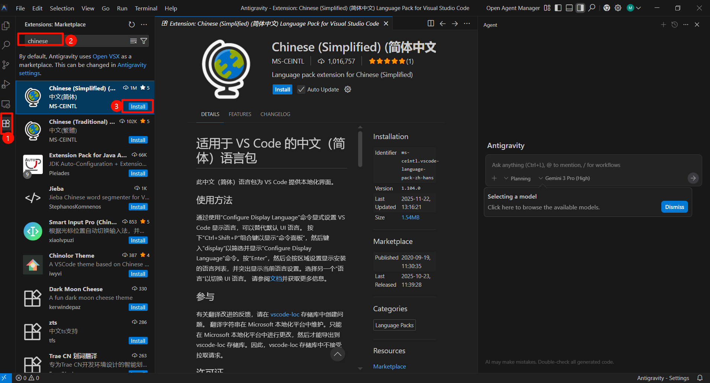
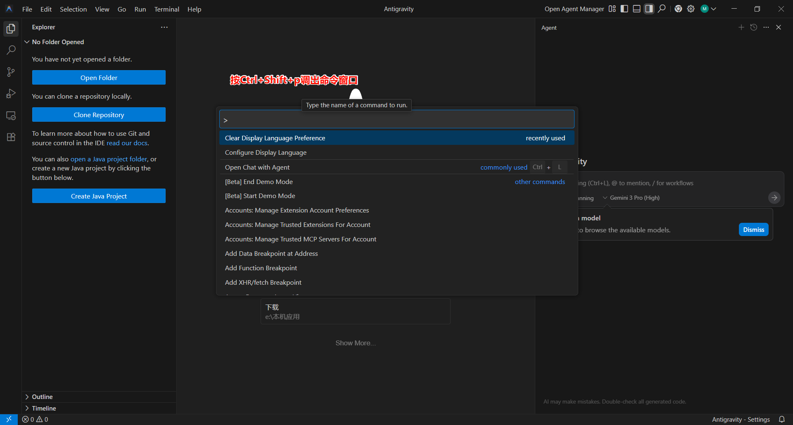
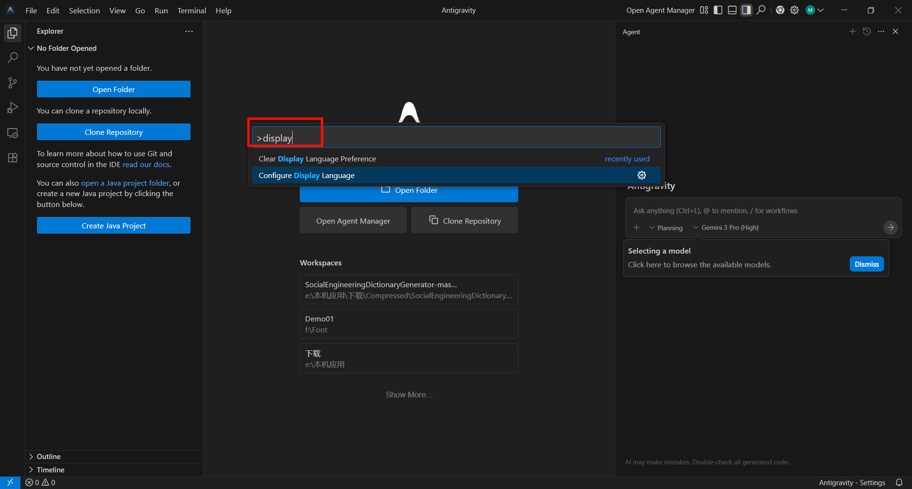
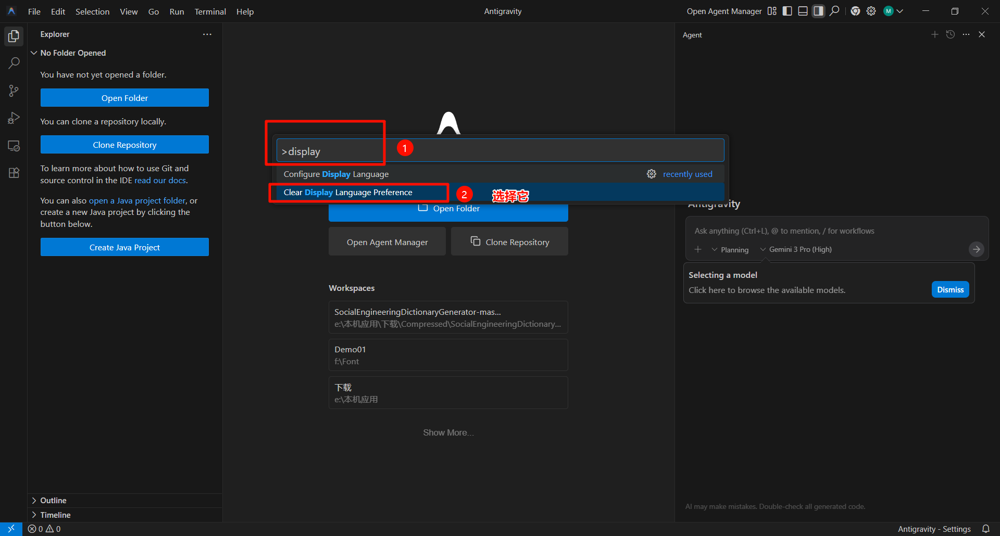
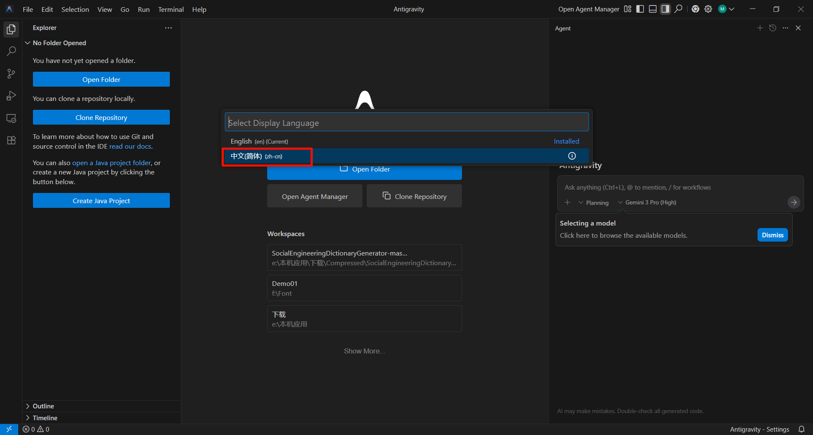
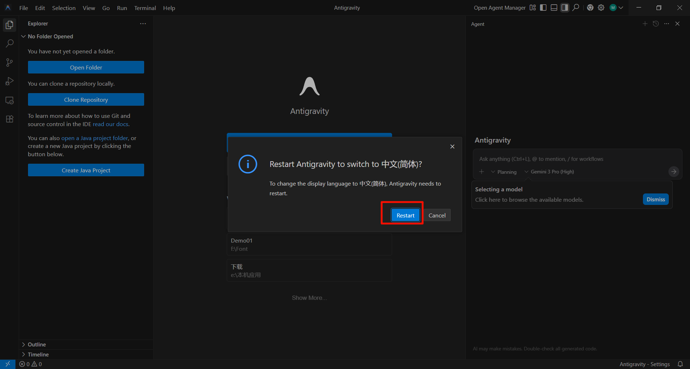

---

id: 1205909

title: "写给新手小白的Google Antigravity汉化教程"

created_at: 2025-11-22T05:37:42.645Z

username: cmczyrn

display_username: "404"

---

# 写给新手小白的Google Antigravity汉化教程

图文教程[最新Google Antigravity汉化教程](https://www.cmcz.ac.cn/1061.html)

## 打开Antigravity

### 界面左边点Extensions扩展（竖排第六个图案）搜寻Chinese安装，重启软件。

## 按下“Ctrl+Shift+P”组合键以显示“命令面板”

## 输入“display”

## 筛选并显示“Configure Display Language”命令

↑、↓键选择后敲回车键(Enter)

## 敲“回车键(Enter)”选择中文-等待重启

## 完成

---

*来源: https://linux.do/t/topic/1205909.json*

