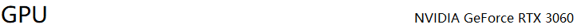
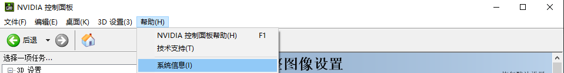

---

id: 1294122

title: "查看显卡是否是残血"

created_at: 2025-12-10T08:57:45.322Z

username: Lateryzh

display_username: "LH"

---

# 查看显卡是否是残血

核心在于校对CUDA核心数量

先打开任务管理器->性能->GPU->右上角看GPU型号

右键桌面->NVIDIA控制面板->帮助->系统信息

---

*来源: https://linux.do/t/topic/1294122.json*

