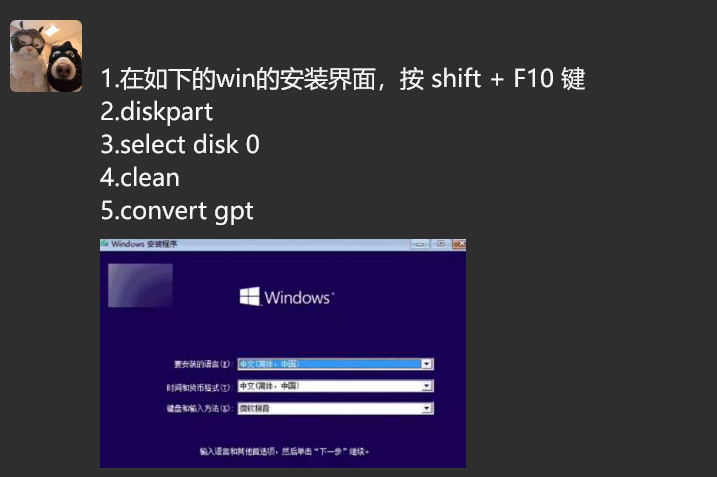
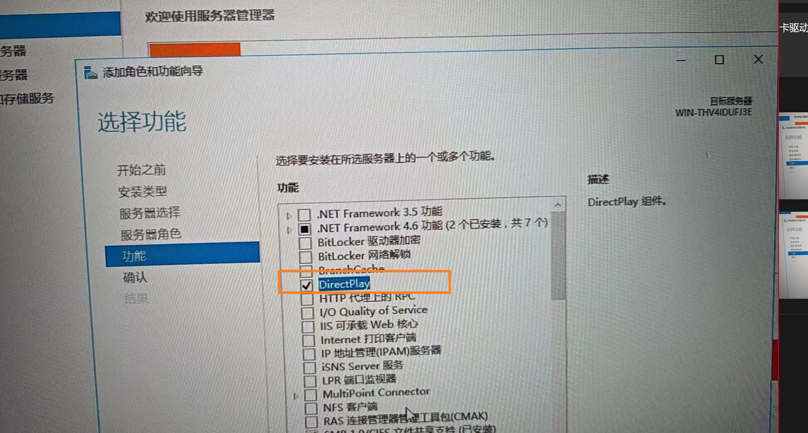
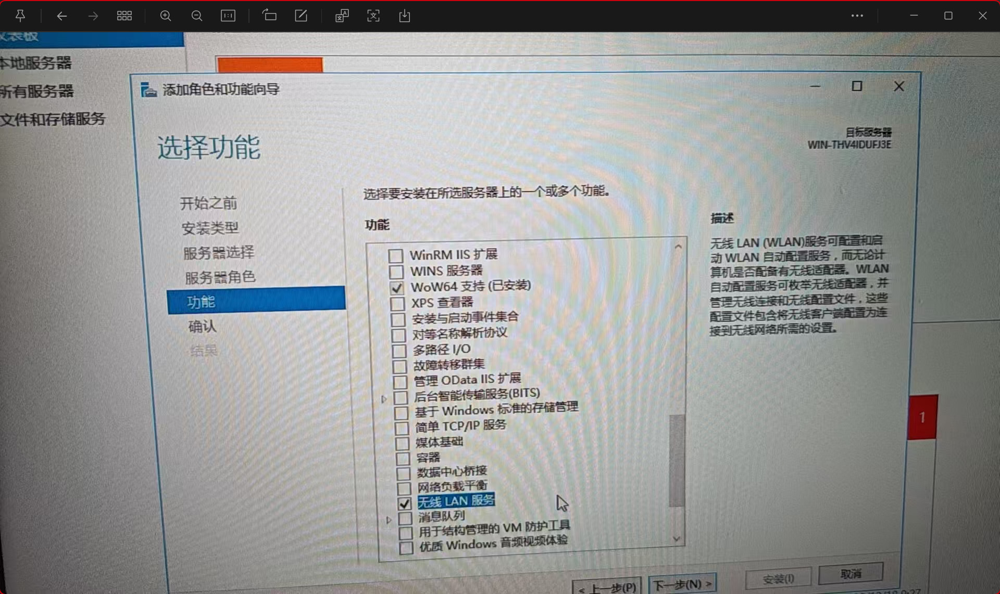
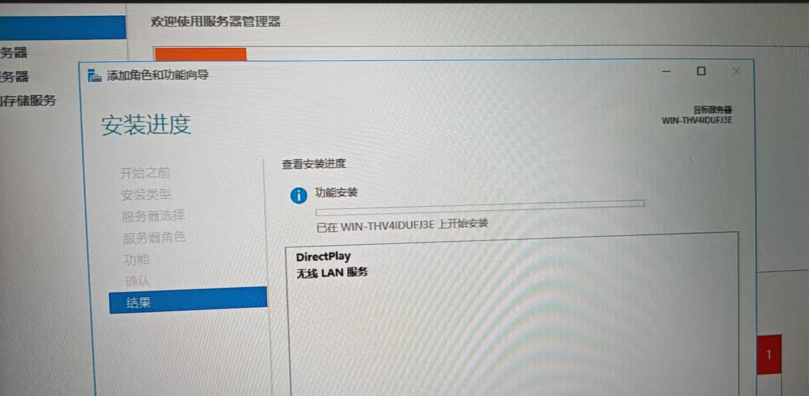
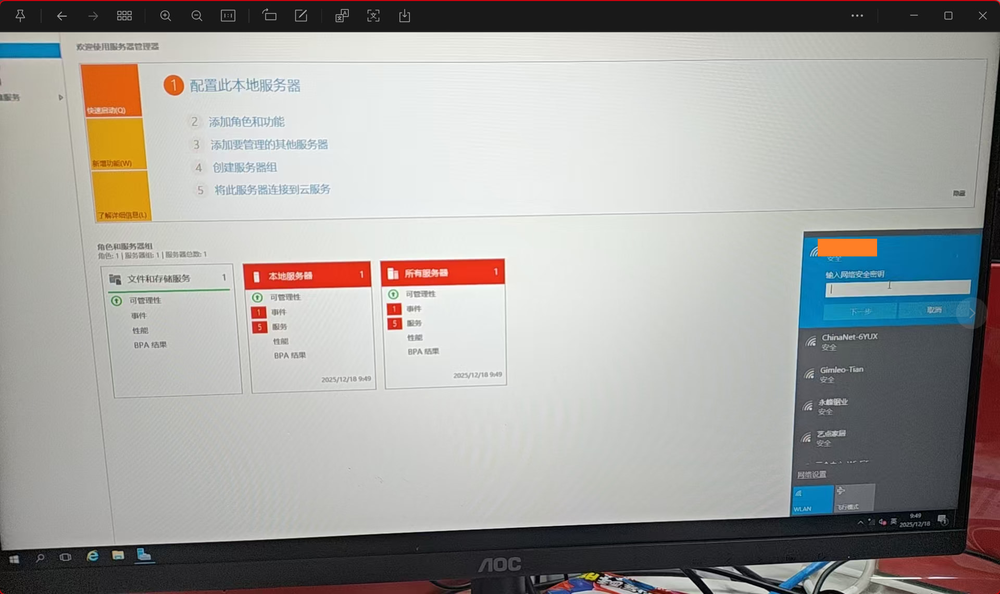
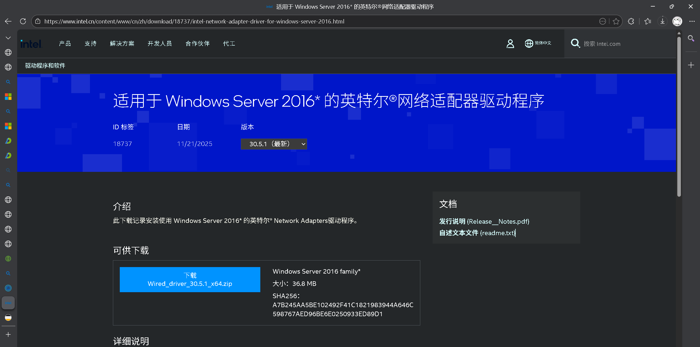

---

id: 1328850

title: "WindowsServer 系统安装"

created_at: 2025-12-18T01:26:25.056Z

username: longDo

display_username: "kelong"

---

# WindowsServer 系统安装

最近搞了很多4核4G小盒子，项目使用aps.net应用程序，这里我将分析windowsServer系统安装经验，联网经验，驱动经验

1.系统安装时

解决磁盘格式问题，将磁盘转换为gpt

！！！注意这会清空磁盘哦

2.初始化网卡驱动（一般优先插个usb免驱，这时候会发现还是没有网络可以按照按照以下Windows功能<DiretcPlay,>）

DiretcPlay

无限LAN服务

等待安装完成后重启

重启后插入usb，主机会自动安装驱动，如果没有自动安装，usb会以磁盘的形式出现，点击安装驱动即可

在网络链接中启动

Wifi链接重启后大功告成

2.网口驱动< [适用于 Windows Server 2016* 的英特尔®网络适配器驱动程序](https://www.intel.cn/content/www/cn/zh/download/18737/intel-network-adapter-driver-for-windows-server-2016.html)>

---

*来源: https://linux.do/t/topic/1328850.json*

