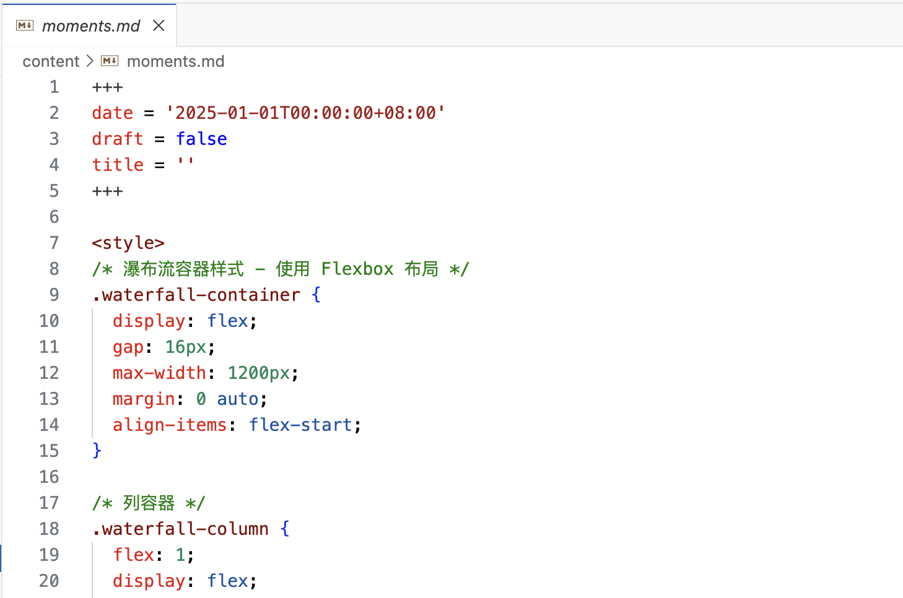
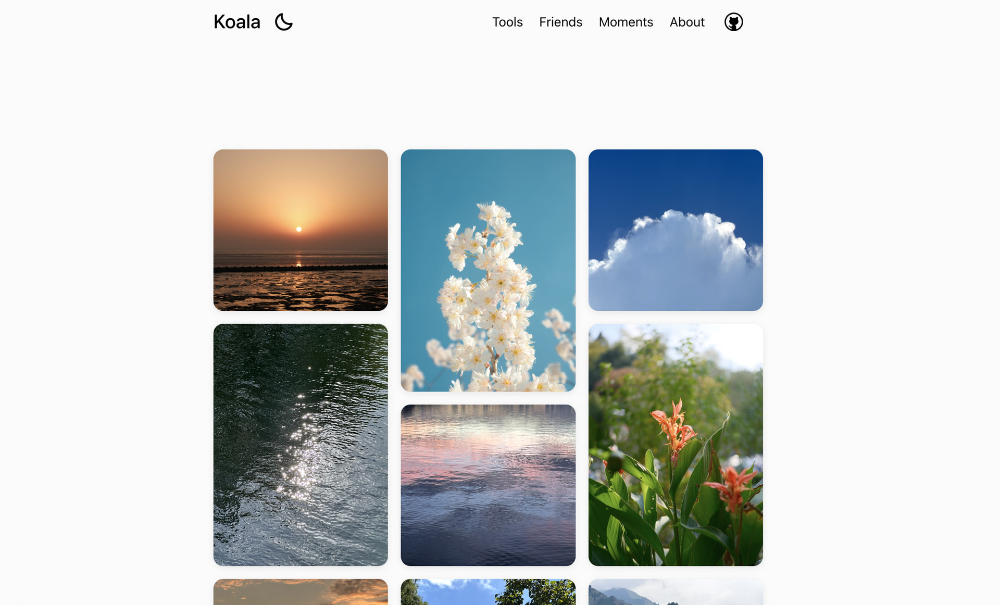
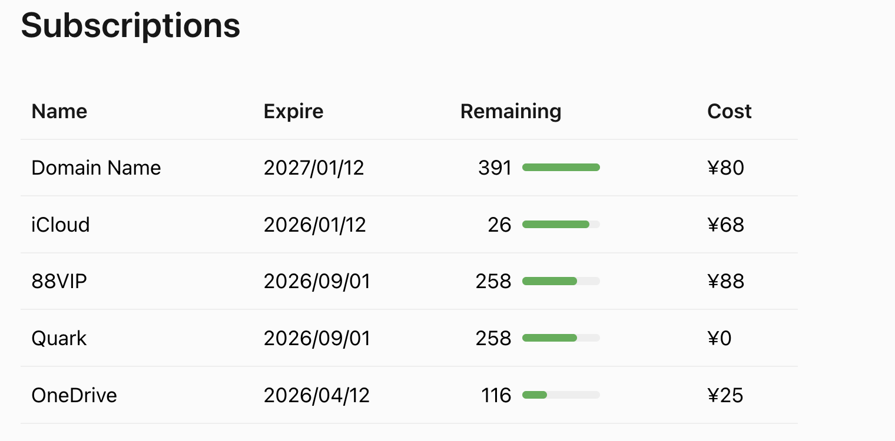

---

id: 1329863

title: "Claude Code 实现了我曾经想在 Markdown 里写 CSS 和 JavaScript 的梦想"

created_at: 2025-12-18T06:09:53.568Z

username: therainisme

display_username: "vivy"

---

# Claude Code 实现了我曾经想在 Markdown 里写 CSS 和 JavaScript 的梦想

这是一个 Markdown 文件，众所周知它可以在里面写 HTML、CSS、JavaScript。我本来用的是 Hugo 纯静态博客，用上 Claude Code 摇身一变，配合上 Vercel 的 Serverless ，实现了下面的效果。

没有使用 React 或者 Vue 这些比较庞大的的框架，老怕给我 Tailwind CSS 一把梭成蓝绿配色。感觉自己的审美应该还是在线的，只需稍加管控，漂亮的小屋就一点一点搭建起来了。

甚至还能实现一个动态看板，我真太爱 Claude Code 了！ 

---

*来源: https://linux.do/t/topic/1329863.json*

