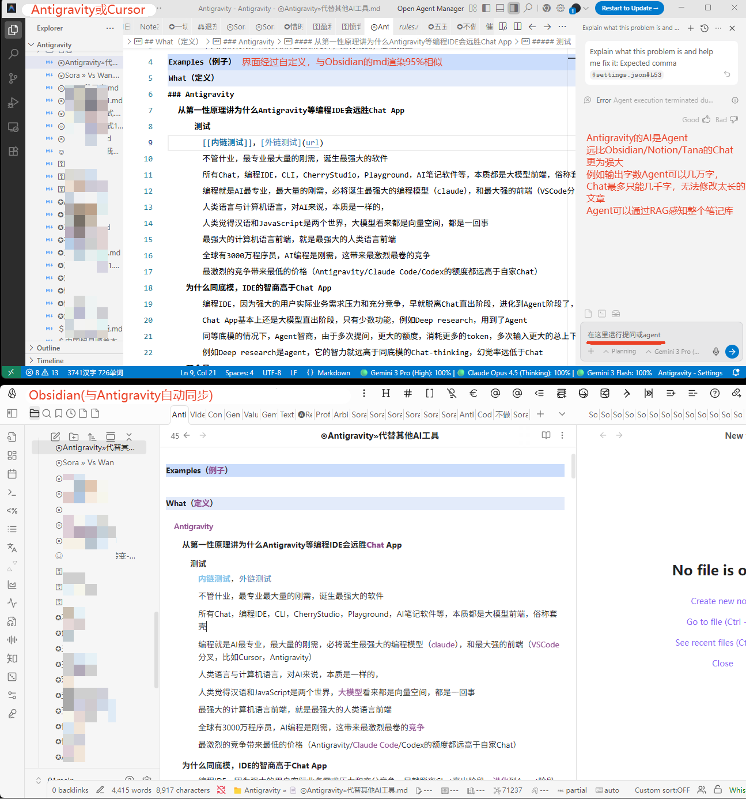

---

id: 1340192

title: ":fire:【大模型系列19】万能神器Antigravity用于聊天非编程，如何代替Gemini app，AIStudio，ChatGPT，Cladue，Obsidian等【长期更新】"

created_at: 2025-12-18T13:30:53.193Z

username: dwqxq1

display_username: "dwqxq1"

---

# :fire:【大模型系列19】万能神器Antigravity用于聊天非编程，如何代替Gemini app，AIStudio，ChatGPT，Cladue，Obsidian等【长期更新】

提纲有点大，一次写不完，先挖坑占位，慢慢填坑

本文就是Antigravity代替Obsidian做笔记软件写的

个人知识有限，AI界知识也日新月异，如有纰漏，感谢指正

这是我用Antigravity写本文的截图，与Obsidian笔记自动同步的对比，渲染效果95%一样

### Antigravity

#### 从第一性原理讲为什么Antigravity等编程IDE会远胜Chat App

不管什么行业，最专业最大量的刚需，诞生最强大的软件

所有Chat，编程IDE，CLI，CherryStudio，Playground，AI笔记软件等，本质都是大模型前端，俗称套壳

编程就是AI最专业，最大量的刚需，必将诞生最强大的编程模型（claude），和最大强的前端（VSCode分叉，比如Cursor，Antigravity）

人类语言与计算机语言，对AI来说，本质是一样的，

人类觉得汉语和JavaScript是两个世界，大模型看来都是向量空间，都是一回事

最强大的计算机语言前端，就是最强大的人类语言前端

全球有3000万程序员，AI编程是刚需，这带来最激烈最卷的竞争

最激烈的竞争带来最低的价格（Antigravity/Claude Code/Codex的额度都远高于自家Chat）

#### 为什么同底模，IDE的智商高于Chat App

编程IDE，因为强大的用户实际业务需求压力和充分竞争，早就脱离Chat直出阶段，进化到Agent阶段了，例如早期的Cursor Composer，现在的Antigravity Planning等

Chat App基本上还是大模型直出阶段，只有少数功能，例如Deep research，用到了Agent

同等底模的情况下，Agent智商，由于多次提问，更大的额度，消耗更多的token，多次输入更大的总上下文，多次输出形成更大的总输出，对于复杂问题，智力是远高于Chat直出的，

例如Deep research是agent，它的智力就远高于同底模的Chat-thinking，幻觉率远低于Chat

#### 开会员

Antigravity一般用免费的Gemini学生一年会员即可，L站里很多教程，本文不赘述，注册几分钟，成本10元在咸鱼买个1刀信用卡

实在不会或懒得弄，闲鱼里买Antigravity成品号几十元

#### 无法登录问题

具体看L站里很多教程，本文不再赘述，两种方法

Ⓐ现在用的是支持Tun的VPN软件 → 开Tun

Ⓑ现在用的是不支持Tun的VPN软件，不想更换 → 继续用现有VPN软件 + Proxifier

### Antigravity代替Gemini App/AIStudio/ChatGPT/Claude App

这里只对比Antigravity/Gemini/ChatGPT/Claude会员，不对比免费账户，

AIStudio暂时与Gemini会员无关，以后可能会关联额度

AIStudio本质就是Chat app，Google推出AIStudio和Gemini app，是内部赛马饱和攻击策略+细分市场策略+免费策略，就像QQ与微信的关系，人家有钞能力，可以同时养两个团队做同样的事情，被自己人干掉，总比被外人干掉好

#### 相似性

都能提问，语音录入

都可以上传图片识图

都支持TXT/MD/PDF/DOCX/XLSX/PPT/HTML/EPUB

#### Antigravity优胜的

##### 额度高

Antigravity每5小时320次gemini-3-pro + 400次gemini-3-flash + 250次opus4.5

Gemini App每天100次左右gemini-3-pro，Antigravity是Gemini App额度10倍以上

AIStudio每天50次左右gemini-3-pro，Antigravity是AIStudio额度20倍以上

Claude$20会员每5小时50条sonnet4.5，或10条opus4.5

Claude$100会员每5小时250条sonnet4.5，或50条opus4.5

Antigravity的opus额度比Claude$100会员还多

##### 连续提问能力

Antigravity可以没有任何时间间隔，连续提问，不必等上一次回答结束，会几个问题按顺序或合并回答

Gemini App/AIStudio/ChatGPT/Claude App必须等上一次回答结束或者终止才能问新的问题

用户经常有提问完了需要补充的情况，如果等AI思考+回答完了，可能刚才要说啥就忘了

打个比方，Chat App是对讲机，是单工的，同时只能一个人说话

Antigravity是手机，是双工的，可以同时两个人说话，AI回答AI的，你问你的，可以同时进行

从这个角度说，Antigravity虽然不是按Chat设计的，但却比Chat App更符合Chat的本质，这大大增加了思考和输入的流畅性，这也是为什么我说IDE对Chat App是降维打击

想下你在现实中说话时，是说一句想一句，还是十句想好了，一次说出来，然后等对方回答？

说一句话，然后对方思考一分钟，这期间禁止你再说话或补充，必须憋着，是不是一件很奇怪，很反人类的事情？

但是现在Chat App就是还在用这么反人类地方式工作着

Cursor也可以连续提问，而且比Antigravity多个可选强制截断的功能

为什么Cursor和Antigravity都有这种连续提问功能，因为程序员工资很高，Deadline也很紧张，大厂程序员一个月工资几万，你让他坐在那，干等AI回答完之前不能说话？程序员急老板更急，没有连续提问功能，老板会买单？

普通Chat App为什么没有连续提问功能，不一定是技术问题，而是用户是包月的，费用固定，你提问题提那么快，消耗那么多token，我怎么赚你钱呢？

##### 上下文多

Antigravity的上下文限制更少，3-pro上下文具体多少暂不清楚，claude佬友说能跑满200k，毕竟代码和Agent都是非常吃上下文的。

Gemini App宣称1m上下文，实测也就128k水平，超过就容易忘前面内容

AIStudio应该能用满1m上下文，左上角有上下文统计

Claude Code上下文能跑满200k

##### 最大输出多

Antigravity的Fast模式最大输出（不含思维链）6~8k，Planning模式因为把大问题自动拆分成多个小问题，总输出可达几十上百k

Gemini App最大输出一般3k左右

AIStudio最大输出一般6k左右

ChatGPT最大输出3k左右

Claude App/Claude Code最大输出未测试

##### Agent功能

Antigravity主打就是Agent功能，IDE就是靠Agent吃饭的，Agent是标配

Claude Code也是Agent

Gemini App/AIStudio/ChatGPT/Claude App没有Agent

##### Brower use

Antigravity有Brower use，用插件调用Chrome

Gemini App/AIStudio/Claude App没有Brower use

ChatGPT会员可以用Altus浏览器的Brower use

Perplexity的Comet是Brower use

##### 聊天记录

Antigravity的聊天历史保存在本地，也可以accept到md文件。

Gemini App/ChatGPT/Claude App聊天记录在云端，哪天封号或盗号就全没了

AIStudio聊天记录在Google Drive里，这笔比Chat保险点，但如果被盗号，也会全部丢失

##### 政策宽松不封号

Antigravity/AIStudio/Gemini App/ChatGPT不容易封号

OpenAI API/Claude Code很容易封号

##### 系统提示词

Antigravity的系统提示词可以设全局，workspace，workspace里的子文件夹等，非常灵活。

Gemini App/ChatGPT/Claude App只能设全局系统提示词

AIStudio只能每个聊天设系统提示词，没有全局系统提示词

##### 画图

Antigravity的画图gemini-3-pro-image(nano-banana-pro)1k分辨率，每5小时限20次，而且可以要求一次最多6张抽卡。

Gemini App是与chat共享每天100次。

AIStudio免费Tier不能画，需要付费Tier，最大支持4k，文字输入和思考价格同3-pro，输出2k每张$0.13，4k每张$0.24

Claude App没有画图功能

#### AIStudio优胜的

免费，无需会员

#### Gemini App优胜的

Gemini App有手机App版本，Antigravity和AIStudio没有

每天20次gemini-3-pro Deep research

可以朗读，语音对话

#### ChatGPT优胜的

可以朗读，语音对话

每月10次O3 Deep research

#### Claude App优胜的

国内梯子Claude App或Claude Code一般不会掉线，Antigravity的gemini-3-pro不容易掉线，Opus有时掉线，需要重试，原因未知

佬友反应国外没有这问题

#### Claude Code优胜的

对于能用惯CLI的人，Claude Code还是很强大的

### Antigravity代替Gemini或ChatGPT Deep research

#### 相似性

本质都是Agent

Antigravity有底模和Agent能力，但是不具备Deep research需要的系统提示词，所以暂时表现肯定不如Gemini或ChatGPT的Deep research

考虑去开源Deep research里看看源代码，系统提示词怎么写的，粘贴到Antigravity里效果咋样，待研究

#### Antigravity优胜的

Antigravity最大输出可以几十上百k，gemini-2.5-pro默认输出10k，提示词破限最大输出32k，Gemini-3-pro最大输出6k左右，暂无法破限。O3-Deep research最大输出是10k左右，暂无法破限

#### Gemini Deep research优胜的

Gemini-2.5-pro Deep research搜索来源多，O3 Deep research搜索结果少

#### ChatGPT Deep research优胜的

O3 Deep research不容易跑题，Gemini-2.5-pro Deep research容易跑题

溯源精确到句子

### Antigravity代替NotebookLM

#### 相似性

都可以全局RAG

#### Antigravity优胜的

Antigravity可以用gemini-3-pro，opus4.5等旗舰模型，NotebookLM只能用gemini-3-flash等低级模型

Antigravity的库上限可能高于NotebookLM（需核实），比如一年前的Cursor的Codebase索引，我实测支持几亿字的库了，

现在NotebookLM每个笔记本只支持50来源×50万词(200mb)=2500万词，不同笔记本之间信息不互通

Antigravity直接用Obsidian的库即可，无需导入，NotebookLM需要导入MD，与Obsidian无法同步

Antigravity是VSCode分叉，本身就是最强大的代码/文本编辑器，完全可以做Markdown笔记软件使用，NotebookLM编辑器不支持MD，

#### NotebookLM优胜的

播客，生成讲解视频，生成PPT等

NotebookLM有溯源（到原始文档），Antigravity怎样溯源待研究

### Antigravity代替Obsidian等笔记软件

#### 相似性

文档都是md格式，可以互相读取，完全兼容，无需转换，无需复制粘贴

#### Antigravity优胜的

#### Obsidian优胜的

### Antigravity代替Cursor

本文重点不是讨论编程

Cursor毕竟开发时间久，Antigravity刚面市，现在编程方面综合功能还不如Cursor，

但是几个月之后谁强就未必了，毕竟Google有钞能力，包月限额比Cursor高得多，

Cursor现在已经基本上已经转型API计费模式了，包月只能用Auto模型，你根本不知道用的啥模型

Google还挖来Windsurf创始团队，Windsurf技术和经验，也不比Cursor差，

#### Antigravity vs Cursor未来发展可以参考Claude Code vs Cursor

Claude Code在2025年3月推出后，仅用4个月就吸引了11.5万硬核开发者，月均新增3万人。

Cursor2023年上线，2025年初用了两年付费人数达到36万人，月均新增1.8万人，当然增长通常是加速的，这只是线性粗略计算*Ⓐ*

Claude Code抢走了大量Cursor用户，有多种可能的原因：

##### ⒶCLI命令行，比VSCode这种图形IDE更先进更好用？

只在少数特定的情境下如此，在大多数情况下，命令行的效率远不如图形IDE。

CLI严重限制了Claude code的用户群体。业余程序员，学生，从未接触过命令行的用户，用不惯这种"复古"的界面

##### Ⓑ虽然使用相同的模型，Claude Code确实比Cursor更智能

在很多方面，Claude Code确实表现好于Cursor

##### ⒸClaude code是Anthropic亲儿子，包月限量比Cursor这种二道贩子高很多倍，

例如$20 claude会员，不浪费额度的话，每个月可以用相当于API $150的额度，而Cursor $20会员只能用API $20的额度，超过就只能Auto模型

证明价格还是最核心的竞争力，Cursor这类VSCode分叉，早了两年面市，确实有先发优势，但VSCode是微软的，又不是Cursor开发的，Cursor并没有形成什么真正的护城河

### Antigravity代替AIStudio API Key

我们需要的不是API Key，而是填API Key的各种前端

因为Antigravity本身就是最强大的前端之一，可以代替很大一部分用API Key的场景，实际上大大减少了API的需求

例如用Antigravity代替CherryStudio，就不用API Key了

在Antigravity上市同一天，Google也把AIStudio Tier0层级的API额度砍为0。为什么是同一天，是巧合吗?还是也有把AIStudio API用户往Antigravity撵的意思

Antigravity本身没有API Key，但是可以Antigravity2API反代

---

*来源: https://linux.do/t/topic/1340192.json*

