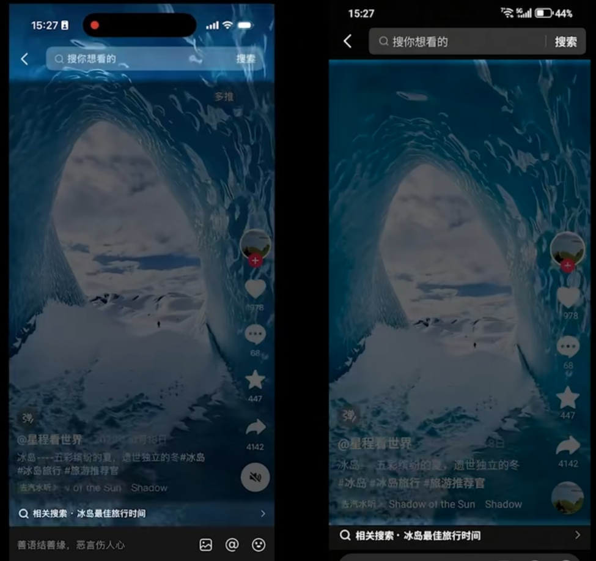

---

id: 1341327

title: "【长期更新】iOS和安卓的差异"

created_at: 2025-12-19T02:43:51.347Z

username: Papain233

display_username: "木瓜蛋白酶Tea🎋"

---

# 【长期更新】iOS和安卓的差异

图片有空的时候再加，欢迎文档共建

# 系统级的差异

## iOS的缺点

1. 复制录入剪贴板、语音转文字时，输入法必须在前台（iOS自带的全局tts除外），导致的语音输入也得跳转一下软件

2. 读小说时无法音量键翻页

3. iOS没有小窗

4. iOS没有应用双开

5. iOS没有全局侧滑返回，且左划返回不是所有应用都可以，逻辑非常乱，别说苹果的设计多么多么有原则之类的，至少用户学起来非常乱

6. iOS的回车键时不时失灵，非常喜欢把回车键变成发送按钮

7. iOS不支持侧载，但可能不算缺点吧，特性，sidestore有点折腾

8. 安卓有相对比较开放的 nfc 和红外遥控器，iOS NFC不能添加门禁卡或其他自定义 NFC

9. iPhone充电很慢

10. iOS文件管理权限低，能看到的文件有限

11. iOS苹果税，相同的价格买更少的东西，安卓只有游戏渠道服有抽成且不改变价格

12. iOS没有长截图

13. 安卓可以通过设置不同密码进入隐私系统

14. iOS除了系统更新外，不支持重启

15. iOS通话录音会通知对方，而安卓不会，甚至有的系统已经实现了应用内通话录音（例如微信通话录音）

16. 安卓有多应用音量，每个软件独立调节音量，iOS不行

17. 安卓推送可以单独关闭小类型，iOS只能全关全开

18. iOS浏览器都是WebKit内核（虽然政策上有所松动），安卓不限制内核

19. iOS 语音输入必须保持在前台，因此想要使用语音输入必须先跳转输入法页面。

20. iOS 相机 APP 无法设置闪光灯常亮，只能在拍照时开启闪光灯曝光。

## iOS的优点

1. 全局仅有一个广告，即app store的搜索置顶，广告可以关和没有广告是两回事

2. 无障碍功能做的非常好，盲人群体基本上用的都是iPhone

3. iOS的深色模式是我用过的所有系统里面适配度和一致性最高的

4. 不支持应用侧载，比较适合长辈用，不会乱装软件

5. 对于逆向来说，iOS无需越狱就可以安装根证书，安卓必须root

6. 墓碑机制，不用刻意杀进程

## 中立差异

1. 快捷截图中，安卓为`音量➖` and `电源键`，iOS为`音量➕` and `电源键`

2. 安卓可以用无障碍功能，使用李跳跳、gkd等功能实现跳过开屏广告等功能，iOS可以通过使用代理插件等直接屏蔽广告

3. iOS 没有九宫格图案密码

# 具体到应用

## 微信

> [!bug]

>

> iOS微信总是比安卓先内测新功能

1. iOS版微信，合并转发的聊天记录可以查看表情，而安卓只能显示`动画表情`

2. 安卓微信长按`图片`按钮可以进入系统原相机，可调用系统原相机（支持变焦、水印、定时），但iOS微信内的拍照调用的就是系统原相机，但不支持添加水印、换滤镜之类的

3. 苹果微信搜索栏位于首页最上方，安卓藏在右上角

4. 安卓微信首页右上角的搜索和加号，在通讯录和发现中同样存在

5. iOS的首页聊天中左划会出现删除、隐藏、标为未读（但是没有置顶！），在安卓中为长按呼出菜单

6. 安卓支持在主页左右滑动来切换“聊天”、“通讯录”和“发现”；iOS不支持，因为与上一条冲突

7. 安卓的首页聊天缩略可以显示微信小表情，iOS只能显示［旺柴］等类似的占位符

8. iOS切换到香港地区，微信可以用面容id登陆

9. iOS的微信小程序无法独立在后台，必须在微信前台，不能后台同时显示微信和小程序窗口（由于iOS严格的后台限制，安卓这么做存在的缺点是开几个小程序后台运存就满了，绿色软件恐怖如斯）。同时应用内，安卓支持把小程序添加到桌面成为独立APP，且支持小窗模式挂起；iOS只能缩小到侧边栏或变成多任务卡片。

10. 安卓在“通讯录”和“发现”页面依然保留右上角的+号和搜索，可秒开付款码、扫一扫之类的；iOS切换页面后无法直接操作。

11. 安卓点击通知直接“空降”到对应聊天界面；iOS点击通知只是打开微信，依然停留在上次退出的页面（如钱包、群聊）。

12. 安卓版微信与某些手机厂商深度定制，点“相册”发送图片时，有些厂商的手机右上角会出现搜索按钮，可以进行图片语义搜索，但未定制的厂商是没有的，例如：小米、Flyme、类原生

13. 安卓微信支持 NFC 和横屏（需要在设置中设置），不过没啥用

14. 小程序上的iOS的优点，iOS 右滑即可折叠收藏整篇公众号文章，安卓得避开系统返回手势，很难成功

## bilibili

1. 安卓播放多条视频后，系统全局侧滑、或左上角的箭头可回到上一条视频，iOS同样操作直接回首页

2. 安卓点左上角小房子即可稳定回主页，iOS…完败

3. 安卓全屏时能预览下一条视频，类似youtube，iOS 必须退出全屏才能重新选择，但我不怎么用

## 微博

挺搞笑的，显示具体手机型号在 iOS 需要会员，在安卓免费但隐藏要开会员，双向奔赴了是

## 小红书

1. 折叠屏安卓连点击图片预览和左右滑动都不稳定，iOS 虽功能少但行为一致，且安卓前几个版本的小红书甚至不支持点击图片查看图片，只支持双指缩放

2. iOS 只能靠“仅自己可见”区分内容，安卓却能用私密笔记系统化管理，会有一个单独的“私密”栏，非常好用

3. 安卓聊天预览图自带快捷编辑转发按钮

## 抖音

1. iOS 顶部搜索、状态栏和音乐沉浸进画面，安卓部分机型直接两条黑边

2. iOS 会被灵动岛遮挡并裁切画面，安卓画面完整但观感参差

3. iOS 在主页长按即可转发视频，安卓必须点进视频才能操作

4. 安卓即便开启系统深色模式，抖音也不一定配合，iOS 跟随更稳定

---

*来源: https://linux.do/t/topic/1341327.json*

