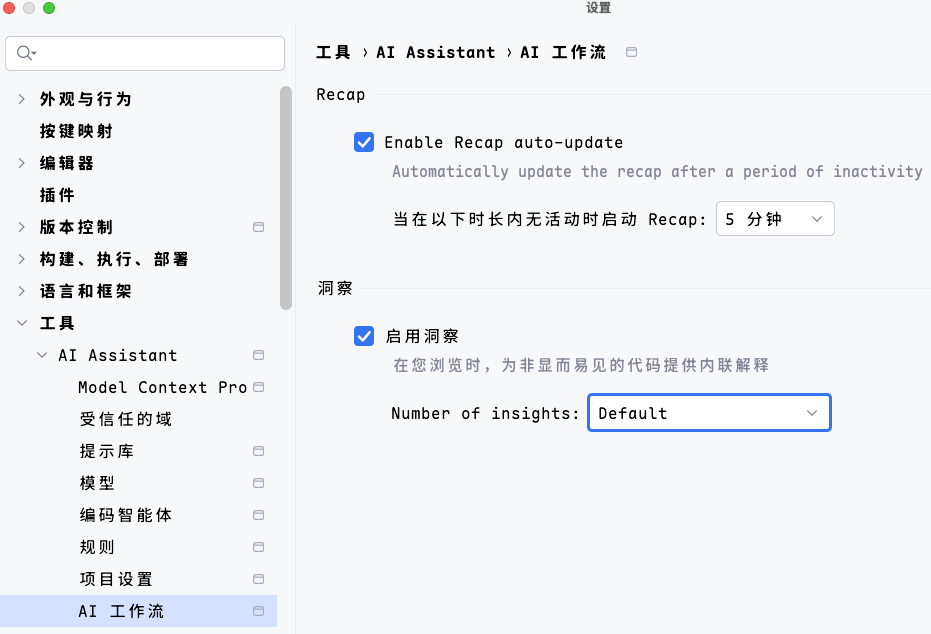
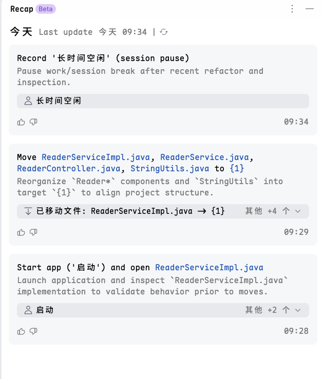
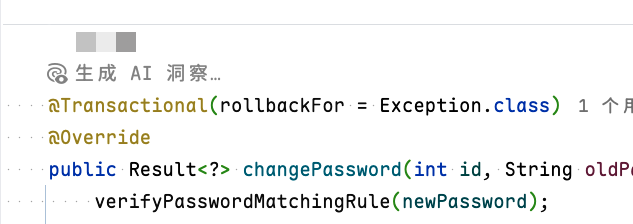
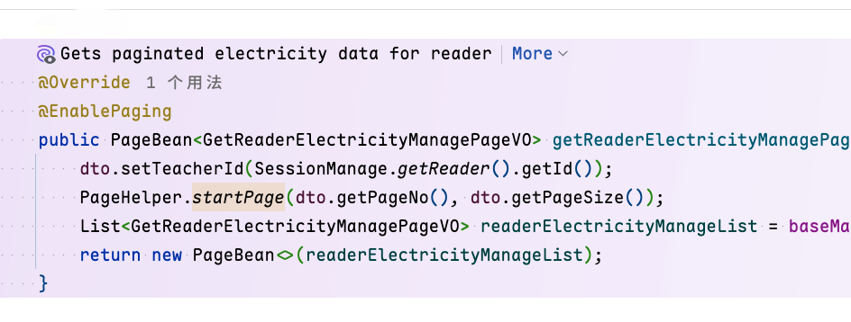
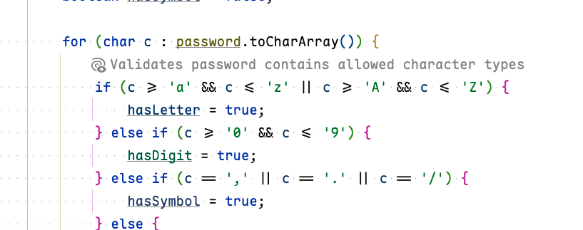
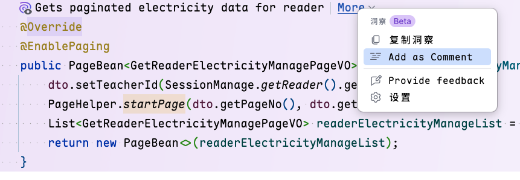
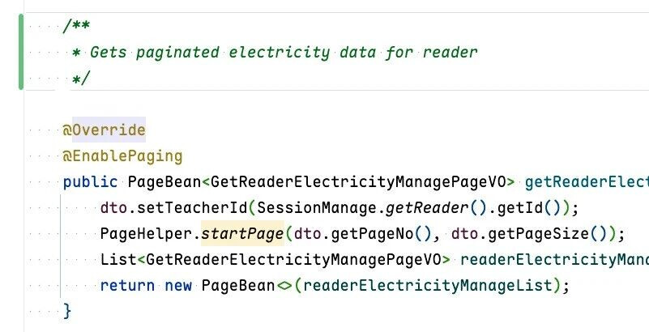
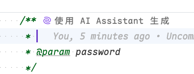

---

id: 1342119

title: "IDEA 2025.3.1 已更新, 「AI 工作流」又是什么好玩的东西？"

created_at: 2025-12-19T06:45:02.320Z

username: ForteScarlet

display_username: "Forte Scarlet"

---

# IDEA 2025.3.1 已更新, 「AI 工作流」又是什么好玩的东西？

中午好！就在今天，JetBrains 的 IntelliJ IDEA (以及部分其他 IDE 产品) 发布了 2025.3.1 版本的更新：

佬友们有没有及时更新哇？不知道有没有注意到，更新后 AI assistant 插件提供了一个看上去还蛮有意思的新功能：AI 工作流。

从配置页面来看，AI 工作流有两个主要的功能：「Recap」和「洞察」功能。

我对这两个功能都做了简单的体验，一起来看看！

## Recap

小学英文水平的我说实话一上来并不认识这个词儿，所以根据它的功能来看，我称它为「摸鱼日志」。

好吧，不管怎么称呼它，我们还是来专注于它的功能。初次见面它是在右上侧的工具栏中：

它弹出了一个气泡，提醒我「您离开了一段时间」，并提醒我查看「休息前的工作回顾」。

欸！咱可不能空口污人清白啊，我只是去蹲了个坑、顺便玩了会儿手机然后去沙发上坐了一会儿养精蓄锐了一下，

工作时间「休息」这种事情可不能乱说啊！

让我们忽略它的不实指控，还是来体验一下它都回顾了一些什么。点开它：

可以从这里看到你今天的摸…工作行为记录。在一天的工作结束之后，除了可以用来回顾一下今天的自己有多辛苦之外，

感觉还可以用来编日报。

Recap 名如其实。

> 当然，不太建议让你的老板或领导也知道这个功能的存在。

## 洞察

接下来是另外一个有意思的功能：AI 洞察。它洞察了些什么呢？在上面的那个配置页面其实就可以看到：

> 在您浏览时，为非显而易见的代码提供内联解释

看描述，是一个用来为你翻译队友们没有注释shi…优质代码的。让我们来找一段代码看看。

这个功能是完全自动的，不需要你去主动点击什么，当它认为某段函数/代码需要被洞察并解释时，

就会出现上图中的效果（分别为洞察中和洞察结果）。

并且它也不仅仅局限于整段函数，也包括了某段代码片段，比如下面这个：

当它洞察完成，你就可以复制洞察结果，或者直接将它添加为代码中的注释：

可能是因为尚处于 Beta 阶段，它暂时还不能更改输出结果的语言。

你可能会觉得它跟另外一个功能「编写文档」比较类似：

不过还是有些区别的，主动与自动的区别、文档注释与行内注释的区别等。

## 尾声

没有去找更新日志（骗你的，其实去找了，但是没找到），

这两个功能都是更新之后在使用过程中发现的，因此可能不会非常全面和完善。如果有什么遗漏的地方还请温柔指出，感谢阅读～

## 补充1

提交 git 时发现的，还有个藏着的新功能（

---

*来源: https://linux.do/t/topic/1342119.json*

