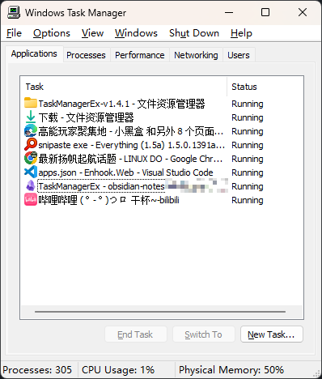
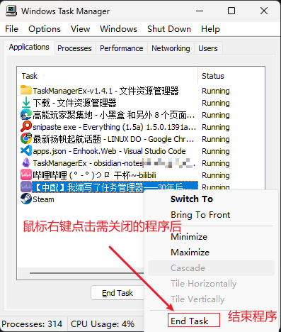
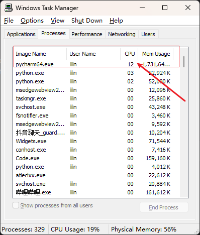

---

id: 1344771

title: "【软件教程】Win11 任务管理器替代品 TaskManagerEx"

created_at: 2025-12-20T07:00:28.508Z

username: Enhook

display_username: "萤火"

---

# 【软件教程】Win11 任务管理器替代品 TaskManagerEx

Windows任务管理器替代品，不再卡顿

## 简介

> 软件官网：[Release v1.4.1 · aubymori/TaskManagerEx · GitHub](https://github.com/aubymori/TaskManagerEx/releases/tag/1.4.1)

Windows 11 的任务管理器太卡了！在使用Win11的过程中，如果电脑卡顿了，像往常一样打开任务管理器，中止高内存占用的软件。**任务管理器会变得更卡**！

有没有什么解决方法呢？在观察了一个Windows任务管理器开发者录制的[视频](https://www.youtube.com/watch?v=yQykvrAR_po)后，有了答案！

**用回 xp 时代的任务管理器**！在Github上找到了可用的软件，运行非常流畅。

## 操作教程

### 快速关闭某一个程序

### 查看占用CPU利用率高的程序

> 帖子发在 [文档共建](/c/wiki/42)，大家使用过程中有什么好方法要分享，也有权限编辑帖子哦

---

*来源: https://linux.do/t/topic/1344771.json*

