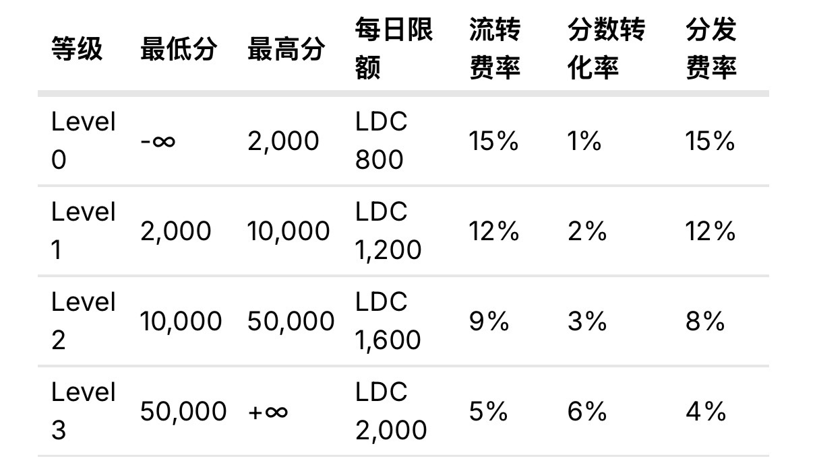
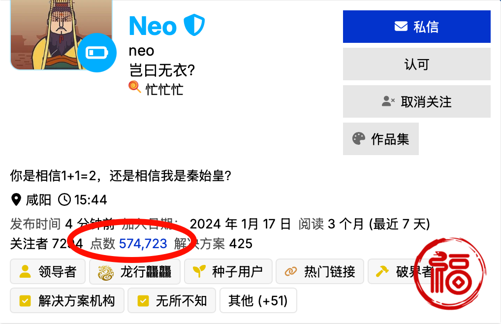
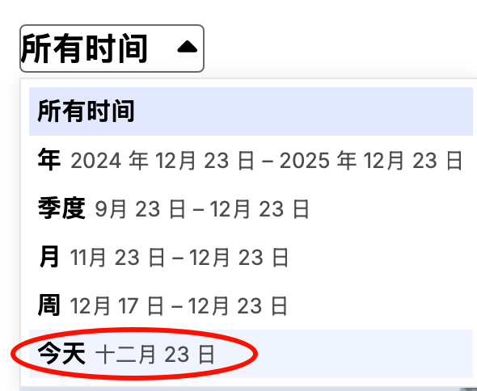

---

id: 1353235

title: "【4.17 更新: 恢复运营】Linux Do Credit FAQ及积分获取规则"

created_at: 2025-12-23T07:40:21.560Z

username: Papain233

display_username: "木瓜蛋白酶Tea🎋"

---

# 【4.17 更新: 恢复运营】Linux Do Credit FAQ及积分获取规则

# 最新更新

2026.4.17 LDC 恢复运营，新增规定：

- 场景仅许可以下四类：商户流转、在线流转、商户分发、限时红包（节假日或社区活动）

- 新增积分流转延迟结算，积分延期到账，7~14日不等

- 更严格限制单日流出上限

- 更高交易折损（手续费），不同信任级别比率不同

- 停止运营期间积分结算：结算上限不超过1000，结算下线不低于0

详见下面两帖：

[「LINUX DO Credit」服务规则调整公告 [已上线]](https://linux.do/t/topic/1986429)

[解释、总结一下新的 LINUX DO Credit 规则](https://linux.do/t/topic/1986820)

2026.3.17 更新

LDC 系统临时下线

[LDC服务临时下线](https://linux.do/t/1770169) [

运营反馈](/c/feedback/2)

> 具体原因可能不少佬友也知道，几十万积分无限兑换100E卡这太吓人了，LDC已经走偏了。

> 从这个服务上线的第一天，就一直在强调，它只是社区活跃的积分，不是数字货币，更不是真实货币。但慢慢的还是在供需关系中走偏了，这是大家可以看到的事实。

> 我们已临时下线了该服务（数据都还在），并希望和大家一起完善LDC的规则，等规则完善之后再择机开启。[@Chenyme](/u/chenyme)

2026.1.5更新

- 调整计分规则，给他人点赞/回应、邀请用户、阅读时长、阅读量从此不再计分

- 每日登陆由1分增长到10分，可能导致某些点赞少但登录多的佬credit分数暴涨

- 新增注意事项：

2025.12.28更新：

- 新增第三条，「LINUX DO Credit」实时积分收入脚本相关内容

2025.12.25更新：

- 更新关于faq第八条，credit下降的相关说明

- 新增faq 9：如何创建你的credit收款地址

从[「LINUX DO Credit」社区积分流转服务平台删档测试](https://linux.do/t/topic/1352387)、[「LINUX DO Credit」正式发布！](https://linux.do/t/topic/1353336)继续讨论，

**Linux Do Credit与Leaderboard里面的获得点数是一比一换算的，这里给出用户点数的获取规则：**

> 得分项目 所得积分 当用户**收到**点赞时所获得的点数 1 当用户**收到**回应时所获得的点数 1 当用户的帖子被标记为解决方案时获得的点数 10 当用户举报帖子并且被管理人员**接受**时所获得的点数 10 用户每天访问站点所获得的点数 10 其余 0

| 行为 | 获得分数 | 细则 |

| --- | --- | --- |

| 点赞 | 0 | **不再加分** |

| 获赞 | +1 | 每次被其他用户点赞获得1分 |

| 阅读时长 | 0 | **不再加分** |

| 阅读量 | 0 | **不再加分** |

| 每日登录 | +10 | 每天登录论坛获得10分 |

| 回复 | 0 | **不再加分** |

| 创建话题 | 0 | **不再加分** |

| 邀请 | 0 | **不再加分** |

| 贴子被标记为解决方案 | +10 | 解决了楼主提出的问题，获得10分 |

| 举报成功 | +10 | 举报帖子并且该举报被管理员接受时，获得10分 |

> [!quote]

>

> 注意：所有发在  的帖子（主帖回帖）获得点赞均不积分

也就是说，从你注册credit站开始算，注册次日0点你将获得的credit分数将和你注册当日获得的点数挂钩，此后每天0点会把leaderloard当日积分结转到credit站，而注册日之前获得的点数则不算在内，所以尽快注册吧～

# 在这里查看你的点数：

# 在这里查看排名：

[https://linux.do/leaderboard/1](https://linux.do/leaderboard/1)

**把时间改为今天，即可查看您今日获得的积分（大约为这个数值，由于leaderboard的数据并非24小时清零制，所以可能会有误差，但是即使今日没更新到部分积分，也会算到明日里的，肯定少不了），这些积分将在次日0点时结转入credit站**

# credit站传送门：

### [LINUX DO Credit](https://credit.linux.do/)

Linux Do 社区积分服务平台

# 常见问题解答FAQ

## 1. LDC（Linux Do Credit）是什么？L站不是抵制发币吗？它是用来买卖东西的吗？它是社区的货币吗？

它只是一个积分系统，可以理解为一种情绪价值激励系统。公益站长或其他服务可以选择接入，当然也有不接入的权利，谁愿意支持它换东西，自己去玩，就是玩，比如原来你搞个公益站，免费放额度给大家玩。但现在你就想试试加上个不同的门槛，用积分去换额度，那你就可以接。总体就是玩。社区没有货币（neo原话）

LDC不是货币、不与法定货币、真实货币、虚拟货币挂钩，不可以兑换，不支持用真实货币买卖，社区积分就是社区积分。

> 这只是社区积分，是为了公益站点、社区活动等服务有更好的机制去运转，同时也能为站长带来点小小的成就感而产生的，社区积分就是社区积分，而非法定货币、真实货币、虚拟货币，他只是一个积分。

> 我多次表态多，L站不可能发币。如果喜欢玩空气币，可以考虑隔壁。

## 2. LDC发布之后，不会导致大量水帖增加吗？

可能会导致一些佬友变活跃，水帖增加也是可能的，但我们需要知道社区是禁止发布无意义内容的，例如“积分+3”等等，如果有佬友看到类似无意义的水积分话题欢迎举报，举报成功就是积分+10

> [!quote]neo关于LDC发布可能导致水帖增加的看法

>

> 我觉得大家都是被微信每次更新，自媒体炒作的文案洗脑了。微信每次上个什么功能，都是核弹级、改变生态之类的，其实影响根本没那么大。积分的存在起码比拿了东西就走，时不时还得蛐蛐论坛一顿要更积极一些。拥抱变化吧，起码真的有人在花时间花心思共建元宇宙。尝试拥抱变化，有问题解决问题。有些人只管在论坛能不能薅到羊毛，能不能学到东西，他们才不在乎论坛死活呢，死了换下一家就完事了。大家也不是头一天上网，纯技术社区活下来的有几个，我们可以掰手指头数一数。

> 有些人害怕水帖多，导致自己在社区学不到东西，我可以理解。但从一开始我定位的社区就不是个纯技术论坛，请看：[向左还是向右的路线问题](https://linux.do/t/topic/188585)

> 有些现实我们必须要看到：一个社区越没人发帖，其他人发帖的欲望和习惯就越低。简单来说，社区保持生气，才能有发帖的欲望，结果才能会有技术帖进来。不然啥都没有。

> 大家应该都是知道鲶鱼效应的吧？没有鲶鱼搅动，沙丁鱼活不了。我们需要给那些在给社区添砖加瓦、提供公益服务、积极分享自己学习内容的佬友们一些正反馈，一个解决方案10分哦。另外，有个事你们还不知道吧，水帖+2分，举报通过+10分哦。

> 推出积分的玩法就是用来提高大家的社区活跃度，给公益站长们一点小小的成就感，只要你不是为了水而水，我相信不会出现大量水贴的，友好的回帖还是大量存在的，总不能认为回了简单的帖子就是水贴吧？而且社区里不可能全部都是精华神贴，L站之所以氛围好就是因为这里可以自由分享，大家相互之间都很友善，所以像往常一样正常逛L站就好啦！

> 虽然现在的积分更新机制，肯定不可避免的会让水贴出现更多，但是你要知道，水贴是可以举报的，举报通过就有10分，这纯纯暴利啊！水贴次数过多、吃举报过多，社区帐号你还想不想要了？所以我觉得大可不必担忧，回帖时发表自己的想法，发言单调点也无妨。况且现在注册这么严格，发帖时掂量掂量，为了获取那点积分冒着风险吃举报，才是捡了芝麻丢了西瓜吧～

## 3. 每日凌晨 **00:00** 自动划转至可用余额，可以调整为实时更新吗？

暂时不会实时更新，实时刷新对服务器要求较高、实时刷新可能导致需要积分时就水帖的不良风气

> 暂时不会～

>

> 为了服务的稳定性，这种大规模刷新比较吃服务器性能

> 如果是实时更新的话，缺积分的时候就会随时开始水贴了呢

如果想看实时新增，可以尝试用这个脚本：「LINUX DO Credit」实时积分收入脚本

> **实时 Credit 积分收入脚本**，想要查看实时收入/担心积分变化的佬可以安装一下。

> **点击下方链接即可安装（需先安装油猴插件）：**

> [https://greasyfork.org/zh-CN/scripts/560312-linux-do-credit-积分](https://greasyfork.org/zh-CN/scripts/560312-linux-do-credit-%E7%A7%AF%E5%88%86)

> 窗口默认显示在右下角，可拖动，每60s刷新，可手动点击触发刷新，不影响原始界面。

## 4. 我现在怎么才50积分，我之前攒的社区分数还算吗？

不算了，12月24日0点会结转12月23日（开服当日）新增点数，12月23日以前获得的分数则不会结转，以保证credit系统的公平和生态稳定。新用户注册当日会获得50分，次日0点将结转注册当日获得的积分，注册日之前获得的点数不会结转到credit系统

> 今天12点会把之前的点数都同步过去，还是说只同步今日新增的？

> 只同步今日的，所以越早注册，越早开始"囤"。

>

> 之前的不会同步，要不然积分生态直接崩溃～

## 5. 我可以买卖我的credit吗？

这是绝对禁止的，credit站有严格的审查系统，如发现买卖积分等违规行为将同时封禁双方的credit账户

> [!warning]

>

> 禁止在站外平台交易 Credit，后台审计系统发现此类行为，双方账户直接封禁。

## 6. 为什么已经0点了我的积分还没结算？

由于人数较多，服务器结算存在延迟，耐心等待一下~

> 积分更新是从 0 点开始启动任务队列，所以可能彼此之间会有延迟～

开服第一天结算可能存在bug，正在排查请耐心等待

> 正在排查，应该是从L站更新时速率429了，我们正在处理。不过不用担心积分丢了，更新是基于历史数据进行的，所以积分肯定不会少，不过可能得多等一段时间啦 ～

## 7. 能把赚的 credit 充到 leadboard 吗？

不能的。代码逻辑是每天统计leaderboard点数差异来增加点数。两者不是同步的关系，而且同时LDC可以为零，而leaderboard则是永远增长的

## 8. 为什么我的积分被倒扣了？为什么我的积分是负数？

[Credit分数下降的几种可能](https://linux.do/t/1359744) [

文档共建](/c/wiki/42)

> 两种比较确定的情况：

>

> 你自己发的主帖被移除了，获得的积分扣除，删帖有三种情况

>

>

> 静默删帖，不太严重的，不计入connect

> 同意删除，会收到通知，不计入connect

> 删帖，会收到通知，计入connect

>

>

> 别人发的帖子被移除了，你在该帖中获得的积分也会被扣除（点赞之类的），你不会收到删帖通知

>

> 还有一种是我的猜测，目前credit站已经在维护了：

>

> 由于昨天 leaderboard 机…

> 积分更新确实可能会出现负数，这不是 BUG，而是你的 Leaderboard 分数变少了，仔细看看是否被举报扣分啦！

## 9. 如何创建我的credit收款链接

[【Linux Do Credit】教你创建自己的收款积分页面](https://linux.do/t/1356124) [

文档共建](/c/wiki/42)

> 我也是小白，早上研究了一下，可以创建自己的收款页面，这样别人也可以给你打赏了

>

>  ![[image]](https://cdn3.ldstatic.com/original/4X/1/1/2/112e34431a761b9dfd797f35a609aab3c476141f.png)

> 填写这些内容，我就直接填写的默认，https: //credit.linux.do 和 https://credit.linux.do/notify

> ![[image]](https://cdn3.ldstatic.com/original/4X/1/a/6/1a61371cdb5ef9ae1271706e438a9b31e1dad9b5.png)

> 创建好后选在线流转

> ![[image]](https://cdn3.ldstatic.com/original/4X/0/3/c/03cd1fef6386a75d3debe03c92014c3b65e60396.png)

> 选择创建服务

> ![[image]](https://cdn3.ldstatic.com/original/4X/7/a/2/7a2e255f65e4b08c23b420c4c6c2c8d862c27aa3.jpeg)

> 里面写好名…

## 10.Linux Do Credit 积分说明

> 积分说明

> 您的 LINUX DO Credit 平台基础积分主要由 **社区积分 (Community Balance)** 划转而来。

>

> **基本获取方式**：通过在 LINUX DO 社区的活跃行为获得：

>

> 发帖、回复、点赞等社区贡献

> 详情可见 [LINUX DO Leaderboard](https://linux.do/leaderboard)

>

>

> **划转规则：**

>

> 划转时间：社区积分每日凌晨 **00:00** 自动划转至可用余额

> 限制说明：划转前不可用于任何积分服务

> 服务费用：目前不收取任何划转 **服务费**

---

一些其他注意事项，具体欢迎阅读：[linux do credit の初体验](https://linux.do/t/topic/1352883)

欢迎给我赞助10LDC：[LINUX DO Credit](https://credit.linux.do/paying/online?token=d26b994c8386b7644bcb6189e372b02f46c16e895b02e2154bb7309677de032e)

- 如果刚进去只有50，先不要着急，可能是刚开服还没有划转过去，静待晚上12点自动划转～50是新注册credit站的奖励

- 感觉一个比较可能的实施方案是：今晚12点开始会结算当日新增的，不然大水哥这种原住民太破坏平衡性了，[@handsome](/u/handsome)

- 静待16点正式开服~

---

*来源: https://linux.do/t/topic/1353235.json*

