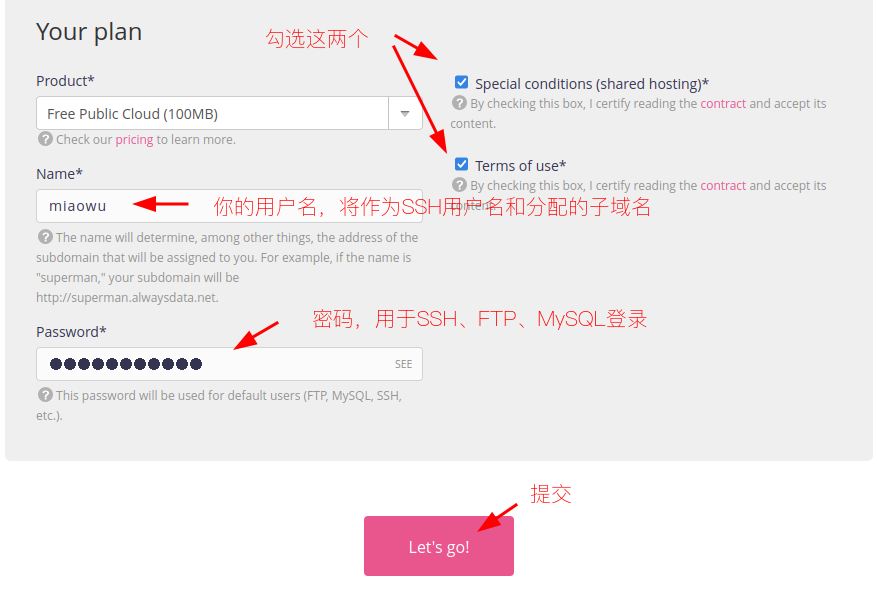
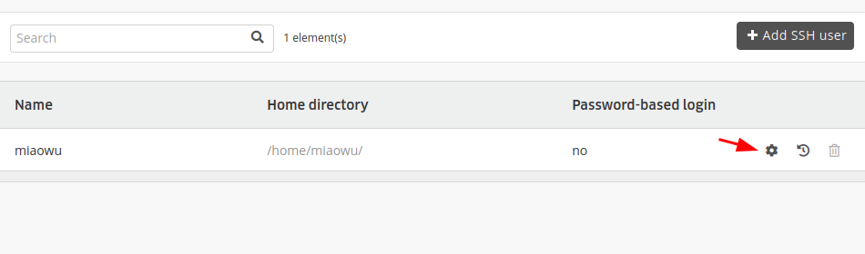
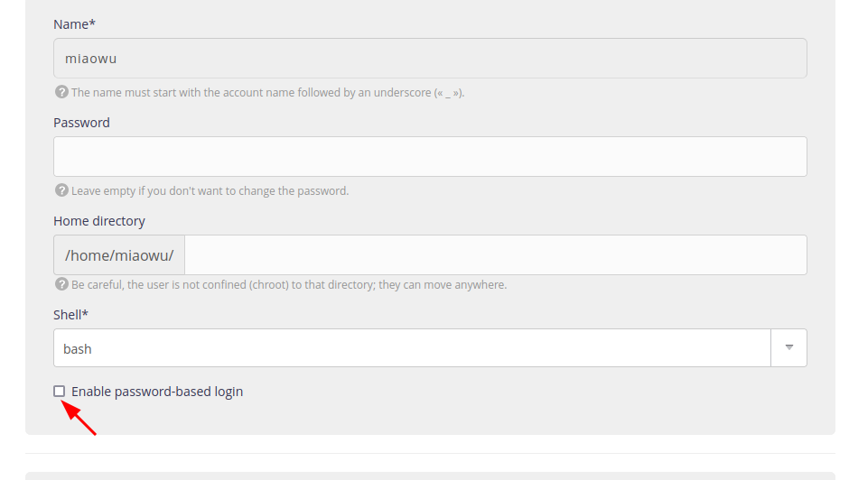
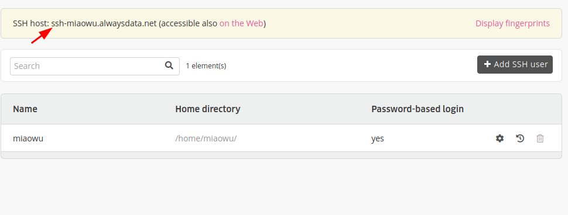
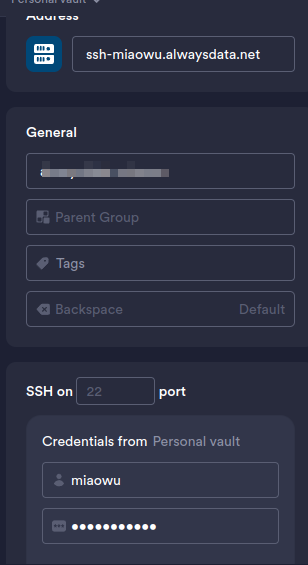
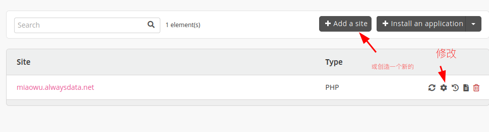
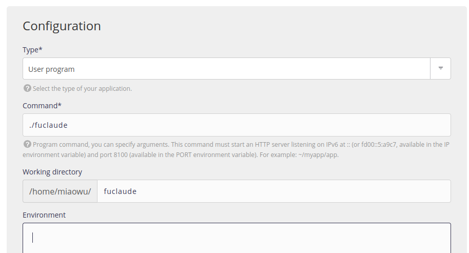
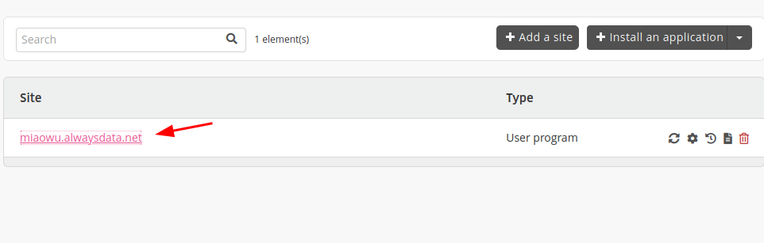

---

id: 135361

title: "在 alwaysdata 运行 Fuclaude"

created_at: 2024-07-14T12:32:37.863Z

username: endercat

display_username: "暁美 ほむら Advanced"

---


# 在 alwaysdata 运行 Fuclaude


### [alwaysdata, the European Cloud](https://www.alwaysdata.com/en/)

Fully managed and all-inclusive hosting, without unexpected expenses. Unlimited databases, mailboxes and websites.

在100MB的Linux服务器跑 Fuclaude的教程 ¯⁠\⁠(⁠°⁠_⁠o⁠)⁠/⁠¯

---

# 1. 注册

选择 100MB 的免费套餐注册


### [alwaysdata, the European Cloud](https://www.alwaysdata.com/en/)

Fully managed and all-inclusive hosting, without unexpected expenses. Unlimited databases, mailboxes and websites.

注册时可能会被要求信用卡验证，可以找个卡过，也可以尝试换个ip和浏览器


注册后，按下图填写



# 2. 连接SSH

前往 [https://admin.alwaysdata.com/ssh/](https://admin.alwaysdata.com/ssh/)


或者点击左侧菜单 **Remote access** → **SSH**

点击SSH用户的设置图标





使用页面上的 **SSH host** 地址连接





# 3. 安装 Fuclaude

在 SSH 中使用以下目录安装

1. 下载

```
wget $(curl -s https://api.github.com/repos/wozulong/fuclaude/releases/latest | jq -r '.assets[] | select(.name | contains("linux-amd64")) | .browser_download_url') -O fuclaude.zip
```

1. 解压

```
unzip -j fuclaude.zip 'fuclaude*/*' -d fuclaude
```

你将被要求输入解压密码，输入后回车即可(密码不会显示，输完回车即可)


3. 修改端口


由于 alwaysdata 要求使用8100端口，故修改为8100端口

```
sed -i 's/127.0.0.1:8181/0.0.0.0:8100/g' config.json
```

需要启用注册，使用以下命令

```
sed -i 's/"signup_enabled": false/"signup_enabled": true/' config.json
```

需要启用 session-key 显示，使用以下命令

```
sed -i 's/"show_session_key": false/"show_session_key": true/' config.json
```

# 4. 部署

前往 [https://admin.alwaysdata.com/site/](https://admin.alwaysdata.com/site/)


点击自动创造的网站设置按钮或创造一个新的网站





到此完成部署，点击你的网站地址即可访问



[https://miaowu.alwaysdata.net](https://miaowu.alwaysdata.net)


---


*来源: https://linux.do/t/topic/135361.json*

