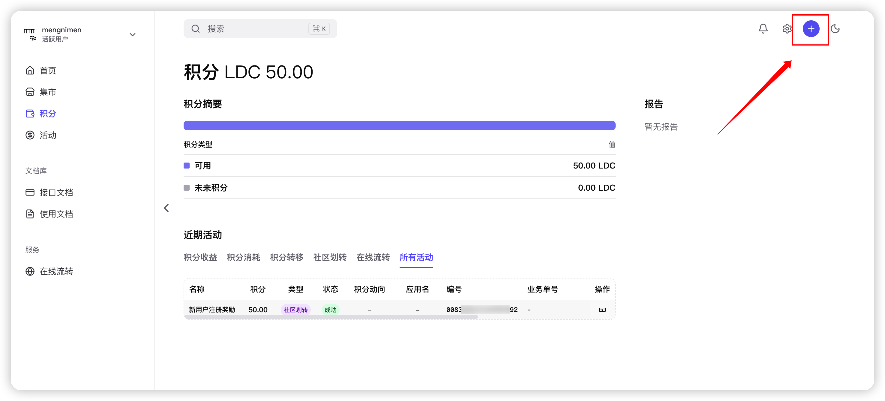
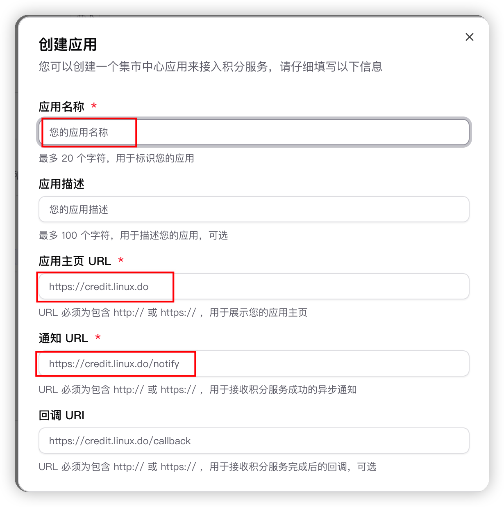
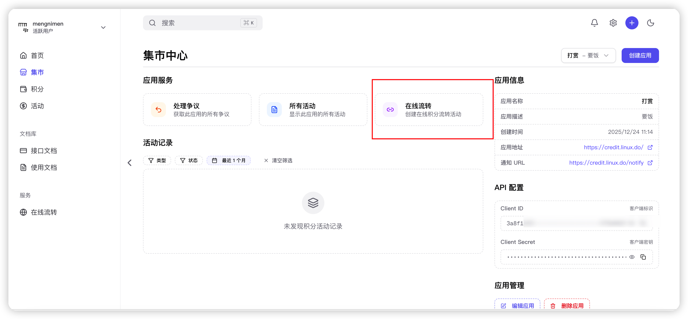
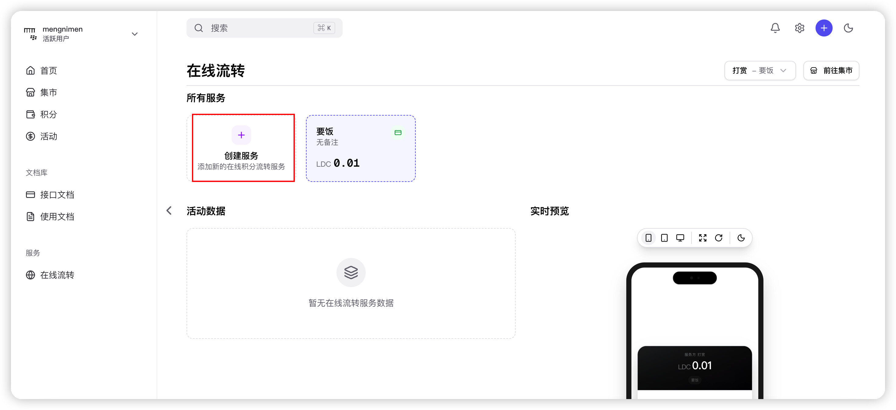
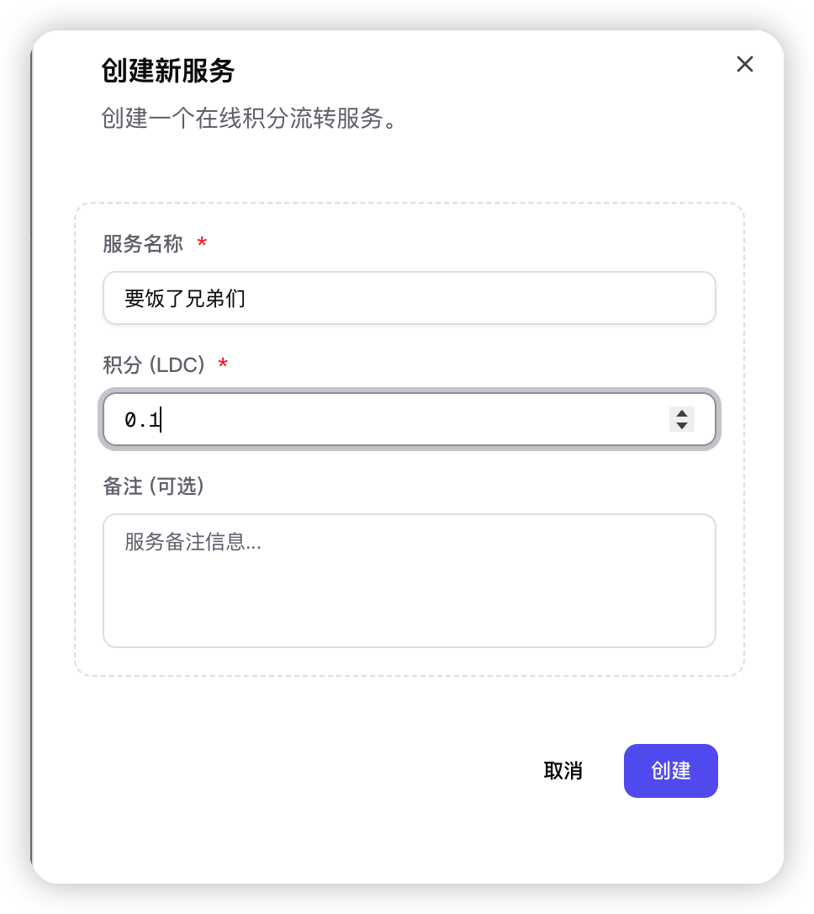
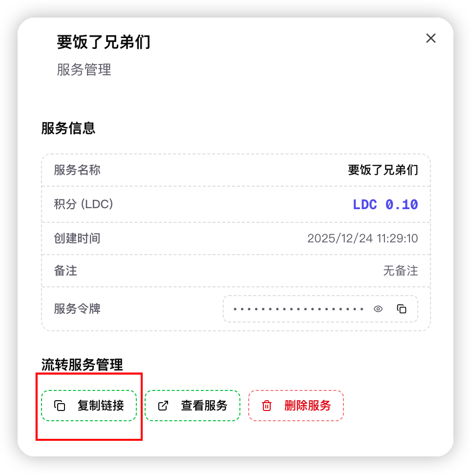
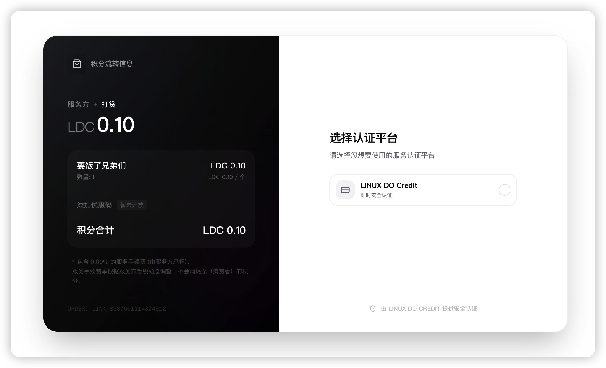
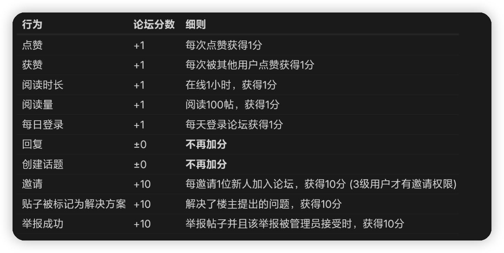

---

id: 1356124

title: "【Linux Do Credit】教你创建自己的收款积分页面"

created_at: 2025-12-24T03:32:35.560Z

username: mengnimen

display_username: "mengnimen"

---

# 【Linux Do Credit】教你创建自己的收款积分页面

我也是小白，早上研究了一下，可以创建自己的收款页面，这样别人也可以给你打赏了

### [LINUX DO Credit](https://credit.linux.do/balance)

Linux Do 社区积分服务平台

注册好之后进入首页点击右上角

创建好链接复制发出来就是你的收款链接了

[要饭啦~](https://credit.linux.do/paying/online?token=d4d5e16fcb6e92e534d1e7126b1382906bced9da37f276c8a239ff3144d35072)

### 点赞也可以增加积分，点赞走起来

---

*来源: https://linux.do/t/topic/1356124.json*

