---

id: 1401642

title: "抛砖引玉 论坛探索中的点滴 欢迎佬友们共建文档"

created_at: 2026-01-03T14:38:19.392Z

username: Rtyu7829

display_username: "Rtyu7829"

---


# 抛砖引玉 论坛探索中的点滴 欢迎佬友们共建文档


> 值此元旦佳节 原计划是前天发的，回首在论坛度过的近九个月，接触到了各领域的知识，感受到了大佬们的热心，更对社区友好共助的氛围感到由衷的温暖。犹记得 [【520 专场】你如何理解我们的社区文化](https://linux.do/t/topic/662077) 中佬友们留下的见解，让我感受到了某种意义上“乌托邦”的氛围。[《秘密花园园丁邀请函》](https://linux.do/t/topic/847468) 让我感受到了对这份净土的守候。

> 论坛中大佬们对知识和技能的无私分享，佬友间的互帮互助，快问快答下各个佬友的热情回复等等，都让我感受到了“理想主义者”的光辉。我打算将这段时间里关于论坛使用、探索中的点滴和经验整理成文档，希望能对有需要的佬友有所帮助。本文档旨在汇总官方文档与个人经验，涵盖入站、等级、阅读、特殊版块、搜索、发帖等部分。佬友们可以利用右侧目录跳转至感兴趣的部分，囿于自身水平，本文档可能会有不精准、不严谨、乃至谬误的地方，抛砖引玉，非常欢迎各位佬友补充、修正，编辑共建该文档。

---

> [!abstract]- 最近更新

>

> 「0 快速入口」新增“L站佬友常用简称和黑话总结”，新增LDC（积分）服务的上线与下线相关，新增简短回应、树形浏览、回复最小长度20字符的上线相关，新增账号新的注册渠道说明（github），新增“开源推广”标签上线相关历程。

> [!success]- 更新日志

>

> 2026-04-18

> 「0 快速入口」新增“L站佬友常用简称和黑话总结”，新增LDC（积分）服务的上线与下线相关，新增简短回应、树形浏览、回复最小长度20字符的上线相关，新增账号新的注册渠道说明（github），新增“开源推广”标签上线相关历程。

> 2026-03-29 感谢 StellaFortuna 佬友补充了代码块内嵌套代码块的方法。

> 2026-01-10

> 新增「0 快速入口」：方便不熟悉相关内容的佬友快速查找。

> 新增 「最新更新与更新日志」:方便快速了解更新情况。

> 「积分乐园 / Credit」补充：强调了积分共建文档，新增积分乐园版块规则、Credit 与 Leaderboard 关系、更新最新计分规则等

> 「访问问题」补充一些新的访问相关问题

> 「发帖回帖」添加发帖图形化编辑器相关，补充更多的Callout 类型和Markdown 相关以及话题字数上限。

> 2026-01-03

> 初稿发布并修正一些格式问题

> [!NOTE]

>

> 因本文档内容较长，有需要的佬友可以点击右侧目录跳转到想看的部分，同时考虑到有些内容如果不了解可能不太方便检索和跳转，所以我整理了一个“快速入口”，按使用路径写了一些可能常用的查询点。点击后可跳转至相应部分，方便快速检索。

---

## 0、快速入口

- [注册与邀请（含历史变迁）](#reg) —— 当前注册规则、以及注册规则及变迁时间线

- [入站申请](#apply) —— 社区文化、审核要点、常见反面案例、以及官方建议。

- [信任等级与 Connect 数据](#tl) —— TL0~TL3要求与权限、100 天滚动窗口与掉级缓冲、Connect查看当前数据

- [新号第一步：Discobot 教程与徽章](#discobot) —— 机器人私信教程、常见徽章索引入口

- [账号界面与安全设置](#profile) —— 个人菜单、通知/追踪/屏蔽、账号安全、构建主页

- [访问与阅读（403/429/过盾/蓝点已读）](#access) —— 常见错误码、cf过盾、蓝点阅读计数逻辑、话题不存在或不公开、交互异常排查

- [版块、群组与特殊版块](#sections) —— 常规版块区分、跳蚤市场（交易分组）的加入与注意事项、积分乐园相关详细信息

- [社区子系统与元宇宙（Connect/Webmail/wiki 等）](#metaverse) —— 各入口用途、导航与站务信息位置

- [搜索（站外搜索与站内搜索、指令集）](#search) —— 外部搜索、站内指令表、组合与筛选

- [发帖、回帖与排版（含图形化编辑器/MD/常见避坑）](#write) —— 创建话题、引用互动、格式/右侧目录/跳转锚点、编辑冲突与常见避坑

- [L站佬友常用简称和黑话总结](https://linux.do/t/topic/1664794)

## 1、注册、登录、等级与安全

### 1.1 注册

- **当前规则**：可通过邀请链接注册，**3级及以上用户**可生成邀请链接，每日限额 1 个，也可通过满3年的github账号申请注册。


如何生成


左侧


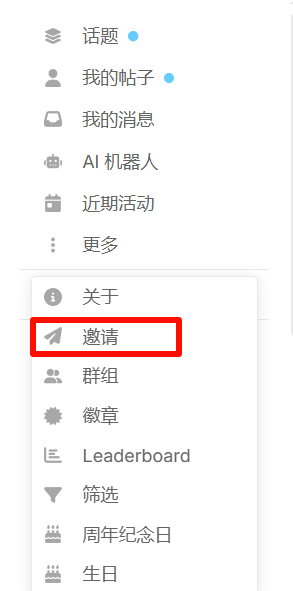

点击头像-个人资料-邀请


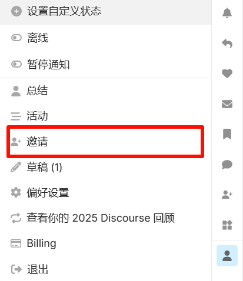


**相关的公告**：


[【进一步压实】社区关闭公开注册](https://linux.do/t/topic/1327075)

**新的邀请码进入方式**：国内IP访问[LINUX DO 邀请码](https://invite.linuxdo.org/)后使用github账号注册，申请规则如图：

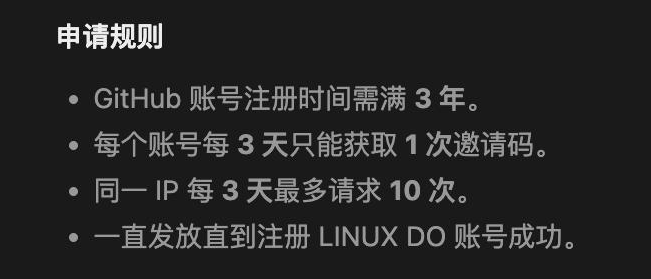

*因我入站较晚和能力问题，某些可能有纰漏，欢迎补充、修正*

- **2024-01-17**：论坛成立，最初注册无需邀请码，建站一个月内入站的佬友可获得种子用户徽章。

[绝版徽章：种子用户！](https://linux.do/t/topic/3859)

[在此处藏一个论坛的注册邀请码](https://linux.do/t/topic/16933)

- **2024-03-01**：有 9251 个注册用户，2 级用户已有 630 人。考虑开启邀请注册。

[是不是要开邀请注册呢？](https://linux.do/t/topic/21625)

- **2024-03-20**：邀请码共享池上线。

[永久LinuxDo论坛邀请链接💕 写了一个LinuxDo邀请码共享池，大家可以上传自己的邀请链接](https://linux.do/t/topic/36752)

- **2024-04-16**：邀请码调整（我没找到具体开始实施邀请注册的日期）。

[论坛人数即将20K，邀请码将调整](https://linux.do/t/topic/58150)

- **2024-06-24**：新LOGO怎么来的？旧的logo是什么？

[新LOGO到底怎么来的？](https://linux.do/t/topic/119711)

- **2024-06-24~26**：测试新 Logo 及最终总结贴。

[三分黑暗，七分光明](https://linux.do/t/topic/119108)

[【最终帖】关于新LOGO你想知道的都在这里](https://linux.do/t/topic/120845)

- **2024-07-16**：建站半年，开放 7 月 17 日一天公开注册。

[哦豁，半年了！简单庆祝一下，限时开放注册！](https://linux.do/t/topic/136278)

- **2024-08-29**：向左向右的探讨。

[向左还是向右的路线问题](https://linux.do/t/topic/188585)

- **横幅内有公开邀请码时期**：


具体上线（2025年3月19日前）和下线日期我没有找到，本人就是使用该邀请码注册的。(如图的该横幅内当初提供公共邀请码)


- **2025-08-07**：社区的路线探讨。

[《秘密花园园丁邀请函》](https://linux.do/t/topic/847468)

- **2025-11-06**：论坛被阻断，11月7日发布相关说明。

[你阻断我，与我无关](https://linux.do/t/topic/1143462)

- 如果你追求直连访问，可参考：

[【更新】OAIFree 这个域名换了个方式跟大家见面](https://linux.do/t/topic/1150121)

- **2025-12-17**：论坛关闭公开注册，可由 3 级以及以上用户生成邀请码。

[【进一步压实】社区关闭公开注册](https://linux.do/t/topic/1327075)

### 1.2 入站的申请

所有的注册申请都是管理人工审核的，为了管理人员的精力和自己想要加入论坛的心愿，我真诚得建议注册前阅读一下下面的内容：

> 我非常感激佬友们对 LINUX DO 的喜爱与支持，也非常明白你们希望加入讨论的迫切心情。

> 但所谓欲速则不达，我还是恳求希望加入的佬友们能看一看这个帖子再做账号申请，以增加成功率和申请效率。

> **首先**，注册之前，我非常诚恳地请各位佬友仔细阅读我们的 [FAQ](https://linux.do/faq) 这里面包含了对本社区的一些介绍和规则，这对于你日常参与本社区的讨论非常重要！请阅读后再勾选注册页面的相应选项。

> **其次**，我们希望知道你大概的加入意愿。加入一个社区是一种双向选择，L 站也许在别人嘴里是一个样，但你亲身体验又是另一个样，未必一定合拍。所以我们希望你能在申请账号的时候填写**申请自述和加入缘由**，基本要求是 **50 字**左右的自写文字（也就是非 AI 生成），大概说说你的经历以及为什么要加入这里，管理可以看到这些内容并进行审核。

> 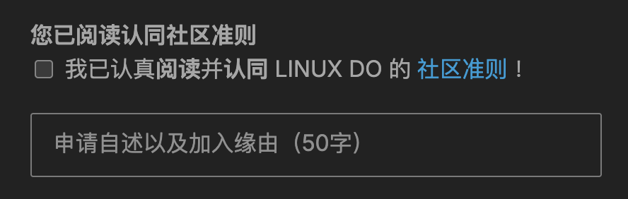

> 佬友们可能不清楚，我们每天会收到几百份的注册申请，注册理由也是各式各样。比如很多直接只写 “学习” 二字的，我们非常欣赏你的学习态度，但不会让你通过注册。也有些 “需要理由吗”，抱歉这个真的需要。还有写一堆自己如何对 `linux` 感兴趣的，写的虽然很长，但 AI 并不理解 L 站到底有多少 `linux` 的讨论。

> 以上这些，包括乱敲甚至直接写 50 个 `1` 的，都不会被通过（目前的通过率大概 `1/5` ？）。因为我们认为，你并不是真的希望加入这个社区，而只是要备有一个账号而已。如果你的申请被拒绝（一般不超过 24 小时），可以使用那个邮箱重新注册。

> **最后**，真诚欢迎每一位新加入社区的佬友！希望你们在这里都有收获、玩的愉快。记得一定要看 [FAQ](https://linux.do/faq) 和社区的置顶帖。

>

> **真诚** 、**友善** 、**团结** 、**专业** ，共建你我引以为荣之社区。

**这个帖子里的是反面案例：**

[“已读乱回“ 申请小作文大赏](https://linux.do/t/topic/950136) [


公告](/c/feedback/announcement/49)

> ![[image]](https://cdn3.ldstatic.com/original/4X/f/c/8/fc8daf0adaeee0b7af6ee945759e7f9db78f4e81.png)

> ![[image]](https://cdn3.ldstatic.com/original/4X/e/3/d/e3dcd37b76aac1be481c35d8234f69ecfe1913cb.png)

>

> 虽然我已经专门写了这一篇帖子来介绍注册相关事宜，并且红字写在了注册界面。

> 但很多申请还是跟没看见一样，各种“已读乱回”。

> 所以特意开此帖，贴一些离谱的申请自述。

> 在不泄露隐私、不关联信息的前提下，给后续申请的“准佬友”们一个提醒。

社区是欢迎真诚想要加入的佬友的，希望想注册的佬友能真心换真心，祝愿想加入的佬友能成功注册！

### 1.3 等级体系

对于等级体系，可以阅读如下三个帖子：

- **【新人请看】了解 Discourse 信任度：**


[【新人请看】了解Discourse信任度](https://linux.do/t/topic/2460)

- **详细的 Discourse 论坛权限等级表：**


[Discourse 论坛权限等级表](https://linux.do/t/topic/18797)

- **一图了解linux.do等级要求：**


[一图了解linux.do等级要求](https://linux.do/t/topic/126358)

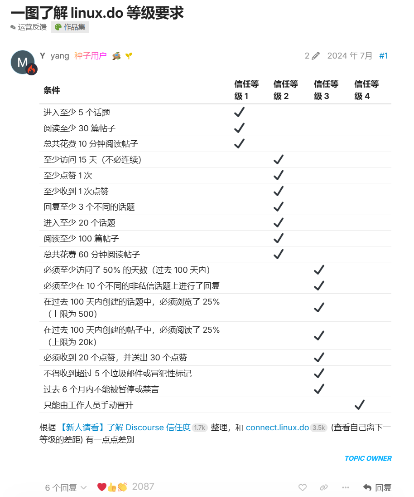

> 根据 [【新人请看】了解 Discourse 信任度](https://linux.do/t/topic/2460) 整理，和 [connect.linux.do](http://connect.linux.do) (查看自己离下一等级的差距) 有一点点差别

- **话题和帖子的区分：**


例如此篇文档就是一个话题，下面的回复就是帖子。

- **关于已读：**


帖子列表或楼层右上角的“蓝点”消失，才算被系统计入“已读”。


如果蓝点长时间不消失，遇到无法点赞的情况，可以访问 [https://linux.do/challenge](https://linux.do/challenge) 过 cloudflare 盾，或者点击 [社区子系统和元宇宙 - LINUX DO](https://linux.do/pub/resources) 里的 challenge 也是一样的效果。


具体可参考此贴：


[当 ajax 遇到 cloudflare 5秒盾](https://linux.do/t/topic/950822)

- **如何查看自己的数据情况？**


佬友们可以进入该链接[Connect](https://connect.linux.do/)查看，也可从左侧资源下的 connnect 进入。


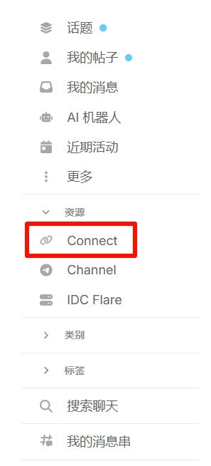


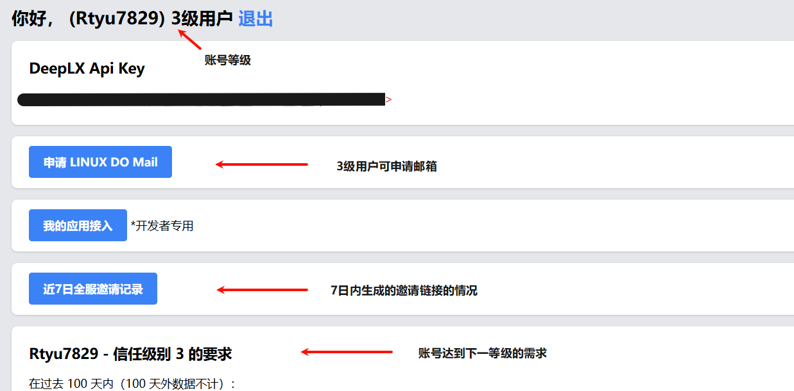

- **该入口仅可查询 2 级以及以上的用户数据，如果你没有达到相应级别，可以使用插件查看相关信息。**


*此外：这是本论坛热心大佬开发的，非论坛官方出品。*

- 插件帖子：


[linuxdo 增强插件，持续更新欢迎反馈（浏览器扩展，油猴已失效不再更新）](https://linux.do/t/topic/170951)

- **数据的计算：计算截至当天24：00，次日凌晨四点更新等级**

- **3级的特殊性：**


3级的数据是 100 天动态滚动的，统计的是近 100 天的活动，如果不达标，会有 2 周缓冲期，之后会掉入二级。


如果你因现实原因无法上论坛，升级到二级就不用担心因不活跃被清理号了。

> 始皇刚在 tg 群说的

> 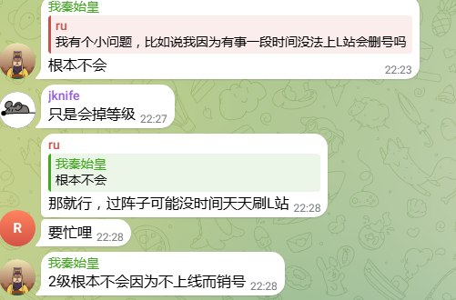

### 1.4 注册成功：机器人教程

建议完成右上角头像点开后 `Discobot`（机器人）发来的私信指引。


佬友们可以了解到一些快速上手的引用、表情、格式等操作，并获得“已认证”的徽章。

如果你对其他徽章感兴趣，可参考如下的帖子：

- **盘点 L 站的徽章 长期更新！**


[盘点L站的徽章 长期更新！（2026.2.17 更新）](https://linux.do/t/topic/342888)

### 1.5 页面的简单认识与账号安全

#### 1.5.1 话题与帖子

话题是类似本文档性质的主贴，帖子是话题下面的回复。

- 对于一个话题

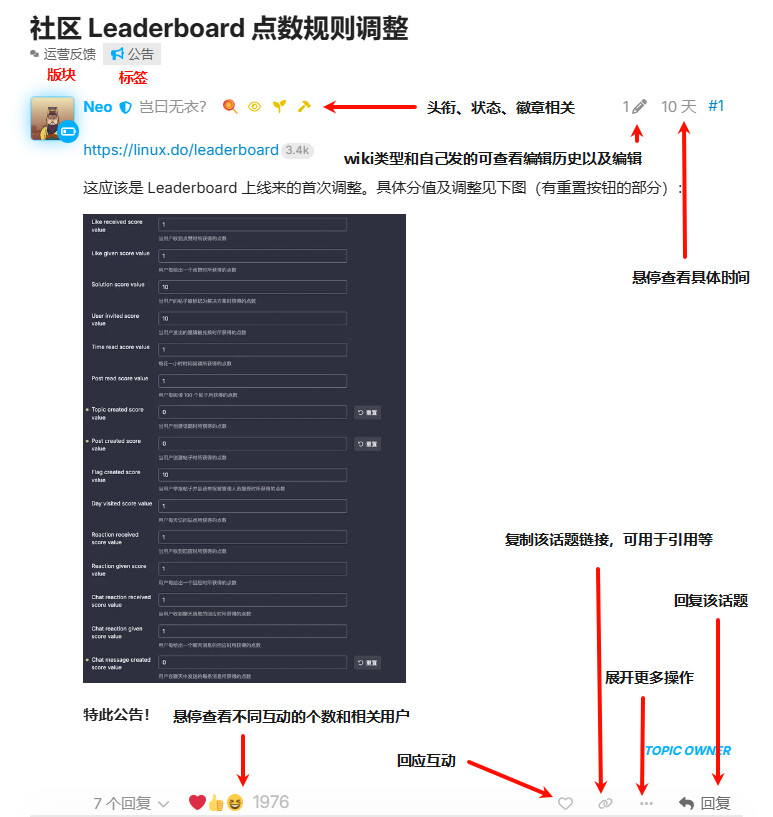

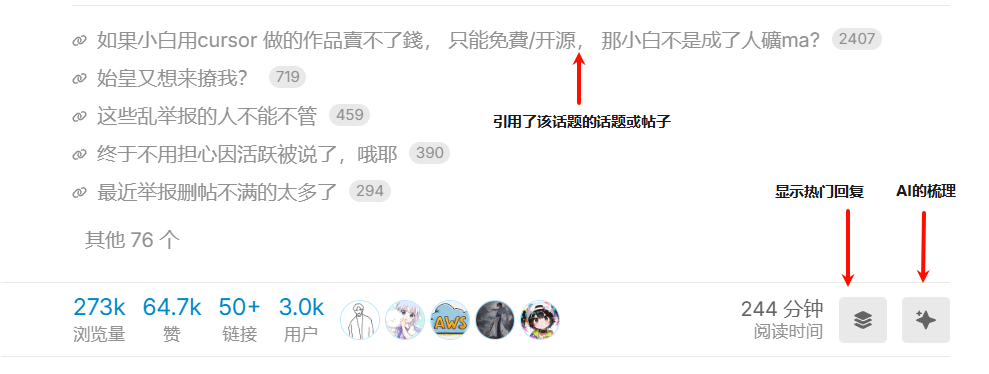


三级以及以上用户可修改帖子的标题，修改不同的版块（可修改帖子等级）、标签。

除版主和领导者外只有wiki类型（需要1级及以上）和自己的帖子可编辑。

对于帖子和话题，发布后 5 分钟内的编辑是不计入编辑次数和历史的，右上角也不会出


现‘铅笔’图标。

话题较长一段时间无人回复，可能会被关闭，关闭状态下的话题无法回复，如果确实有相关需要，可以联系管理申请重新开放帖子。

- 对于一个帖子


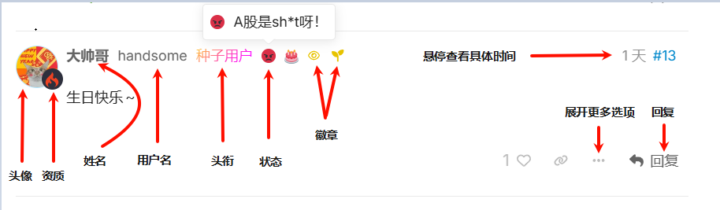


用户名、头像、姓名、头衔、资质、状态：


进入个人资料-偏好设置-账户


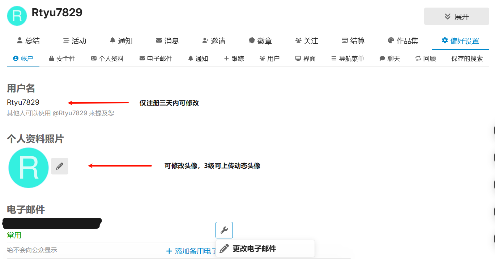


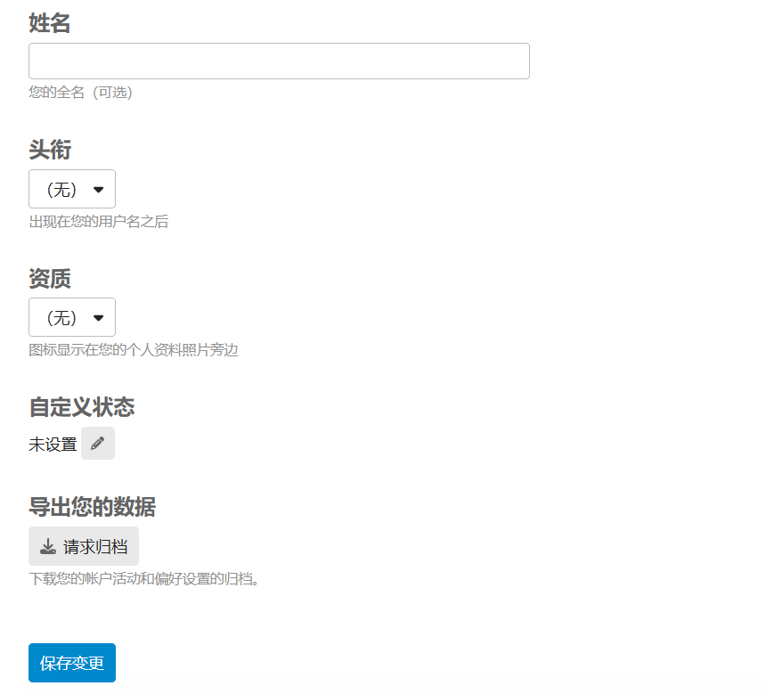


姓名：可更改或不填写，不填写则只显示用户名


头衔：出现在用户名后，例如：活跃成员、种子用户、文化宣传员等等


资质：三级用户可获得火焰样式，版主，一个蓝色的对号且头像周边有蓝色光效。管理员，缺电的蓝色电池 默认还是自设我就不清楚了


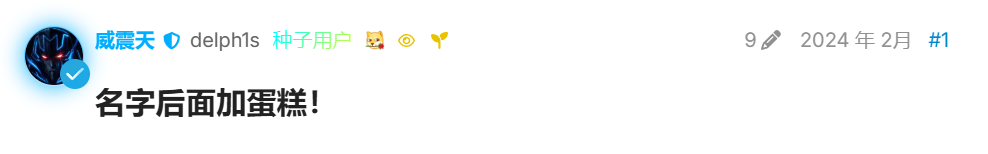


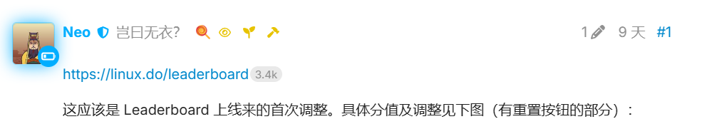


状态：可设置表情和内容，悬停后可查看其内容


蛋糕：注册满一年或者到了个人资料里设定的生日日期，你的用户名后会多一个小蛋糕


可参考该帖子：


[名字后面加蛋糕！](https://linux.do/t/topic/21184)


徽章：金色眼睛图案和金色幼苗对应“全年不落”和“种子用户”徽章，拥有会自动展示，          无需设置。金色锤子对应的是破界者徽章。

- 图中上下分别是他人的和自己的帖子：


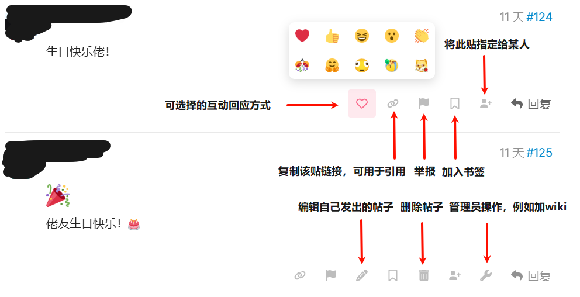


对于帖子和话题，发布后 5 分钟内的编辑是不计入编辑次数和历史的，右上角也不会出


现‘铅笔’图标。

删除帖子后这个帖子依然占位在这里，会显示此贴被删除。

#### 1.5.2 个人菜单与资料

- 右上角点击头像后 ，右侧各个按钮鼠标悬停可以看到基本介绍。


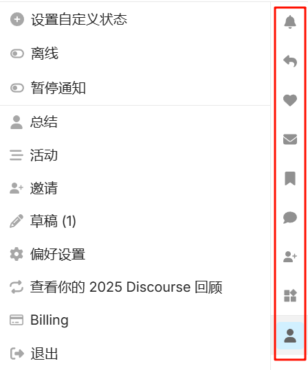

- 点击最下面个人资料，我们将进入账号总览。


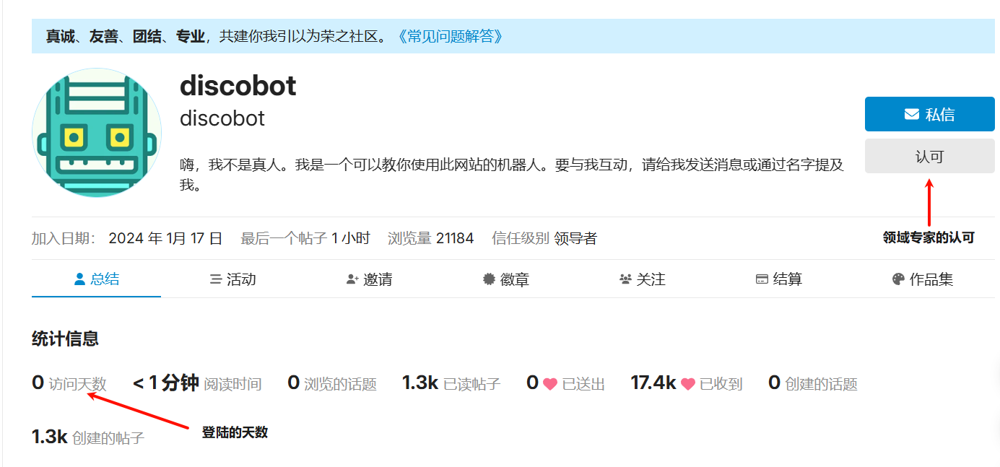


总结：你可以看到一些基本统计信息。

关于“认可”：可参考该贴：


[【今天最后一帖】社区领域专家：蓝V](https://linux.do/t/topic/117407)

聊天功能一个多前已经下线，现在想私聊可以私信。

- **活动**：


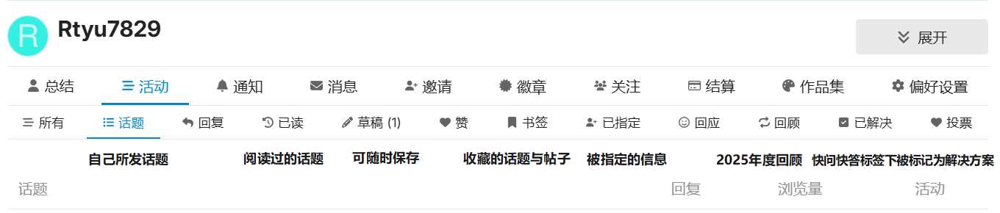


已指定：里有被指定的话题和消息。

书签：之前图里扩展功能中加入的帖子，也可以把话题加入书签。

已解决：在有快问快答的标签下的回答被发帖人标记为解决方案后获得的。

- **通知**：可以配置各类你想看到的通知情况。


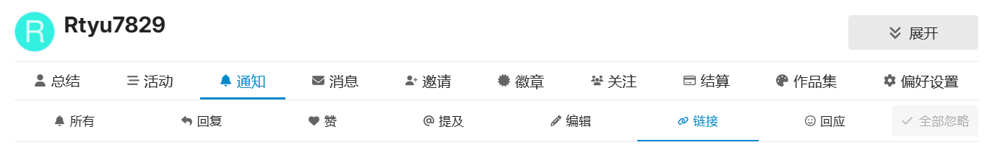


链接：他人引用的你的帖子或话题的记录

- **消息**：可以看到各类系统消息，以及查看你发的私信。


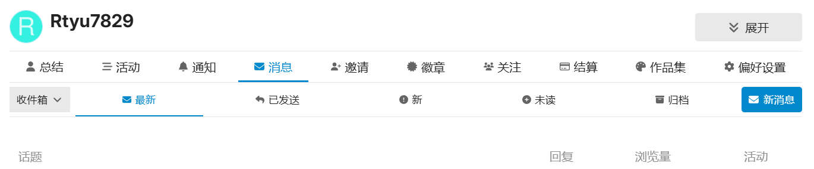

- **邀请**：3级用户可以在这儿生成邀请链接，每天一个，有效期一天。


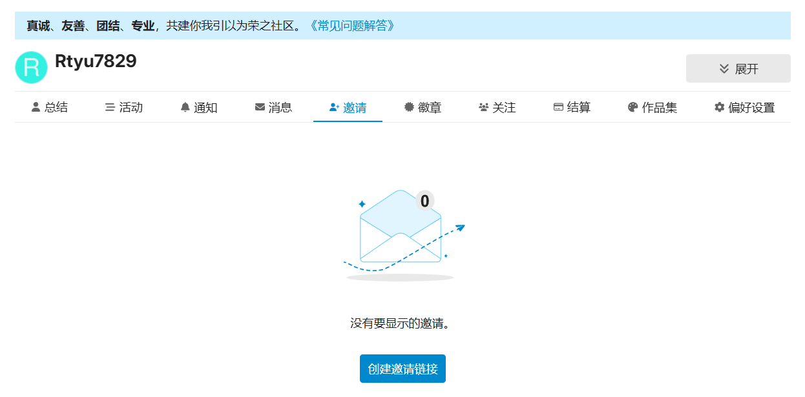

- **徽章**：收藏的徽章会在他人点你的头像或用户名后优先展示。


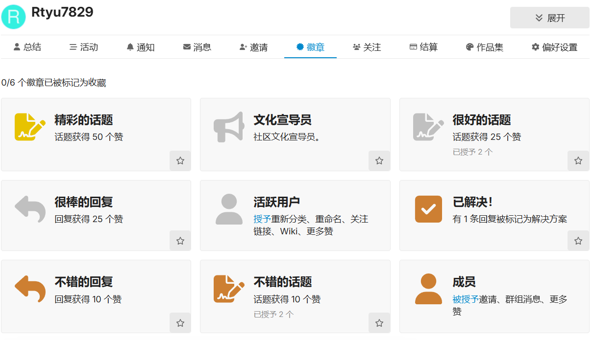

#### 1.5.3 偏好设置

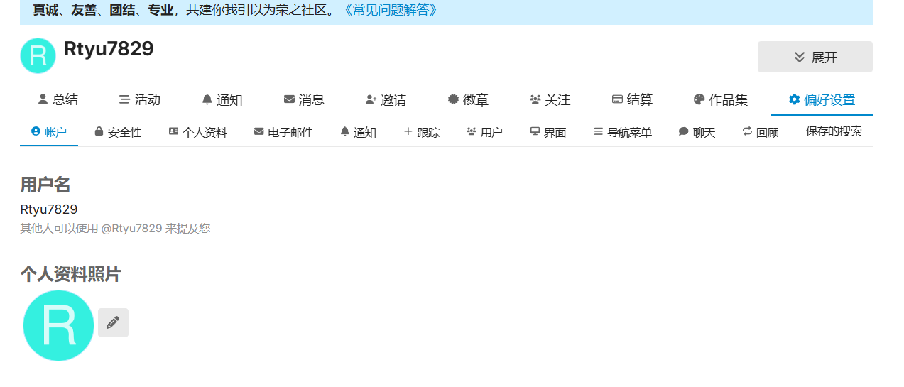

- **账户**：[帖子](#post)部分已介绍。

- **个人资料**：可以设置生日、用户卡片徽章、用户卡片背景等个性化设置，


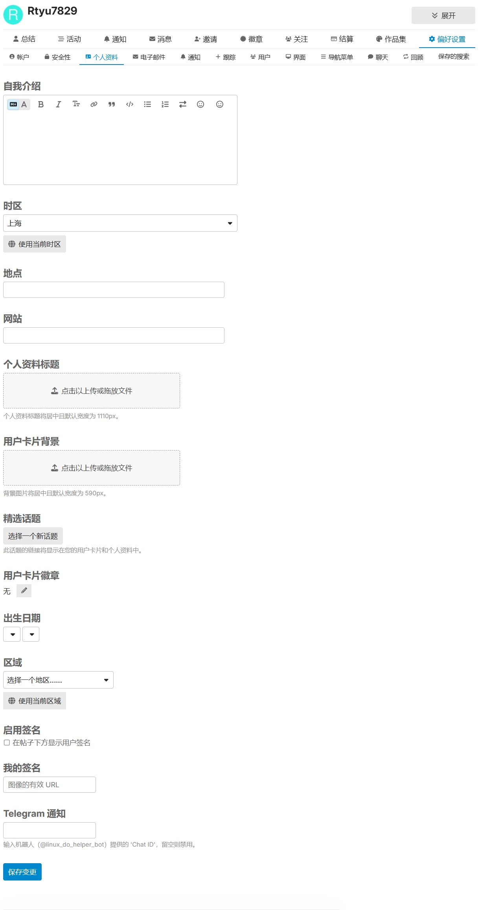

- **电子邮件**：可以设置会收到哪些的邮件提醒。

- **追踪**：里可配置屏蔽你不想看到带有某些版块和标签的话题。


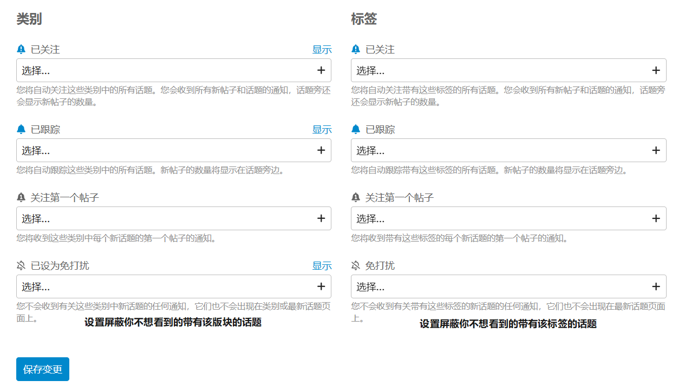

- **用户**：中配置屏蔽某用户的情况，忽略和免打扰是两种不同的程度。


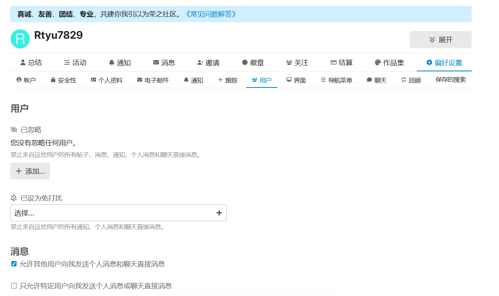

- **聊天功能**：在一个月前下架了。

- **回顾**：可以再次看到2025年的回顾。

---

## 2、访问与阅读

### 2.1 论坛的架构

可参考此贴：

> 总体思想：遇事不决先分层，一层不够加一层。

> 先放个 mermaid 架构图：

> `graph TD     user((👥 用户访问))          subgraph Cloudflare [☁️ Cloudflare]         direction TB         cf[🛡️ CDN + DDoS 防护]     end          subgraph LoadBalancer [⚖️ 抗投诉 VPS]         lb[🔄 负载均衡器]     end          subgraph Origin [🏢 高性能裸金属服务器群]         web[🌐 Web + 数据库 + 缓存]         discourse[💬 Discourse 系统]     end      subgraph Proxy [🛡️ 高防 VPS]         proxy[🔒 对外访问统一出口]     end          internet((🌍 互联网))      user --> cf     cf --> lb     lb --> web     web --> discourse     discourse --> proxy     proxy --> internet          classDef userStyle fill:#e1f5fe,stroke:#01579b,stroke-width:3px,color:#000;     classDef cfStyle fill:#ff6f00,stroke:#e65100,stroke-width:3px,color:#fff;     classDef lbStyle fill:#2e7d32,stroke:#1b5e20,stroke-width:3px,color:#fff;     classDef serverStyle fill:#1565c0,stroke:#0d47a1,stroke-width:3px,color:#fff;     classDef proxyStyle fill:#c62828,stroke:#8e0000,stroke-width:3px,color:#fff;     classDef internetStyle fill:#455a64,stroke:#263238,stroke-width:3px,color:#fff;          class user userStyle;     class cf cfStyle;     class lb lbStyle;     class web,discourse serverStyle;     class proxy proxyStyle;     class internet internetStyle; `

> 上图就是 LINUX DO 当前的网站服务器架构简图。省略了一些细节，包括改造后的 Discourse 服务器群，这不影响本文需要表达的东西。

**论坛使用了cloudflare的CDN，有时一些情况的出现是 cf 盾的原因。**

**过盾的方式：**


是有自动过盾的机制的，如果因各种原因导致没自动过盾，可以手动过盾：


可以访问 [https://linux.do/challenge](https://linux.do/challenge) 过 cloudflare 盾，或者点击 [社区子系统和元宇宙 - LINUX DO](https://linux.do/pub/resources) 里的 challenge 也是一样的效果。

### 2.2 网络与访问

- **403 error**：

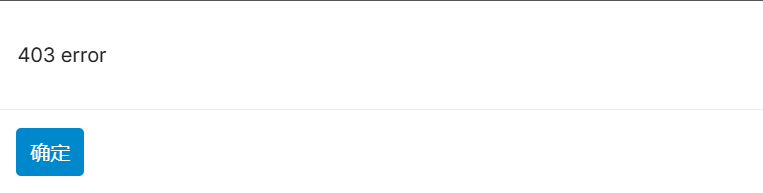

手动过盾即可。

- **429 error**：


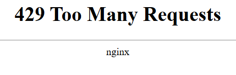


不要一下子开太多页面，等一下后刷新相关页面。

- **Rate Limit**：


通常因共享 IP 使用人数过多，手动过盾或更换 IP 。

### 2.3 阅读计数逻辑

帖子列表或楼层右上角的“蓝点”消失，才算被系统计入“已读”。


如果蓝点长时间不消失，或无法点赞，建议手动过盾。

### 2.4 徽章

对徽章感兴趣的可参考此贴：

- **盘点 L 站的徽章 长期更新！**


[盘点L站的徽章 长期更新！（2026.2.17 更新）](https://linux.do/t/topic/342888)

### 2.5 另外一些常见的疑难杂症 (FAQ)

> **Q：帖子显示如图**

>

> 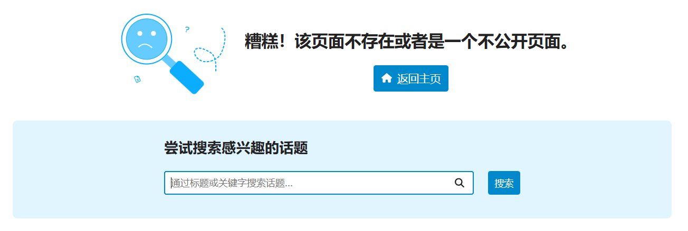

>

> A：可能原因主要有四：

>

> 等级不够（权限不足）；

> 未加入特定群组（如跳蚤市场）；

> 帖子正处于审核或被隐藏；

> 帖子已被删除。

>

>

>

>

>

> **Q：为什么我无法编辑 Wiki，无法创建投票话题？**

>

> A：这是零级的限制，只要阅读一点时间升级到一级就可以了。

>

>

>

> **Q：徽章是怎么获得的？**

>

> A：部分徽章是自动获取，部分是活动获取，还有9个绝版徽章，例如种子用户就是绝版

>

> 徽章。

>

> 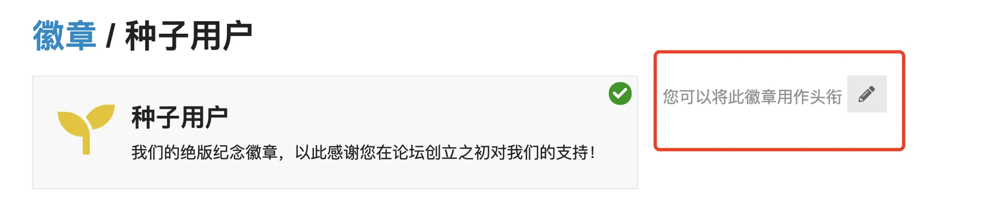

>

> 详细信息参考： [盘点L站的徽章 长期更新！（2026.2.17 更新）](https://linux.do/t/topic/342888)

>

>

>

> **Q：为什么“总结”里面的访问天数和connect显示不一样？**

>

>

> A：只要登录，访问天数就会加一天，connect里的计为一天需要一定的互动，我没找到具体可量化的要求。

>

>

> **Q：一些拼车、交易信息我怎么找不到？**

>

>

> A：可能是你没有加入跳蚤市场的群组，加入[交易分组](https://linux.do/g/g-trade)后即可在版块内查看。

>

>

> **Q：不小心将话题设为免打扰如何取消？**

>

>

> A：访问该[链接](https://linux.do/?state=muted)后将其移出。

>

>

> **站内的疑难杂症贴汇总：**

>

> [遇到难题了吗？让我们一起解决！](https://linux.do/t/topic/88916)

### 2.6 可以阅读的帖子：

- 如果佬友加入相对较晚，又对论坛过去的一些事件感兴趣，可以阅读下面的帖子：


[2025 L 站大事件回顧](https://linux.do/t/topic/1317854)

- 如果之前的“注册规则变迁和一些社区相关”漏看了，[可以点此跳转](#rule)。

- 论坛有精华神贴的标签


由来：


[【长期帖】来推荐你心目中的精华神帖吧](https://linux.do/t/topic/188854)


标签展开-精华神贴，佬友们可以查看此标签内的帖子，阅读自己感兴趣的。

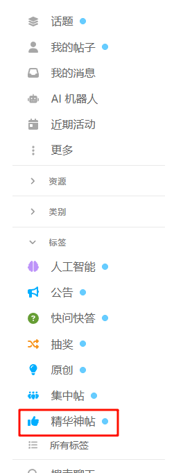

---

## 3、版块与社区子系统和元宇宙

### 3.1 首页左侧

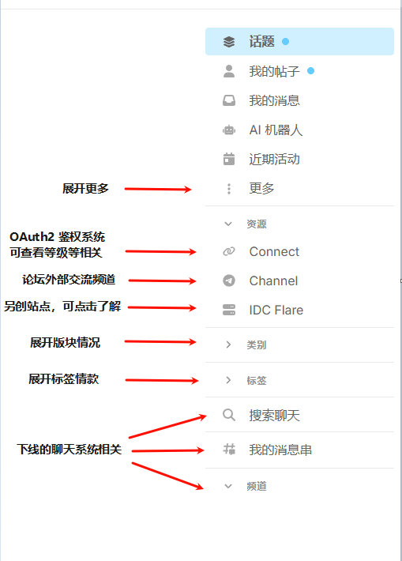

- IDC Flare: 域名、主机等相关信息的集散地。

- 展开更多


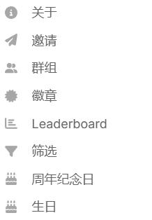


群组：可加入不同的群组，例如跳蚤市场、无广告等。

Leaderboard：你可能在不同地方看到过如下图的排行榜，查看位置就是这儿了。


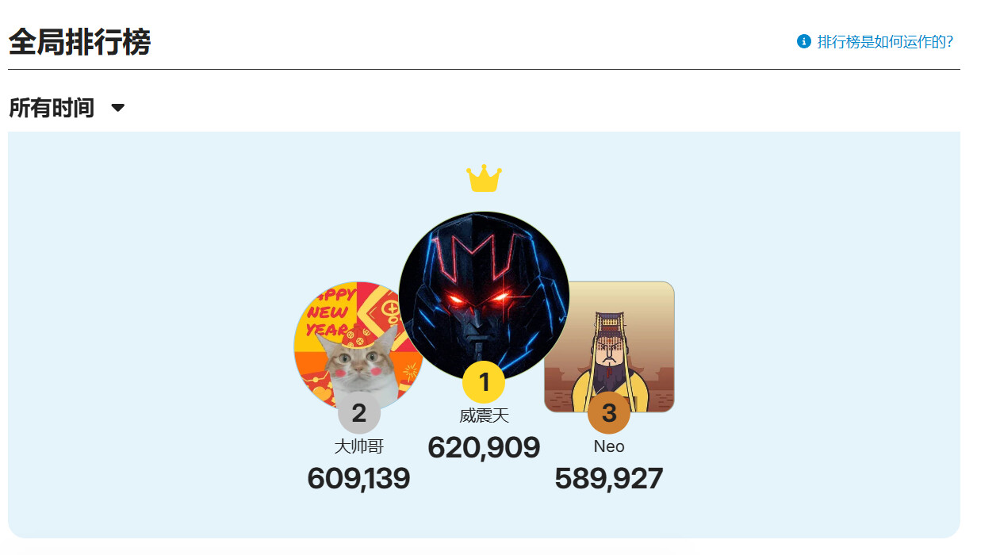

筛选：[相关可点此跳转至后续详细介绍](#filters)

周年纪念日和生日：注册满一年或者到了个人资料里设定的生日日期，你的用户名后会多一个小蛋糕。

### 3.2 常规版块与特殊版块

#### 常规版块：

- 展开类别 - 所有类别


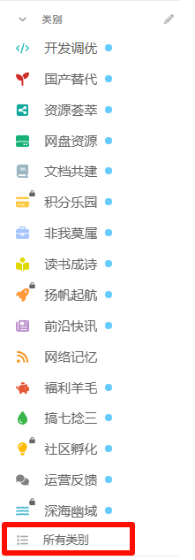


在这儿你可以看到所有版块的基本介绍，每个版块单独点进去可以看到置顶说明。

#### 特殊版块：

- **跳蚤市场**：


原先是能直接看到此版块的，2025年6月19日作出调整：


查看跳蚤市场调整公告


[关于优化交易、推广需求的变更公告](https://linux.do/t/topic/735935/1)


有的佬友已经注意到了，论坛的 #trade::category 跳蚤市场版块不见了。那么它究竟去哪了呢？

直接说重点：加入[交易分组](https://linux.do/g/g-trade)可见。

社区将推广类信息从 [深海幽域](/c/muted/45) 分拆至专门的版块，是对交易、推广需求的一次优化。


在加入[交易分组](https://linux.do/g/g-trade)后，跳蚤市场的帖子会出现在信息流，可以被搜索。这给了交易、推广需求极大的便利，同时又平衡了对相关信息不感兴趣佬友的需求。

简单来说，如果你需要浏览、发布交易或推广信息，请加入[交易分组](https://linux.do/g/g-trade)。那么之后你会多一个版块，一个跟正常版块没有区别的版块。


如果你不再有如上需求，你可以随时离开[交易分组](https://linux.do/g/g-trade)。那么此版块将会完全从你的视线里消失。

#trade::category 版块后续将不区分 1、2、3 等级。

请注意：交易物品来路必须正当，禁止黑灰产、” 羊毛 “等销赃性质交易（如 edu 及附带产物）！

这是一种里站的形式，相信是一次进步的变革，我们拭目以待。


**现状**：不再直接显示，需要**手动加入 交易分组** 才能查看，可随时退出。


*友情提醒*：交易需谨慎，社区只是有这个版块。

- **积分乐园**：


2025年12月23日 LINUX DO Credit 的正式上线：

[「LINUX DO Credit」正式发布！](https://linux.do/t/topic/1353336)


删档测试：


[「LINUX DO Credit」社区积分流转服务平台删档测试](https://linux.do/t/topic/1352387)


实时积分收入脚本：


[「LINUX DO Credit」实时积分收入脚本](https://linux.do/t/topic/1365853)


积分相关公告贴：


[晒 LINUX DO Credit 集中帖](https://linux.do/t/topic/1369846)

[关于 “积分乐园” 类别](https://linux.do/t/topic/1369846)

[社区 Leaderboard 点数规则调整](https://linux.do/t/topic/1355933)

[积分舒适区？那不存在的](https://linux.do/t/topic/1378052)


只有注册了积分站积分才会开始计算 [点此跳转](https://credit.linux.do/)


2026年3月17日，[LDC服务临时下线](https://linux.do/t/topic/1770169)


2026年4月17日，LDC服务重新上线并进行了调整：


[「LINUX DO Credit」服务规则调整公告 [已上线]](https://linux.do/t/topic/1986429)

[解释、总结一下新的 LINUX DO Credit 规则](https://linux.do/t/topic/1986820)


积分相关的文档共建，你对积分的所有疑问该帖内基本都有所涉及，很详细：


[【4.17 更新: 恢复运营】Linux Do Credit FAQ及积分获取规则](https://linux.do/t/topic/1353235)

> 最新更新

> 2026.1.5 更新

>

> 调整计分规则，给他人点赞 / 回应、邀请用户、阅读时长、阅读量从此不再计分

>

> 注意：每次积分规则调整都会导致 leaderboard 和 credit 大幅变化（当调整规则时，有扣分会被保护为 0）

> 每日登陆由 1 分增长到 10 分，可能导致某些点赞少但登录多的佬 credit 分数暴涨

> 新增注意事项：

>

> 注意：所有发在  的帖子（主帖回帖）获得点赞均不积分

>

> 更新日志

> 2025.12.28 更新：

>

> 新增第三条，「LINUX DO Credit」实时积分收入脚本相关内容

>

> 2025.12.25 更新：

>

> 更新关于 faq 第八条，credit 下降的相关说明

> 新增 faq 9：如何创建你的 credit 收款地址

>

> 从[「LINUX DO Credit」社区积分流转服务平台删档测试](https://linux.do/t/topic/1352387)、[「LINUX DO Credit」正式发布！](https://linux.do/t/topic/1353336)继续讨论，

> **Linux Do Credit 与 Leaderboard 里面的获得点数是一比一换算的，这里给出用户点数的获取规则：**

>

>

>

> [别刷了，别刷了，服务器顶不住了](https://linux.do/t/topic/1409175/1)

>

> 得分项目 所得积分 当用户**收到**点赞时所获得的点数 1 当用户**收到**回应时所获得的点数 1 当用户的帖子被标记为解决方案时获得的点数 10 当用户举报帖子并且被管理人员**接受**时所获得的点数 10 用户每天访问站点所获得的点数 10 其余 0

>

>

>

>

>

>

> 行为

> 获得分数

> 细则

>

>

>

>

> 点赞

> 0

> **不再加分**

>

>

> 获赞

> +1

> 每次被其他用户点赞获得 1 分

>

>

> 阅读时长

> 0

> **不再加分**

>

>

> 阅读量

> 0

> **不再加分**

>

>

> 每日登录

> +10

> 每天登录论坛获得 10 分

>

>

> 回复

> 0

> **不再加分**

>

>

> 创建话题

> 0

> **不再加分**

>

>

> 邀请

> +10

> **不再加分**

>

>

> 贴子被标记为解决方案

> +10

> 解决了楼主提出的问题，获得 10 分

>

>

> 举报成功

> +10

> 举报帖子并且该举报被管理员接受时，获得 10 分

>

>

>

>

> Quote

> 注意：所有发在  的帖子（主帖回帖）获得点赞均不积分

>

> 也就是说，从你注册 credit 站开始算，注册次日 0 点你将获得的 credit 分数将和你注册当日获得的点数挂钩，此后每天 0 点会把 leaderloard 当日积分结转到 credit 站，而注册日之前获得的点数则不算在内，所以尽快注册吧～

### 3.3 社区子系统和元宇宙

#### 3.3.1 入口与总览

- **进入方式**:点击右上角该标识。


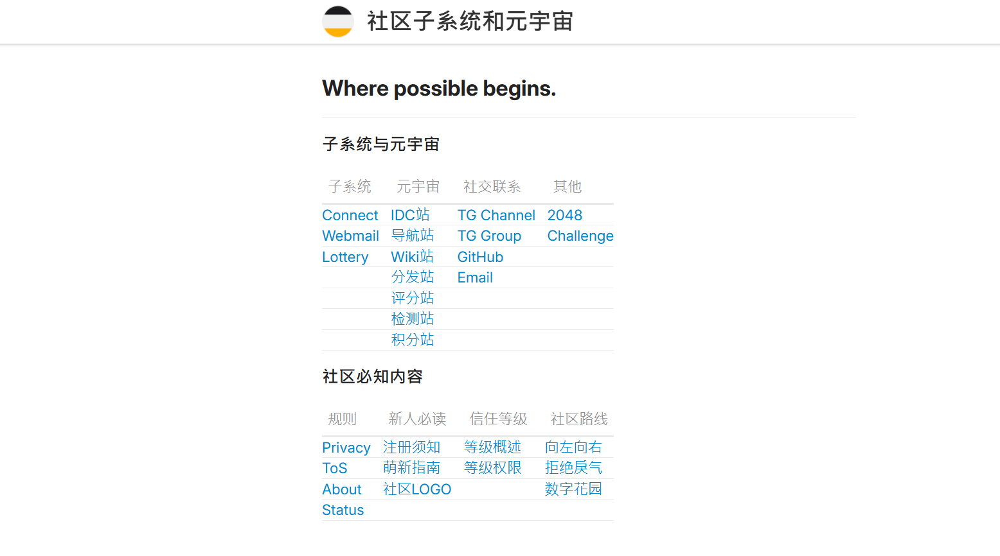

#### 3.3.2 子系统

- **Connect**:一套标准的 OAuth2 鉴权系统，可以让开发者共享论坛的用户基本信息。可以查看等级、升级要求、申请邮箱等等，是站内元宇宙的通行证基础。

- **Webmail**：Linux Do 邮箱相关系统，公告帖子可参考：


[LINUX DO Mail 开始起航～](https://linux.do/t/topic/451470)


linux.do邮箱相关：

- **最初的linux.do邮箱（需3级权限）**：


[小小福利，送给老干部们](https://linux.do/t/topic/8044)

- **LINUX DO Mail 的变迁（需1级权限）**：


[发现个好东西：申请 LINUX DO Mail](https://linux.do/t/topic/437600)

- **3级邮箱内测扩大（需3级权限）**：


[LINUX DO Mail 扩大内测范围](https://linux.do/t/topic/432697)

- **【测评】LINUX DO Mail 域名邮箱详细分析与测评报告(需1级权限)**：


[【测评】LINUX DO Mail 域名邮箱详细分析与测评报告](https://linux.do/t/topic/437320)

- **Lottery**：LINUX DO 抽奖程序，关于如何发一个抽奖贴，可参考wiki内内容：


[https://wiki.linux.do/Community/LinuxDoLottery](https://wiki.linux.do/Community/LinuxDoLottery)

#### 3.3.3 元宇宙

- **IDC站**：即上述资源里的IDC Flare，域名、主机等信息集散地。可以点击查看其相关内容。


[我有一个执念](https://linux.do/t/topic/971168)

- **导航站**：汇总 Linux DO 提供的各项服务，funclaude、Deeplx等

- **wiki**:很详细，汇总了各类站内相关信息，论坛中间一段时间没上，元宇宙当初是建设中，写到这儿才注意到有些内容重复了

- **分发站**：即Linux Do CDK，当初有些公益被滥用严重，为了能让真正有需要的佬友们用到，从佬友们发帖讨论，到某大佬使用了CDK分发的点子（我有些不太确定，就不具体指明了）做出了开源的方案并部署投入使用，一些发公益的佬友随后响应，接着各方大佬各显神通，不同的项目也多了起来，最后汇总，推出了官方CDK分发站。该事件也让我感受到论坛内互帮互助的友好氛围，对整个事件感兴趣的可以搜索阅读哦。

[【官宣】Linux Do CDK 官方分发平台正式发布！](https://linux.do/t/topic/771955) [


文档共建](/c/wiki/42)

>  Linux Do CDK 分发平台正式上线！

>

>

> 各位佬们下午好！ 很高兴和大家宣布 Linux Do CDK 分发平台 正式上线运营啦！经过团队的打磨和社区佬友们的大力支持，我们终于为大家带来了这个体验丝滑的分发管理平台~

>

> 注意：方块佬的分发站数据已经合并到官方分发站！直接导入的用户分数初始化为0，佬们耐心等待夜晚自动更新分数哟～

>

>

>

> …

- **评分站**：高级推广的佬友们的一些评价，有意使用高级推广服务的可参考一下。

- **检测站**：实时追踪各大AI模型对话接口的可用性、延迟与官方服务状态。


我写到这儿时HTTP ERROR 522了，后来又好了


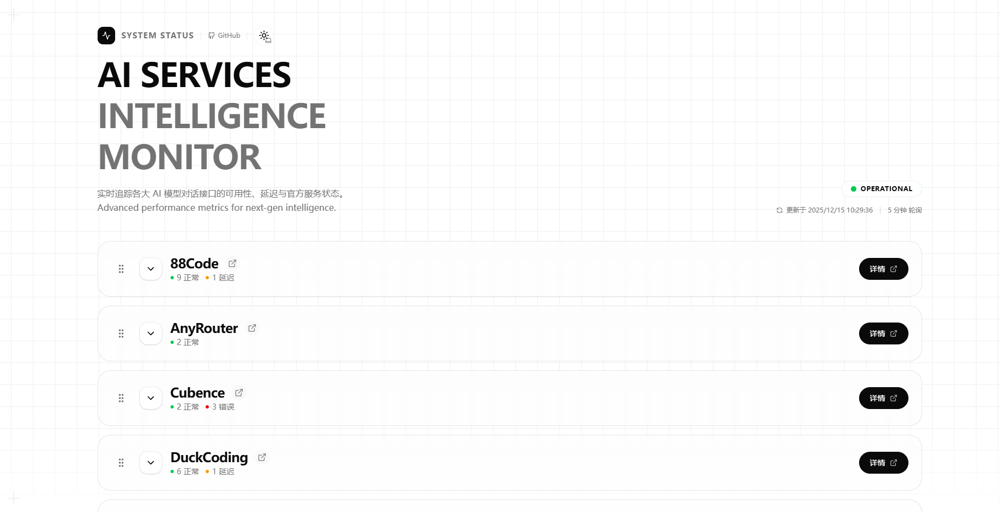

- **积分站**：特殊版块积分乐园时已经叙述过了，[可点此跳转](#credit)。

#### 3.3.4 社交联系

- **TG Channel和TG Group**：tg频道交流。

- **GitHub**：论坛的github项目库

- **Email**:linux.do 站点的官方联系邮箱,点击后，会唤起默认邮件客户端并自动将收件人填为admin@linux.do。


[!DANGER]


遇到社区内的一些问题，建议优先发带有快问快答标签的帖子，一些功能疑惑或者建议可在运营反馈版块发帖，该功能实际范围：如果出现影响此网站的关键问题或紧急事项，请联系 [admin@linux.do](mailto:admin@linux.do)。如果您发现任何不当内容，请立即与我们的版主和管理员进行对话。请记住，联系前请先登录

#### 3.3.5 其他

- **2028**：2048小游戏

- **challenge**：点击手动过盾

### 3.4 社区必知内容

#### 3.4.1 规则

- **Privacy**：论坛的隐私政策。

- **ToS**：即Terms of Service（服务条款）


原文开头介绍：


这些条款并不制约 [https://linux.do](https://linux.do) 上的本互联网论坛的使用，但有一天可能制约。


这种情况下，要使用本论坛，您必须同意运营本论坛的公司 LINUX DO 的这些条款。

本公司可能根据其他条款提供其他产品和服务。这些条款仅适用于本论坛的使用。

- **About**：网站现在的总体详细情况，在这里你也可以看到管理员和版主的相关人员。


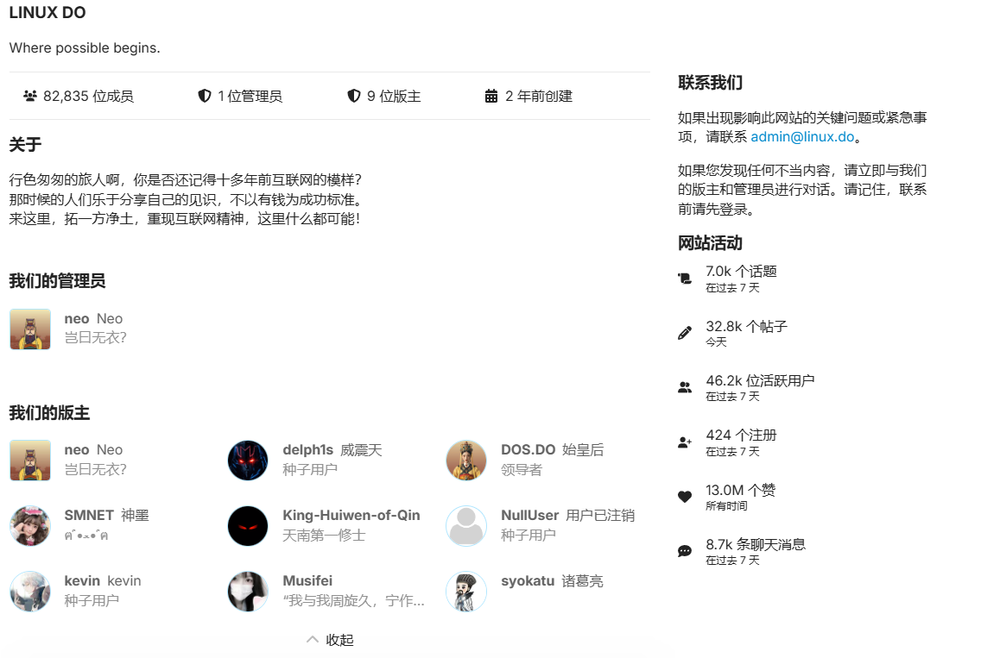

- **Status**: 是自己网络出问题了，还是论坛相关的出问题了呢？该网站可查看网站情况，帮助你排查问题。


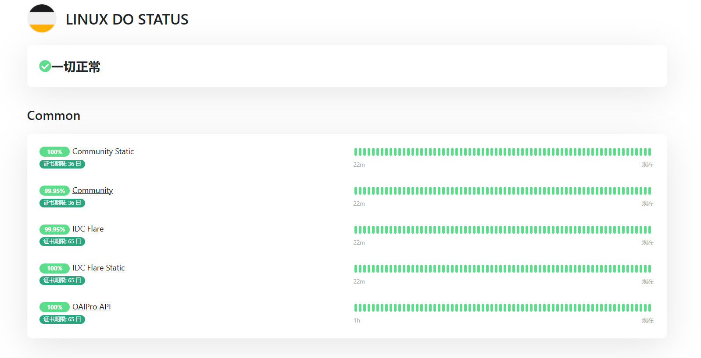

#### 3.4.2 新人必读 信任等级 社区路线

- **新人必读**：注册需知本文档前面已经引用，建议注册前看一看。社区logo放在了最开始的“注册规则变迁和一些社区相关”中，萌新指南很详细，建议阅读。

- **信任等级**：前文已经叙述。

- **社区路线**：其实本文档全部引用了哦，不过你也可以现在点进去再阅读。

---

## 4、搜索

### 4.1 外部搜索：Google、Bing等

- **核心语法 site**：只搜索指定网站的内容

**示例**：在 Google 或 Bing 搜索框输入：


`site:linux.do 关键词`


*例如想找gpt相关*： `site:linux.do gpt`

*例如想找neo发言*： `site:linux.do neo`

- 如果你对搜索引擎的指令（如 intitle:, filetype:）等感兴趣,推荐阅读（需要1级权限）：


[[新手教程] 搜索引擎的妙用，告别小白](https://linux.do/t/topic/52570)

### 4.2 内部搜索：使用站内的搜索

- 站内有不同位置的搜索，我会图文记录一下如何快速筛选想找的内容

- 站内最上方：


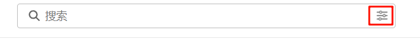

- 点击后跳转


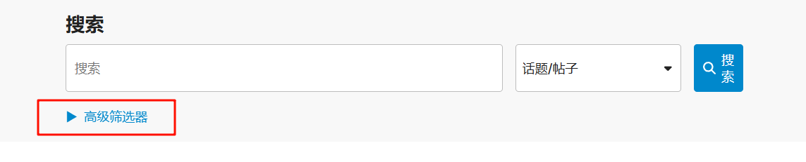

- 高级筛选器（下面的表格有一部分相应解释）

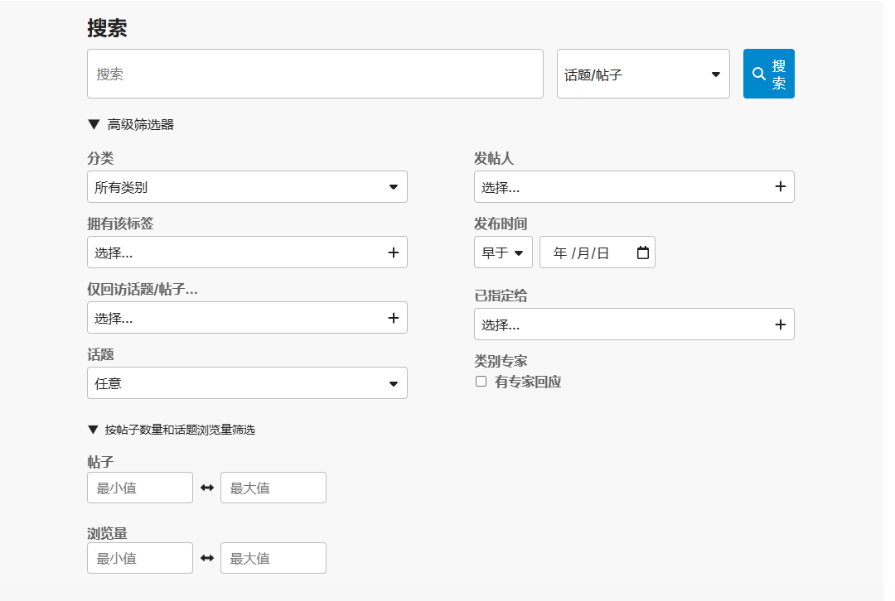


分类：你想要筛选的版块


发帖人： 输入“@”加上用户名搜索后选择。


标签：下拉选择，下拉里如果没有，可以手动输入搜索相关标签后选择。


已指定给:筛选指定给特定用户或群组的话题,可以输入搜索后选择。


仅回访话题/帖子…:


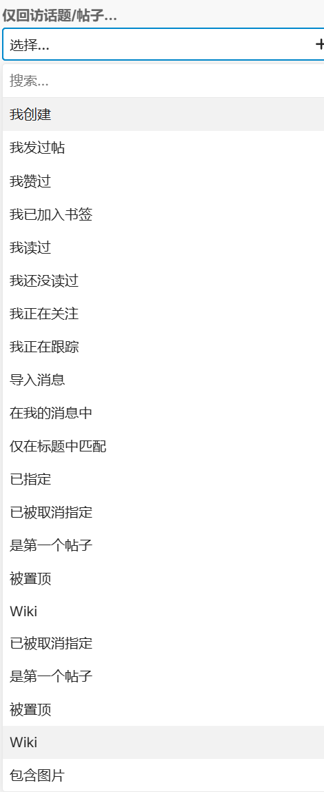


话题：


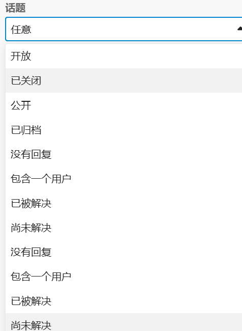


类别专家：可参考该贴什么是“专家”[【今天最后一帖】社区领域专家：蓝V](https://linux.do/t/topic/117407)


搜索后的排序也是挺有用的，佬友们可以自行选择，默认是相关性。


举个例子，例如我了解到论坛的logo曾经换过，想了解论坛的logo变化。


我知道我加入后没有相关变化，所以我指定加入前的日期。发帖人：[@neo](/u/neo)


搜索后依据相关性排序，第一个就找到了汇总贴，找之前本想后续再搜索新旧logo


是什么样式的，但阅读公告贴后就在帖子里找到了答案。


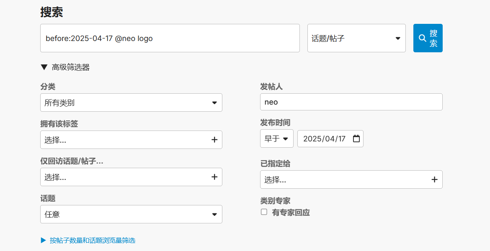

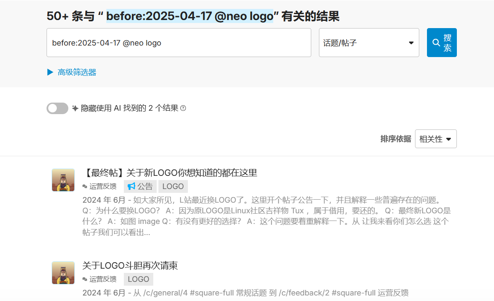

- 话题内，右上方：


输入要找的内容后点击在此话题中我们就可以快速搜索该话题中自己想找的内容，点击


可跳转至相应位置


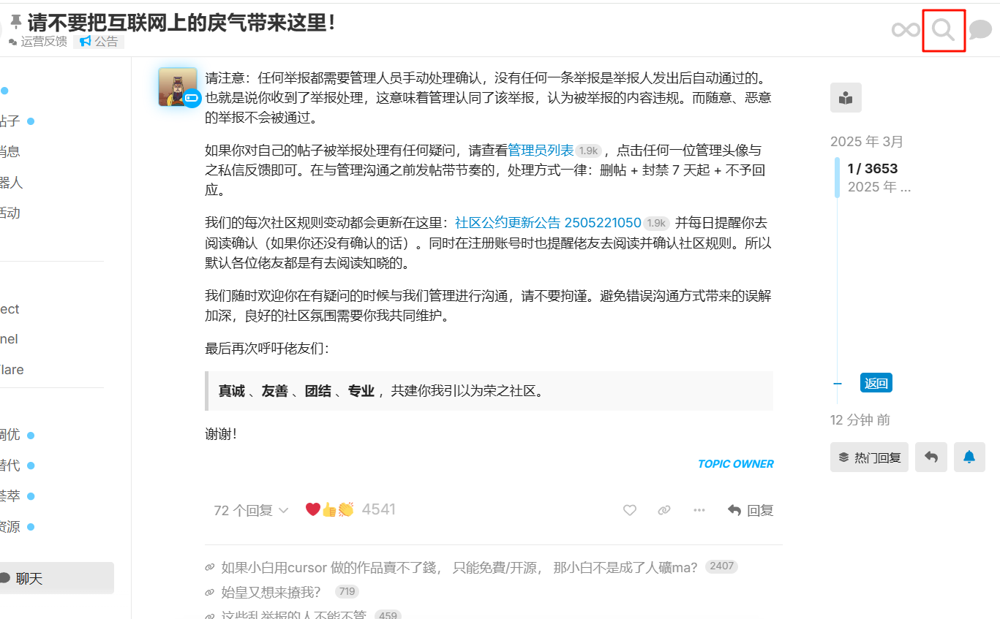


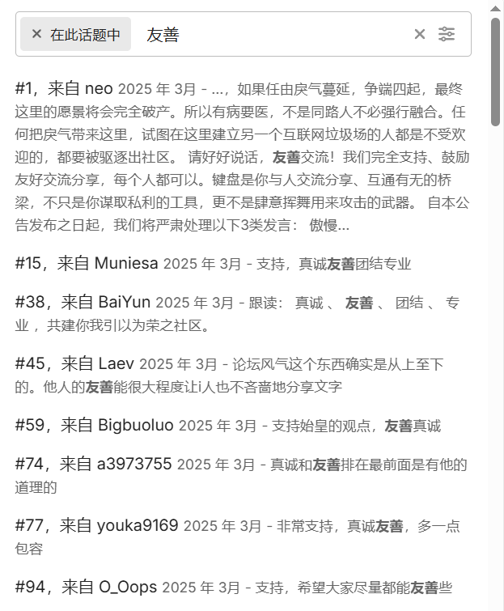

- 筛选（左侧-更多-筛选）：


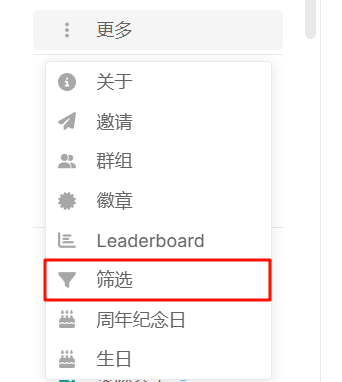


可以看到一个指令集：


这些指令可以直接输入搜索框，可以多个组合使用（中间加空格）。

| 指令 | 参数/选项 | 举例 | 说明 |

| --- | --- | --- | --- |

| **in:** | `title` (仅标题) `body` (仅正文) `first` (仅首楼) `posted` (我发过的) `likes` (我赞过的) `bookmarks` (我书签中的) `seen` (我看过的) `unseen` (未看过的) `watching` (关注中) `tracking` (追踪中) `muted` (已屏蔽) `all` (全局搜索) `messages` (我的信息) `wiki` (Wiki共建贴) `pinned` (置顶贴) `assigned` (已指定的) `unassigned` (未指定的) | `in:title logo` `in:likes linux ` `in:body 无法登录` `in:unseen gemini` | **搜索范围过滤器**。 `in:title` 从标题中筛选。 `in:likes`  点赞过想回看的。 `in:body` 仅仅正文中搜索 `in:unseen` 配合版块筛选可以快速筛选还没看过的信息。 |

| **status:** | `open` (开放中) `closed` (已锁贴)  `public`(无等级限制) `archived` (已归档) `noreplies` (零回复的) `single_user` (包含一个用户) `solved` (已解决) `unsolved` (未解决) | `status:solved gpt降智` `status:noreplies` | **状态过滤器**。 `solved` 已经被标记了解决方案的快问快答。 `noreplies` 还无解决方案欢迎去回复的。 `single_user` 只有楼主一人自言自语的话题。 |

| **with:** | `category_expert_response` |  | 强制搜索结果中必须有专家回应。 |

| **user:** | `用户名` / `@用户名` | `user:neo` `@neo` | **发帖人过滤器**。 只看某位特定佬友的发言。 |

| **group:** | `群组名` | `group:g-trade` | **群组过滤器**。 只看特定群组（如交易分组）的内容。 |

| **category:** | `版块名` / `#版块名` | `category:前沿快讯` `#news` | **分类过滤器**。 将搜索范围限定在特定的版块内。 |

| **tag:** | `标签名` | `tag:快问快答` | **标签过滤器**。 搜索带有特定标签的帖子。 |

| **order:** | `latest` (最新发布) `latest_topic` (最新回复) `views` (浏览量) `likes` (点赞数) | `order:views` `order:latest` | **排序规则**。 默认按相关性排序 |

| **after:** / **created-after:** | `YYYY-MM-DD` | `after:2025-01-01` | **起始时间**。 只搜指定日期之后的帖子。 |

| **before:** / **created-before:** | `YYYY-MM-DD` | `before:2024-06-01` | **截止时间**。 只搜指定日期之前的帖子。 |

| **min_posts:** | `数字` | `min_posts:50` | **最小回复数**。 筛选回复量高于`数字`的热门帖。 |

| **max_posts:** | `数字` | `max_posts:5` | **最大回复数**。 筛选回复较少的帖子。 |

| **min_views:** | `数字` | `min_views:1000` | **最小浏览量**。 通过浏览量筛选关注度相对较高的内容。 |

---

### 4.3 指令集的搜索例子

- **找neo在我注册前发的、标题里带“logo”的、有公告标签的话题：**


`@neo before:2025-04-17 in:title tag:公告 logo`


- **在“开发调优”版块，找那些我看过且赞过的、回复数超过 100的，标题带有SKILLs的话题：**


`#develop in:seen in:likes min_posts:100 in:title SKILLs `


`category:开发调优 in:seen in:likes min_posts:100 in:title SKILLs `


其实上面的内容高级筛选器基本都有，只是以指令集形式展现了出来。

## 5、话题与回帖

### 5.1 话题

#### 5.1.1：创建话题

- **右上角点击新建话题，我的帖子里可查看草稿。**


- **创建话题前强烈建议仔细阅读以下内容**：


[https://linux.do/faq](https://linux.do/faq)


[请不要把互联网上的戾气带来这里！](https://linux.do/t/topic/482293)

- **左上角可切换帖子投票，帖子投票类似于如下帖子里的这种形式**：


[【520专场】你如何理解我们的社区文化](https://linux.do/t/topic/662077)

- **版块和标签**：选择契合的版块和标签，可下拉选择，没有的可以搜索并选择。


- **新的开源推广相关**：最终版本 [新推广方式：开源推广](https://linux.do/t/topic/1776670)


历程

[【已过时】进一步规范社区的公益推广内容](https://linux.do/t/topic/1753758)


[没想到最先急眼的人居然是他？](https://linux.do/t/topic/1758147)


[新推广方式：开源推广](https://linux.do/t/topic/1776670)

#### 5.1.2：模式、草稿、字数

**Markdown** 与 **富文本（所见即所得）**，可以在左上角切换。

- **Markdown 模式**


输入的是源文本：`**加粗**`、``代码``、`> 引用`、`- 列表` 等；右侧预览可以看到最终呈现效果。

- **富文本模式**


加粗、链接、列表、引用会即时渲染，所见即所得同时也**支持直接输入 Markdown**（例如 `**bold**`）。

- **字数上限**


目前话题的字数上限是64000字，如果写长篇话题可以考虑合适的拆分。

- **草稿**


无论是首次写还是后续编辑，点击右上角此叉后效果均为保存为草稿而不是发布，此外有时编辑界面卡顿可保存为草稿后重新打开再编辑。


---

#### 5.1.3 工具栏与“更多”菜单

如图所言，使用Markdown、BBCode 或 HTML 进行排版。拖放或粘贴图片以插入。


悬停可查看各个按钮的功能，话题和回帖的格式基本是通用的。


可以点击按钮后输入，也可框选后调整格式。表情长按可拖动到输入框变为图片


图片可点击右侧预览图片下方的百分比按钮快速调整大小。


若遇到长图显示不全（也可点击看大图）或模糊的情况，可以手动删除图片代码中的尺寸参数（例如删除 |690x500，只保留 ! 名称），这样图片就会以全尺寸铺满显示。

```


```

多图可点击变为图片表格。


更多功能：


其实上面的图形化操作就基本足够了。佬友们可以自己试试。


图里的是一些效果的展示


#### 5.1.4 一些 Markdown语法

单独列一些，其实上面的图形化操作就差不多了，注意绝大部分特殊符号需切换至英文输入法：


**1）加粗 / 斜体 / 删除线 / 行内代码**

```
**加粗**  *斜体*  ~~删除线~~  `行内代码`
```

**2）引用**

```
> 这是第一层引用
>
>> 这是第二层引用（两个大于号）
>>
>>> 这是第三层引用（三个大于号）
```


- **空格**：`>` 后面最好加一个空格，兼容性更好。

- **空行**：如果希望两层引用之间有空隙，可以在中间加一行只有 `>` 的空行。

**3）列表**

```
- 无序列表
  - 二级缩进
1. 有序列表
2. 第二项

下一级列表前不同的空格数效果不一样 符号- + * 是一样的效果
* 第一层（无空格）
  * 第二层（ 2 个空格）
    * 第三层（ 4 个空格）
```


**4）链接**

```
[显示文字](https://example.com)
```

**5）分割线**

```
---
```

**6）代码块**

> 使用三个反引号 ````` 包裹内容，不仅能防止字符被系统误识别导致乱码，还方便一键复制里面的内容。
**示例：**
```
```bash(语言名称，可不写)
curl -I https://linux.do
```
```
正如上面示例

如果你的代码块内又有子代码块，你可以使用``````或者更多 ` 来使得渲染不出错


详情可见[这个话题](https://linux.do/t/topic/1844916)

**7）表格**


这个更多里添加方便些。

```
| 字段 | 含义 |
|-----|-----|
| TL | 信任等级 |
| tag | 标签 |
```

---

#### 5.1.5 特色格式

##### A) Onebox（链接卡片预览）

- **想要卡片**：把链接**单独占一行**粘贴即可生成 Onebox。

- **不想 Onebox（只想裸链接）**：用尖括号包住 `< >`链接。

```
https://www.google.com/

<https://www.google.com/>
```

##### B) Details（折叠块）

```
[details="点我展开：更多说明"]
这里是折叠内容……
[/details]
```

##### C) Spoiler（模糊剧透）

```
[spoiler]
这里是被遮挡的内容
[/spoiler]
```

##### D) Footnote（脚注）

```
Discourse 支持两种常见脚注写法
```

**写法 1：就地脚注**

```
这是正文一句话。^[这里是脚注内容]
```

**写法 2：编号脚注**

```
这是正文一句话。[^1]

[^1]: 这里是脚注内容
```

##### E) Callout / GitHub Alerts 风格提示框

```
> [!TIP]
> 这是一个绿色框

> [!WARNING]
> 这是一个黄色框

> [!DANGER]
> 这是一个红色框

> [!NOTE]
> 这是一个蓝色框

> [!CAUTION]
> 这是一个偏黄色的框
```

补充了Obsidian Callouts：


具体可参考该贴：

[搞一点妖艳的 Obsidian Callouts](https://linux.do/t/topic/964458) [


开发调优](/c/develop/4)

> 看不见效果的请先刷新页面。

>

> [!note]

> Lorem ipsum dolor sit amet

> > [!note]

> > Lorem ipsum dolor sit amet

>

>

>

> [!abstract]

> Lorem ipsum dolor sit amet

> > [!abstract]

> > Lorem ipsum dolor sit amet

>

>

>

> [!info]

> Lorem ipsu…

##### F) Checklist（可勾选清单）

```
- [ ] 待办项
- [x] 已完成
- [X] 已完成
```

##### G) 投票（Poll）

除了加号添加


也可以直接用语法：

```
[poll type=regular]
* 选项 A
* 选项 B
[/poll]
```

##### H) BBCode 变色

**彩色文字**：


不要滥用彩色文字。

```
[color=red]红字[/color]
[color=#ff9900]橙字[/color]
```

---

#### 5.1.6 目录与“自由跳转”

较长的帖子为了方便查找和阅读，可采用不同的方式来实现效果。

##### 方法 1：用主题 TOC

站内启用了主题目录，可在右侧生成的导航时间轴：


在正文最上方放一行：

```
<div data-theme-toc="true"></div>
```

然后用规范的 `## / ###` 标题分段，右侧就会自动生成导航时间轴。


成功预览会如图显示：


##### 方法 2：链接到标题锚点

悬停在不同等级的标题上，右键后复制链接


把复制到的链接粘到正文里，例如：

```
[点此跳转至编辑者徽章](复制到的标题链接)
```

##### 方法 3：自定义锚点

```
[点此跳转至编辑者徽章](#editor)

编辑者徽章 <a name="editor"></a>
```

注意：使用英文输入法的引号：引号里的单词和#后的单词必须一样（区分大小写）。 可使用横杠 - 或下划线 _，不能使用空格。

#### 5.1.7 编辑时卡顿

- 使用MD相关编辑器编辑好了复制过来

- 编辑器界面右上角点叉关闭并保存，再刷新页面写。

---

### 5.2 再避坑

- **AFF**:


社区不再接受任何公开形式的AFF。


无论版块，无论主帖、回帖，管理发的公开帖（集中帖）除外。


如果你需要对方的AFF，请私信/私聊对方获取。

- **不要滥用彩色文字**

- **如果你要发网盘相关内容，建议先阅读如下公告**：


[针对网盘标签进行了一点小优化](https://linux.do/t/topic/384263)


[关于资源网盘的重大优化来了](https://linux.do/t/topic/870439)

- **FAQ**：“不可以直接使用AI生成、润色内容。为维护中文互联网环境，此内容只接受截图发出！”。

---

### 5.3 回帖与互动

- **互动**：爱心处悬停可选择不同的互动方式。


- **引用回复**：左键长按选中想引用的部分，引用或复制引用

- **@ 提及**：`@用户名` 能@相关佬友。

- **书签**：想回看的话题或帖子。

- **解决方案（快问快答标签）**：提问帖如果得到满意的解答，可以把相应楼层设为“解决方案”，该方案会被引用到话题内，方便后来的人找到解决方案。

- **上线测试两个新功能** 和 **调整帖子最小长度** :新增了boost和树形浏览功能，新增了帖子回复最小长度20字符。

---

## 结尾

> 本文档原计划是元旦当天发布的，未曾想越写越长，加之一些事情耽搁了时间，一直拖到了现在，回看文档仍然有不少缺漏可补足的地方，排版也有些可改进的地方。但还是想在新年伊始把这份初稿呈现出来，就当是迟到的元旦祝福吧，佬友们元旦快乐！

> 本文档旨在通过官方规则和个人经验汇总，降低佬友们的探索成本。希望这点分享能帮助到有需要的佬友。同时囿于自身水平，本文档可能会有不精准、不严谨、乃至谬误的地方，非常欢迎各位佬友补充、修正。同时这也只是我自己探索中的点滴，期待佬友们把自己探索社区的点滴写上去。

## 欢迎佬友们编辑共建该文档！

- **共建说明**：


佬友们可点击帖子右上角的“铅笔”图案查看修改历史以及修改文档。


或者帖子右下角的铅笔图案也可以修改文档。


关于**Edit Conflict（编辑冲突）**：


当打开编辑器之后，如果这篇帖子在服务器端出现了**更新版本**（例如：其他人保存了编辑，管理/有权限的人改了标题、分类、标签等），当前编辑的草稿就可能与最新版本发生冲突。编辑器会右下角提示Edit Conflict[[1]](#footnote-12076547-1)编辑冲突以避免覆盖他人的内容。冲突提示可能在编辑过程中出现，也可能在你点击保存时才出现。发生冲突后，若选择选择Overwrite Edit（覆盖保存），可能覆盖掉别人刚刚保存的内容。建议在本地复制一份自己修改的部分，刷新页面加载最新版本，然后重新编辑后保存。


---

1.   [↩︎](#footnote-ref-12076547-1)


---


*来源: https://linux.do/t/topic/1401642.json*

