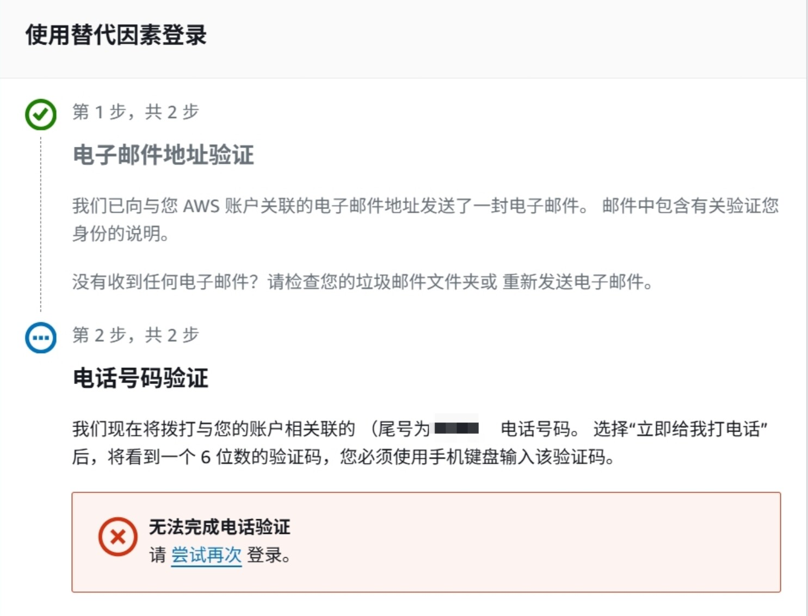
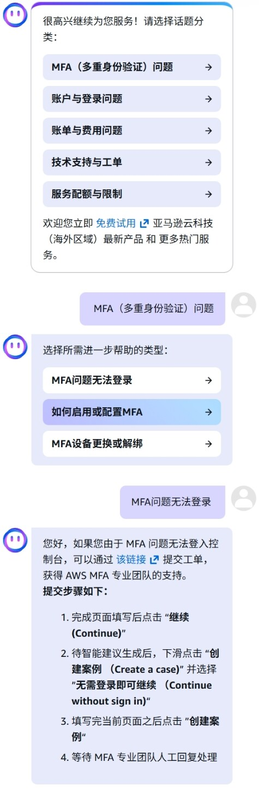
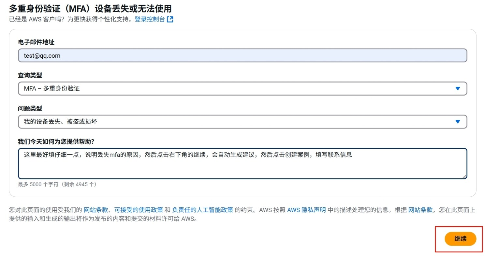
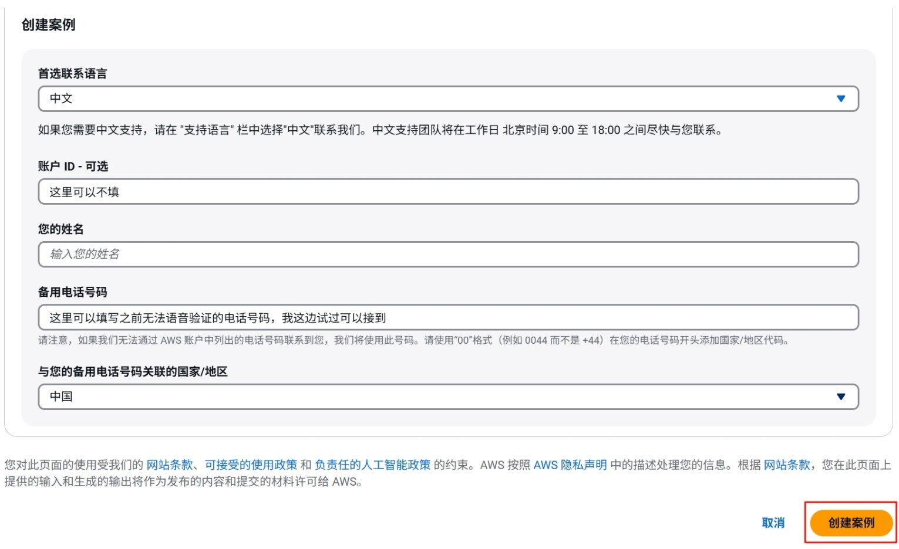
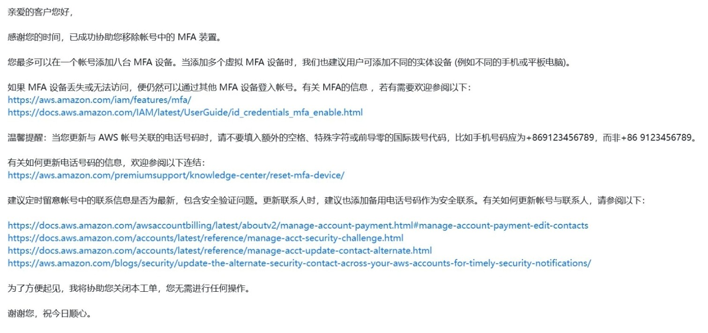

---

id: 1412921

title: "记一次关于 AWS 忘记 MFA 的解决过程"

created_at: 2026-01-06T11:28:55.074Z

username: timelessxiao

display_username: "浅影阿"

---

# 记一次关于 AWS 忘记 MFA 的解决过程

## 原因 ：

之前创建 AWS 账号的时候开启了 MFA，但通行密钥只放在了电脑上，电脑格式化后密钥就找不到了，本来想通过邮箱和电话语音验证码的方式找回，可由于一直接不到电话，所以只能通过开工单的方式联系客服处理。

## 步骤

1. 点击链接：[AWS Support 和客户服务联系信息 | Amazon Web Services](https://aws.amazon.com/cn/contact-us/)，点击页面右侧智能售后，选择话题分类 “MFA（多重身份验证）问题”，进一步选择帮助类型"MFA 问题无法登录", 然后根据机器人给的步骤，点击给的链接提交工单就行

1. 提交工单

2. 创建案例

3. 后面就等电话联系，我这边大概过了一天就来电话了，电话来源为美国，所以你得提前确认手机卡是否关闭了境外电话免打扰，电话内容就是确认一下你是否为本人，让你接收一个邮箱验证码，通过后就可以重新设置 mfa 了，这里推荐 [ente auth](https://ente.io/auth/)，因为可以双端同步，非常方便!

## 总结

总体来说还是挺简单的，就是刚开始丢失 mfa 登录不了的时候会有点慌，后面有经验就挺好解决的

---

*来源: https://linux.do/t/topic/1412921.json*

